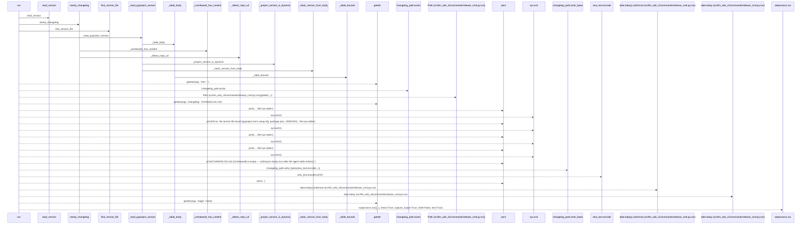
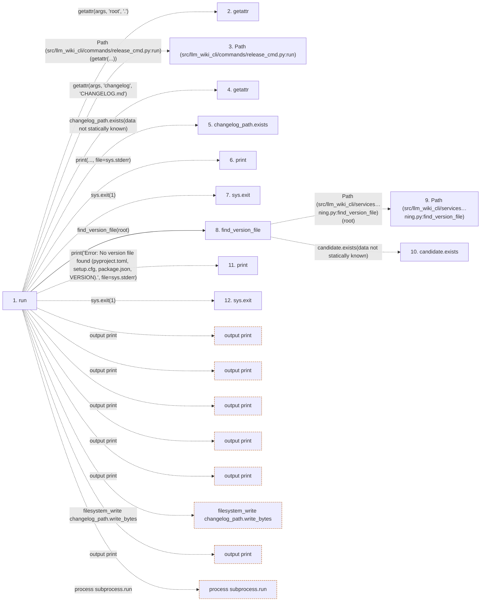

# release

**Entry point:** `run` (`cli`)
**Source:** [release_cmd](../modules/release_cmd.md)
**Modules touched:** [release_cmd](../modules/release_cmd.md), [versioning](../modules/versioning.md)

## Call sequence

> Static overview in presentation order, not runtime execution order. Arrows retain captured callers; representative internal continuations and boundary examples precede repeated helper detail.

<!-- Auto-generated from static call edges. Dashed arrows are external or unresolved calls. Reviewed runtime conditions and side effects belong in Behavior. -->

> Call sequence diagram shows 30 of 100 interactions; 70 omitted to keep the visualization within the 30-interaction and generated-diagram limits, with uncertain identities omitted rather than inferred.

> Captured boundary calls: external 16 of 43 (27 omitted); unresolved 4 of 45 (41 omitted). These counts cover the captured static trace.

Omitted captured detail, grouped by actual caller occurrence and target module:

| Caller | Parent step | Target module | Kind | Omitted interactions |
| --- | --- | --- | --- | --- |
| `src/llm_wiki_cli/services/versioning.py:find_version_file` | 8 | - | external | 1 |
| `src/llm_wiki_cli/services/versioning.py:find_version_file` | 8 | - | unresolved | 1 |
| `src/llm_wiki_cli/services/versioning.py:read_version` | 13 | - | unresolved | 4 |
| `src/llm_wiki_cli/services/versioning.py:_read_pyproject_version` | 15 | - | unresolved | 9 |
| `src/llm_wiki_cli/services/versioning.py:_read_pyproject_version` | 15 | - | external | 6 |
| `src/llm_wiki_cli/services/versioning.py:_table_bounds` | 32 | - | unresolved | 6 |
| `src/llm_wiki_cli/services/versioning.py:_table_bounds` | 32 | - | external | 1 |
| `src/llm_wiki_cli/services/versioning.py:_project_version_is_dynamic` | 40 | - | external | 3 |
> Omission summary shows 8 of 19 groups; 11 further groups are not expanded here. Counts above include all omitted interactions.
> Detailed flow queries retain their own coverage and limits; omitted paths may execute at runtime.

## Data flow

<!-- Auto-generated static analysis. Treat values and boundaries as best-effort hints, not runtime proof. -->

### Analysis coverage

**Effect analysis partially available.** Flow assembly and source effect analysis are separate; empty observations do not prove an empty handler body.

Source steps: 13; effect analysis evaluated: 12, partial: 1, unavailable: 0. Counts include steps omitted from the displayed trace.

Collector observations for 13 source steps with known totals: observed: 75, emitted: 71, omitted: 4. Unavailable totals are excluded.

- Effect collector omitted observations before flow assembly; displayed effects are partial.

| Step | Callable record | Effect analysis | Collector totals | Observed | Emitted | Omitted |
|---|---|---|---|---:|---:|---:|
| `run` | `available` | `partial` | `available` | `22` | `18` | `4` |
| `getattr` | `not_applicable` | `not_applicable` | `not_applicable` | — | — | — |
| `Path (src/llm_wiki_cli/commands/release_cmd.py:run)` | `not_applicable` | `not_applicable` | `not_applicable` | — | — | — |
| `getattr` | `not_applicable` | `not_applicable` | `not_applicable` | — | — | — |
| `changelog_path.exists` | `not_applicable` | `not_applicable` | `not_applicable` | — | — | — |
| `print` | `not_applicable` | `not_applicable` | `not_applicable` | — | — | — |
| `sys.exit` | `not_applicable` | `not_applicable` | `not_applicable` | — | — | — |
| `find_version_file` | `available` | `evaluated` | `available` | `4` | `4` | `0` |
| `Path (src/llm_wiki_cli/services…ning.py:find_version_file)` | `not_applicable` | `not_applicable` | `not_applicable` | — | — | — |
| `candidate.exists` | `not_applicable` | `not_applicable` | `not_applicable` | — | — | — |
| `print` | `not_applicable` | `not_applicable` | `not_applicable` | — | — | — |
| `sys.exit` | `not_applicable` | `not_applicable` | `not_applicable` | — | — | — |

### Step data

| Step | Inputs | Reads | Writes | Returns |
|---|---|---|---|---|
| `run` | `args` | `sys`, `sys`, `sys`, `sys`, `sys`, `subprocess`, `sys`, `sys` | - | `none` |
| `getattr` | - | - | - | - |
| `Path (src/llm_wiki_cli/commands/release_cmd.py:run)` | - | - | - | - |
| `getattr` | - | - | - | - |
| `changelog_path.exists` | - | - | - | - |
| `print` | - | - | - | - |
| `sys.exit` | - | - | - | - |
| `find_version_file` | `root: str` | `VERSION_PATTERNS` | - | `candidate`, `None` |
| `Path (src/llm_wiki_cli/services…ning.py:find_version_file)` | - | - | - | - |
| `candidate.exists` | - | - | - | - |
| `print` | - | - | - | - |
| `sys.exit` | - | - | - | - |

### Call data

| From | To | Line | Call |
|---|---|---:|---|
| run | getattr | 118 | `getattr(args, 'root', '.')` |
| run | Path (src/llm_wiki_cli/commands/release_cmd.py:run) | 119 | `Path(getattr(...))` |
| run | getattr | 119 | `getattr(args, 'changelog', 'CHANGELOG.md')` |
| run | changelog_path.exists | 121 | `changelog_path.exists(data not statically known)` |
| run | print | 122 | `print(..., file=sys.stderr)` |
| run | sys.exit | 123 | `sys.exit(1)` |
| run | find_version_file | 126 | `find_version_file(root)` |
| find_version_file | Path (src/llm_wiki_cli/services…ning.py:find_version_file) | 31 | `Path(root)` |
| find_version_file | candidate.exists | 34 | `candidate.exists(data not statically known)` |
| run | print | 128 | `print('Error: No version file found (pyproject.toml, setup.cfg, package.json, VERSION).', file=sys.stderr)` |
| run | sys.exit | 132 | `sys.exit(1)` |

### Boundary effects

| Kind | Target | Step | Line |
|---|---|---|---:|
| output | `print` | `run` | 122 |
| output | `print` | `run` | 128 |
| output | `print` | `run` | 136 |
| output | `print` | `run` | 142 |
| output | `print` | `run` | 146 |
| filesystem_write | `changelog_path.write_bytes` | `run` | 151 |
| output | `print` | `run` | 152 |
| process | `subprocess.run` | `run` | 156 |

### Static analysis gaps

| Kind | Step | Target | Line |
|---|---|---|---:|
| external_call | `run` | `getattr` | 118 |
| external_call | `run` | `getattr` | 119 |
| unresolved_call | `run` | `changelog_path.exists` | 121 |
| external_call | `run` | `sys.exit` | 123 |
| unresolved_call | `find_version_file` | `candidate.exists` | 34 |
| external_call | `run` | `sys.exit` | 132 |
| step_limit | `run` | `first 12 steps` | 0 |

## Behavior

This flow starts at `run` and is classified as `cli`. The generated call and data-flow sections are bounded static projections; runtime conditions and side effects require source-level confirmation.
