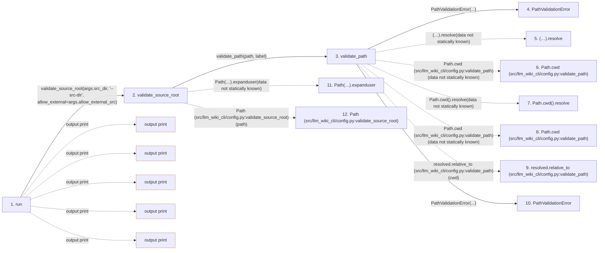

# search

**Entry point:** `run` (`cli`)
**Source:** [search_cmd](../modules/search_cmd.md)
**Modules touched:** [api](../modules/api.md), [common](../modules/common.md), [concept_identity](../modules/concept_identity.md), [config](../modules/config.md), and 31 more

**Complete modules touched:**

- [api](../modules/api.md)
- [common](../modules/common.md)
- [concept_identity](../modules/concept_identity.md)
- [config](../modules/config.md)
- [documentation_queries](../modules/documentation_queries.md)
- [documentation_query_builder](../modules/documentation_query_builder.md)
- [filesystem_guard](../modules/filesystem_guard.md)
- [implementation_evidence](../modules/implementation_evidence.md)
- [io](../modules/io.md)
- [knowledge_artifacts](../modules/knowledge_artifacts.md)
- [knowledge_governance](../modules/knowledge_governance.md)
- [knowledge_model](../modules/knowledge_model.md)
- [knowledge_storage](../modules/knowledge_storage.md)
- [knowledge_storage_access](../modules/knowledge_storage_access.md)
- [knowledge_storage_io](../modules/knowledge_storage_io.md)
- [maintenance_evidence](../modules/maintenance_evidence.md)
- [maintenance_projection](../modules/maintenance_projection.md)
- [maintenance_protocol](../modules/maintenance_protocol.md)
- [maintenance_state](../modules/maintenance_state.md)
- [maintenance_status](../modules/maintenance_status.md)
- [markdown_sections](../modules/markdown_sections.md)
- [search_cmd](../modules/search_cmd.md)
- [search_discovery](../modules/search_discovery.md)
- [search_discovery_capture](../modules/search_discovery_capture.md)
- [search_lexical](../modules/search_lexical.md)
- [search_rank](../modules/search_rank.md)
- [search_service](../modules/search_service.md)
- [search_source](../modules/search_source.md)
- [section_ownership](../modules/section_ownership.md)
- [source_selection](../modules/source_selection.md)
- [source_snapshot](../modules/source_snapshot.md)
- [sync_manifest](../modules/sync_manifest.md)
- [validation](../modules/validation.md)
- [wiki_surface](../modules/wiki_surface.md)
- [workflow_profile](../modules/workflow_profile.md)

## Call sequence

> Static overview in presentation order, not runtime execution order. Arrows retain captured callers; siblings are shown before deeper helper detail.

```mermaid
sequenceDiagram
    participant p0 as run
    participant p1 as validate_source_root
    participant p2 as validate_path
    participant p3 as search_wiki (src/llm_wiki_cli/api.py)
    participant p4 as getattr (src/llm_wiki_cli/commands/search_cmd.py:run)
    participant p5 as print
    participant p6 as json.dumps (src/llm_wiki_cli/commands/search_cmd.py:run)
    participant p7 as cast
    participant p8 as Path(…).expanduser
    participant p9 as search_wiki (src/llm_wiki_cli/services/search_service.py)
    participant p10 as Path (src/llm_wiki_cli/config.py:validate_source_root)
    participant p11 as InvalidRequestError
    participant p12 as candidate.is_absolute
    participant p13 as str (src/llm_wiki_cli/api.py:search_wiki)
    participant p14 as Path.cwd (src/llm_wiki_cli/config.py:validate_source_root)
    participant p15 as candidate.resolve (src/llm_wiki_cli/config.py:validate_source_root)
    participant p16 as PathValidationError
    participant p17 as resolved.is_dir
    participant p18 as os.path.abspath (src/llm_wiki_cli/config.py:validate_source_root)
    participant p19 as windows_current_user_sid
    participant p20 as isinstance (src/llm_wiki_cli/config.py:validate_source_root)
    participant p21 as getattr (src/llm_wiki_cli/config.py:validate_source_root)
    p0->>p1: validate_source_root
    p0->>p2: validate_path
    p0->>p3: search_wiki (src/llm_wiki_cli/api.py)
    p0-->>p4: getattr (src/llm_wiki_cli/commands/search_cmd.py:run)(args, 'include_source', False)
    p0-->>p4: getattr (src/llm_wiki_cli/commands/search_cmd.py:run)(args, 'discovery', None)
    p0-->>p5: print(json.dumps(...))
    p0-->>p6: json.dumps (src/llm_wiki_cli/commands/search_cmd.py:run)(result, ensure_ascii=False, sort_keys=True, indent=2)
    p0-->>p5: print(...)
    p0-->>p5: print(...)
    p0-->>p5: print(...)
    p0-->>p5: print(json.dumps(...))
    p0-->>p6: json.dumps (src/llm_wiki_cli/commands/search_cmd.py:run)(result[...], ensure_ascii=False, sort_keys=True, indent=2)
    p1->>p2: validate_path
    p3-->>p7: cast(SearchResult, search(...))
    p1-->>p8: Path(…).expanduser
    p3->>p9: search_wiki (src/llm_wiki_cli/services/search_service.py)
    p1-->>p10: Path (src/llm_wiki_cli/config.py:validate_source_root)(path)
    p3->>p11: InvalidRequestError
    p1-->>p12: candidate.is_absolute
    p3-->>p13: str (src/llm_wiki_cli/api.py:search_wiki)(exc)
    p1-->>p14: Path.cwd (src/llm_wiki_cli/config.py:validate_source_root)
    p1-->>p15: candidate.resolve (src/llm_wiki_cli/config.py:validate_source_root)(strict=True)
    p1->>p16: PathValidationError
    p1-->>p17: resolved.is_dir
    p1->>p16: PathValidationError
    p1-->>p10: Path (src/llm_wiki_cli/config.py:validate_source_root)(os.path.abspath(...))
    p1-->>p18: os.path.abspath (src/llm_wiki_cli/config.py:validate_source_root)(candidate)
    p1->>p19: windows_current_user_sid
    p1-->>p20: isinstance (src/llm_wiki_cli/config.py:validate_source_root)(current_sid, str)
    p1-->>p21: getattr (src/llm_wiki_cli/config.py:validate_source_root)(os, 'geteuid', None)
```

<!-- Auto-generated from static call edges. Dashed arrows are external or unresolved calls. Reviewed runtime conditions and side effects belong in Behavior. -->

> Call sequence diagram shows 30 of 1251 interactions; 1221 omitted to keep the visualization within the 30-interaction and generated-diagram limits, with uncertain identities omitted rather than inferred.

> Captured boundary calls: external 17 of 505 (488 omitted); unresolved 4 of 355 (351 omitted). These counts cover the captured static trace.

Omitted captured detail, grouped by actual caller occurrence and target module:

| Caller | Parent step | Target module | Kind | Omitted interactions |
| --- | --- | --- | --- | --- |
| `src/llm_wiki_cli/config.py:validate_path` | 3 | [src/llm_wiki_cli/config.py](../modules/config.md) | internal | 2 |
| `src/llm_wiki_cli/config.py:validate_path` | 3 | - | unresolved | 3 |
| `src/llm_wiki_cli/config.py:validate_path` | 3 | - | external | 2 |
| `src/llm_wiki_cli/services/filesystem_guard.py:windows_current_user_sid` | 21 | [src/llm_wiki_cli/services/filesystem_guard.py](../modules/filesystem_guard.md) | internal | 2 |
| `src/llm_wiki_cli/services/filesystem_guard.py:_current_windows_user_sid` | 23 | - | external | 19 |
| `src/llm_wiki_cli/services/filesystem_guard.py:_current_windows_user_sid` | 23 | - | unresolved | 4 |
| `src/llm_wiki_cli/services/filesystem_guard.py:_current_windows_user_sid` | 23 | [src/llm_wiki_cli/services/filesystem_guard.py](../modules/filesystem_guard.md) | internal | 5 |
| `src/llm_wiki_cli/services/filesystem_guard.py:_windows_sid_string` | 49 | - | external | 8 |
> Omission summary shows 8 of 221 groups; 213 further groups are not expanded here. Counts above include all omitted interactions.
> Detailed flow queries retain their own coverage and limits; omitted paths may execute at runtime.

> Trace truncated at the depth limit; deeper calls are omitted.

## Data flow

<!-- Auto-generated static analysis. Treat values and boundaries as best-effort hints, not runtime proof. -->

### Step data

| Step | Inputs | Reads | Writes | Returns |
|---|---|---|---|---|
| `run` | `args` | - | - | - |
| `validate_source_root` | `path: str`, `label: str`, `allow_external: bool` | `sys`, `os`, `WindowsSecurityGuardError`, `sys` | - | `validate_path(...)`, `resolved` |
| `validate_path` | `path: str`, `label: str` | - | - | `resolved` |
| `PathValidationError` | - | - | - | - |
| `(…).resolve` | - | - | - | - |
| `Path.cwd (src/llm_wiki_cli/config.py:validate_path)` | - | - | - | - |
| `Path.cwd().resolve` | - | - | - | - |
| `Path.cwd (src/llm_wiki_cli/config.py:validate_path)` | - | - | - | - |
| `resolved.relative_to (src/llm_wiki_cli/config.py:validate_path)` | - | - | - | - |
| `PathValidationError` | - | - | - | - |
| `Path(…).expanduser` | - | - | - | - |
| `Path (src/llm_wiki_cli/config.py:validate_source_root)` | - | - | - | - |

### Call data

| From | To | Line | Call |
|---|---|---:|---|
| run | validate_source_root | 10 | `validate_source_root(args.src_dir, '--src-dir', allow_external=args.allow_external_src)` |
| validate_source_root | validate_path | 160 | `validate_path(path, label)` |
| validate_path | PathValidationError | 134 | `PathValidationError(...)` |
| validate_path | (…).resolve | 135 | `(Path.cwd() / path).resolve(data not statically known)` |
| validate_path | Path.cwd (src/llm_wiki_cli/config.py:validate_path) | 135 | `Path.cwd(data not statically known)` |
| validate_path | Path.cwd().resolve | 136 | `Path.cwd().resolve(data not statically known)` |
| validate_path | Path.cwd (src/llm_wiki_cli/config.py:validate_path) | 136 | `Path.cwd(data not statically known)` |
| validate_path | resolved.relative_to (src/llm_wiki_cli/config.py:validate_path) | 138 | `resolved.relative_to(cwd)` |
| validate_path | PathValidationError | 140 | `PathValidationError(...)` |
| validate_source_root | Path(…).expanduser | 163 | `Path(path).expanduser(data not statically known)` |
| validate_source_root | Path (src/llm_wiki_cli/config.py:validate_source_root) | 163 | `Path(path)` |

### Boundary effects

| Kind | Target | Step | Line |
|---|---|---|---:|
| output | `print` | `run` | 24 |
| output | `print` | `run` | 27 |
| output | `print` | `run` | 28 |
| output | `print` | `run` | 29 |
| output | `print` | `run` | 31 |

### Static analysis gaps

| Kind | Step | Target | Line |
|---|---|---|---:|
| unresolved_call | `validate_path` | `(Path.cwd() / path).resolve` | 135 |
| external_call | `validate_path` | `Path.cwd` | 135 |
| unresolved_call | `validate_path` | `Path.cwd().resolve` | 136 |
| external_call | `validate_path` | `Path.cwd` | 136 |
| unresolved_call | `validate_path` | `resolved.relative_to` | 138 |
| unresolved_call | `validate_source_root` | `Path(path).expanduser` | 163 |
| step_limit | `run` | `first 12 steps` | 0 |
| truncated_flow | `run` | `depth limit` | 0 |

## Behavior

This flow starts at `run` and is classified as `cli`. The generated call and data-flow sections are bounded static projections; runtime conditions and side effects require source-level confirmation.
