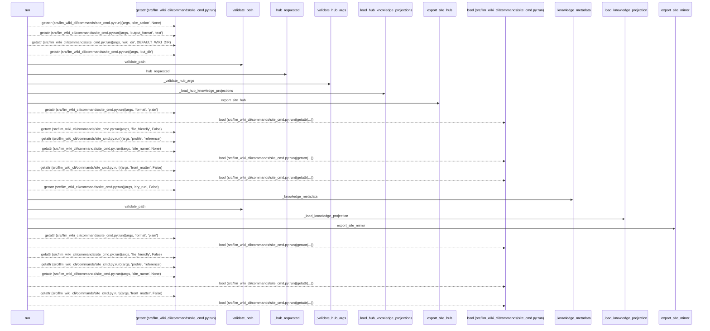
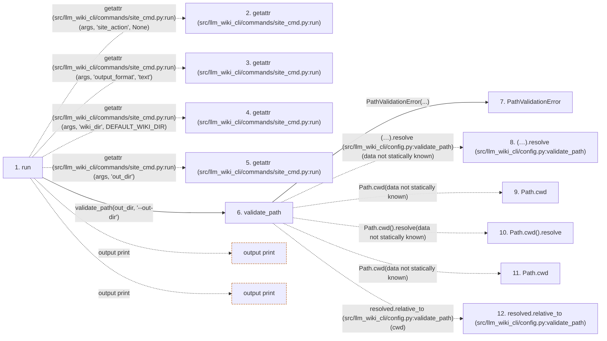

# site

**Entry point:** `run` (`cli`)
**Source:** [site_cmd](../modules/site_cmd.md)
**Modules touched:** [concept_identity](../modules/concept_identity.md), [config](../modules/config.md), [filesystem_guard](../modules/filesystem_guard.md), [implementation_evidence](../modules/implementation_evidence.md), and 26 more

**Complete modules touched:**

- [concept_identity](../modules/concept_identity.md)
- [config](../modules/config.md)
- [filesystem_guard](../modules/filesystem_guard.md)
- [implementation_evidence](../modules/implementation_evidence.md)
- [io](../modules/io.md)
- [knowledge_artifacts](../modules/knowledge_artifacts.md)
- [knowledge_consumption](../modules/knowledge_consumption.md)
- [knowledge_envelope](../modules/knowledge_envelope.md)
- [knowledge_evidence](../modules/knowledge_evidence.md)
- [knowledge_freshness](../modules/knowledge_freshness.md)
- [knowledge_governance](../modules/knowledge_governance.md)
- [knowledge_graph](../modules/knowledge_graph.md)
- [knowledge_loader](../modules/knowledge_loader.md)
- [knowledge_model](../modules/knowledge_model.md)
- [knowledge_observability](../modules/knowledge_observability.md)
- [knowledge_projection](../modules/knowledge_projection.md)
- [knowledge_storage](../modules/knowledge_storage.md)
- [knowledge_storage_io](../modules/knowledge_storage_io.md)
- [knowledge_verification](../modules/knowledge_verification.md)
- [maintenance_protocol](../modules/maintenance_protocol.md)
- [maintenance_state](../modules/maintenance_state.md)
- [maintenance_status](../modules/maintenance_status.md)
- [site_cmd](../modules/site_cmd.md)
- [site_export](../modules/site_export.md)
- [site_html_check](../modules/site_html_check.md)
- [sync_manifest](../modules/sync_manifest.md)
- [validation](../modules/validation.md)
- [verification_contracts](../modules/verification_contracts.md)
- [wiki_media](../modules/wiki_media.md)
- [wiki_surface](../modules/wiki_surface.md)

## Call sequence

> Static overview in presentation order, not runtime execution order. Arrows retain captured callers; siblings are shown before deeper helper detail.

<!-- Auto-generated from static call edges. Dashed arrows are external or unresolved calls. Reviewed runtime conditions and side effects belong in Behavior. -->

> Call sequence diagram shows 30 of 2531 interactions; 2501 omitted to keep the visualization within the 30-interaction and generated-diagram limits, with uncertain identities omitted rather than inferred.

> Captured boundary calls: external 21 of 681 (660 omitted); unresolved 0 of 799 (799 omitted). These counts cover the captured static trace.

Omitted captured detail, grouped by actual caller occurrence and target module:

| Caller | Parent step | Target module | Kind | Omitted interactions |
| --- | --- | --- | --- | --- |
| `src/llm_wiki_cli/config.py:validate_path` | 6 | [src/llm_wiki_cli/config.py](../modules/config.md) | internal | 2 |
| `src/llm_wiki_cli/config.py:validate_path` | 6 | - | unresolved | 3 |
| `src/llm_wiki_cli/config.py:validate_path` | 6 | - | external | 2 |
| `src/llm_wiki_cli/commands/site_cmd.py:_hub_requested` | 14 | - | external | 3 |
| `src/llm_wiki_cli/commands/site_cmd.py:_validate_hub_args` | 18 | - | external | 3 |
| `src/llm_wiki_cli/commands/site_cmd.py:_validate_hub_args` | 18 | [src/llm_wiki_cli/config.py](../modules/config.md) | internal | 2 |
| `src/llm_wiki_cli/commands/site_cmd.py:_load_hub_knowledge_projections` | 24 | [src/llm_wiki_cli/commands/site_cmd.py](../modules/site_cmd.md) | internal | 2 |
| `src/llm_wiki_cli/commands/site_cmd.py:_knowledge_metadata` | 25 | - | external | 3 |
> Omission summary shows 8 of 548 groups; 540 further groups are not expanded here. Counts above include all omitted interactions.
> Detailed flow queries retain their own coverage and limits; omitted paths may execute at runtime.

> Trace truncated at the depth limit; deeper calls are omitted.

## Data flow

<!-- Auto-generated static analysis. Treat values and boundaries as best-effort hints, not runtime proof. -->

### Step data

| Step | Inputs | Reads | Writes | Returns |
|---|---|---|---|---|
| `run` | `args` | `DEFAULT_WIKI_DIR`, `DEFAULT_WIKI_DIR`, `SiteExportError`, `sys`, `sys` | - | `none`, `none` |
| `getattr (src/llm_wiki_cli/commands/site_cmd.py:run)` | - | - | - | - |
| `getattr (src/llm_wiki_cli/commands/site_cmd.py:run)` | - | - | - | - |
| `getattr (src/llm_wiki_cli/commands/site_cmd.py:run)` | - | - | - | - |
| `getattr (src/llm_wiki_cli/commands/site_cmd.py:run)` | - | - | - | - |
| `validate_path` | `path: str`, `label: str` | - | - | `resolved` |
| `PathValidationError` | - | - | - | - |
| `(…).resolve (src/llm_wiki_cli/config.py:validate_path)` | - | - | - | - |
| `Path.cwd` | - | - | - | - |
| `Path.cwd().resolve` | - | - | - | - |
| `Path.cwd` | - | - | - | - |
| `resolved.relative_to (src/llm_wiki_cli/config.py:validate_path)` | - | - | - | - |

### Call data

| From | To | Line | Call |
|---|---|---:|---|
| run | getattr (src/llm_wiki_cli/commands/site_cmd.py:run) | 138 | `getattr(args, 'site_action', None)` |
| run | getattr (src/llm_wiki_cli/commands/site_cmd.py:run) | 139 | `getattr(args, 'output_format', 'text')` |
| run | getattr (src/llm_wiki_cli/commands/site_cmd.py:run) | 143 | `getattr(args, 'wiki_dir', DEFAULT_WIKI_DIR)` |
| run | getattr (src/llm_wiki_cli/commands/site_cmd.py:run) | 144 | `getattr(args, 'out_dir')` |
| run | validate_path | 145 | `validate_path(out_dir, '--out-dir')` |
| validate_path | PathValidationError | 134 | `PathValidationError(...)` |
| validate_path | (…).resolve (src/llm_wiki_cli/config.py:validate_path) | 135 | `(Path.cwd() / path).resolve(data not statically known)` |
| validate_path | Path.cwd | 135 | `Path.cwd(data not statically known)` |
| validate_path | Path.cwd().resolve | 136 | `Path.cwd().resolve(data not statically known)` |
| validate_path | Path.cwd | 136 | `Path.cwd(data not statically known)` |
| validate_path | resolved.relative_to (src/llm_wiki_cli/config.py:validate_path) | 138 | `resolved.relative_to(cwd)` |

### Boundary effects

| Kind | Target | Step | Line |
|---|---|---|---:|
| output | `print` | `run` | 229 |
| output | `print` | `run` | 232 |

### Static analysis gaps

| Kind | Step | Target | Line |
|---|---|---|---:|
| external_call | `run` | `getattr` | 138 |
| external_call | `run` | `getattr` | 139 |
| external_call | `run` | `getattr` | 143 |
| external_call | `run` | `getattr` | 144 |
| unresolved_call | `validate_path` | `(Path.cwd() / path).resolve` | 135 |
| external_call | `validate_path` | `Path.cwd` | 135 |
| unresolved_call | `validate_path` | `Path.cwd().resolve` | 136 |
| external_call | `validate_path` | `Path.cwd` | 136 |
| unresolved_call | `validate_path` | `resolved.relative_to` | 138 |
| step_limit | `run` | `first 12 steps` | 0 |
| truncated_flow | `run` | `depth limit` | 0 |

## Behavior

This flow starts at `run` and is classified as `cli`. The generated call and data-flow sections are bounded static projections; runtime conditions and side effects require source-level confirmation.
