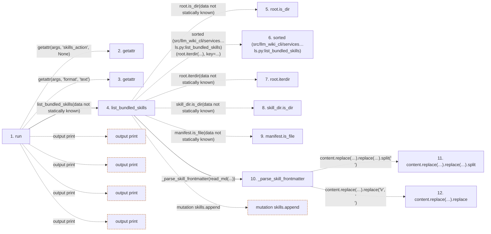

# skills

**Entry point:** `run` (`cli`)
**Source:** [skills_cmd](../modules/skills_cmd.md)
**Modules touched:** [config](../modules/config.md), [io](../modules/io.md), [skills](../modules/skills.md), [skills_cmd](../modules/skills_cmd.md), [validation](../modules/validation.md), [wiki_write_basis](../modules/wiki_write_basis.md)

## Call sequence

> Static overview in presentation order, not runtime execution order. Arrows retain captured callers; representative internal continuations and boundary examples precede repeated helper detail.

```mermaid
sequenceDiagram
    participant p0 as run
    participant p1 as list_bundled_skills
    participant p2 as export_skills
    participant p3 as _print_report
    participant p4 as _default_install_dest
    participant p5 as validate_path
    participant p6 as install_skills
    participant p7 as render_skill_list_json
    participant p8 as render_skill_list_text
    participant p9 as _ensure_safe_base
    participant p10 as _select_skills
    participant p11 as read_config
    participant p12 as _preflight_reference_requirement
    participant p13 as read_md
    participant p14 as _ensure_regular_directory
    participant p15 as _is_regular_file
    participant p16 as write_md
    participant p17 as _write_utf8_text
    participant p18 as _skill_tree_matches
    participant p19 as write_bytes_atomic
    participant p20 as _directory_ancestry_is_safe
    participant p21 as _tree_entries
    participant p22 as _nearest_existing_directory
    participant p23 as _tree_snapshot
    participant p24 as PathValidationError
    participant p25 as render_report_json
    participant p26 as get_agent_config_path
    participant p27 as render_report_text
    participant p28 as _parse_skill_frontmatter
    participant p29 as getattr
    participant p30 as root.is_dir
    p0->>p1: list_bundled_skills
    p0->>p2: export_skills
    p0->>p3: _print_report
    p0->>p4: _default_install_dest
    p0->>p5: validate_path
    p0->>p6: install_skills
    p0->>p7: render_skill_list_json
    p0->>p8: render_skill_list_text
    p2->>p9: _ensure_safe_base
    p2->>p10: _select_skills
    p4->>p11: read_config
    p2->>p12: _preflight_reference_requirement
    p1->>p13: read_md
    p2->>p14: _ensure_regular_directory
    p2->>p15: _is_regular_file
    p2->>p16: write_md
    p16->>p17: _write_utf8_text
    p12->>p18: _skill_tree_matches
    p17->>p19: write_bytes_atomic
    p18->>p20: _directory_ancestry_is_safe
    p18->>p21: _tree_entries
    p20->>p22: _nearest_existing_directory
    p21->>p23: _tree_snapshot
    p5->>p24: PathValidationError
    p3->>p25: render_report_json
    p4->>p26: get_agent_config_path
    p3->>p27: render_report_text
    p1->>p28: _parse_skill_frontmatter
    p0-->>p29: getattr(args, 'skills_action', None)
    p1-->>p30: root.is_dir
```

<!-- Auto-generated from static call edges. Dashed arrows are external or unresolved calls. Reviewed runtime conditions and side effects belong in Behavior. -->

> Call sequence diagram shows 30 of 310 interactions; 280 omitted to keep the visualization within the 30-interaction and generated-diagram limits, with uncertain identities omitted rather than inferred.

> Captured boundary calls: external 1 of 102 (101 omitted); unresolved 1 of 114 (113 omitted). These counts cover the captured static trace.

Omitted captured detail, grouped by actual caller occurrence and target module:

| Caller | Parent step | Target module | Kind | Omitted interactions |
| --- | --- | --- | --- | --- |
| `src/llm_wiki_cli/commands/skills_cmd.py:run` | 1 | - | external | 17 |
| `src/llm_wiki_cli/services/skills.py:list_bundled_skills` | 4 | - | external | 1 |
| `src/llm_wiki_cli/services/skills.py:list_bundled_skills` | 4 | - | unresolved | 4 |
| `src/llm_wiki_cli/services/skills.py:_parse_skill_frontmatter` | 10 | - | unresolved | 10 |
| `src/llm_wiki_cli/services/io.py:read_md` | 21 | [src/llm_wiki_cli/services/io.py](../modules/io.md) | internal | 1 |
| `src/llm_wiki_cli/services/io.py:decode_markdown_bytes` | 22 | - | unresolved | 4 |
| `src/llm_wiki_cli/services/io.py:read_md` | 21 | - | unresolved | 1 |
| `src/llm_wiki_cli/services/skills.py:list_bundled_skills` | 4 | [src/llm_wiki_cli/services/skills.py](../modules/skills.md) | internal | 2 |
> Omission summary shows 8 of 72 groups; 64 further groups are not expanded here. Counts above include all omitted interactions.
> Detailed flow queries retain their own coverage and limits; omitted paths may execute at runtime.

> Trace truncated at the depth limit; deeper calls are omitted.

## Data flow

<!-- Auto-generated static analysis. Treat values and boundaries as best-effort hints, not runtime proof. -->

### Analysis coverage

**Effect analysis partially available.** Flow assembly and source effect analysis are separate; empty observations do not prove an empty handler body.

Source steps: 95; effect analysis evaluated: 78, partial: 0, unavailable: 17. Counts include steps omitted from the displayed trace.

- Callable record unavailable; the selected entry symbol has no represented callable body.
- Effect collector totals unavailable; observed counts cover captured records only.

| Step | Callable record | Effect analysis | Collector totals |
|---|---|---|---|
| `run` | `available` | `evaluated` | `available` |
| `getattr` | `not_applicable` | `not_applicable` | `not_applicable` |
| `getattr` | `not_applicable` | `not_applicable` | `not_applicable` |
| `list_bundled_skills` | `available` | `evaluated` | `available` |
| `root.is_dir` | `not_applicable` | `not_applicable` | `not_applicable` |
| `sorted (src/llm_wiki_cli/services…ls.py:list_bundled_skills)` | `not_applicable` | `not_applicable` | `not_applicable` |
| `root.iterdir` | `not_applicable` | `not_applicable` | `not_applicable` |
| `skill_dir.is_dir` | `not_applicable` | `not_applicable` | `not_applicable` |
| `manifest.is_file` | `not_applicable` | `not_applicable` | `not_applicable` |
| `_parse_skill_frontmatter` | `available` | `evaluated` | `available` |
| `content.replace(…).replace(…).split` | `not_applicable` | `not_applicable` | `not_applicable` |
| `content.replace(…).replace` | `not_applicable` | `not_applicable` | `not_applicable` |

### Step data

| Step | Inputs | Reads | Writes | Returns |
|---|---|---|---|---|
| `run` | `args` | `SkillsError`, `sys`, `sys` | - | `none`, `none`, `none` |
| `getattr` | - | - | - | - |
| `getattr` | - | - | - | - |
| `list_bundled_skills` | `skills_root: Path \| None` | `BUNDLED_SKILLS_ROOT`, `SKILL_MANIFEST_NAME` | - | `[...]`, `skills` |
| `root.is_dir` | - | - | - | - |
| `sorted (src/llm_wiki_cli/services…ls.py:list_bundled_skills)` | - | - | - | - |
| `root.iterdir` | - | - | - | - |
| `skill_dir.is_dir` | - | - | - | - |
| `manifest.is_file` | - | - | - | - |
| `_parse_skill_frontmatter` | `content: str` | - | - | `(...)`, `(...)` |
| `content.replace(…).replace(…).split` | - | - | - | - |
| `content.replace(…).replace` | - | - | - | - |

### Call data

| From | To | Line | Call |
|---|---|---:|---|
| run | getattr | 46 | `getattr(args, 'skills_action', None)` |
| run | getattr | 47 | `getattr(args, 'format', 'text')` |
| run | list_bundled_skills | 51 | `list_bundled_skills(data not statically known)` |
| list_bundled_skills | root.is_dir | 268 | `root.is_dir(data not statically known)` |
| list_bundled_skills | sorted (src/llm_wiki_cli/services…ls.py:list_bundled_skills) | 272 | `sorted(root.iterdir(...), key=...)` |
| list_bundled_skills | root.iterdir | 272 | `root.iterdir(data not statically known)` |
| list_bundled_skills | skill_dir.is_dir | 274 | `skill_dir.is_dir(data not statically known)` |
| list_bundled_skills | manifest.is_file | 274 | `manifest.is_file(data not statically known)` |
| list_bundled_skills | _parse_skill_frontmatter | 276 | `_parse_skill_frontmatter(read_md(...))` |
| _parse_skill_frontmatter | content.replace(…).replace(…).split | 1345 | `content.replace('\r\n', '\n').replace('\r', '\n').split('\n')` |
| _parse_skill_frontmatter | content.replace(…).replace | 1345 | `content.replace('\r\n', '\n').replace('\r', '\n')` |

### Boundary effects

| Kind | Target | Step | Line |
|---|---|---|---:|
| output | `print` | `run` | 53 |
| output | `print` | `run` | 55 |
| output | `print` | `run` | 83 |
| output | `print` | `run` | 86 |
| mutation | `skills.append` | `list_bundled_skills` | 277 |

### Static analysis gaps

| Kind | Step | Target | Line |
|---|---|---|---:|
| external_call | `run` | `getattr` | 46 |
| external_call | `run` | `getattr` | 47 |
| unresolved_call | `list_bundled_skills` | `root.is_dir` | 268 |
| external_call | `list_bundled_skills` | `sorted` | 272 |
| unresolved_call | `list_bundled_skills` | `root.iterdir` | 272 |
| unresolved_call | `list_bundled_skills` | `skill_dir.is_dir` | 274 |
| unresolved_call | `list_bundled_skills` | `manifest.is_file` | 274 |
| unresolved_call | `_parse_skill_frontmatter` | `content.replace('\r\n', '\n').replace('\r', '\n').split` | 1345 |
| unresolved_call | `_parse_skill_frontmatter` | `content.replace('\r\n', '\n').replace` | 1345 |
| step_limit | `run` | `first 12 steps` | 0 |
| truncated_flow | `run` | `depth limit` | 0 |

## Behavior

This flow starts at `run` and is classified as `cli`. The generated call and data-flow sections are bounded static projections; runtime conditions and side effects require source-level confirmation.
