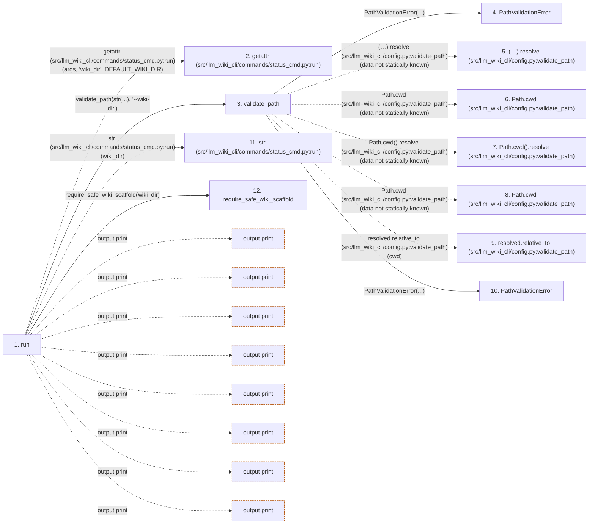

# status

**Entry point:** `run` (`cli`)
**Source:** [status_cmd](../modules/status_cmd.md)
**Modules touched:** [bootstrap_recovery](../modules/bootstrap_recovery.md), [circuit_breaker](../modules/circuit_breaker.md), [common](../modules/common.md), [config](../modules/config.md), and 37 more

**Complete modules touched:**

- [bootstrap_recovery](../modules/bootstrap_recovery.md)
- [circuit_breaker](../modules/circuit_breaker.md)
- [common](../modules/common.md)
- [config](../modules/config.md)
- [filesystem_guard](../modules/filesystem_guard.md)
- [immutable](../modules/immutable.md)
- [implementation_evidence](../modules/implementation_evidence.md)
- [io](../modules/io.md)
- [knowledge_artifacts](../modules/knowledge_artifacts.md)
- [knowledge_consumption](../modules/knowledge_consumption.md)
- [knowledge_envelope](../modules/knowledge_envelope.md)
- [knowledge_evidence](../modules/knowledge_evidence.md)
- [knowledge_freshness](../modules/knowledge_freshness.md)
- [knowledge_governance](../modules/knowledge_governance.md)
- [knowledge_graph](../modules/knowledge_graph.md)
- [knowledge_index](../modules/knowledge_index.md)
- [knowledge_loader](../modules/knowledge_loader.md)
- [knowledge_observability](../modules/knowledge_observability.md)
- [knowledge_packs](../modules/knowledge_packs.md)
- [knowledge_reuse](../modules/knowledge_reuse.md)
- [knowledge_storage](../modules/knowledge_storage.md)
- [knowledge_storage_io](../modules/knowledge_storage_io.md)
- [legacy_hooks](../modules/legacy_hooks.md)
- [maintenance_protocol](../modules/maintenance_protocol.md)
- [maintenance_state](../modules/maintenance_state.md)
- [maintenance_status](../modules/maintenance_status.md)
- [manifest_storage](../modules/manifest_storage.md)
- [paths](../modules/paths.md)
- [rendering_lifecycle](../modules/rendering_lifecycle.md)
- [section_ownership](../modules/section_ownership.md)
- [services_schema](../modules/services_schema.md)
- [skills](../modules/skills.md)
- [source_selection](../modules/source_selection.md)
- [source_snapshot](../modules/source_snapshot.md)
- [status_cmd](../modules/status_cmd.md)
- [sync_manifest](../modules/sync_manifest.md)
- [validation](../modules/validation.md)
- [wiki_lifecycle](../modules/wiki_lifecycle.md)
- [wiki_media](../modules/wiki_media.md)
- [wiki_surface](../modules/wiki_surface.md)
- [wiki_surface_index](../modules/wiki_surface_index.md)

## Call sequence

> Static overview in presentation order, not runtime execution order. Arrows retain captured callers; representative internal continuations and boundary examples precede repeated helper detail.

```mermaid
sequenceDiagram
    participant p0 as run
    participant p1 as validate_path
    participant p2 as require_safe_wiki_scaffold
    participant p3 as validate_source_root
    participant p4 as _count_surface_pages
    participant p5 as _architecture_page_count
    participant p6 as _print_knowledge_status
    participant p7 as inspect_config
    participant p8 as _print_managed_lifecycle
    participant p9 as inspect_legacy_hooks
    participant p10 as load_state
    participant p11 as display_project_path
    participant p12 as iter_page_kinds
    participant p13 as _status_label
    participant p14 as _configured_agent
    participant p15 as shell_quote
    participant p16 as first_unsafe_path_component
    participant p17 as breaker_ttl_seconds
    participant p18 as load_snapshot_knowledge_observability
    participant p19 as _hook_directories
    participant p20 as knowledge_status_payload
    participant p21 as _diagnostic_schema_target
    participant p22 as canonical_path
    participant p23 as verify_reference_skill
    participant p24 as classify_lifecycle_status
    participant p25 as windows_current_user_sid
    participant p26 as inspect_config_path
    participant p27 as is_managed_hook_content
    participant p28 as _print_reference_summary
    participant p29 as getattr (src/llm_wiki_cli/commands/status_cmd.py:run)
    participant p30 as wiki_path.exists
    p0->>p1: validate_path
    p0->>p2: require_safe_wiki_scaffold
    p0->>p3: validate_source_root
    p0->>p4: _count_surface_pages
    p0->>p5: _architecture_page_count
    p0->>p6: _print_knowledge_status
    p0->>p7: inspect_config
    p0->>p8: _print_managed_lifecycle
    p0->>p9: inspect_legacy_hooks
    p0->>p10: load_state
    p0->>p11: display_project_path
    p0->>p12: iter_page_kinds
    p0->>p13: _status_label
    p0->>p14: _configured_agent
    p0->>p15: shell_quote
    p0->>p16: first_unsafe_path_component
    p0->>p17: breaker_ttl_seconds
    p6->>p18: load_snapshot_knowledge_observability
    p9->>p19: _hook_directories
    p6->>p20: knowledge_status_payload
    p8->>p21: _diagnostic_schema_target
    p4->>p22: canonical_path
    p8->>p23: verify_reference_skill
    p8->>p24: classify_lifecycle_status
    p3->>p25: windows_current_user_sid
    p7->>p26: inspect_config_path
    p9->>p27: is_managed_hook_content
    p8->>p28: _print_reference_summary
    p0-->>p29: getattr (src/llm_wiki_cli/commands/status_cmd.py:run)(args, 'wiki_dir', DEFAULT_WIKI_DIR)
    p0-->>p30: wiki_path.exists
```

<!-- Auto-generated from static call edges. Dashed arrows are external or unresolved calls. Reviewed runtime conditions and side effects belong in Behavior. -->

> Call sequence diagram shows 30 of 2093 interactions; 2063 omitted to keep the visualization within the 30-interaction and generated-diagram limits, with uncertain identities omitted rather than inferred.

> Captured boundary calls: external 1 of 716 (715 omitted); unresolved 1 of 526 (525 omitted). These counts cover the captured static trace.

Omitted captured detail, grouped by actual caller occurrence and target module:

| Caller | Parent step | Target module | Kind | Omitted interactions |
| --- | --- | --- | --- | --- |
| `src/llm_wiki_cli/config.py:validate_path` | 3 | [src/llm_wiki_cli/config.py](../modules/config.md) | internal | 2 |
| `src/llm_wiki_cli/config.py:validate_path` | 3 | - | unresolved | 3 |
| `src/llm_wiki_cli/config.py:validate_path` | 3 | - | external | 2 |
| `src/llm_wiki_cli/commands/status_cmd.py:run` | 1 | - | external | 43 |
| `src/llm_wiki_cli/services/wiki_lifecycle.py:require_safe_wiki_scaffold` | 12 | - | external | 3 |
| `src/llm_wiki_cli/services/wiki_lifecycle.py:require_safe_wiki_scaffold` | 12 | [src/llm_wiki_cli/services/wiki_surface.py](../modules/wiki_surface.md) | internal | 1 |
| `src/llm_wiki_cli/services/wiki_surface.py:iter_directory_kinds` | 15 | - | external | 1 |
| `src/llm_wiki_cli/services/wiki_lifecycle.py:require_safe_wiki_scaffold` | 12 | [src/llm_wiki_cli/services/io.py](../modules/io.md) | internal | 1 |
> Omission summary shows 8 of 533 groups; 525 further groups are not expanded here. Counts above include all omitted interactions.
> Detailed flow queries retain their own coverage and limits; omitted paths may execute at runtime.

> Trace truncated at the depth limit; deeper calls are omitted.

## Data flow

<!-- Auto-generated static analysis. Treat values and boundaries as best-effort hints, not runtime proof. -->

### Analysis coverage

**Effect analysis partially available.** Flow assembly and source effect analysis are separate; empty observations do not prove an empty handler body.

Source steps: 852; effect analysis evaluated: 554, partial: 0, unavailable: 298. Counts include steps omitted from the displayed trace.

- Callable record unavailable; the selected entry symbol has no represented callable body.
- Effect collector totals unavailable; observed counts cover captured records only.

| Step | Callable record | Effect analysis | Collector totals |
|---|---|---|---|
| `run` | `available` | `evaluated` | `available` |
| `getattr (src/llm_wiki_cli/commands/status_cmd.py:run)` | `not_applicable` | `not_applicable` | `not_applicable` |
| `validate_path` | `available` | `evaluated` | `available` |
| `PathValidationError` | `unavailable` | `unavailable` | `unavailable` |
| `(…).resolve (src/llm_wiki_cli/config.py:validate_path)` | `not_applicable` | `not_applicable` | `not_applicable` |
| `Path.cwd (src/llm_wiki_cli/config.py:validate_path)` | `not_applicable` | `not_applicable` | `not_applicable` |
| `Path.cwd().resolve (src/llm_wiki_cli/config.py:validate_path)` | `not_applicable` | `not_applicable` | `not_applicable` |
| `Path.cwd (src/llm_wiki_cli/config.py:validate_path)` | `not_applicable` | `not_applicable` | `not_applicable` |
| `resolved.relative_to (src/llm_wiki_cli/config.py:validate_path)` | `not_applicable` | `not_applicable` | `not_applicable` |
| `PathValidationError` | `unavailable` | `unavailable` | `unavailable` |
| `str (src/llm_wiki_cli/commands/status_cmd.py:run)` | `not_applicable` | `not_applicable` | `not_applicable` |
| `require_safe_wiki_scaffold` | `available` | `evaluated` | `available` |

### Step data

| Step | Inputs | Reads | Writes | Returns |
|---|---|---|---|---|
| `run` | `args` | `DEFAULT_WIKI_DIR`, `WikiScaffoldPathError`, `AgentConfigState`, `IDE_AGENTS`, `AgentConfigState`, `LegacyHookError` | - | `none` |
| `getattr (src/llm_wiki_cli/commands/status_cmd.py:run)` | - | - | - | - |
| `validate_path` | `path: str`, `label: str` | - | - | `resolved` |
| `PathValidationError` | - | - | - | - |
| `(…).resolve (src/llm_wiki_cli/config.py:validate_path)` | - | - | - | - |
| `Path.cwd (src/llm_wiki_cli/config.py:validate_path)` | - | - | - | - |
| `Path.cwd().resolve (src/llm_wiki_cli/config.py:validate_path)` | - | - | - | - |
| `Path.cwd (src/llm_wiki_cli/config.py:validate_path)` | - | - | - | - |
| `resolved.relative_to (src/llm_wiki_cli/config.py:validate_path)` | - | - | - | - |
| `PathValidationError` | - | - | - | - |
| `str (src/llm_wiki_cli/commands/status_cmd.py:run)` | - | - | - | - |
| `require_safe_wiki_scaffold` | `wiki_dir: Union[str, Path]` | - | - | - |

### Call data

| From | To | Line | Call |
|---|---|---:|---|
| run | getattr (src/llm_wiki_cli/commands/status_cmd.py:run) | 855 | `getattr(args, 'wiki_dir', DEFAULT_WIKI_DIR)` |
| run | validate_path | 856 | `validate_path(str(...), '--wiki-dir')` |
| validate_path | PathValidationError | 134 | `PathValidationError(...)` |
| validate_path | (…).resolve (src/llm_wiki_cli/config.py:validate_path) | 135 | `(Path.cwd() / path).resolve(data not statically known)` |
| validate_path | Path.cwd (src/llm_wiki_cli/config.py:validate_path) | 135 | `Path.cwd(data not statically known)` |
| validate_path | Path.cwd().resolve (src/llm_wiki_cli/config.py:validate_path) | 136 | `Path.cwd().resolve(data not statically known)` |
| validate_path | Path.cwd (src/llm_wiki_cli/config.py:validate_path) | 136 | `Path.cwd(data not statically known)` |
| validate_path | resolved.relative_to (src/llm_wiki_cli/config.py:validate_path) | 138 | `resolved.relative_to(cwd)` |
| validate_path | PathValidationError | 140 | `PathValidationError(...)` |
| run | str (src/llm_wiki_cli/commands/status_cmd.py:run) | 856 | `str(wiki_dir)` |
| run | require_safe_wiki_scaffold | 858 | `require_safe_wiki_scaffold(wiki_dir)` |

### Boundary effects

| Kind | Target | Step | Line |
|---|---|---|---:|
| output | `print` | `run` | 874 |
| output | `print` | `run` | 875 |
| output | `print` | `run` | 879 |
| output | `print` | `run` | 884 |
| output | `print` | `run` | 888 |
| output | `print` | `run` | 889 |
| output | `print` | `run` | 891 |
| output | `print` | `run` | 894 |

### Static analysis gaps

| Kind | Step | Target | Line |
|---|---|---|---:|
| external_call | `run` | `getattr` | 855 |
| unresolved_call | `validate_path` | `(Path.cwd() / path).resolve` | 135 |
| external_call | `validate_path` | `Path.cwd` | 135 |
| unresolved_call | `validate_path` | `Path.cwd().resolve` | 136 |
| external_call | `validate_path` | `Path.cwd` | 136 |
| unresolved_call | `validate_path` | `resolved.relative_to` | 138 |
| step_limit | `run` | `first 12 steps` | 0 |
| truncated_flow | `run` | `depth limit` | 0 |

## Behavior

This flow starts at `run` and is classified as `cli`. The generated call and data-flow sections are bounded static projections; runtime conditions and side effects require source-level confirmation.
