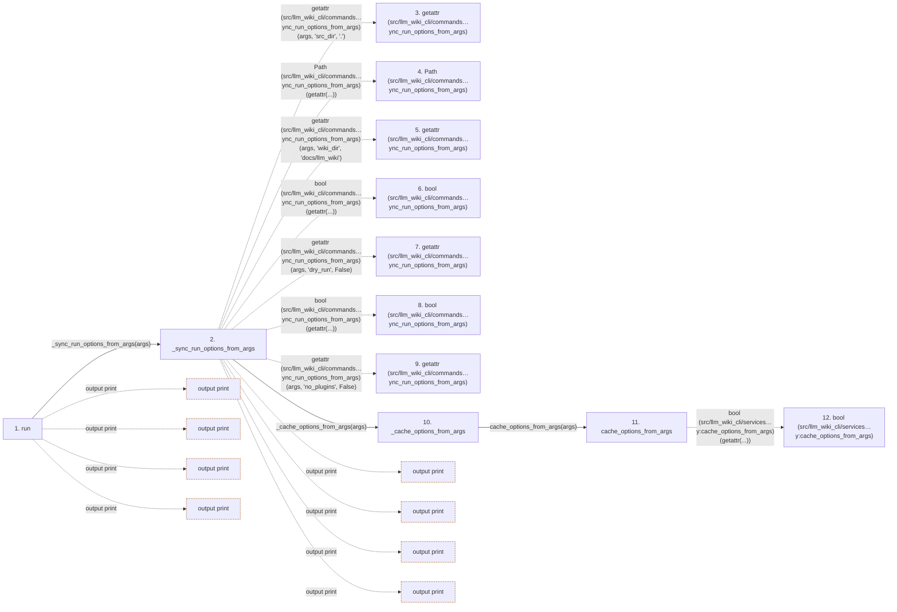

# sync

**Entry point:** `run` (`cli`)
**Source:** [sync_cmd](../modules/sync_cmd.md)
**Modules touched:** [analysis_capture](../modules/analysis_capture.md), [analysis_compatibility](../modules/analysis_compatibility.md), [api_contracts](../modules/api_contracts.md), and 81 more

**Complete modules touched:**

- [analysis_capture](../modules/analysis_capture.md)
- [analysis_compatibility](../modules/analysis_compatibility.md)
- [api_contracts](../modules/api_contracts.md)
- [bootstrap_recovery](../modules/bootstrap_recovery.md)
- [bootstrap_runtime](../modules/bootstrap_runtime.md)
- [canonical_json](../modules/canonical_json.md)
- [common](../modules/common.md)
- [concept_identity](../modules/concept_identity.md)
- [config](../modules/config.md)
- [current_contracts](../modules/current_contracts.md)
- [data_flow](../modules/data_flow.md)
- [dockerfile_parser](../modules/dockerfile_parser.md)
- [entrypoints](../modules/entrypoints.md)
- [extraction_jobs](../modules/extraction_jobs.md)
- [extraction_service](../modules/extraction_service.md)
- [extractor_helpers](../modules/extractor_helpers.md)
- [filesystem_guard](../modules/filesystem_guard.md)
- [helper_cache](../modules/helper_cache.md)
- [helper_preparation](../modules/helper_preparation.md)
- [helper_runtime](../modules/helper_runtime.md)
- [immutable](../modules/immutable.md)
- [imports](../modules/imports.md)
- [infrastructure_inventory](../modules/infrastructure_inventory.md)
- [infrastructure_sync](../modules/infrastructure_sync.md)
- [inventory_cache](../modules/inventory_cache.md)
- [io](../modules/io.md)
- [knowledge_artifacts](../modules/knowledge_artifacts.md)
- [knowledge_envelope](../modules/knowledge_envelope.md)
- [knowledge_evidence](../modules/knowledge_evidence.md)
- [knowledge_freshness](../modules/knowledge_freshness.md)
- [knowledge_generation](../modules/knowledge_generation.md)
- [knowledge_governance](../modules/knowledge_governance.md)
- [knowledge_graph](../modules/knowledge_graph.md)
- [knowledge_index](../modules/knowledge_index.md)
- [knowledge_loader](../modules/knowledge_loader.md)
- [knowledge_model](../modules/knowledge_model.md)
- [knowledge_orchestration](../modules/knowledge_orchestration.md)
- [knowledge_packs](../modules/knowledge_packs.md)
- [knowledge_reuse](../modules/knowledge_reuse.md)
- [knowledge_storage](../modules/knowledge_storage.md)
- [knowledge_storage_diagnostics](../modules/knowledge_storage_diagnostics.md)
- [knowledge_storage_io](../modules/knowledge_storage_io.md)
- [knowledge_storage_lifecycle](../modules/knowledge_storage_lifecycle.md)
- [maintenance_evidence](../modules/maintenance_evidence.md)
- [maintenance_projection](../modules/maintenance_projection.md)
- [maintenance_protocol](../modules/maintenance_protocol.md)
- [maintenance_recovery](../modules/maintenance_recovery.md)
- [maintenance_shapes](../modules/maintenance_shapes.md)
- [maintenance_state](../modules/maintenance_state.md)
- [manifest_storage](../modules/manifest_storage.md)
- [markdown_sections](../modules/markdown_sections.md)
- [normalization_diagnostics](../modules/normalization_diagnostics.md)
- [paths](../modules/paths.md)
- [plugins](../modules/plugins.md)
- [progress](../modules/progress.md)
- [python_calls](../modules/python_calls.md)
- [python_implementation](../modules/python_implementation.md)
- [python_imports](../modules/python_imports.md)
- [runtime_output](../modules/runtime_output.md)
- [scoped_sync_repair](../modules/scoped_sync_repair.md)
- [section_ownership](../modules/section_ownership.md)
- [services_dependencies](../modules/services_dependencies.md)
- [source_retirement](../modules/source_retirement.md)
- [source_selection](../modules/source_selection.md)
- [source_snapshot](../modules/source_snapshot.md)
- [storage_spool](../modules/storage_spool.md)
- [sync_analysis](../modules/sync_analysis.md)
- [sync_analysis_cache](../modules/sync_analysis_cache.md)
- [sync_analysis_storage](../modules/sync_analysis_storage.md)
- [sync_cmd](../modules/sync_cmd.md)
- [sync_generated_sections](../modules/sync_generated_sections.md)
- [sync_manifest](../modules/sync_manifest.md)
- [sync_recovery](../modules/sync_recovery.md)
- [sync_retained_links](../modules/sync_retained_links.md)
- [sync_transition_execution](../modules/sync_transition_execution.md)
- [sync_transitions](../modules/sync_transitions.md)
- [validation](../modules/validation.md)
- [wiki_lifecycle](../modules/wiki_lifecycle.md)
- [wiki_media](../modules/wiki_media.md)
- [wiki_surface](../modules/wiki_surface.md)
- [wiki_surface_index](../modules/wiki_surface_index.md)
- [wiki_write_basis](../modules/wiki_write_basis.md)
- [yaml_formats](../modules/yaml_formats.md)
- [yaml_syntax](../modules/yaml_syntax.md)

## Call sequence

> Static overview in presentation order, not runtime execution order. Arrows retain captured callers; representative internal continuations and boundary examples precede repeated helper detail.

```mermaid
sequenceDiagram
    participant p0 as run
    participant p1 as _sync_run_options_from_args
    participant p2 as _outside_tree
    participant p3 as maintenance_write_operation
    participant p4 as _run_sync_options
    participant p5 as finalize_knowledge_storage
    participant p6 as _absolute_path
    participant p7 as _prepare_sync_run
    participant p8 as guard_maintenance_owner
    participant p9 as governance_writer_lock
    participant p10 as storage_writer_lock
    participant p11 as prepare_boundary
    participant p12 as storage_report
    participant p13 as _cache_options_from_args
    participant p14 as _capture_spooled_wiki
    participant p15 as prune_knowledge_storage
    participant p16 as _recovery_directory
    participant p17 as extraction_job_request_from_args
    participant p18 as report_capture
    participant p19 as save_recovery_snapshot
    participant p20 as _print_cache_stats
    participant p21 as mark_recovery_complete
    participant p22 as retain_recovery_catalogs
    participant p23 as _run_prepared_sync
    participant p24 as repair_paths
    participant p25 as validate_source_root
    participant p26 as cache_options_from_args
    participant p27 as validate_path
    participant p28 as _wiki_files
    participant p29 as bool (src/llm_wiki_cli/commands/sync_cmd.py:run)
    participant p30 as application.changed_files.extend
    p0->>p1: _sync_run_options_from_args
    p0->>p2: _outside_tree
    p0->>p3: maintenance_write_operation
    p0->>p4: _run_sync_options
    p0->>p5: finalize_knowledge_storage
    p2->>p6: _absolute_path
    p4->>p7: _prepare_sync_run
    p3->>p8: guard_maintenance_owner
    p3->>p9: governance_writer_lock
    p3->>p10: storage_writer_lock
    p4->>p11: prepare_boundary
    p5->>p12: storage_report
    p1->>p13: _cache_options_from_args
    p3->>p14: _capture_spooled_wiki
    p5->>p15: prune_knowledge_storage
    p3->>p16: _recovery_directory
    p1->>p17: extraction_job_request_from_args
    p4->>p18: report_capture
    p3->>p19: save_recovery_snapshot
    p4->>p20: _print_cache_stats
    p3->>p21: mark_recovery_complete
    p3->>p22: retain_recovery_catalogs
    p4->>p23: _run_prepared_sync
    p1->>p24: repair_paths
    p1->>p25: validate_source_root
    p13->>p26: cache_options_from_args
    p25->>p27: validate_path
    p14->>p28: _wiki_files
    p0-->>p29: bool (src/llm_wiki_cli/commands/sync_cmd.py:run)(getattr(...))
    p4-->>p30: application.changed_files.extend(selected)
```

<!-- Auto-generated from static call edges. Dashed arrows are external or unresolved calls. Reviewed runtime conditions and side effects belong in Behavior. -->

> Call sequence diagram shows 30 of 7171 interactions; 7141 omitted to keep the visualization within the 30-interaction and generated-diagram limits, with uncertain identities omitted rather than inferred.

> Captured boundary calls: external 1 of 2448 (2447 omitted); unresolved 1 of 2140 (2139 omitted). These counts cover the captured static trace.

Omitted captured detail, grouped by actual caller occurrence and target module:

| Caller | Parent step | Target module | Kind | Omitted interactions |
| --- | --- | --- | --- | --- |
| `src/llm_wiki_cli/commands/sync_cmd.py:_sync_run_options_from_args` | 2 | - | external | 43 |
| `src/llm_wiki_cli/services/inventory_cache.py:cache_options_from_args` | 11 | - | external | 8 |
| `src/llm_wiki_cli/services/inventory_cache.py:cache_options_from_args` | 11 | - | unresolved | 1 |
| `src/llm_wiki_cli/services/inventory_cache.py:cache_options_from_args` | 11 | [src/llm_wiki_cli/services/runtime_output.py](../modules/runtime_output.md) | internal | 2 |
| `src/llm_wiki_cli/services/inventory_cache.py:cache_options_from_args` | 11 | [src/llm_wiki_cli/services/inventory_cache.py](../modules/inventory_cache.md) | internal | 1 |
| `src/llm_wiki_cli/commands/sync_cmd.py:_sync_run_options_from_args` | 2 | [src/llm_wiki_cli/services/inventory_cache.py](../modules/inventory_cache.md) | internal | 1 |
| `src/llm_wiki_cli/services/extraction_jobs.py:extraction_job_request_from_args` | 28 | - | external | 5 |
| `src/llm_wiki_cli/services/extraction_jobs.py:extraction_job_request_from_args` | 28 | [src/llm_wiki_cli/services/extraction_jobs.py](../modules/extraction_jobs.md) | internal | 1 |
> Omission summary shows 8 of 1658 groups; 1650 further groups are not expanded here. Counts above include all omitted interactions.
> Detailed flow queries retain their own coverage and limits; omitted paths may execute at runtime.

> Trace truncated at the depth limit; deeper calls are omitted.

## Data flow

<!-- Auto-generated static analysis. Treat values and boundaries as best-effort hints, not runtime proof. -->

### Analysis coverage

**Effect analysis partially available.** Flow assembly and source effect analysis are separate; empty observations do not prove an empty handler body.

Source steps: 2584; effect analysis evaluated: 1854, partial: 112, unavailable: 618. Counts include steps omitted from the displayed trace.

Collector observations for 1966 source steps with known totals: observed: 11976, emitted: 11325, omitted: 651. Unavailable totals are excluded.

- Callable record unavailable for one or more source steps; those steps have no represented callable body.
- Effect collector omitted observations before flow assembly; displayed effects are partial.
- Effect collector totals unavailable; observed counts cover captured records only.

| Step | Callable record | Effect analysis | Collector totals | Observed | Emitted | Omitted |
|---|---|---|---|---:|---:|---:|
| `run` | `available` | `evaluated` | `available` | `11` | `11` | `0` |
| `_sync_run_options_from_args` | `available` | `evaluated` | `available` | `12` | `12` | `0` |
| `getattr (src/llm_wiki_cli/commands…ync_run_options_from_args)` | `not_applicable` | `not_applicable` | `not_applicable` | — | — | — |
| `Path (src/llm_wiki_cli/commands…ync_run_options_from_args)` | `not_applicable` | `not_applicable` | `not_applicable` | — | — | — |
| `getattr (src/llm_wiki_cli/commands…ync_run_options_from_args)` | `not_applicable` | `not_applicable` | `not_applicable` | — | — | — |
| `bool (src/llm_wiki_cli/commands…ync_run_options_from_args)` | `not_applicable` | `not_applicable` | `not_applicable` | — | — | — |
| `getattr (src/llm_wiki_cli/commands…ync_run_options_from_args)` | `not_applicable` | `not_applicable` | `not_applicable` | — | — | — |
| `bool (src/llm_wiki_cli/commands…ync_run_options_from_args)` | `not_applicable` | `not_applicable` | `not_applicable` | — | — | — |
| `getattr (src/llm_wiki_cli/commands…ync_run_options_from_args)` | `not_applicable` | `not_applicable` | `not_applicable` | — | — | — |
| `_cache_options_from_args` | `available` | `evaluated` | `available` | `2` | `2` | `0` |
| `cache_options_from_args` | `available` | `evaluated` | `available` | `3` | `3` | `0` |
| `bool (src/llm_wiki_cli/services…y:cache_options_from_args)` | `not_applicable` | `not_applicable` | `not_applicable` | — | — | — |

### Step data

| Step | Inputs | Reads | Writes | Returns |
|---|---|---|---|---|
| `run` | `args` | `options.wiki_dir`, `options.wiki_dir`, `options.dry_run`, `sys`, `options.dry_run`, `options.wiki_dir` | - | - |
| `_sync_run_options_from_args` | `args` | `ScopedRepairError`, `sys`, `sys`, `sys`, `sys`, `print_extraction_job_plan` | - | `_SyncRunOptions(...)` |
| `getattr (src/llm_wiki_cli/commands…ync_run_options_from_args)` | - | - | - | - |
| `Path (src/llm_wiki_cli/commands…ync_run_options_from_args)` | - | - | - | - |
| `getattr (src/llm_wiki_cli/commands…ync_run_options_from_args)` | - | - | - | - |
| `bool (src/llm_wiki_cli/commands…ync_run_options_from_args)` | - | - | - | - |
| `getattr (src/llm_wiki_cli/commands…ync_run_options_from_args)` | - | - | - | - |
| `bool (src/llm_wiki_cli/commands…ync_run_options_from_args)` | - | - | - | - |
| `getattr (src/llm_wiki_cli/commands…ync_run_options_from_args)` | - | - | - | - |
| `_cache_options_from_args` | `args` | - | - | `cache_options_from_args(...)` |
| `cache_options_from_args` | `args` | `stderr_warning` | - | `InventoryCacheOptions(...)` |
| `bool (src/llm_wiki_cli/services…y:cache_options_from_args)` | - | - | - | - |

### Call data

| From | To | Line | Call |
|---|---|---:|---|
| run | _sync_run_options_from_args | 5432 | `_sync_run_options_from_args(args)` |
| _sync_run_options_from_args | getattr (src/llm_wiki_cli/commands…ync_run_options_from_args) | 2435 | `getattr(args, 'src_dir', '.')` |
| _sync_run_options_from_args | Path (src/llm_wiki_cli/commands…ync_run_options_from_args) | 2436 | `Path(getattr(...))` |
| _sync_run_options_from_args | getattr (src/llm_wiki_cli/commands…ync_run_options_from_args) | 2436 | `getattr(args, 'wiki_dir', 'docs/llm_wiki')` |
| _sync_run_options_from_args | bool (src/llm_wiki_cli/commands…ync_run_options_from_args) | 2437 | `bool(getattr(...))` |
| _sync_run_options_from_args | getattr (src/llm_wiki_cli/commands…ync_run_options_from_args) | 2437 | `getattr(args, 'dry_run', False)` |
| _sync_run_options_from_args | bool (src/llm_wiki_cli/commands…ync_run_options_from_args) | 2438 | `bool(getattr(...))` |
| _sync_run_options_from_args | getattr (src/llm_wiki_cli/commands…ync_run_options_from_args) | 2438 | `getattr(args, 'no_plugins', False)` |
| _sync_run_options_from_args | _cache_options_from_args | 2439 | `_cache_options_from_args(args)` |
| _cache_options_from_args | cache_options_from_args | 307 | `cache_options_from_args(args)` |
| cache_options_from_args | bool (src/llm_wiki_cli/services…y:cache_options_from_args) | 322 | `bool(getattr(...))` |

### Boundary effects

| Kind | Target | Step | Line |
|---|---|---|---:|
| output | `print` | `run` | 5446 |
| output | `print` | `run` | 5449 |
| output | `print` | `run` | 5453 |
| output | `print` | `run` | 5455 |
| output | `print` | `_sync_run_options_from_args` | 2464 |
| output | `print` | `_sync_run_options_from_args` | 2467 |
| output | `print` | `_sync_run_options_from_args` | 2473 |
| output | `print` | `_sync_run_options_from_args` | 2479 |

### Static analysis gaps

| Kind | Step | Target | Line |
|---|---|---|---:|
| external_call | `_sync_run_options_from_args` | `getattr` | 2435 |
| external_call | `_sync_run_options_from_args` | `getattr` | 2436 |
| external_call | `_sync_run_options_from_args` | `getattr` | 2437 |
| external_call | `_sync_run_options_from_args` | `getattr` | 2438 |
| step_limit | `run` | `first 12 steps` | 0 |
| truncated_flow | `run` | `depth limit` | 0 |

## Behavior

Classifies the wiki lifecycle, validates the persisted source-selection and
generation policy, captures one live source snapshot, and computes source,
infrastructure, and optional-surface changes. Dry-run prints the complete plan;
broad unforced updates stop before page application. An applied run preserves supported
semantic prose, rebuilds navigation, appends the log, and commits mutually
consistent generated state so repeating the same command converges to no work.

Removed declarations in surviving documentable modules are retained as qualified
source history. Exact recorded owner revival can restore live generation without
inventing lifecycle or approval. Previously owned empty modules receive scoped parser qualification; their
module page remains current while removed declarations become retained history.
Parser/coverage gaps and ambiguous duplicate custody still stop before writes.

An applied operation retains exact bytes and identities for newly created
Markdown pages. Rejected publication emits the recovery journal hash and leaves
mandatory ownership checks active. Explicit `maintenance recover-new-pages`
previews and removes only unchanged new pages before retry; readers and sync
never perform that recovery implicitly. Adopted full-preimage recovery remains
available independently.

Broad-update errors distinguish source changes from additional generator
refresh inputs and expose bounded path samples with omitted counts. A copied,
platform-quoted preview preserves the caller's roots and planning bindings;
dry-run reveals every affected input path and its source-change reason. Source
inputs are not rewritten, and a preview never grants broad-write approval.

After successful staging, a broad preview explains how to explicitly authorize
the reviewed update by replacing dry-run with force. Force computes a fresh plan;
source, helper, selection, provider or wiki changes require renewed preview and
review. Matching generated page writes are skipped, while changed generated
content and current evidence are committed through the existing owning path.
The normal repeat run leaves active wiki state unchanged; adopted maintenance
may separately capture a recovery preimage outside the wiki. Ownership,
integrity and explicit recovery requirements remain active throughout.

Current deep normalization can also schedule an unchanged source with captured
invalid evidence for an owning refresh. The preview distinguishes this from
source edits and generator transitions, and broad guards remain active. Full
reconciliation replaces only evidence supported by fresh observations, including
same-version repairs, without a fabricated source edit or a scoped-write promise.

An explicit `--no-plugins --repair-evidence` request limits application to selected
unchanged sources with complete current producer commitments and adopted custody.
A producer transition must reproduce retained known observations. Identical
executable observations can re-anchor to their actual captured issuer, reopening
review without losing history or acknowledging it.
It repairs existing module/entity evidence together and preserves other unknowns.
Full discovery, analysis, graph reconciliation, native artifacts, an isolated
preflight copy and recovery preimages still require global work. Wider logical or
typed-graph changes refuse; broad review remains active. A matching known selected
basis causes no scoped publication, and success does not certify unselected
source evidence. Repeat strict validation after the repair.

Help connects captured evidence diagnosis and raw inspection to previewing the
ordinary owning update. Broad changes still require review and explicit authority;
force is never implied by a failure or an upgrade. Fresh malformed evidence stays
blocking. After repair, supported prose review, re-anchor and strict validation
retain their established ownership and integrity checks.
