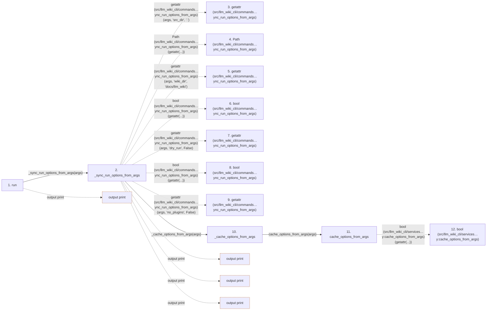

# sync

**Entry point:** `run` (`cli`)
**Source:** [sync_cmd](../modules/sync_cmd.md)
**Modules touched:** [analysis_capture](../modules/analysis_capture.md), [analysis_compatibility](../modules/analysis_compatibility.md), [api_contracts](../modules/api_contracts.md), and 63 more

**Complete modules touched:**

- [analysis_capture](../modules/analysis_capture.md)
- [analysis_compatibility](../modules/analysis_compatibility.md)
- [api_contracts](../modules/api_contracts.md)
- [bootstrap_runtime](../modules/bootstrap_runtime.md)
- [common](../modules/common.md)
- [concept_identity](../modules/concept_identity.md)
- [config](../modules/config.md)
- [data_flow](../modules/data_flow.md)
- [entrypoints](../modules/entrypoints.md)
- [extraction_jobs](../modules/extraction_jobs.md)
- [extraction_service](../modules/extraction_service.md)
- [extractor_helpers](../modules/extractor_helpers.md)
- [filesystem_guard](../modules/filesystem_guard.md)
- [immutable](../modules/immutable.md)
- [implementation_evidence](../modules/implementation_evidence.md)
- [imports](../modules/imports.md)
- [infrastructure_inventory](../modules/infrastructure_inventory.md)
- [infrastructure_sync](../modules/infrastructure_sync.md)
- [inventory_cache](../modules/inventory_cache.md)
- [io](../modules/io.md)
- [knowledge_artifacts](../modules/knowledge_artifacts.md)
- [knowledge_envelope](../modules/knowledge_envelope.md)
- [knowledge_evidence](../modules/knowledge_evidence.md)
- [knowledge_generation](../modules/knowledge_generation.md)
- [knowledge_governance](../modules/knowledge_governance.md)
- [knowledge_graph](../modules/knowledge_graph.md)
- [knowledge_index](../modules/knowledge_index.md)
- [knowledge_model](../modules/knowledge_model.md)
- [knowledge_orchestration](../modules/knowledge_orchestration.md)
- [knowledge_packs](../modules/knowledge_packs.md)
- [knowledge_reuse](../modules/knowledge_reuse.md)
- [knowledge_storage](../modules/knowledge_storage.md)
- [knowledge_storage_io](../modules/knowledge_storage_io.md)
- [maintenance_projection](../modules/maintenance_projection.md)
- [maintenance_protocol](../modules/maintenance_protocol.md)
- [maintenance_shapes](../modules/maintenance_shapes.md)
- [maintenance_state](../modules/maintenance_state.md)
- [manifest_storage](../modules/manifest_storage.md)
- [markdown_sections](../modules/markdown_sections.md)
- [paths](../modules/paths.md)
- [plugins](../modules/plugins.md)
- [progress](../modules/progress.md)
- [python_calls](../modules/python_calls.md)
- [python_imports](../modules/python_imports.md)
- [runtime_output](../modules/runtime_output.md)
- [section_ownership](../modules/section_ownership.md)
- [services_dependencies](../modules/services_dependencies.md)
- [source_retirement](../modules/source_retirement.md)
- [source_selection](../modules/source_selection.md)
- [source_snapshot](../modules/source_snapshot.md)
- [sync_analysis](../modules/sync_analysis.md)
- [sync_analysis_cache](../modules/sync_analysis_cache.md)
- [sync_cmd](../modules/sync_cmd.md)
- [sync_generated_sections](../modules/sync_generated_sections.md)
- [sync_manifest](../modules/sync_manifest.md)
- [sync_retained_links](../modules/sync_retained_links.md)
- [sync_transition_execution](../modules/sync_transition_execution.md)
- [sync_transitions](../modules/sync_transitions.md)
- [validation](../modules/validation.md)
- [wiki_lifecycle](../modules/wiki_lifecycle.md)
- [wiki_media](../modules/wiki_media.md)
- [wiki_surface](../modules/wiki_surface.md)
- [wiki_surface_index](../modules/wiki_surface_index.md)
- [wiki_write_basis](../modules/wiki_write_basis.md)
- [yaml_formats](../modules/yaml_formats.md)
- [yaml_syntax](../modules/yaml_syntax.md)

## Call sequence

> Static overview in presentation order, not runtime execution order. Arrows retain captured callers; representative internal continuations and boundary examples precede repeated helper detail.

```mermaid
sequenceDiagram
    participant p0 as run
    participant p1 as _sync_run_options_from_args
    participant p2 as maintenance_write_operation
    participant p3 as _run_sync_options
    participant p4 as _absolute_path
    participant p5 as _prepare_sync_run
    participant p6 as guard_maintenance_owner
    participant p7 as report_capture
    participant p8 as governance_writer_lock
    participant p9 as storage_writer_lock
    participant p10 as _cache_options_from_args
    participant p11 as _print_cache_stats
    participant p12 as snapshot_wiki
    participant p13 as _run_prepared_sync
    participant p14 as _recovery_directory
    participant p15 as extraction_job_request_from_args
    participant p16 as save_recovery_snapshot
    participant p17 as validate_source_root
    participant p18 as cache_options_from_args
    participant p19 as validate_path
    participant p20 as assert_no_pending_page_moves
    participant p21 as _run_sync_dry_run
    participant p22 as ensure_guarded_directory
    participant p23 as _load_or_seed_manifest
    participant p24 as _enforce_sync_write_safety
    participant p25 as load_adoption_marker
    participant p26 as SyncManifest.load
    participant p27 as _validate_persisted_source_selection
    participant p28 as prepare_cache_options
    participant p29 as print (src/llm_wiki_cli/commands/sync_cmd.py:run)
    participant p30 as write_basis.assert_current
    p0->>p1: _sync_run_options_from_args
    p0->>p2: maintenance_write_operation
    p0->>p3: _run_sync_options
    p2->>p4: _absolute_path
    p3->>p5: _prepare_sync_run
    p2->>p6: guard_maintenance_owner
    p3->>p7: report_capture
    p2->>p8: governance_writer_lock
    p2->>p9: storage_writer_lock
    p1->>p10: _cache_options_from_args
    p3->>p11: _print_cache_stats
    p2->>p12: snapshot_wiki
    p3->>p13: _run_prepared_sync
    p2->>p14: _recovery_directory
    p1->>p15: extraction_job_request_from_args
    p2->>p16: save_recovery_snapshot
    p1->>p17: validate_source_root
    p10->>p18: cache_options_from_args
    p17->>p19: validate_path
    p5->>p20: assert_no_pending_page_moves
    p13->>p21: _run_sync_dry_run
    p16->>p22: ensure_guarded_directory
    p5->>p23: _load_or_seed_manifest
    p13->>p24: _enforce_sync_write_safety
    p6->>p25: load_adoption_marker
    p6->>p26: SyncManifest.load
    p5->>p27: _validate_persisted_source_selection
    p5->>p28: prepare_cache_options
    p0-->>p29: print (src/llm_wiki_cli/commands/sync_cmd.py:run)(..., file=sys.stderr)
    p3-->>p30: write_basis.assert_current
```

<!-- Auto-generated from static call edges. Dashed arrows are external or unresolved calls. Reviewed runtime conditions and side effects belong in Behavior. -->

> Call sequence diagram shows 30 of 5671 interactions; 5641 omitted to keep the visualization within the 30-interaction and generated-diagram limits, with uncertain identities omitted rather than inferred.

> Captured boundary calls: external 1 of 1955 (1954 omitted); unresolved 1 of 1766 (1765 omitted). These counts cover the captured static trace.

Omitted captured detail, grouped by actual caller occurrence and target module:

| Caller | Parent step | Target module | Kind | Omitted interactions |
| --- | --- | --- | --- | --- |
| `src/llm_wiki_cli/commands/sync_cmd.py:_sync_run_options_from_args` | 2 | - | external | 38 |
| `src/llm_wiki_cli/services/inventory_cache.py:cache_options_from_args` | 11 | - | external | 8 |
| `src/llm_wiki_cli/services/inventory_cache.py:cache_options_from_args` | 11 | - | unresolved | 1 |
| `src/llm_wiki_cli/services/inventory_cache.py:cache_options_from_args` | 11 | [src/llm_wiki_cli/services/runtime_output.py](../modules/runtime_output.md) | internal | 2 |
| `src/llm_wiki_cli/services/inventory_cache.py:cache_options_from_args` | 11 | [src/llm_wiki_cli/services/inventory_cache.py](../modules/inventory_cache.md) | internal | 1 |
| `src/llm_wiki_cli/commands/sync_cmd.py:_sync_run_options_from_args` | 2 | [src/llm_wiki_cli/services/inventory_cache.py](../modules/inventory_cache.md) | internal | 1 |
| `src/llm_wiki_cli/services/extraction_jobs.py:extraction_job_request_from_args` | 28 | - | external | 5 |
| `src/llm_wiki_cli/services/extraction_jobs.py:extraction_job_request_from_args` | 28 | [src/llm_wiki_cli/services/extraction_jobs.py](../modules/extraction_jobs.md) | internal | 1 |
> Omission summary shows 8 of 1260 groups; 1252 further groups are not expanded here. Counts above include all omitted interactions.
> Detailed flow queries retain their own coverage and limits; omitted paths may execute at runtime.

> Trace truncated at the depth limit; deeper calls are omitted.

## Data flow

<!-- Auto-generated static analysis. Treat values and boundaries as best-effort hints, not runtime proof. -->

### Step data

| Step | Inputs | Reads | Writes | Returns |
|---|---|---|---|---|
| `run` | `args` | `options.wiki_dir`, `options.dry_run`, `sys` | - | - |
| `_sync_run_options_from_args` | `args` | `sys`, `sys`, `sys`, `print_extraction_job_plan` | - | `_SyncRunOptions(...)` |
| `getattr (src/llm_wiki_cli/commands…ync_run_options_from_args)` | - | - | - | - |
| `Path (src/llm_wiki_cli/commands…ync_run_options_from_args)` | - | - | - | - |
| `getattr (src/llm_wiki_cli/commands…ync_run_options_from_args)` | - | - | - | - |
| `bool (src/llm_wiki_cli/commands…ync_run_options_from_args)` | - | - | - | - |
| `getattr (src/llm_wiki_cli/commands…ync_run_options_from_args)` | - | - | - | - |
| `bool (src/llm_wiki_cli/commands…ync_run_options_from_args)` | - | - | - | - |
| `getattr (src/llm_wiki_cli/commands…ync_run_options_from_args)` | - | - | - | - |
| `_cache_options_from_args` | `args` | - | - | `cache_options_from_args(...)` |
| `cache_options_from_args` | `args` | `stderr_warning` | - | `InventoryCacheOptions(...)` |
| `bool (src/llm_wiki_cli/services…y:cache_options_from_args)` | - | - | - | - |

### Call data

| From | To | Line | Call |
|---|---|---:|---|
| run | _sync_run_options_from_args | 5032 | `_sync_run_options_from_args(args)` |
| _sync_run_options_from_args | getattr (src/llm_wiki_cli/commands…ync_run_options_from_args) | 2404 | `getattr(args, 'src_dir', '.')` |
| _sync_run_options_from_args | Path (src/llm_wiki_cli/commands…ync_run_options_from_args) | 2405 | `Path(getattr(...))` |
| _sync_run_options_from_args | getattr (src/llm_wiki_cli/commands…ync_run_options_from_args) | 2405 | `getattr(args, 'wiki_dir', 'docs/llm_wiki')` |
| _sync_run_options_from_args | bool (src/llm_wiki_cli/commands…ync_run_options_from_args) | 2406 | `bool(getattr(...))` |
| _sync_run_options_from_args | getattr (src/llm_wiki_cli/commands…ync_run_options_from_args) | 2406 | `getattr(args, 'dry_run', False)` |
| _sync_run_options_from_args | bool (src/llm_wiki_cli/commands…ync_run_options_from_args) | 2407 | `bool(getattr(...))` |
| _sync_run_options_from_args | getattr (src/llm_wiki_cli/commands…ync_run_options_from_args) | 2407 | `getattr(args, 'no_plugins', False)` |
| _sync_run_options_from_args | _cache_options_from_args | 2408 | `_cache_options_from_args(args)` |
| _cache_options_from_args | cache_options_from_args | 301 | `cache_options_from_args(args)` |
| cache_options_from_args | bool (src/llm_wiki_cli/services…y:cache_options_from_args) | 311 | `bool(getattr(...))` |

### Boundary effects

| Kind | Target | Step | Line |
|---|---|---|---:|
| output | `print` | `run` | 5039 |
| output | `print` | `_sync_run_options_from_args` | 2425 |
| output | `print` | `_sync_run_options_from_args` | 2431 |
| output | `print` | `_sync_run_options_from_args` | 2437 |

### Static analysis gaps

| Kind | Step | Target | Line |
|---|---|---|---:|
| external_call | `_sync_run_options_from_args` | `getattr` | 2404 |
| external_call | `_sync_run_options_from_args` | `getattr` | 2405 |
| external_call | `_sync_run_options_from_args` | `getattr` | 2406 |
| external_call | `_sync_run_options_from_args` | `getattr` | 2407 |
| step_limit | `run` | `first 12 steps` | 0 |
| truncated_flow | `run` | `depth limit` | 0 |

## Behavior

Classifies the wiki lifecycle, validates the persisted source-selection and
generation policy, captures one live source snapshot, and computes source,
infrastructure, and optional-surface changes. Dry-run prints the complete plan;
broad unforced updates stop before writes. An applied run preserves supported
semantic prose, rebuilds navigation, appends the log, and commits mutually
consistent generated state so repeating the same command converges to no work.

Removed declarations in surviving documentable modules are retained as qualified
source history. Exact recorded owner revival can restore live generation without
inventing lifecycle or approval. Parser/coverage gaps and ambiguous duplicate
custody stop before writes rather than being interpreted as source removal.
