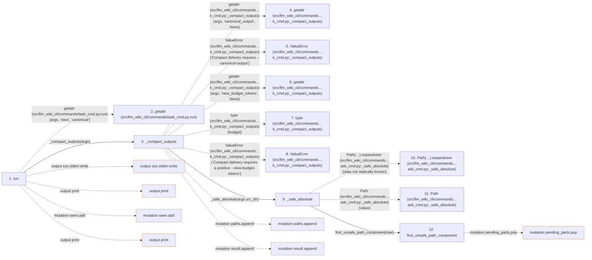

# task-context

**Entry point:** `run` (`cli`)
**Source:** [task_cmd](../modules/task_cmd.md)
**Modules touched:** [filesystem_guard](../modules/filesystem_guard.md), [io](../modules/io.md), [knowledge_storage](../modules/knowledge_storage.md), [knowledge_storage_io](../modules/knowledge_storage_io.md), and 4 more

**Complete modules touched:**

- [filesystem_guard](../modules/filesystem_guard.md)
- [io](../modules/io.md)
- [knowledge_storage](../modules/knowledge_storage.md)
- [knowledge_storage_io](../modules/knowledge_storage_io.md)
- [request_json](../modules/request_json.md)
- [task_cmd](../modules/task_cmd.md)
- [token_counting](../modules/token_counting.md)
- [wiki_write_basis](../modules/wiki_write_basis.md)

## Call sequence

> Static overview in presentation order, not runtime execution order. Arrows retain captured callers; siblings are shown before deeper helper detail.

```mermaid
sequenceDiagram
    participant p0 as run
    participant p1 as getattr (src/llm_wiki_cli/commands/task_cmd.py:run)
    participant p2 as _compact_outputs
    participant p3 as ValueError (src/llm_wiki_cli/commands/task_cmd.py:run)
    participant p4 as load_request
    participant p5 as api.WorkflowPolicy
    participant p6 as api.load_workflow_profile
    participant p7 as LocalTokenizerCounter
    participant p8 as api.build_compact_task_context
    participant p9 as api.build_task_context
    participant p10 as isinstance (src/llm_wiki_cli/commands/task_cmd.py:run)
    participant p11 as _publish_compact_outputs
    participant p12 as sys.stderr.write
    participant p13 as print
    participant p14 as json.dumps
    participant p15 as result.to_payload
    participant p16 as SystemExit
    participant p17 as write_utf8_stdout
    participant p18 as write_text_output
    participant p19 as set
    participant p20 as id
    participant p21 as seen.add
    p0-->>p1: getattr (src/llm_wiki_cli/commands/task_cmd.py:run)(args, 'view', 'canonical')
    p0->>p2: _compact_outputs
    p0-->>p1: getattr (src/llm_wiki_cli/commands/task_cmd.py:run)(args, 'view_budget_tokens', None)
    p0-->>p1: getattr (src/llm_wiki_cli/commands/task_cmd.py:run)(args, 'canonical_output', None)
    p0-->>p3: ValueError (src/llm_wiki_cli/commands/task_cmd.py:run)('Compact artifact options require --view compact-v1')
    p0->>p4: load_request
    p0-->>p5: api.WorkflowPolicy(read_scope=...)
    p0-->>p6: api.load_workflow_profile(args.profile, policy=policy)
    p0->>p7: LocalTokenizerCounter
    p0-->>p8: api.build_compact_task_context(request, view_options={...}, **=options)
    p0-->>p9: api.build_task_context(request, **=options)
    p0-->>p10: isinstance (src/llm_wiki_cli/commands/task_cmd.py:run)(result, api.CompactTaskContext)
    p0-->>p10: isinstance (src/llm_wiki_cli/commands/task_cmd.py:run)(result, api.CompactTaskContext)
    p0->>p11: _publish_compact_outputs
    p0-->>p12: sys.stderr.write(result.diagnostic_rendered)
    p0-->>p13: print(json.dumps(...), file=sys.stderr)
    p0-->>p14: json.dumps(result.to_payload(...), sort_keys=True)
    p0-->>p15: result.to_payload
    p0-->>p16: SystemExit(3)
    p0->>p11: _publish_compact_outputs
    p0->>p17: write_utf8_stdout
    p0->>p18: write_text_output
    p0->>p17: write_utf8_stdout
    p0-->>p10: isinstance (src/llm_wiki_cli/commands/task_cmd.py:run)(exc, (...))
    p0-->>p1: getattr (src/llm_wiki_cli/commands/task_cmd.py:run)(exc, 'details', None)
    p0-->>p19: set
    p0-->>p20: id(cause)
    p0-->>p21: seen.add(id(...))
    p0-->>p20: id(cause)
    p0-->>p10: isinstance (src/llm_wiki_cli/commands/task_cmd.py:run)(cause, KnowledgeStorageError)
```

<!-- Auto-generated from static call edges. Dashed arrows are external or unresolved calls. Reviewed runtime conditions and side effects belong in Behavior. -->

> Call sequence diagram shows 30 of 614 interactions; 584 omitted to keep the visualization within the 30-interaction and generated-diagram limits, with uncertain identities omitted rather than inferred.

> Captured boundary calls: external 16 of 357 (341 omitted); unresolved 6 of 106 (100 omitted). These counts cover the captured static trace.

Omitted captured detail, grouped by actual caller occurrence and target module:

| Caller | Parent step | Target module | Kind | Omitted interactions |
| --- | --- | --- | --- | --- |
| `src/llm_wiki_cli/commands/task_cmd.py:_compact_outputs` | 3 | - | external | 13 |
| `src/llm_wiki_cli/commands/task_cmd.py:_compact_outputs` | 3 | [src/llm_wiki_cli/commands/task_cmd.py](../modules/task_cmd.md) | internal | 6 |
| `src/llm_wiki_cli/commands/task_cmd.py:_safe_absolute` | 9 | - | unresolved | 2 |
| `src/llm_wiki_cli/commands/task_cmd.py:_safe_absolute` | 9 | - | external | 2 |
| `src/llm_wiki_cli/commands/task_cmd.py:_safe_absolute` | 9 | [src/llm_wiki_cli/services/io.py](../modules/io.md) | internal | 1 |
| `src/llm_wiki_cli/services/io.py:first_unsafe_path_component` | 12 | - | external | 20 |
| `src/llm_wiki_cli/services/io.py:first_unsafe_path_component` | 12 | - | unresolved | 5 |
| `src/llm_wiki_cli/commands/task_cmd.py:_compact_outputs` | 3 | - | unresolved | 12 |
> Omission summary shows 8 of 105 groups; 97 further groups are not expanded here. Counts above include all omitted interactions.
> Detailed flow queries retain their own coverage and limits; omitted paths may execute at runtime.

> Trace truncated at the depth limit; deeper calls are omitted.

## Data flow

<!-- Auto-generated static analysis. Treat values and boundaries as best-effort hints, not runtime proof. -->

### Step data

| Step | Inputs | Reads | Writes | Returns |
|---|---|---|---|---|
| `run` | `args` | `sys`, `sys` | - | - |
| `getattr (src/llm_wiki_cli/commands/task_cmd.py:run)` | - | - | - | - |
| `_compact_outputs` | `args` | - | - | `result` |
| `getattr (src/llm_wiki_cli/commands…k_cmd.py:_compact_outputs)` | - | - | - | - |
| `ValueError (src/llm_wiki_cli/commands…k_cmd.py:_compact_outputs)` | - | - | - | - |
| `getattr (src/llm_wiki_cli/commands…k_cmd.py:_compact_outputs)` | - | - | - | - |
| `type (src/llm_wiki_cli/commands…k_cmd.py:_compact_outputs)` | - | - | - | - |
| `ValueError (src/llm_wiki_cli/commands…k_cmd.py:_compact_outputs)` | - | - | - | - |
| `_safe_absolute` | `value` | - | - | `raw.resolve(...)` |
| `Path(…).expanduser (src/llm_wiki_cli/commands…ask_cmd.py:_safe_absolute)` | - | - | - | - |
| `Path (src/llm_wiki_cli/commands…ask_cmd.py:_safe_absolute)` | - | - | - | - |
| `first_unsafe_path_component` | `path: str \| Path`, `trusted_symlink_uids: Set[int] \| None`, `trusted_symlink_owner: Callable[[Path], bool] \| None` | `stat`, `os` | - | `lexical`, `None`, `current`, `current`, `current`, `current`, `current`, `None` |

### Call data

| From | To | Line | Call |
|---|---|---:|---|
| run | getattr (src/llm_wiki_cli/commands/task_cmd.py:run) | 97 | `getattr(args, 'view', 'canonical')` |
| run | _compact_outputs | 98 | `_compact_outputs(args)` |
| _compact_outputs | getattr (src/llm_wiki_cli/commands…k_cmd.py:_compact_outputs) | 38 | `getattr(args, 'canonical_output', None)` |
| _compact_outputs | ValueError (src/llm_wiki_cli/commands…k_cmd.py:_compact_outputs) | 39 | `ValueError('Compact delivery requires --canonical-output')` |
| _compact_outputs | getattr (src/llm_wiki_cli/commands…k_cmd.py:_compact_outputs) | 40 | `getattr(args, 'view_budget_tokens', None)` |
| _compact_outputs | type (src/llm_wiki_cli/commands…k_cmd.py:_compact_outputs) | 41 | `type(budget)` |
| _compact_outputs | ValueError (src/llm_wiki_cli/commands…k_cmd.py:_compact_outputs) | 42 | `ValueError('Compact delivery requires a positive --view-budget-tokens')` |
| _compact_outputs | _safe_absolute | 43 | `_safe_absolute(args.src_dir)` |
| _safe_absolute | Path(…).expanduser (src/llm_wiki_cli/commands…ask_cmd.py:_safe_absolute) | 15 | `Path(value).expanduser(data not statically known)` |
| _safe_absolute | Path (src/llm_wiki_cli/commands…ask_cmd.py:_safe_absolute) | 15 | `Path(value)` |
| _safe_absolute | first_unsafe_path_component | 16 | `first_unsafe_path_component(raw)` |

### Boundary effects

| Kind | Target | Step | Line |
|---|---|---|---:|
| output | `sys.stderr.write` | `run` | 126 |
| output | `print` | `run` | 128 |
| mutation | `seen.add` | `run` | 147 |
| output | `print` | `run` | 162 |
| mutation | `paths.append` | `_compact_outputs` | 52 |
| mutation | `result.append` | `_compact_outputs` | 71 |
| mutation | `pending_parts.pop` | `first_unsafe_path_component` | 71 |

### Static analysis gaps

| Kind | Step | Target | Line |
|---|---|---|---:|
| external_call | `run` | `getattr` | 97 |
| external_call | `_compact_outputs` | `getattr` | 38 |
| external_call | `_compact_outputs` | `ValueError` | 39 |
| external_call | `_compact_outputs` | `getattr` | 40 |
| external_call | `_compact_outputs` | `type` | 41 |
| external_call | `_compact_outputs` | `ValueError` | 42 |
| unresolved_call | `_safe_absolute` | `Path(value).expanduser` | 15 |
| step_limit | `run` | `first 12 steps` | 0 |
| truncated_flow | `run` | `depth limit` | 0 |

## Behavior

Loads an explicit task request and optional profile within operator-supplied limits. It emits the canonical qualified result or a structured failure. No source change, helper preparation, agent setup or suggested follow-up is performed by the read.
