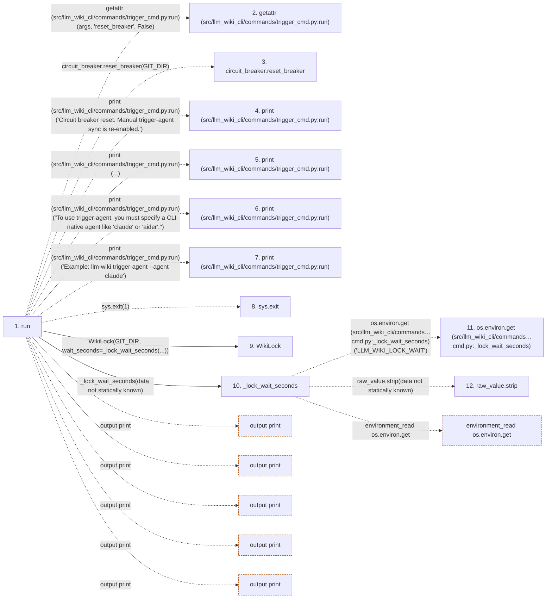

# trigger-agent

**Entry point:** `run` (`cli`)
**Source:** [trigger_cmd](../modules/trigger_cmd.md)
**Modules touched:** [common](../modules/common.md), [domain_pack](../modules/domain_pack.md), [extraction_service](../modules/extraction_service.md), [filesystem_guard](../modules/filesystem_guard.md), and 24 more

**Complete modules touched:**

- [common](../modules/common.md)
- [domain_pack](../modules/domain_pack.md)
- [extraction_service](../modules/extraction_service.md)
- [filesystem_guard](../modules/filesystem_guard.md)
- [generate_prompt_cmd](../modules/generate_prompt_cmd.md)
- [gitignore](../modules/gitignore.md)
- [host](../modules/host.md)
- [imports](../modules/imports.md)
- [io](../modules/io.md)
- [knowledge_observability](../modules/knowledge_observability.md)
- [knowledge_storage](../modules/knowledge_storage.md)
- [knowledge_storage_io](../modules/knowledge_storage_io.md)
- [lockfile](../modules/lockfile.md)
- [maintenance_state](../modules/maintenance_state.md)
- [manifest_storage](../modules/manifest_storage.md)
- [metrics](../modules/metrics.md)
- [path_policy](../modules/path_policy.md)
- [paths](../modules/paths.md)
- [plugins](../modules/plugins.md)
- [redaction](../modules/redaction.md)
- [secure_file](../modules/secure_file.md)
- [source_selection](../modules/source_selection.md)
- [source_snapshot](../modules/source_snapshot.md)
- [sync_manifest](../modules/sync_manifest.md)
- [team](../modules/team.md)
- [trigger_cmd](../modules/trigger_cmd.md)
- [validation](../modules/validation.md)
- [wiki_git_policy](../modules/wiki_git_policy.md)

## Call sequence

> Static overview in presentation order, not runtime execution order. Arrows retain captured callers; representative internal continuations and boundary examples precede repeated helper detail.

```mermaid
sequenceDiagram
    participant p0 as run
    participant p1 as _run_sync
    participant p2 as WikiLock
    participant p3 as _lock_wait_seconds
    participant p4 as validate_path
    participant p5 as _validated_trigger_source
    participant p6 as _record_trigger_start
    participant p7 as _prepare_and_run_sync
    participant p8 as record_event
    participant p9 as _preflight_trigger_source_selection
    participant p10 as _fetch_last_commit_diff
    participant p11 as _filter_trigger_diff
    participant p12 as _skip_large_diff
    participant p13 as validate_source_root
    participant p14 as _build_sync_prompt
    participant p15 as _skip_large_prompt
    participant p16 as _write_prompt_file
    participant p17 as _run_agent
    participant p18 as SyncManifest.load
    participant p19 as filter_source_diff
    participant p20 as _redact_prompt_artifact
    participant p21 as _iso_now
    participant p22 as _record_trigger_failure
    participant p23 as get_inventory_result
    participant p24 as _sanitize_metrics_value
    participant p25 as print_inventory_failures
    participant p26 as resolve_source_selection
    participant p27 as validate_persisted_source_selection_identity
    participant p28 as get_call_graph
    participant p29 as getattr (src/llm_wiki_cli/commands/trigger_cmd.py:run)
    participant p30 as circuit_breaker.reset_breaker
    p0->>p1: _run_sync
    p0->>p2: WikiLock
    p0->>p3: _lock_wait_seconds
    p1->>p4: validate_path
    p1->>p5: _validated_trigger_source
    p1->>p6: _record_trigger_start
    p1->>p7: _prepare_and_run_sync
    p6->>p8: record_event
    p7->>p9: _preflight_trigger_source_selection
    p7->>p10: _fetch_last_commit_diff
    p7->>p11: _filter_trigger_diff
    p7->>p12: _skip_large_diff
    p5->>p13: validate_source_root
    p7->>p14: _build_sync_prompt
    p7->>p15: _skip_large_prompt
    p7->>p16: _write_prompt_file
    p7->>p17: _run_agent
    p9->>p18: SyncManifest.load
    p11->>p19: filter_source_diff
    p16->>p20: _redact_prompt_artifact
    p8->>p21: _iso_now
    p10->>p22: _record_trigger_failure
    p14->>p23: get_inventory_result
    p8->>p24: _sanitize_metrics_value
    p14->>p25: print_inventory_failures
    p9->>p26: resolve_source_selection
    p9->>p27: validate_persisted_source_selection_identity
    p14->>p28: get_call_graph
    p0-->>p29: getattr (src/llm_wiki_cli/commands/trigger_cmd.py:run)(args, 'reset_breaker', False)
    p0-->>p30: circuit_breaker.reset_breaker(GIT_DIR)
```

<!-- Auto-generated from static call edges. Dashed arrows are external or unresolved calls. Reviewed runtime conditions and side effects belong in Behavior. -->

> Call sequence diagram shows 30 of 821 interactions; 791 omitted to keep the visualization within the 30-interaction and generated-diagram limits, with uncertain identities omitted rather than inferred.

> Captured boundary calls: external 1 of 293 (292 omitted); unresolved 1 of 202 (201 omitted). These counts cover the captured static trace.

Omitted captured detail, grouped by actual caller occurrence and target module:

| Caller | Parent step | Target module | Kind | Omitted interactions |
| --- | --- | --- | --- | --- |
| `src/llm_wiki_cli/commands/trigger_cmd.py:run` | 1 | - | external | 7 |
| `src/llm_wiki_cli/commands/trigger_cmd.py:_lock_wait_seconds` | 10 | - | external | 5 |
| `src/llm_wiki_cli/commands/trigger_cmd.py:_lock_wait_seconds` | 10 | - | unresolved | 1 |
| `src/llm_wiki_cli/commands/trigger_cmd.py:_run_sync` | 17 | - | external | 2 |
| `src/llm_wiki_engine/path_policy.py:validate_path` | 19 | [src/llm_wiki_engine/path_policy.py](../modules/path_policy.md) | internal | 2 |
| `src/llm_wiki_engine/path_policy.py:validate_path` | 19 | - | unresolved | 5 |
| `src/llm_wiki_engine/path_policy.py:validate_path` | 19 | [src/llm_wiki_engine/host.py](../modules/host.md) | internal | 2 |
| `src/llm_wiki_engine/host.py:current_host` | 23 | - | unresolved | 1 |
> Omission summary shows 8 of 224 groups; 216 further groups are not expanded here. Counts above include all omitted interactions.
> Detailed flow queries retain their own coverage and limits; omitted paths may execute at runtime.

> Trace truncated at the depth limit; deeper calls are omitted.

## Data flow

<!-- Auto-generated static analysis. Treat values and boundaries as best-effort hints, not runtime proof. -->

### Analysis coverage

**Effect analysis partially available.** Flow assembly and source effect analysis are separate; empty observations do not prove an empty handler body.

Source steps: 327; effect analysis evaluated: 233, partial: 15, unavailable: 79. Counts include steps omitted from the displayed trace.

Collector observations for 248 source steps with known totals: observed: 1572, emitted: 1522, omitted: 50. Unavailable totals are excluded.

- Callable record unavailable for one or more source steps; those steps have no represented callable body.
- Effect collector omitted observations before flow assembly; displayed effects are partial.
- Effect collector totals unavailable; observed counts cover captured records only.

| Step | Callable record | Effect analysis | Collector totals | Observed | Emitted | Omitted |
|---|---|---|---|---:|---:|---:|
| `run` | `available` | `evaluated` | `available` | `12` | `12` | `0` |
| `getattr (src/llm_wiki_cli/commands/trigger_cmd.py:run)` | `not_applicable` | `not_applicable` | `not_applicable` | — | — | — |
| `circuit_breaker.reset_breaker` | `not_applicable` | `not_applicable` | `not_applicable` | — | — | — |
| `print (src/llm_wiki_cli/commands/trigger_cmd.py:run)` | `not_applicable` | `not_applicable` | `not_applicable` | — | — | — |
| `print (src/llm_wiki_cli/commands/trigger_cmd.py:run)` | `not_applicable` | `not_applicable` | `not_applicable` | — | — | — |
| `print (src/llm_wiki_cli/commands/trigger_cmd.py:run)` | `not_applicable` | `not_applicable` | `not_applicable` | — | — | — |
| `print (src/llm_wiki_cli/commands/trigger_cmd.py:run)` | `not_applicable` | `not_applicable` | `not_applicable` | — | — | — |
| `sys.exit` | `not_applicable` | `not_applicable` | `not_applicable` | — | — | — |
| `WikiLock` | `unavailable` | `unavailable` | `unavailable` | — | — | — |
| `_lock_wait_seconds` | `available` | `evaluated` | `available` | `3` | `3` | `0` |
| `os.environ.get (src/llm_wiki_cli/commands…cmd.py:_lock_wait_seconds)` | `not_applicable` | `not_applicable` | `not_applicable` | — | — | — |
| `raw_value.strip` | `not_applicable` | `not_applicable` | `not_applicable` | — | — | — |

### Step data

| Step | Inputs | Reads | Writes | Returns |
|---|---|---|---|---|
| `run` | `args` | `GIT_DIR`, `IDE_AGENTS`, `GIT_DIR`, `LockAcquisitionError`, `TriggerFailure` | - | `none` |
| `getattr (src/llm_wiki_cli/commands/trigger_cmd.py:run)` | - | - | - | - |
| `circuit_breaker.reset_breaker` | - | - | - | - |
| `print (src/llm_wiki_cli/commands/trigger_cmd.py:run)` | - | - | - | - |
| `print (src/llm_wiki_cli/commands/trigger_cmd.py:run)` | - | - | - | - |
| `print (src/llm_wiki_cli/commands/trigger_cmd.py:run)` | - | - | - | - |
| `print (src/llm_wiki_cli/commands/trigger_cmd.py:run)` | - | - | - | - |
| `sys.exit` | - | - | - | - |
| `WikiLock` | - | - | - | - |
| `_lock_wait_seconds` | - | - | - | `0.0`, `wait_seconds` |
| `os.environ.get (src/llm_wiki_cli/commands…cmd.py:_lock_wait_seconds)` | - | - | - | - |
| `raw_value.strip` | - | - | - | - |

### Call data

| From | To | Line | Call |
|---|---|---:|---|
| run | getattr (src/llm_wiki_cli/commands/trigger_cmd.py:run) | 49 | `getattr(args, 'reset_breaker', False)` |
| run | circuit_breaker.reset_breaker | 50 | `circuit_breaker.reset_breaker(GIT_DIR)` |
| run | print (src/llm_wiki_cli/commands/trigger_cmd.py:run) | 51 | `print('Circuit breaker reset. Manual trigger-agent sync is re-enabled.')` |
| run | print (src/llm_wiki_cli/commands/trigger_cmd.py:run) | 55 | `print(...)` |
| run | print (src/llm_wiki_cli/commands/trigger_cmd.py:run) | 56 | `print("To use trigger-agent, you must specify a CLI-native agent like 'claude' or 'aider'.")` |
| run | print (src/llm_wiki_cli/commands/trigger_cmd.py:run) | 59 | `print('Example: llm-wiki trigger-agent --agent claude')` |
| run | sys.exit | 60 | `sys.exit(1)` |
| run | WikiLock | 64 | `WikiLock(GIT_DIR, wait_seconds=_lock_wait_seconds(...))` |
| run | _lock_wait_seconds | 64 | `_lock_wait_seconds(data not statically known)` |
| _lock_wait_seconds | os.environ.get (src/llm_wiki_cli/commands…cmd.py:_lock_wait_seconds) | 507 | `os.environ.get('LLM_WIKI_LOCK_WAIT')` |
| _lock_wait_seconds | raw_value.strip | 508 | `raw_value.strip(data not statically known)` |

### Boundary effects

| Kind | Target | Step | Line |
|---|---|---|---:|
| output | `print` | `run` | 51 |
| output | `print` | `run` | 55 |
| output | `print` | `run` | 56 |
| output | `print` | `run` | 59 |
| output | `print` | `run` | 67 |
| environment_read | `os.environ.get` | `_lock_wait_seconds` | 507 |

### Static analysis gaps

| Kind | Step | Target | Line |
|---|---|---|---:|
| external_call | `run` | `getattr` | 49 |
| unresolved_call | `run` | `circuit_breaker.reset_breaker` | 50 |
| external_call | `run` | `sys.exit` | 60 |
| unresolved_call | `_lock_wait_seconds` | `raw_value.strip` | 508 |
| step_limit | `run` | `first 12 steps` | 0 |
| truncated_flow | `run` | `depth limit` | 0 |

## Behavior

This flow starts at `run` and is classified as `cli`. The generated call and data-flow sections are bounded static projections; runtime conditions and side effects require source-level confirmation.
