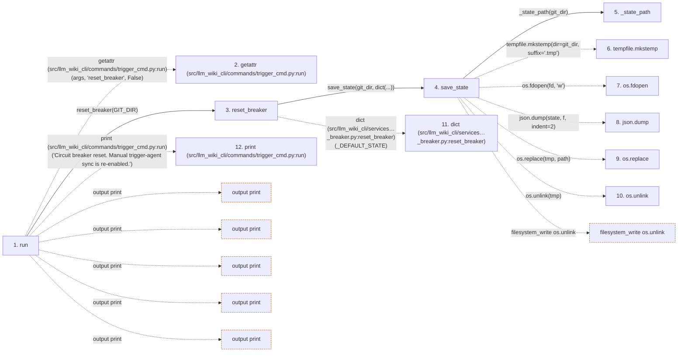

# trigger-agent

**Entry point:** `run` (`cli`)
**Source:** [trigger_cmd](../modules/trigger_cmd.md)
**Modules touched:** [circuit_breaker](../modules/circuit_breaker.md), [common](../modules/common.md), [config](../modules/config.md), [extraction_service](../modules/extraction_service.md), and 22 more

**Complete modules touched:**

- [circuit_breaker](../modules/circuit_breaker.md)
- [common](../modules/common.md)
- [config](../modules/config.md)
- [extraction_service](../modules/extraction_service.md)
- [filesystem_guard](../modules/filesystem_guard.md)
- [generate_prompt_cmd](../modules/generate_prompt_cmd.md)
- [imports](../modules/imports.md)
- [io](../modules/io.md)
- [knowledge_observability](../modules/knowledge_observability.md)
- [knowledge_storage](../modules/knowledge_storage.md)
- [knowledge_storage_io](../modules/knowledge_storage_io.md)
- [lockfile](../modules/lockfile.md)
- [maintenance_state](../modules/maintenance_state.md)
- [manifest_storage](../modules/manifest_storage.md)
- [metrics](../modules/metrics.md)
- [paths](../modules/paths.md)
- [plugins](../modules/plugins.md)
- [redaction](../modules/redaction.md)
- [secure_file](../modules/secure_file.md)
- [source_selection](../modules/source_selection.md)
- [source_snapshot](../modules/source_snapshot.md)
- [sync_manifest](../modules/sync_manifest.md)
- [team](../modules/team.md)
- [trigger_cmd](../modules/trigger_cmd.md)
- [validation](../modules/validation.md)
- [wiki_git_policy](../modules/wiki_git_policy.md)

## Call sequence

> Static overview in presentation order, not runtime execution order. Arrows retain captured callers; siblings are shown before deeper helper detail.

```mermaid
sequenceDiagram
    participant p0 as run
    participant p1 as getattr (src/llm_wiki_cli/commands/trigger_cmd.py:run)
    participant p2 as reset_breaker
    participant p3 as print (src/llm_wiki_cli/commands/trigger_cmd.py:run)
    participant p4 as sys.exit
    participant p5 as WikiLock
    participant p6 as _lock_wait_seconds
    participant p7 as _run_sync
    participant p8 as SystemExit
    participant p9 as save_state
    participant p10 as os.environ.get (src/llm_wiki_cli/commands…cmd.py:_lock_wait_seconds)
    participant p11 as getattr (src/llm_wiki_cli/commands/trigger_cmd.py:_run_sync)
    participant p12 as dict (src/llm_wiki_cli/services…_breaker.py:reset_breaker)
    participant p13 as raw_value.strip
    participant p14 as validate_path
    participant p15 as float (src/llm_wiki_cli/commands…cmd.py:_lock_wait_seconds)
    participant p16 as _validated_trigger_source
    participant p17 as ValueError
    participant p18 as time.monotonic (src/llm_wiki_cli/commands/trigger_cmd.py:_run_sync)
    participant p19 as math.isfinite (src/llm_wiki_cli/commands…cmd.py:_lock_wait_seconds)
    participant p20 as _is_breaker_open
    participant p21 as _record_trigger_start
    participant p22 as _prepare_and_run_sync
    participant p23 as record_failure
    participant p24 as _record_trigger_finish
    participant p25 as _state_path
    p0-->>p1: getattr (src/llm_wiki_cli/commands/trigger_cmd.py:run)(args, 'reset_breaker', False)
    p0->>p2: reset_breaker
    p0-->>p3: print (src/llm_wiki_cli/commands/trigger_cmd.py:run)('Circuit breaker reset. Manual trigger-agent sync is re-enabled.')
    p0-->>p3: print (src/llm_wiki_cli/commands/trigger_cmd.py:run)(...)
    p0-->>p3: print (src/llm_wiki_cli/commands/trigger_cmd.py:run)("To use trigger-agent, you must specify a CLI-native agent like 'claude' or 'aider'.")
    p0-->>p3: print (src/llm_wiki_cli/commands/trigger_cmd.py:run)('Example: llm-wiki trigger-agent --agent claude')
    p0-->>p4: sys.exit(1)
    p0->>p5: WikiLock
    p0->>p6: _lock_wait_seconds
    p0->>p7: _run_sync
    p0-->>p3: print (src/llm_wiki_cli/commands/trigger_cmd.py:run)('Another llm-wiki sync is already running. Skipping.')
    p0-->>p8: SystemExit(exc.exit_code)
    p2->>p9: save_state
    p6-->>p10: os.environ.get (src/llm_wiki_cli/commands…cmd.py:_lock_wait_seconds)('LLM_WIKI_LOCK_WAIT')
    p7-->>p11: getattr (src/llm_wiki_cli/commands/trigger_cmd.py:_run_sync)(args, 'wiki_dir', DEFAULT_WIKI_DIR)
    p2-->>p12: dict (src/llm_wiki_cli/services…_breaker.py:reset_breaker)(_DEFAULT_STATE)
    p6-->>p13: raw_value.strip
    p7->>p14: validate_path
    p6-->>p15: float (src/llm_wiki_cli/commands…cmd.py:_lock_wait_seconds)(raw_value)
    p7->>p16: _validated_trigger_source
    p6-->>p17: ValueError('LLM_WIKI_LOCK_WAIT must be a finite non-negative number of seconds.')
    p7-->>p18: time.monotonic (src/llm_wiki_cli/commands/trigger_cmd.py:_run_sync)
    p6-->>p19: math.isfinite (src/llm_wiki_cli/commands…cmd.py:_lock_wait_seconds)(wait_seconds)
    p7->>p20: _is_breaker_open
    p6-->>p17: ValueError('LLM_WIKI_LOCK_WAIT must be a finite non-negative number of seconds.')
    p7->>p21: _record_trigger_start
    p7->>p22: _prepare_and_run_sync
    p7->>p23: record_failure
    p7->>p24: _record_trigger_finish
    p9->>p25: _state_path
```

<!-- Auto-generated from static call edges. Dashed arrows are external or unresolved calls. Reviewed runtime conditions and side effects belong in Behavior. -->

> Call sequence diagram shows 30 of 858 interactions; 828 omitted to keep the visualization within the 30-interaction and generated-diagram limits, with uncertain identities omitted rather than inferred.

> Captured boundary calls: external 16 of 328 (312 omitted); unresolved 1 of 197 (196 omitted). These counts cover the captured static trace.

Omitted captured detail, grouped by actual caller occurrence and target module:

| Caller | Parent step | Target module | Kind | Omitted interactions |
| --- | --- | --- | --- | --- |
| `src/llm_wiki_cli/services/circuit_breaker.py:save_state` | 4 | - | external | 5 |
| `src/llm_wiki_cli/config.py:validate_path` | 27 | [src/llm_wiki_cli/config.py](../modules/config.md) | internal | 2 |
| `src/llm_wiki_cli/config.py:validate_path` | 27 | - | unresolved | 3 |
| `src/llm_wiki_cli/config.py:validate_path` | 27 | - | external | 2 |
| `src/llm_wiki_cli/commands/trigger_cmd.py:_validated_trigger_source` | 35 | - | external | 5 |
| `src/llm_wiki_cli/commands/trigger_cmd.py:_validated_trigger_source` | 35 | [src/llm_wiki_cli/config.py](../modules/config.md) | internal | 1 |
| `src/llm_wiki_cli/config.py:validate_source_root` | 40 | [src/llm_wiki_cli/config.py](../modules/config.md) | internal | 7 |
| `src/llm_wiki_cli/config.py:validate_source_root` | 40 | - | unresolved | 5 |
> Omission summary shows 8 of 229 groups; 221 further groups are not expanded here. Counts above include all omitted interactions.
> Detailed flow queries retain their own coverage and limits; omitted paths may execute at runtime.

> Trace truncated at the depth limit; deeper calls are omitted.

## Data flow

<!-- Auto-generated static analysis. Treat values and boundaries as best-effort hints, not runtime proof. -->

### Step data

| Step | Inputs | Reads | Writes | Returns |
|---|---|---|---|---|
| `run` | `args` | `GIT_DIR`, `IDE_AGENTS`, `GIT_DIR`, `LockAcquisitionError`, `TriggerFailure` | - | `none` |
| `getattr (src/llm_wiki_cli/commands/trigger_cmd.py:run)` | - | - | - | - |
| `reset_breaker` | `git_dir: Path` | `_DEFAULT_STATE` | - | - |
| `save_state` | `git_dir: Path`, `state: dict` | - | - | - |
| `_state_path` | `git_dir: Path` | `_STATE_FILE` | - | `...` |
| `tempfile.mkstemp` | - | - | - | - |
| `os.fdopen` | - | - | - | - |
| `json.dump` | - | - | - | - |
| `os.replace` | - | - | - | - |
| `os.unlink` | - | - | - | - |
| `dict (src/llm_wiki_cli/services…_breaker.py:reset_breaker)` | - | - | - | - |
| `print (src/llm_wiki_cli/commands/trigger_cmd.py:run)` | - | - | - | - |

### Call data

| From | To | Line | Call |
|---|---|---:|---|
| run | getattr (src/llm_wiki_cli/commands/trigger_cmd.py:run) | 49 | `getattr(args, 'reset_breaker', False)` |
| run | reset_breaker | 50 | `circuit_breaker.reset_breaker(GIT_DIR)` |
| reset_breaker | save_state | 139 | `save_state(git_dir, dict(...))` |
| save_state | _state_path | 55 | `_state_path(git_dir)` |
| save_state | tempfile.mkstemp | 56 | `tempfile.mkstemp(dir=git_dir, suffix='.tmp')` |
| save_state | os.fdopen | 58 | `os.fdopen(fd, 'w')` |
| save_state | json.dump | 59 | `json.dump(state, f, indent=2)` |
| save_state | os.replace | 60 | `os.replace(tmp, path)` |
| save_state | os.unlink | 63 | `os.unlink(tmp)` |
| reset_breaker | dict (src/llm_wiki_cli/services…_breaker.py:reset_breaker) | 139 | `dict(_DEFAULT_STATE)` |
| run | print (src/llm_wiki_cli/commands/trigger_cmd.py:run) | 51 | `print('Circuit breaker reset. Manual trigger-agent sync is re-enabled.')` |

### Boundary effects

| Kind | Target | Step | Line |
|---|---|---|---:|
| output | `print` | `run` | 51 |
| output | `print` | `run` | 55 |
| output | `print` | `run` | 56 |
| output | `print` | `run` | 59 |
| output | `print` | `run` | 67 |
| filesystem_write | `os.unlink` | `save_state` | 63 |

### Static analysis gaps

| Kind | Step | Target | Line |
|---|---|---|---:|
| external_call | `run` | `getattr` | 49 |
| external_call | `save_state` | `tempfile.mkstemp` | 56 |
| external_call | `save_state` | `os.fdopen` | 58 |
| external_call | `save_state` | `json.dump` | 59 |
| external_call | `save_state` | `os.replace` | 60 |
| step_limit | `run` | `first 12 steps` | 0 |
| truncated_flow | `run` | `depth limit` | 0 |

## Behavior

This flow starts at `run` and is classified as `cli`. The generated call and data-flow sections are bounded static projections; runtime conditions and side effects require source-level confirmation.
