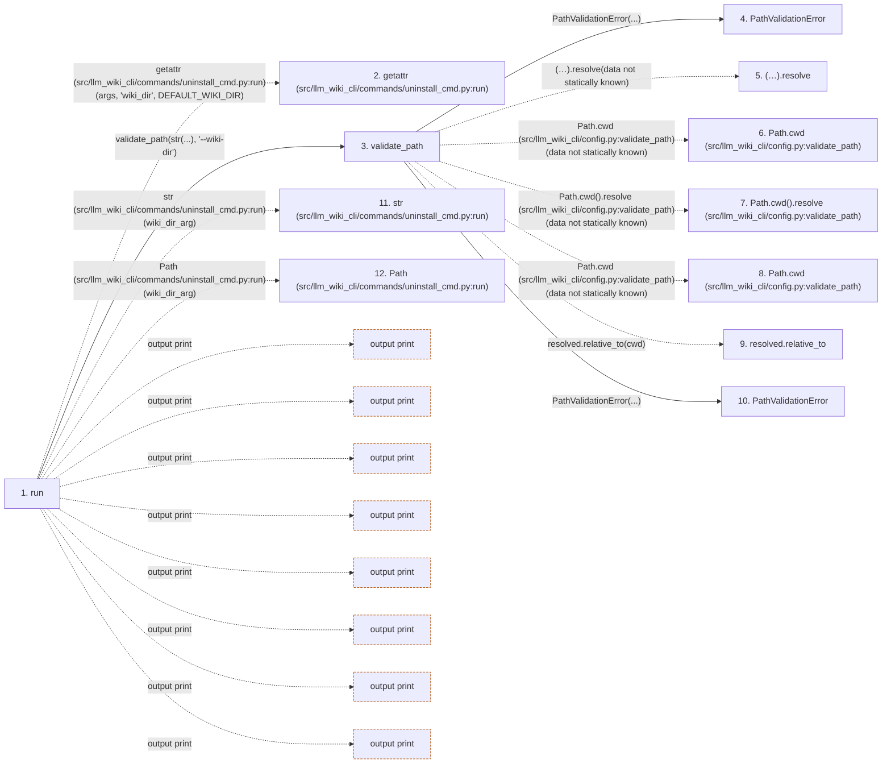

# uninstall

**Entry point:** `run` (`cli`)
**Source:** [uninstall_cmd](../modules/uninstall_cmd.md)
**Modules touched:** [ci_installer](../modules/ci_installer.md), [config](../modules/config.md), [filesystem_guard](../modules/filesystem_guard.md), [io](../modules/io.md), and 6 more

**Complete modules touched:**

- [ci_installer](../modules/ci_installer.md)
- [config](../modules/config.md)
- [filesystem_guard](../modules/filesystem_guard.md)
- [io](../modules/io.md)
- [legacy_hooks](../modules/legacy_hooks.md)
- [paths](../modules/paths.md)
- [services_schema](../modules/services_schema.md)
- [skills](../modules/skills.md)
- [uninstall_cmd](../modules/uninstall_cmd.md)
- [wiki_write_basis](../modules/wiki_write_basis.md)

## Call sequence

> Static overview in presentation order, not runtime execution order. Arrows retain captured callers; siblings are shown before deeper helper detail.

```mermaid
sequenceDiagram
    participant p0 as run
    participant p1 as getattr (src/llm_wiki_cli/commands/uninstall_cmd.py:run)
    participant p2 as validate_path
    participant p3 as str (src/llm_wiki_cli/commands/uninstall_cmd.py:run)
    participant p4 as Path (src/llm_wiki_cli/commands/uninstall_cmd.py:run)
    participant p5 as _preflight_hooks
    participant p6 as _preflight_agent_schemas
    participant p7 as _preflight_reference_skills
    participant p8 as tuple (src/llm_wiki_cli/commands/uninstall_cmd.py:run)
    participant p9 as _preflight_wiki_removal
    participant p10 as _preflight_runtime_artifacts
    participant p11 as _preflight_ci_workflow
    participant p12 as print (src/llm_wiki_cli/commands/uninstall_cmd.py:run)
    participant p13 as SystemExit
    participant p14 as _remove_hooks
    participant p15 as _clean_agent_schemas
    participant p16 as display_project_path
    p0-->>p1: getattr (src/llm_wiki_cli/commands/uninstall_cmd.py:run)(args, 'wiki_dir', DEFAULT_WIKI_DIR)
    p0->>p2: validate_path
    p0-->>p3: str (src/llm_wiki_cli/commands/uninstall_cmd.py:run)(wiki_dir_arg)
    p0-->>p4: Path (src/llm_wiki_cli/commands/uninstall_cmd.py:run)(wiki_dir_arg)
    p0-->>p1: getattr (src/llm_wiki_cli/commands/uninstall_cmd.py:run)(args, 'remove_wiki', False)
    p0-->>p1: getattr (src/llm_wiki_cli/commands/uninstall_cmd.py:run)(args, 'dry_run', False)
    p0->>p5: _preflight_hooks
    p0->>p6: _preflight_agent_schemas
    p0->>p7: _preflight_reference_skills
    p0-->>p8: tuple (src/llm_wiki_cli/commands/uninstall_cmd.py:run)(...)
    p0->>p9: _preflight_wiki_removal
    p0->>p10: _preflight_runtime_artifacts
    p0->>p11: _preflight_ci_workflow
    p0-->>p12: print (src/llm_wiki_cli/commands/uninstall_cmd.py:run)(..., file=sys.stderr)
    p0-->>p13: SystemExit(2)
    p0-->>p12: print (src/llm_wiki_cli/commands/uninstall_cmd.py:run)('DRY RUN — no files will be modified:\n')
    p0-->>p12: print (src/llm_wiki_cli/commands/uninstall_cmd.py:run)('LLM Wiki Uninstall')
    p0-->>p12: print (src/llm_wiki_cli/commands/uninstall_cmd.py:run)(...)
    p0-->>p12: print (src/llm_wiki_cli/commands/uninstall_cmd.py:run)('\n1. Git Hooks:')
    p0->>p14: _remove_hooks
    p0-->>p12: print (src/llm_wiki_cli/commands/uninstall_cmd.py:run)(' Nothing to remove.')
    p0-->>p12: print (src/llm_wiki_cli/commands/uninstall_cmd.py:run)('\n2. Agent Constraint Blocks:')
    p0->>p15: _clean_agent_schemas
    p0-->>p12: print (src/llm_wiki_cli/commands/uninstall_cmd.py:run)(' Nothing to remove.')
    p0-->>p12: print (src/llm_wiki_cli/commands/uninstall_cmd.py:run)('\n3. Wiki Directory:')
    p0-->>p12: print (src/llm_wiki_cli/commands/uninstall_cmd.py:run)(...)
    p0->>p16: display_project_path
    p0-->>p12: print (src/llm_wiki_cli/commands/uninstall_cmd.py:run)(...)
    p0->>p16: display_project_path
    p0-->>p12: print (src/llm_wiki_cli/commands/uninstall_cmd.py:run)(...)
```

<!-- Auto-generated from static call edges. Dashed arrows are external or unresolved calls. Reviewed runtime conditions and side effects belong in Behavior. -->

> Call sequence diagram shows 30 of 1155 interactions; 1125 omitted to keep the visualization within the 30-interaction and generated-diagram limits, with uncertain identities omitted rather than inferred.

> Captured boundary calls: external 19 of 538 (519 omitted); unresolved 0 of 235 (235 omitted). These counts cover the captured static trace.

Omitted captured detail, grouped by actual caller occurrence and target module:

| Caller | Parent step | Target module | Kind | Omitted interactions |
| --- | --- | --- | --- | --- |
| `src/llm_wiki_cli/config.py:validate_path` | 3 | [src/llm_wiki_cli/config.py](../modules/config.md) | internal | 2 |
| `src/llm_wiki_cli/config.py:validate_path` | 3 | - | unresolved | 3 |
| `src/llm_wiki_cli/config.py:validate_path` | 3 | - | external | 2 |
| `src/llm_wiki_cli/commands/uninstall_cmd.py:_preflight_hooks` | 15 | [src/llm_wiki_cli/services/legacy_hooks.py](../modules/legacy_hooks.md) | internal | 1 |
| `src/llm_wiki_cli/services/legacy_hooks.py:inspect_legacy_hooks` | 16 | [src/llm_wiki_cli/services/legacy_hooks.py](../modules/legacy_hooks.md) | internal | 8 |
| `src/llm_wiki_cli/services/legacy_hooks.py:_hook_directories` | 17 | - | unresolved | 9 |
| `src/llm_wiki_cli/services/legacy_hooks.py:_hook_directories` | 17 | - | external | 7 |
| `src/llm_wiki_cli/services/legacy_hooks.py:_hook_directories` | 17 | [src/llm_wiki_cli/services/legacy_hooks.py](../modules/legacy_hooks.md) | internal | 6 |
> Omission summary shows 8 of 251 groups; 243 further groups are not expanded here. Counts above include all omitted interactions.
> Detailed flow queries retain their own coverage and limits; omitted paths may execute at runtime.

> Trace truncated at the depth limit; deeper calls are omitted.

## Data flow

<!-- Auto-generated static analysis. Treat values and boundaries as best-effort hints, not runtime proof. -->

### Step data

| Step | Inputs | Reads | Writes | Returns |
|---|---|---|---|---|
| `run` | `args` | `DEFAULT_WIKI_DIR`, `ReferenceSkillState`, `BUNDLED_SKILLS_ROOT`, `REFERENCE_SKILL_ID`, `ManagedSchemaBlockError`, `ManagedSchemaPathError`, `UnsafeUninstallPathError`, `sys` | - | `none`, `none`, `none` |
| `getattr (src/llm_wiki_cli/commands/uninstall_cmd.py:run)` | - | - | - | - |
| `validate_path` | `path: str`, `label: str` | - | - | `resolved` |
| `PathValidationError` | - | - | - | - |
| `(…).resolve` | - | - | - | - |
| `Path.cwd (src/llm_wiki_cli/config.py:validate_path)` | - | - | - | - |
| `Path.cwd().resolve (src/llm_wiki_cli/config.py:validate_path)` | - | - | - | - |
| `Path.cwd (src/llm_wiki_cli/config.py:validate_path)` | - | - | - | - |
| `resolved.relative_to` | - | - | - | - |
| `PathValidationError` | - | - | - | - |
| `str (src/llm_wiki_cli/commands/uninstall_cmd.py:run)` | - | - | - | - |
| `Path (src/llm_wiki_cli/commands/uninstall_cmd.py:run)` | - | - | - | - |

### Call data

| From | To | Line | Call |
|---|---|---:|---|
| run | getattr (src/llm_wiki_cli/commands/uninstall_cmd.py:run) | 811 | `getattr(args, 'wiki_dir', DEFAULT_WIKI_DIR)` |
| run | validate_path | 812 | `validate_path(str(...), '--wiki-dir')` |
| validate_path | PathValidationError | 134 | `PathValidationError(...)` |
| validate_path | (…).resolve | 135 | `(Path.cwd() / path).resolve(data not statically known)` |
| validate_path | Path.cwd (src/llm_wiki_cli/config.py:validate_path) | 135 | `Path.cwd(data not statically known)` |
| validate_path | Path.cwd().resolve (src/llm_wiki_cli/config.py:validate_path) | 136 | `Path.cwd().resolve(data not statically known)` |
| validate_path | Path.cwd (src/llm_wiki_cli/config.py:validate_path) | 136 | `Path.cwd(data not statically known)` |
| validate_path | resolved.relative_to | 138 | `resolved.relative_to(cwd)` |
| validate_path | PathValidationError | 140 | `PathValidationError(...)` |
| run | str (src/llm_wiki_cli/commands/uninstall_cmd.py:run) | 812 | `str(wiki_dir_arg)` |
| run | Path (src/llm_wiki_cli/commands/uninstall_cmd.py:run) | 813 | `Path(wiki_dir_arg)` |

### Boundary effects

| Kind | Target | Step | Line |
|---|---|---|---:|
| output | `print` | `run` | 839 |
| output | `print` | `run` | 843 |
| output | `print` | `run` | 846 |
| output | `print` | `run` | 847 |
| output | `print` | `run` | 850 |
| output | `print` | `run` | 853 |
| output | `print` | `run` | 856 |
| output | `print` | `run` | 859 |

### Static analysis gaps

| Kind | Step | Target | Line |
|---|---|---|---:|
| external_call | `run` | `getattr` | 811 |
| unresolved_call | `validate_path` | `(Path.cwd() / path).resolve` | 135 |
| external_call | `validate_path` | `Path.cwd` | 135 |
| unresolved_call | `validate_path` | `Path.cwd().resolve` | 136 |
| external_call | `validate_path` | `Path.cwd` | 136 |
| unresolved_call | `validate_path` | `resolved.relative_to` | 138 |
| step_limit | `run` | `first 12 steps` | 0 |
| truncated_flow | `run` | `depth limit` | 0 |

## Behavior

This flow starts at `run` and is classified as `cli`. The generated call and data-flow sections are bounded static projections; runtime conditions and side effects require source-level confirmation.
