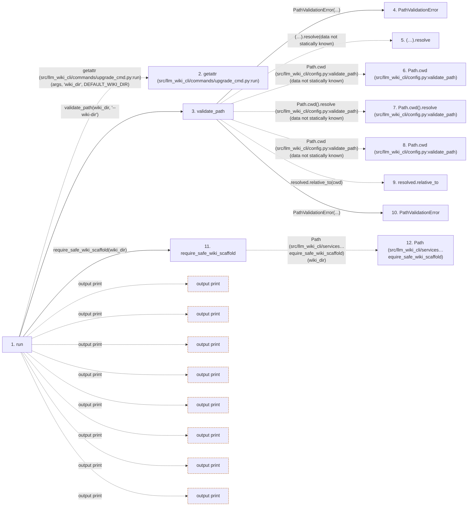

# upgrade

**Entry point:** `run` (`cli`)
**Source:** [upgrade_cmd](../modules/upgrade_cmd.md)
**Modules touched:** [bootstrap_recovery](../modules/bootstrap_recovery.md), [canonical_json](../modules/canonical_json.md), [common](../modules/common.md), [config](../modules/config.md), and 62 more

**Complete modules touched:**

- [bootstrap_recovery](../modules/bootstrap_recovery.md)
- [canonical_json](../modules/canonical_json.md)
- [common](../modules/common.md)
- [config](../modules/config.md)
- [context_packet](../modules/context_packet.md)
- [context_service](../modules/context_service.md)
- [current_contracts](../modules/current_contracts.md)
- [data_flow](../modules/data_flow.md)
- [documentation_queries](../modules/documentation_queries.md)
- [documentation_query_builder](../modules/documentation_query_builder.md)
- [entrypoints](../modules/entrypoints.md)
- [extraction_service](../modules/extraction_service.md)
- [filesystem_guard](../modules/filesystem_guard.md)
- [immutable](../modules/immutable.md)
- [implementation_evidence](../modules/implementation_evidence.md)
- [imports](../modules/imports.md)
- [infrastructure_inventory](../modules/infrastructure_inventory.md)
- [io](../modules/io.md)
- [knowledge_artifacts](../modules/knowledge_artifacts.md)
- [knowledge_consumption](../modules/knowledge_consumption.md)
- [knowledge_envelope](../modules/knowledge_envelope.md)
- [knowledge_evidence](../modules/knowledge_evidence.md)
- [knowledge_freshness](../modules/knowledge_freshness.md)
- [knowledge_governance](../modules/knowledge_governance.md)
- [knowledge_graph](../modules/knowledge_graph.md)
- [knowledge_index](../modules/knowledge_index.md)
- [knowledge_loader](../modules/knowledge_loader.md)
- [knowledge_model](../modules/knowledge_model.md)
- [knowledge_orchestration](../modules/knowledge_orchestration.md)
- [knowledge_packs](../modules/knowledge_packs.md)
- [knowledge_reuse](../modules/knowledge_reuse.md)
- [knowledge_storage](../modules/knowledge_storage.md)
- [knowledge_storage_io](../modules/knowledge_storage_io.md)
- [knowledge_storage_lifecycle](../modules/knowledge_storage_lifecycle.md)
- [knowledge_verification](../modules/knowledge_verification.md)
- [legacy_hooks](../modules/legacy_hooks.md)
- [maintenance_evidence](../modules/maintenance_evidence.md)
- [maintenance_projection](../modules/maintenance_projection.md)
- [maintenance_protocol](../modules/maintenance_protocol.md)
- [maintenance_service](../modules/maintenance_service.md)
- [maintenance_shapes](../modules/maintenance_shapes.md)
- [maintenance_state](../modules/maintenance_state.md)
- [maintenance_status](../modules/maintenance_status.md)
- [manifest_storage](../modules/manifest_storage.md)
- [markdown_sections](../modules/markdown_sections.md)
- [paths](../modules/paths.md)
- [plugins](../modules/plugins.md)
- [python_implementation](../modules/python_implementation.md)
- [rendering_lifecycle](../modules/rendering_lifecycle.md)
- [section_ownership](../modules/section_ownership.md)
- [services_dependencies](../modules/services_dependencies.md)
- [services_schema](../modules/services_schema.md)
- [skills](../modules/skills.md)
- [source_retirement](../modules/source_retirement.md)
- [source_selection](../modules/source_selection.md)
- [source_snapshot](../modules/source_snapshot.md)
- [storage_spool](../modules/storage_spool.md)
- [sync_manifest](../modules/sync_manifest.md)
- [upgrade_cmd](../modules/upgrade_cmd.md)
- [validation](../modules/validation.md)
- [verification_contracts](../modules/verification_contracts.md)
- [wiki_lifecycle](../modules/wiki_lifecycle.md)
- [wiki_media](../modules/wiki_media.md)
- [wiki_surface](../modules/wiki_surface.md)
- [wiki_surface_index](../modules/wiki_surface_index.md)
- [wiki_write_basis](../modules/wiki_write_basis.md)

## Call sequence

> Static overview in presentation order, not runtime execution order. Arrows retain captured callers; representative internal continuations and boundary examples precede repeated helper detail.

```mermaid
sequenceDiagram
    participant p0 as run
    participant p1 as validate_path
    participant p2 as require_safe_wiki_scaffold
    participant p3 as require_safe_config_path
    participant p4 as remove_legacy_hooks
    participant p5 as inspect_config
    participant p6 as resolve_source_selection
    participant p7 as _resolve_agent
    participant p8 as _require_replaceable_schema_path
    participant p9 as _preflight_cleanup_agent
    participant p10 as verify_reference_skill
    participant p11 as upgrade_current_knowledge
    participant p12 as require_config_inspection_unchanged
    participant p13 as _provision_reference_skill_guarded
    participant p14 as select_render_profile
    participant p15 as _upgrade_schema
    participant p16 as _upgrade_dirs
    participant p17 as write_config
    participant p18 as require_committed_config
    participant p19 as _target_cleanup_is_ready
    participant p20 as _cleanup_recorded_source
    participant p21 as inspect_legacy_hooks
    participant p22 as get_agent_config_path
    participant p23 as config_requires_manual_recovery
    participant p24 as skills_install_dir
    participant p25 as reference_recovery_command
    participant p26 as current_contract_defaults
    participant p27 as formatted_json_bytes
    participant p28 as unlink_guarded_bytes
    participant p29 as getattr (src/llm_wiki_cli/commands/upgrade_cmd.py:run)
    participant p30 as stored.get
    p0->>p1: validate_path
    p0->>p2: require_safe_wiki_scaffold
    p0->>p3: require_safe_config_path
    p0->>p4: remove_legacy_hooks
    p0->>p5: inspect_config
    p0->>p6: resolve_source_selection
    p0->>p7: _resolve_agent
    p0->>p8: _require_replaceable_schema_path
    p0->>p9: _preflight_cleanup_agent
    p0->>p10: verify_reference_skill
    p0->>p11: upgrade_current_knowledge
    p0->>p12: require_config_inspection_unchanged
    p0->>p13: _provision_reference_skill_guarded
    p0->>p14: select_render_profile
    p0->>p15: _upgrade_schema
    p0->>p16: _upgrade_dirs
    p0->>p17: write_config
    p0->>p18: require_committed_config
    p0->>p19: _target_cleanup_is_ready
    p0->>p20: _cleanup_recorded_source
    p0->>p21: inspect_legacy_hooks
    p0->>p22: get_agent_config_path
    p0->>p23: config_requires_manual_recovery
    p0->>p24: skills_install_dir
    p0->>p25: reference_recovery_command
    p0->>p26: current_contract_defaults
    p0->>p27: formatted_json_bytes
    p0->>p28: unlink_guarded_bytes
    p0-->>p29: getattr (src/llm_wiki_cli/commands/upgrade_cmd.py:run)(args, 'wiki_dir', DEFAULT_WIKI_DIR)
    p0-->>p30: stored.get('source_selection')
```

<!-- Auto-generated from static call edges. Dashed arrows are external or unresolved calls. Reviewed runtime conditions and side effects belong in Behavior. -->

> Call sequence diagram shows 30 of 3969 interactions; 3939 omitted to keep the visualization within the 30-interaction and generated-diagram limits, with uncertain identities omitted rather than inferred.

> Captured boundary calls: external 1 of 1411 (1410 omitted); unresolved 1 of 863 (862 omitted). These counts cover the captured static trace.

Omitted captured detail, grouped by actual caller occurrence and target module:

| Caller | Parent step | Target module | Kind | Omitted interactions |
| --- | --- | --- | --- | --- |
| `src/llm_wiki_cli/config.py:validate_path` | 3 | [src/llm_wiki_cli/config.py](../modules/config.md) | internal | 2 |
| `src/llm_wiki_cli/config.py:validate_path` | 3 | - | unresolved | 3 |
| `src/llm_wiki_cli/config.py:validate_path` | 3 | - | external | 2 |
| `src/llm_wiki_cli/services/wiki_lifecycle.py:require_safe_wiki_scaffold` | 11 | - | external | 3 |
| `src/llm_wiki_cli/services/wiki_lifecycle.py:require_safe_wiki_scaffold` | 11 | [src/llm_wiki_cli/services/wiki_surface.py](../modules/wiki_surface.md) | internal | 1 |
| `src/llm_wiki_cli/services/wiki_surface.py:iter_directory_kinds` | 14 | - | external | 1 |
| `src/llm_wiki_cli/services/wiki_lifecycle.py:require_safe_wiki_scaffold` | 11 | [src/llm_wiki_cli/services/io.py](../modules/io.md) | internal | 1 |
| `src/llm_wiki_cli/services/io.py:first_unsafe_path_component` | 17 | - | external | 20 |
> Omission summary shows 8 of 972 groups; 964 further groups are not expanded here. Counts above include all omitted interactions.
> Detailed flow queries retain their own coverage and limits; omitted paths may execute at runtime.

> Trace truncated at the depth limit; deeper calls are omitted.

## Data flow

<!-- Auto-generated static analysis. Treat values and boundaries as best-effort hints, not runtime proof. -->

### Analysis coverage

**Effect analysis partially available.** Flow assembly and source effect analysis are separate; empty observations do not prove an empty handler body.

Source steps: 1696; effect analysis evaluated: 1095, partial: 86, unavailable: 515. Counts include steps omitted from the displayed trace.

Collector observations for 1181 source steps with known totals: observed: 7774, emitted: 7168, omitted: 606. Unavailable totals are excluded.

- Callable record unavailable for one or more source steps; those steps have no represented callable body.
- Effect collector omitted observations before flow assembly; displayed effects are partial.
- Effect collector totals unavailable; observed counts cover captured records only.

| Step | Callable record | Effect analysis | Collector totals | Observed | Emitted | Omitted |
|---|---|---|---|---:|---:|---:|
| `run` | `available` | `partial` | `available` | `118` | `20` | `98` |
| `getattr (src/llm_wiki_cli/commands/upgrade_cmd.py:run)` | `not_applicable` | `not_applicable` | `not_applicable` | — | — | — |
| `validate_path` | `available` | `evaluated` | `available` | `3` | `3` | `0` |
| `PathValidationError` | `unavailable` | `unavailable` | `unavailable` | — | — | — |
| `(…).resolve` | `not_applicable` | `not_applicable` | `not_applicable` | — | — | — |
| `Path.cwd (src/llm_wiki_cli/config.py:validate_path)` | `not_applicable` | `not_applicable` | `not_applicable` | — | — | — |
| `Path.cwd().resolve (src/llm_wiki_cli/config.py:validate_path)` | `not_applicable` | `not_applicable` | `not_applicable` | — | — | — |
| `Path.cwd (src/llm_wiki_cli/config.py:validate_path)` | `not_applicable` | `not_applicable` | `not_applicable` | — | — | — |
| `resolved.relative_to` | `not_applicable` | `not_applicable` | `not_applicable` | — | — | — |
| `PathValidationError` | `unavailable` | `unavailable` | `unavailable` | — | — | — |
| `require_safe_wiki_scaffold` | `available` | `evaluated` | `available` | `1` | `1` | `0` |
| `Path (src/llm_wiki_cli/services…equire_safe_wiki_scaffold)` | `not_applicable` | `not_applicable` | `not_applicable` | — | — | — |

### Step data

| Step | Inputs | Reads | Writes | Returns |
|---|---|---|---|---|
| `run` | `args` | `DEFAULT_WIKI_DIR`, `WikiScaffoldPathError`, `sys`, `LegacyHookError`, `sys`, `AgentConfigState`, `sys`, `AgentConfigState` | `config[...]`, `config[...]`, `config[...]` | - |
| `getattr (src/llm_wiki_cli/commands/upgrade_cmd.py:run)` | - | - | - | - |
| `validate_path` | `path: str`, `label: str` | - | - | `resolved` |
| `PathValidationError` | - | - | - | - |
| `(…).resolve` | - | - | - | - |
| `Path.cwd (src/llm_wiki_cli/config.py:validate_path)` | - | - | - | - |
| `Path.cwd().resolve (src/llm_wiki_cli/config.py:validate_path)` | - | - | - | - |
| `Path.cwd (src/llm_wiki_cli/config.py:validate_path)` | - | - | - | - |
| `resolved.relative_to` | - | - | - | - |
| `PathValidationError` | - | - | - | - |
| `require_safe_wiki_scaffold` | `wiki_dir: Union[str, Path]` | - | - | - |
| `Path (src/llm_wiki_cli/services…equire_safe_wiki_scaffold)` | - | - | - | - |

### Call data

| From | To | Line | Call |
|---|---|---:|---|
| run | getattr (src/llm_wiki_cli/commands/upgrade_cmd.py:run) | 600 | `getattr(args, 'wiki_dir', DEFAULT_WIKI_DIR)` |
| run | validate_path | 601 | `validate_path(wiki_dir, '--wiki-dir')` |
| validate_path | PathValidationError | 134 | `PathValidationError(...)` |
| validate_path | (…).resolve | 135 | `(Path.cwd() / path).resolve(data not statically known)` |
| validate_path | Path.cwd (src/llm_wiki_cli/config.py:validate_path) | 135 | `Path.cwd(data not statically known)` |
| validate_path | Path.cwd().resolve (src/llm_wiki_cli/config.py:validate_path) | 136 | `Path.cwd().resolve(data not statically known)` |
| validate_path | Path.cwd (src/llm_wiki_cli/config.py:validate_path) | 136 | `Path.cwd(data not statically known)` |
| validate_path | resolved.relative_to | 138 | `resolved.relative_to(cwd)` |
| validate_path | PathValidationError | 140 | `PathValidationError(...)` |
| run | require_safe_wiki_scaffold | 603 | `require_safe_wiki_scaffold(wiki_dir)` |
| require_safe_wiki_scaffold | Path (src/llm_wiki_cli/services…equire_safe_wiki_scaffold) | 43 | `Path(wiki_dir)` |

### Boundary effects

| Kind | Target | Step | Line |
|---|---|---|---:|
| output | `print` | `run` | 606 |
| output | `print` | `run` | 611 |
| output | `print` | `run` | 615 |
| output | `print` | `run` | 617 |
| output | `print` | `run` | 634 |
| output | `print` | `run` | 646 |
| output | `print` | `run` | 657 |
| output | `print` | `run` | 665 |

### Static analysis gaps

| Kind | Step | Target | Line |
|---|---|---|---:|
| external_call | `run` | `getattr` | 600 |
| unresolved_call | `validate_path` | `(Path.cwd() / path).resolve` | 135 |
| external_call | `validate_path` | `Path.cwd` | 135 |
| unresolved_call | `validate_path` | `Path.cwd().resolve` | 136 |
| external_call | `validate_path` | `Path.cwd` | 136 |
| unresolved_call | `validate_path` | `resolved.relative_to` | 138 |
| step_limit | `run` | `first 12 steps` | 0 |
| truncated_flow | `run` | `depth limit` | 0 |

## Behavior

This flow starts at `run` and is classified as `cli`. The generated call and data-flow sections are bounded static projections; runtime conditions and side effects require source-level confirmation.

Project upgrade refreshes owned recovery instructions and preserves configured
skills opt-out, source selection and user-authored text outside the managed block.
An older default installation receives the current reference or inline recipe.
Neither refreshed instructions nor storage upgrade alone clears captured unknown
evidence: diagnosis and an authorized owning writer retain distinct roles.
