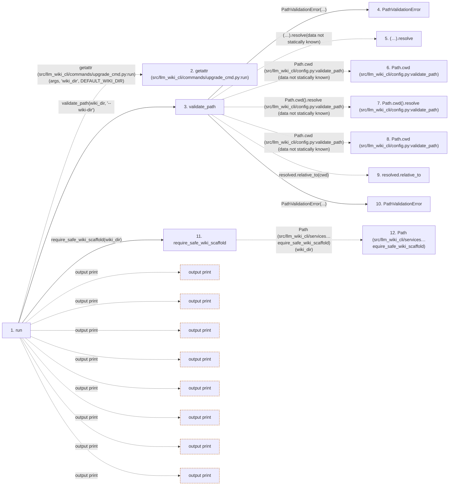

# upgrade

**Entry point:** `run` (`cli`)
**Source:** [upgrade_cmd](../modules/upgrade_cmd.md)
**Modules touched:** [config](../modules/config.md), [filesystem_guard](../modules/filesystem_guard.md), [io](../modules/io.md), [knowledge_evidence](../modules/knowledge_evidence.md), and 12 more

**Complete modules touched:**

- [config](../modules/config.md)
- [filesystem_guard](../modules/filesystem_guard.md)
- [io](../modules/io.md)
- [knowledge_evidence](../modules/knowledge_evidence.md)
- [legacy_hooks](../modules/legacy_hooks.md)
- [paths](../modules/paths.md)
- [plugins](../modules/plugins.md)
- [rendering_lifecycle](../modules/rendering_lifecycle.md)
- [services_schema](../modules/services_schema.md)
- [skills](../modules/skills.md)
- [source_selection](../modules/source_selection.md)
- [upgrade_cmd](../modules/upgrade_cmd.md)
- [validation](../modules/validation.md)
- [wiki_lifecycle](../modules/wiki_lifecycle.md)
- [wiki_surface](../modules/wiki_surface.md)
- [wiki_write_basis](../modules/wiki_write_basis.md)

## Call sequence

> Static overview in presentation order, not runtime execution order. Arrows retain captured callers; siblings are shown before deeper helper detail.

```mermaid
sequenceDiagram
    participant p0 as run
    participant p1 as getattr (src/llm_wiki_cli/commands/upgrade_cmd.py:run)
    participant p2 as validate_path
    participant p3 as require_safe_wiki_scaffold
    participant p4 as require_safe_config_path
    participant p5 as print (src/llm_wiki_cli/commands/upgrade_cmd.py:run)
    participant p6 as SystemExit (src/llm_wiki_cli/commands/upgrade_cmd.py:run)
    participant p7 as remove_legacy_hooks
    participant p8 as inspect_legacy_hooks
    participant p9 as inspect_config
    participant p10 as get_agent_config_path
    participant p11 as dict (src/llm_wiki_cli/commands/upgrade_cmd.py:run)
    participant p12 as config_requires_manual_recovery
    participant p13 as Path (src/llm_wiki_cli/commands/upgrade_cmd.py:run)
    participant p14 as stored.get
    participant p15 as isinstance (src/llm_wiki_cli/commands/upgrade_cmd.py:run)
    p0-->>p1: getattr (src/llm_wiki_cli/commands/upgrade_cmd.py:run)(args, 'wiki_dir', DEFAULT_WIKI_DIR)
    p0->>p2: validate_path
    p0->>p3: require_safe_wiki_scaffold
    p0->>p4: require_safe_config_path
    p0-->>p5: print (src/llm_wiki_cli/commands/upgrade_cmd.py:run)(..., file=sys.stderr)
    p0-->>p6: SystemExit (src/llm_wiki_cli/commands/upgrade_cmd.py:run)(2)
    p0-->>p5: print (src/llm_wiki_cli/commands/upgrade_cmd.py:run)('Legacy Git Hook Cleanup:')
    p0->>p7: remove_legacy_hooks
    p0->>p8: inspect_legacy_hooks
    p0-->>p5: print (src/llm_wiki_cli/commands/upgrade_cmd.py:run)(..., file=sys.stderr)
    p0-->>p6: SystemExit (src/llm_wiki_cli/commands/upgrade_cmd.py:run)(2)
    p0-->>p5: print (src/llm_wiki_cli/commands/upgrade_cmd.py:run)(...)
    p0->>p9: inspect_config
    p0->>p10: get_agent_config_path
    p0-->>p5: print (src/llm_wiki_cli/commands/upgrade_cmd.py:run)(..., file=sys.stderr)
    p0-->>p6: SystemExit (src/llm_wiki_cli/commands/upgrade_cmd.py:run)(2)
    p0-->>p5: print (src/llm_wiki_cli/commands/upgrade_cmd.py:run)(..., file=sys.stderr)
    p0-->>p6: SystemExit (src/llm_wiki_cli/commands/upgrade_cmd.py:run)(2)
    p0-->>p11: dict (src/llm_wiki_cli/commands/upgrade_cmd.py:run)(config_inspection.data)
    p0->>p12: config_requires_manual_recovery
    p0-->>p5: print (src/llm_wiki_cli/commands/upgrade_cmd.py:run)(..., file=sys.stderr)
    p0-->>p13: Path (src/llm_wiki_cli/commands/upgrade_cmd.py:run)(wiki_dir)
    p0-->>p6: SystemExit (src/llm_wiki_cli/commands/upgrade_cmd.py:run)(2)
    p0-->>p5: print (src/llm_wiki_cli/commands/upgrade_cmd.py:run)(..., file=sys.stderr)
    p0-->>p6: SystemExit (src/llm_wiki_cli/commands/upgrade_cmd.py:run)(2)
    p0-->>p5: print (src/llm_wiki_cli/commands/upgrade_cmd.py:run)('Error: local agent config path is unsafe', file=sys.stderr)
    p0-->>p6: SystemExit (src/llm_wiki_cli/commands/upgrade_cmd.py:run)(2)
    p0-->>p1: getattr (src/llm_wiki_cli/commands/upgrade_cmd.py:run)(args, 'source_selection', None)
    p0-->>p14: stored.get('source_selection')
    p0-->>p15: isinstance (src/llm_wiki_cli/commands/upgrade_cmd.py:run)(stored_selection, str)
```

<!-- Auto-generated from static call edges. Dashed arrows are external or unresolved calls. Reviewed runtime conditions and side effects belong in Behavior. -->

> Call sequence diagram shows 30 of 1687 interactions; 1657 omitted to keep the visualization within the 30-interaction and generated-diagram limits, with uncertain identities omitted rather than inferred.

> Captured boundary calls: external 21 of 737 (716 omitted); unresolved 1 of 357 (356 omitted). These counts cover the captured static trace.

Omitted captured detail, grouped by actual caller occurrence and target module:

| Caller | Parent step | Target module | Kind | Omitted interactions |
| --- | --- | --- | --- | --- |
| `src/llm_wiki_cli/config.py:validate_path` | 3 | [src/llm_wiki_cli/config.py](../modules/config.md) | internal | 2 |
| `src/llm_wiki_cli/config.py:validate_path` | 3 | - | unresolved | 3 |
| `src/llm_wiki_cli/config.py:validate_path` | 3 | - | external | 2 |
| `src/llm_wiki_cli/services/wiki_lifecycle.py:require_safe_wiki_scaffold` | 11 | - | external | 3 |
| `src/llm_wiki_cli/services/wiki_lifecycle.py:require_safe_wiki_scaffold` | 11 | [src/llm_wiki_cli/services/wiki_surface.py](../modules/wiki_surface.md) | internal | 1 |
| `src/llm_wiki_cli/services/wiki_surface.py:iter_directory_kinds` | 14 | - | external | 1 |
| `src/llm_wiki_cli/services/wiki_lifecycle.py:require_safe_wiki_scaffold` | 11 | [src/llm_wiki_cli/services/io.py](../modules/io.md) | internal | 1 |
| `src/llm_wiki_cli/services/io.py:first_unsafe_path_component` | 17 | - | external | 20 |
> Omission summary shows 8 of 376 groups; 368 further groups are not expanded here. Counts above include all omitted interactions.
> Detailed flow queries retain their own coverage and limits; omitted paths may execute at runtime.

> Trace truncated at the depth limit; deeper calls are omitted.

## Data flow

<!-- Auto-generated static analysis. Treat values and boundaries as best-effort hints, not runtime proof. -->

### Step data

| Step | Inputs | Reads | Writes | Returns |
|---|---|---|---|---|
| `run` | `args` | `DEFAULT_WIKI_DIR`, `WikiScaffoldPathError`, `sys`, `LegacyHookError`, `sys`, `AgentConfigState`, `sys`, `AgentConfigState` | `config[...]`, `config[...]`, `config[...]` | - |
| `getattr (src/llm_wiki_cli/commands/upgrade_cmd.py:run)` | - | - | - | - |
| `validate_path` | `path: str`, `label: str` | - | - | `resolved` |
| `PathValidationError` | - | - | - | - |
| `(…).resolve` | - | - | - | - |
| `Path.cwd (src/llm_wiki_cli/config.py:validate_path)` | - | - | - | - |
| `Path.cwd().resolve (src/llm_wiki_cli/config.py:validate_path)` | - | - | - | - |
| `Path.cwd (src/llm_wiki_cli/config.py:validate_path)` | - | - | - | - |
| `resolved.relative_to` | - | - | - | - |
| `PathValidationError` | - | - | - | - |
| `require_safe_wiki_scaffold` | `wiki_dir: Union[str, Path]` | - | - | - |
| `Path (src/llm_wiki_cli/services…equire_safe_wiki_scaffold)` | - | - | - | - |

### Call data

| From | To | Line | Call |
|---|---|---:|---|
| run | getattr (src/llm_wiki_cli/commands/upgrade_cmd.py:run) | 585 | `getattr(args, 'wiki_dir', DEFAULT_WIKI_DIR)` |
| run | validate_path | 586 | `validate_path(wiki_dir, '--wiki-dir')` |
| validate_path | PathValidationError | 134 | `PathValidationError(...)` |
| validate_path | (…).resolve | 135 | `(Path.cwd() / path).resolve(data not statically known)` |
| validate_path | Path.cwd (src/llm_wiki_cli/config.py:validate_path) | 135 | `Path.cwd(data not statically known)` |
| validate_path | Path.cwd().resolve (src/llm_wiki_cli/config.py:validate_path) | 136 | `Path.cwd().resolve(data not statically known)` |
| validate_path | Path.cwd (src/llm_wiki_cli/config.py:validate_path) | 136 | `Path.cwd(data not statically known)` |
| validate_path | resolved.relative_to | 138 | `resolved.relative_to(cwd)` |
| validate_path | PathValidationError | 140 | `PathValidationError(...)` |
| run | require_safe_wiki_scaffold | 588 | `require_safe_wiki_scaffold(wiki_dir)` |
| require_safe_wiki_scaffold | Path (src/llm_wiki_cli/services…equire_safe_wiki_scaffold) | 43 | `Path(wiki_dir)` |

### Boundary effects

| Kind | Target | Step | Line |
|---|---|---|---:|
| output | `print` | `run` | 591 |
| output | `print` | `run` | 596 |
| output | `print` | `run` | 600 |
| output | `print` | `run` | 602 |
| output | `print` | `run` | 619 |
| output | `print` | `run` | 631 |
| output | `print` | `run` | 642 |
| output | `print` | `run` | 650 |

### Static analysis gaps

| Kind | Step | Target | Line |
|---|---|---|---:|
| external_call | `run` | `getattr` | 585 |
| unresolved_call | `validate_path` | `(Path.cwd() / path).resolve` | 135 |
| external_call | `validate_path` | `Path.cwd` | 135 |
| unresolved_call | `validate_path` | `Path.cwd().resolve` | 136 |
| external_call | `validate_path` | `Path.cwd` | 136 |
| unresolved_call | `validate_path` | `resolved.relative_to` | 138 |
| step_limit | `run` | `first 12 steps` | 0 |
| truncated_flow | `run` | `depth limit` | 0 |

## Behavior

This flow starts at `run` and is classified as `cli`. The generated call and data-flow sections are bounded static projections; runtime conditions and side effects require source-level confirmation.
