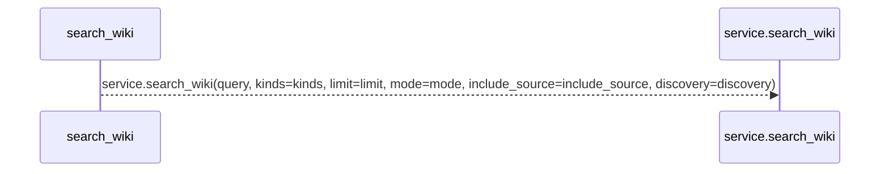
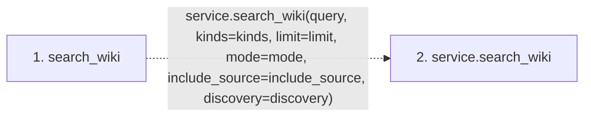

# search_wiki

**Entry point:** `search_wiki` (`mcp`)
**Source:** [mcp_server](../modules/mcp_server.md)
**Modules touched:** [mcp_server](../modules/mcp_server.md)

## Call sequence

> Static overview in presentation order, not runtime execution order. Arrows retain captured callers; representative internal continuations and boundary examples precede repeated helper detail.

<!-- Auto-generated from static call edges. Dashed arrows are external or unresolved calls. Reviewed runtime conditions and side effects belong in Behavior. -->

> Call sequence diagram shows 1 of 1 interactions; 0 omitted to keep the visualization within the 30-interaction and generated-diagram limits, with uncertain identities omitted rather than inferred.

> Captured boundary calls: external 0 of 0 (0 omitted); unresolved 1 of 1 (0 omitted). These counts cover the captured static trace.
> Detailed flow queries retain their own coverage and limits; omitted paths may execute at runtime.

## Data flow

<!-- Auto-generated static analysis. Treat values and boundaries as best-effort hints, not runtime proof. -->

### Step data

| Step | Inputs | Reads | Writes | Returns |
|---|---|---|---|---|
| `search_wiki` | `query: str`, `kinds: list[str] \| None`, `limit: int`, `mode: str`, `include_source: bool`, `discovery: str \| None` | - | - | `service.search_wiki(...)` |
| `service.search_wiki` | - | - | - | - |

### Call data

| From | To | Line | Call |
|---|---|---:|---|
| search_wiki | service.search_wiki | 1494 | `service.search_wiki(query, kinds=kinds, limit=limit, mode=mode, include_source=include_source, discovery=discovery)` |

### Boundary effects

*No boundary effects detected.*

### Static analysis gaps

| Kind | Step | Target | Line |
|---|---|---|---:|
| unresolved_call | `search_wiki` | `service.search_wiki` | 1494 |

## Behavior

Checks the server source-selection pin and validates the query, requested surface kinds, limit and search mode. The default is deterministic lexical ranking through the shared search owner, with scores, match reasons and corpus/result bounds. Explicit substring mode retains case-insensitive literal matching. Results identify canonical pages and local snippets; they are discovery candidates, not proof of complete coverage or runtime behavior.
