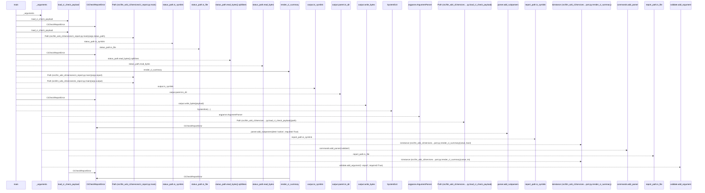
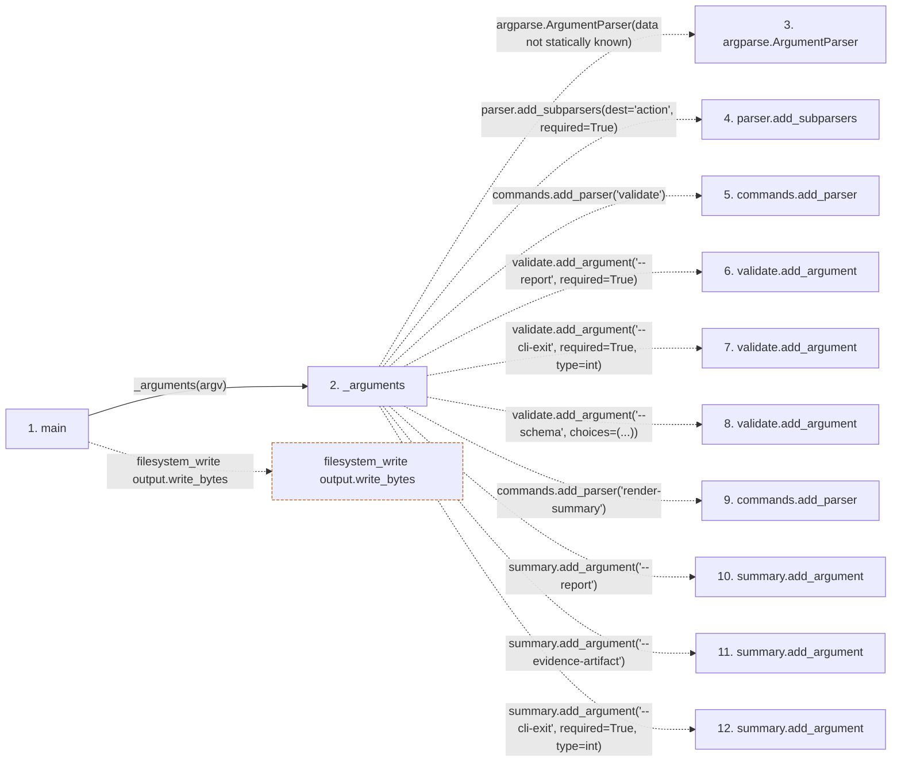

# ci_report

**Entry point:** `main` (`process`)
**Source:** [ci_report](../modules/ci_report.md)
**Modules touched:** [analysis_compatibility](../modules/analysis_compatibility.md), [ci_report](../modules/ci_report.md), [health_contract](../modules/health_contract.md), [health_summary](../modules/health_summary.md), and 1 more

**Complete modules touched:**

- [analysis_compatibility](../modules/analysis_compatibility.md)
- [ci_report](../modules/ci_report.md)
- [health_contract](../modules/health_contract.md)
- [health_summary](../modules/health_summary.md)
- [knowledge_observability](../modules/knowledge_observability.md)

**Related modules:** [doctor_service](../modules/doctor_service.md), [health_contract](../modules/health_contract.md), [health_summary](../modules/health_summary.md), and 3 more

**Complete related modules:**

- [doctor_service](../modules/doctor_service.md)
- [health_contract](../modules/health_contract.md)
- [health_summary](../modules/health_summary.md)
- [knowledge_observability](../modules/knowledge_observability.md)
- [lint_service](../modules/lint_service.md)
- [services_contracts](../modules/services_contracts.md)

## Call sequence

> Static overview in presentation order, not runtime execution order. Arrows retain captured callers; siblings are shown before deeper helper detail.

<!-- Auto-generated from static call edges. Dashed arrows are external or unresolved calls. Reviewed runtime conditions and side effects belong in Behavior. -->

> Call sequence diagram shows 30 of 559 interactions; 529 omitted to keep the visualization within the 30-interaction and generated-diagram limits, with uncertain identities omitted rather than inferred.

> Captured boundary calls: external 8 of 128 (120 omitted); unresolved 12 of 107 (95 omitted). These counts cover the captured static trace.

Omitted captured detail, grouped by actual caller occurrence and target module:

| Caller | Parent step | Target module | Kind | Omitted interactions |
| --- | --- | --- | --- | --- |
| `src/llm_wiki_cli/services/ci_report.py:_arguments` | 2 | - | unresolved | 17 |
| `src/llm_wiki_cli/services/ci_report.py:load_ci_check_payload` | 24 | - | unresolved | 1 |
| `src/llm_wiki_cli/services/ci_report.py:load_ci_check_payload` | 24 | - | external | 1 |
| `src/llm_wiki_cli/services/ci_report.py:load_ci_check_payload` | 24 | [src/llm_wiki_cli/services/ci_report.py](../modules/ci_report.md) | internal | 2 |
| `src/llm_wiki_cli/services/ci_report.py:validate_ci_check_payload` | 32 | - | external | 9 |
| `src/llm_wiki_cli/services/ci_report.py:validate_ci_check_payload` | 32 | - | unresolved | 2 |
| `src/llm_wiki_cli/services/ci_report.py:validate_ci_check_payload` | 32 | [src/llm_wiki_cli/services/ci_report.py](../modules/ci_report.md) | internal | 31 |
| `src/llm_wiki_cli/services/ci_report.py:_validate_ci_v3` | 35 | [src/llm_wiki_cli/services/ci_report.py](../modules/ci_report.md) | internal | 4 |
> Omission summary shows 8 of 72 groups; 64 further groups are not expanded here. Counts above include all omitted interactions.
> Detailed flow queries retain their own coverage and limits; omitted paths may execute at runtime.

> Trace truncated at the depth limit; deeper calls are omitted.

## Data flow

<!-- Auto-generated static analysis. Treat values and boundaries as best-effort hints, not runtime proof. -->

### Step data

| Step | Inputs | Reads | Writes | Returns |
|---|---|---|---|---|
| `main` | `argv: Sequence[str] \| None` | `CiCheckReportError` | - | `0`, `0` |
| `_arguments` | `argv: Sequence[str] \| None` | - | - | `parser.parse_args(...)` |
| `argparse.ArgumentParser` | - | - | - | - |
| `parser.add_subparsers` | - | - | - | - |
| `commands.add_parser` | - | - | - | - |
| `validate.add_argument` | - | - | - | - |
| `validate.add_argument` | - | - | - | - |
| `validate.add_argument` | - | - | - | - |
| `commands.add_parser` | - | - | - | - |
| `summary.add_argument` | - | - | - | - |
| `summary.add_argument` | - | - | - | - |
| `summary.add_argument` | - | - | - | - |

### Call data

| From | To | Line | Call |
|---|---|---:|---|
| main | _arguments | 1569 | `_arguments(argv)` |
| _arguments | argparse.ArgumentParser | 1542 | `argparse.ArgumentParser(data not statically known)` |
| _arguments | parser.add_subparsers | 1543 | `parser.add_subparsers(dest='action', required=True)` |
| _arguments | commands.add_parser | 1544 | `commands.add_parser('validate')` |
| _arguments | validate.add_argument | 1545 | `validate.add_argument('--report', required=True)` |
| _arguments | validate.add_argument | 1546 | `validate.add_argument('--cli-exit', required=True, type=int)` |
| _arguments | validate.add_argument | 1547 | `validate.add_argument('--schema', choices=(...))` |
| _arguments | commands.add_parser | 1549 | `commands.add_parser('render-summary')` |
| _arguments | summary.add_argument | 1550 | `summary.add_argument('--report')` |
| _arguments | summary.add_argument | 1551 | `summary.add_argument('--evidence-artifact')` |
| _arguments | summary.add_argument | 1552 | `summary.add_argument('--cli-exit', required=True, type=int)` |

### Boundary effects

| Kind | Target | Step | Line |
|---|---|---|---:|
| filesystem_write | `output.write_bytes` | `main` | 1609 |

### Static analysis gaps

| Kind | Step | Target | Line |
|---|---|---|---:|
| external_call | `_arguments` | `argparse.ArgumentParser` | 1542 |
| unresolved_call | `_arguments` | `parser.add_subparsers` | 1543 |
| unresolved_call | `_arguments` | `commands.add_parser` | 1544 |
| unresolved_call | `_arguments` | `validate.add_argument` | 1545 |
| unresolved_call | `_arguments` | `validate.add_argument` | 1546 |
| unresolved_call | `_arguments` | `validate.add_argument` | 1547 |
| unresolved_call | `_arguments` | `commands.add_parser` | 1549 |
| unresolved_call | `_arguments` | `summary.add_argument` | 1550 |
| unresolved_call | `_arguments` | `summary.add_argument` | 1551 |
| unresolved_call | `_arguments` | `summary.add_argument` | 1552 |
| step_limit | `main` | `first 12 steps` | 0 |
| truncated_flow | `main` | `depth limit` | 0 |

## Behavior

This flow starts at `main` and is classified as `process`. The generated call and data-flow sections are bounded static projections; runtime conditions and side effects require source-level confirmation.
