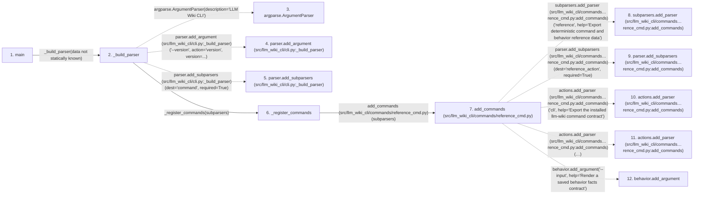

# cli

**Entry point:** `main` (`process`)
**Source:** [cli](../modules/cli.md)
**Modules touched:** [analysis_compatibility](../modules/analysis_compatibility.md), [cli](../modules/cli.md), [docs_cmd](../modules/docs_cmd.md), [helper_runtime](../modules/helper_runtime.md), and 5 more

**Complete modules touched:**

- [analysis_compatibility](../modules/analysis_compatibility.md)
- [cli](../modules/cli.md)
- [docs_cmd](../modules/docs_cmd.md)
- [helper_runtime](../modules/helper_runtime.md)
- [progress](../modules/progress.md)
- [publication_candidate_cmd](../modules/publication_candidate_cmd.md)
- [publication_cmd](../modules/publication_cmd.md)
- [reference_cmd](../modules/reference_cmd.md)
- [resource_diagnostics](../modules/resource_diagnostics.md)

**Related modules:** [analysis_compatibility](../modules/analysis_compatibility.md), [commands___init__](../modules/commands___init__.md), [config](../modules/config.md), [extraction_jobs](../modules/extraction_jobs.md), and 7 more

**Complete related modules:**

- [analysis_compatibility](../modules/analysis_compatibility.md)
- [commands___init__](../modules/commands___init__.md)
- [config](../modules/config.md)
- [extraction_jobs](../modules/extraction_jobs.md)
- [helper_runtime](../modules/helper_runtime.md)
- [llm_wiki_cli___init__](../modules/llm_wiki_cli___init__.md)
- [maintenance_queue](../modules/maintenance_queue.md)
- [progress](../modules/progress.md)
- [resource_diagnostics](../modules/resource_diagnostics.md)
- [runtime_output](../modules/runtime_output.md)
- [services_contracts](../modules/services_contracts.md)

## Call sequence

> Static overview in presentation order, not runtime execution order. Arrows retain captured callers; representative internal continuations and boundary examples precede repeated helper detail.

```mermaid
sequenceDiagram
    participant p0 as main
    participant p1 as _build_parser
    participant p2 as _report_cli_errors
    participant p3 as _helper_preparation_policy
    participant p4 as comparison_scope
    participant p5 as _dispatch_command
    participant p6 as helper_operation
    participant p7 as _register_commands
    participant p8 as _add_helper_preparation_arguments
    participant p9 as resource_failure_hint
    participant p10 as _add_init_command
    participant p11 as _add_extract_command
    participant p12 as _add_lint_command
    participant p13 as _add_prepare_extractors_command
    participant p14 as _add_ci_check_command
    participant p15 as _add_knowledge_command
    participant p16 as _add_team_command
    participant p17 as _add_trigger_agent_command
    participant p18 as _add_bootstrap_command
    participant p19 as _add_generate_prompt_command
    participant p20 as _add_metrics_command
    participant p21 as _add_review_command
    participant p22 as _add_search_command
    participant p23 as _add_status_command
    participant p24 as _add_queue_command
    participant p25 as _add_maintenance_command
    participant p26 as _add_query_command
    participant p27 as _add_task_context_command
    participant p28 as _add_mcp_command
    participant p29 as getattr (src/llm_wiki_cli/cli.py:main)
    participant p30 as parser.parse_args
    p0->>p1: _build_parser
    p0->>p2: _report_cli_errors
    p0->>p3: _helper_preparation_policy
    p0->>p4: comparison_scope
    p0->>p5: _dispatch_command
    p0->>p6: helper_operation
    p1->>p7: _register_commands
    p1->>p8: _add_helper_preparation_arguments
    p2->>p9: resource_failure_hint
    p7->>p10: _add_init_command
    p7->>p11: _add_extract_command
    p7->>p12: _add_lint_command
    p7->>p13: _add_prepare_extractors_command
    p7->>p14: _add_ci_check_command
    p7->>p15: _add_knowledge_command
    p7->>p16: _add_team_command
    p7->>p17: _add_trigger_agent_command
    p7->>p18: _add_bootstrap_command
    p7->>p19: _add_generate_prompt_command
    p7->>p20: _add_metrics_command
    p7->>p21: _add_review_command
    p7->>p22: _add_search_command
    p7->>p23: _add_status_command
    p7->>p24: _add_queue_command
    p7->>p25: _add_maintenance_command
    p7->>p26: _add_query_command
    p7->>p27: _add_task_context_command
    p7->>p28: _add_mcp_command
    p0-->>p29: getattr (src/llm_wiki_cli/cli.py:main)(args, 'comparison_policy', 'auto')
    p0-->>p30: parser.parse_args
```

<!-- Auto-generated from static call edges. Dashed arrows are external or unresolved calls. Reviewed runtime conditions and side effects belong in Behavior. -->

> Call sequence diagram shows 30 of 860 interactions; 830 omitted to keep the visualization within the 30-interaction and generated-diagram limits, with uncertain identities omitted rather than inferred.

> Captured boundary calls: external 1 of 56 (55 omitted); unresolved 1 of 643 (642 omitted). These counts cover the captured static trace.

Omitted captured detail, grouped by actual caller occurrence and target module:

| Caller | Parent step | Target module | Kind | Omitted interactions |
| --- | --- | --- | --- | --- |
| `src/llm_wiki_cli/cli.py:_build_parser` | 2 | - | external | 1 |
| `src/llm_wiki_cli/cli.py:_build_parser` | 2 | - | unresolved | 2 |
| `src/llm_wiki_cli/cli.py:_register_commands` | 6 | [src/llm_wiki_cli/commands/reference_cmd.py](../modules/reference_cmd.md) | internal | 1 |
| `src/llm_wiki_cli/commands/reference_cmd.py:add_commands` | 7 | - | unresolved | 9 |
| `src/llm_wiki_cli/cli.py:_add_init_command` | 17 | - | unresolved | 9 |
| `src/llm_wiki_cli/cli.py:_add_init_command` | 17 | [src/llm_wiki_cli/cli.py](../modules/cli.md) | internal | 2 |
| `src/llm_wiki_cli/cli.py:_add_helper_cache_argument` | 24 | - | unresolved | 1 |
| `src/llm_wiki_cli/cli.py:_add_source_selection_argument` | 29 | - | unresolved | 1 |
> Omission summary shows 8 of 119 groups; 111 further groups are not expanded here. Counts above include all omitted interactions.
> Detailed flow queries retain their own coverage and limits; omitted paths may execute at runtime.

> Trace truncated at the depth limit; deeper calls are omitted.

## Data flow

<!-- Auto-generated static analysis. Treat values and boundaries as best-effort hints, not runtime proof. -->

### Analysis coverage

**Effect analysis partially available.** Flow assembly and source effect analysis are separate; empty observations do not prove an empty handler body.

Source steps: 162; effect analysis evaluated: 159, partial: 1, unavailable: 2. Counts include steps omitted from the displayed trace.

Collector observations for 160 source steps with known totals: observed: 385, emitted: 381, omitted: 4. Unavailable totals are excluded.

- Callable record unavailable for one or more source steps; those steps have no represented callable body.
- Effect collector omitted observations before flow assembly; displayed effects are partial.
- Effect collector totals unavailable; observed counts cover captured records only.

| Step | Callable record | Effect analysis | Collector totals | Observed | Emitted | Omitted |
|---|---|---|---|---:|---:|---:|
| `main` | `available` | `evaluated` | `available` | `1` | `1` | `0` |
| `_build_parser` | `available` | `evaluated` | `available` | `2` | `2` | `0` |
| `argparse.ArgumentParser` | `not_applicable` | `not_applicable` | `not_applicable` | — | — | — |
| `parser.add_argument (src/llm_wiki_cli/cli.py:_build_parser)` | `not_applicable` | `not_applicable` | `not_applicable` | — | — | — |
| `parser.add_subparsers (src/llm_wiki_cli/cli.py:_build_parser)` | `not_applicable` | `not_applicable` | `not_applicable` | — | — | — |
| `_register_commands` | `available` | `evaluated` | `available` | `1` | `1` | `0` |
| `add_commands (src/llm_wiki_cli/commands/reference_cmd.py)` | `available` | `evaluated` | `available` | `1` | `1` | `0` |
| `subparsers.add_parser (src/llm_wiki_cli/commands…rence_cmd.py:add_commands)` | `not_applicable` | `not_applicable` | `not_applicable` | — | — | — |
| `parser.add_subparsers (src/llm_wiki_cli/commands…rence_cmd.py:add_commands)` | `not_applicable` | `not_applicable` | `not_applicable` | — | — | — |
| `actions.add_parser (src/llm_wiki_cli/commands…rence_cmd.py:add_commands)` | `not_applicable` | `not_applicable` | `not_applicable` | — | — | — |
| `actions.add_parser (src/llm_wiki_cli/commands…rence_cmd.py:add_commands)` | `not_applicable` | `not_applicable` | `not_applicable` | — | — | — |
| `behavior.add_argument` | `not_applicable` | `not_applicable` | `not_applicable` | — | — | — |

### Step data

| Step | Inputs | Reads | Writes | Returns |
|---|---|---|---|---|
| `main` | - | - | `args.helper_preparation` | - |
| `_build_parser` | - | `__version__` | - | `parser` |
| `argparse.ArgumentParser` | - | - | - | - |
| `parser.add_argument (src/llm_wiki_cli/cli.py:_build_parser)` | - | - | - | - |
| `parser.add_subparsers (src/llm_wiki_cli/cli.py:_build_parser)` | - | - | - | - |
| `_register_commands` | `subparsers` | - | - | - |
| `add_commands (src/llm_wiki_cli/commands/reference_cmd.py)` | `subparsers` | - | - | - |
| `subparsers.add_parser (src/llm_wiki_cli/commands…rence_cmd.py:add_commands)` | - | - | - | - |
| `parser.add_subparsers (src/llm_wiki_cli/commands…rence_cmd.py:add_commands)` | - | - | - | - |
| `actions.add_parser (src/llm_wiki_cli/commands…rence_cmd.py:add_commands)` | - | - | - | - |
| `actions.add_parser (src/llm_wiki_cli/commands…rence_cmd.py:add_commands)` | - | - | - | - |
| `behavior.add_argument` | - | - | - | - |

### Call data

| From | To | Line | Call |
|---|---|---:|---|
| main | _build_parser | 2789 | `_build_parser(data not statically known)` |
| _build_parser | argparse.ArgumentParser | 270 | `argparse.ArgumentParser(description='LLM Wiki CLI')` |
| _build_parser | parser.add_argument (src/llm_wiki_cli/cli.py:_build_parser) | 271 | `parser.add_argument('--version', action='version', version=...)` |
| _build_parser | parser.add_subparsers (src/llm_wiki_cli/cli.py:_build_parser) | 274 | `parser.add_subparsers(dest='command', required=True)` |
| _build_parser | _register_commands | 275 | `_register_commands(subparsers)` |
| _register_commands | add_commands (src/llm_wiki_cli/commands/reference_cmd.py) | 355 | `reference_cmd.add_commands(subparsers)` |
| add_commands (src/llm_wiki_cli/commands/reference_cmd.py) | subparsers.add_parser (src/llm_wiki_cli/commands…rence_cmd.py:add_commands) | 17 | `subparsers.add_parser('reference', help='Export deterministic command and behavior reference data')` |
| add_commands (src/llm_wiki_cli/commands/reference_cmd.py) | parser.add_subparsers (src/llm_wiki_cli/commands…rence_cmd.py:add_commands) | 20 | `parser.add_subparsers(dest='reference_action', required=True)` |
| add_commands (src/llm_wiki_cli/commands/reference_cmd.py) | actions.add_parser (src/llm_wiki_cli/commands…rence_cmd.py:add_commands) | 21 | `actions.add_parser('cli', help='Export the installed llm-wiki command contract')` |
| add_commands (src/llm_wiki_cli/commands/reference_cmd.py) | actions.add_parser (src/llm_wiki_cli/commands…rence_cmd.py:add_commands) | 24 | `actions.add_parser('behavior', help='Export installed package, setup, storage, task and skill declarations')` |
| add_commands (src/llm_wiki_cli/commands/reference_cmd.py) | behavior.add_argument | 28 | `behavior.add_argument('--input', help='Render a saved behavior facts contract')` |

### Boundary effects

*No boundary-effect observations were captured in this static trace.*

### Static analysis gaps

| Kind | Step | Target | Line |
|---|---|---|---:|
| external_call | `_build_parser` | `argparse.ArgumentParser` | 270 |
| unresolved_call | `_build_parser` | `parser.add_argument` | 271 |
| unresolved_call | `_build_parser` | `parser.add_subparsers` | 274 |
| unresolved_call | `add_commands` | `subparsers.add_parser` | 17 |
| unresolved_call | `add_commands` | `parser.add_subparsers` | 20 |
| unresolved_call | `add_commands` | `actions.add_parser` | 21 |
| unresolved_call | `add_commands` | `actions.add_parser` | 24 |
| unresolved_call | `add_commands` | `behavior.add_argument` | 28 |
| step_limit | `main` | `first 12 steps` | 0 |
| truncated_flow | `main` | `depth limit` | 0 |

## Behavior

This flow starts at `main` and is classified as `process`. The generated call and data-flow sections are bounded static projections; runtime conditions and side effects require source-level confirmation.

The knowledge inspection/comparison parsers accept continuation, exact review identity, record ordinal and byte offset. These arguments reach the same storage review owner; they do not enable setup, mutation or broader validation than the requested read scope. Compact JSON byte limits include the final CLI newline.

The doctor target-runtime branch routes to the bounded committed-metadata diagnostic. Its declaration file is data and cannot supply executable commands. Known mismatch/unknown results return status 2; matching declarations return 0 while preserving the requirement for fresh target-native proof. This branch does not inventory application sources or mutate wiki data.
