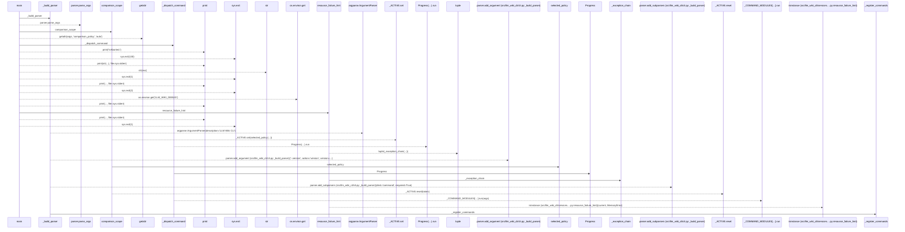
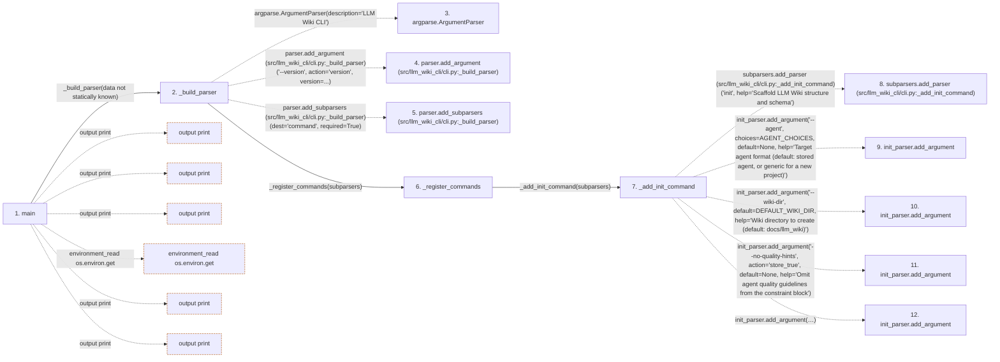

# cli

**Entry point:** `main` (`process`)
**Source:** [cli](../modules/cli.md)
**Modules touched:** [analysis_compatibility](../modules/analysis_compatibility.md), [cli](../modules/cli.md), [progress](../modules/progress.md), [resource_diagnostics](../modules/resource_diagnostics.md)

**Related modules:** [analysis_compatibility](../modules/analysis_compatibility.md), [config](../modules/config.md), [extraction_jobs](../modules/extraction_jobs.md), [llm_wiki_cli___init__](../modules/llm_wiki_cli___init__.md), and 5 more

**Complete related modules:**

- [analysis_compatibility](../modules/analysis_compatibility.md)
- [config](../modules/config.md)
- [extraction_jobs](../modules/extraction_jobs.md)
- [llm_wiki_cli___init__](../modules/llm_wiki_cli___init__.md)
- [maintenance_queue](../modules/maintenance_queue.md)
- [progress](../modules/progress.md)
- [resource_diagnostics](../modules/resource_diagnostics.md)
- [runtime_output](../modules/runtime_output.md)
- [services_contracts](../modules/services_contracts.md)

## Call sequence

> Static overview in presentation order, not runtime execution order. Arrows retain captured callers; siblings are shown before deeper helper detail.

<!-- Auto-generated from static call edges. Dashed arrows are external or unresolved calls. Reviewed runtime conditions and side effects belong in Behavior. -->

> Call sequence diagram shows 30 of 708 interactions; 678 omitted to keep the visualization within the 30-interaction and generated-diagram limits, with uncertain identities omitted rather than inferred.

> Captured boundary calls: external 15 of 24 (9 omitted); unresolved 7 of 550 (543 omitted). These counts cover the captured static trace.

Omitted captured detail, grouped by actual caller occurrence and target module:

| Caller | Parent step | Target module | Kind | Omitted interactions |
| --- | --- | --- | --- | --- |
| `src/llm_wiki_cli/cli.py:_register_commands` | 6 | [src/llm_wiki_cli/cli.py](../modules/cli.md) | internal | 35 |
| `src/llm_wiki_cli/cli.py:_add_init_command` | 7 | - | unresolved | 9 |
| `src/llm_wiki_cli/cli.py:_add_init_command` | 7 | [src/llm_wiki_cli/cli.py](../modules/cli.md) | internal | 2 |
| `src/llm_wiki_cli/cli.py:_add_helper_cache_argument` | 14 | - | unresolved | 1 |
| `src/llm_wiki_cli/cli.py:_add_source_selection_argument` | 19 | - | unresolved | 1 |
| `src/llm_wiki_cli/cli.py:_add_extract_command` | 21 | - | unresolved | 12 |
| `src/llm_wiki_cli/cli.py:_add_extract_command` | 21 | [src/llm_wiki_cli/cli.py](../modules/cli.md) | internal | 3 |
| `src/llm_wiki_cli/cli.py:_add_include_tests_argument` | 31 | - | unresolved | 1 |
> Omission summary shows 8 of 84 groups; 76 further groups are not expanded here. Counts above include all omitted interactions.
> Detailed flow queries retain their own coverage and limits; omitted paths may execute at runtime.

## Data flow

<!-- Auto-generated static analysis. Treat values and boundaries as best-effort hints, not runtime proof. -->

### Step data

| Step | Inputs | Reads | Writes | Returns |
|---|---|---|---|---|
| `main` | - | `PathValidationError`, `sys`, `RuntimeOutputError`, `sys`, `sys`, `sys` | - | - |
| `_build_parser` | - | `__version__` | - | `parser` |
| `argparse.ArgumentParser` | - | - | - | - |
| `parser.add_argument (src/llm_wiki_cli/cli.py:_build_parser)` | - | - | - | - |
| `parser.add_subparsers (src/llm_wiki_cli/cli.py:_build_parser)` | - | - | - | - |
| `_register_commands` | `subparsers` | - | - | - |
| `_add_init_command` | `subparsers` | `AGENT_CHOICES`, `DEFAULT_WIKI_DIR` | - | - |
| `subparsers.add_parser (src/llm_wiki_cli/cli.py:_add_init_command)` | - | - | - | - |
| `init_parser.add_argument` | - | - | - | - |
| `init_parser.add_argument` | - | - | - | - |
| `init_parser.add_argument` | - | - | - | - |
| `init_parser.add_argument` | - | - | - | - |

### Call data

| From | To | Line | Call |
|---|---|---:|---|
| main | _build_parser | 2627 | `_build_parser(data not statically known)` |
| _build_parser | argparse.ArgumentParser | 261 | `argparse.ArgumentParser(description='LLM Wiki CLI')` |
| _build_parser | parser.add_argument (src/llm_wiki_cli/cli.py:_build_parser) | 262 | `parser.add_argument('--version', action='version', version=...)` |
| _build_parser | parser.add_subparsers (src/llm_wiki_cli/cli.py:_build_parser) | 265 | `parser.add_subparsers(dest='command', required=True)` |
| _build_parser | _register_commands | 266 | `_register_commands(subparsers)` |
| _register_commands | _add_init_command | 301 | `_add_init_command(subparsers)` |
| _add_init_command | subparsers.add_parser (src/llm_wiki_cli/cli.py:_add_init_command) | 380 | `subparsers.add_parser('init', help='Scaffold LLM Wiki structure and schema')` |
| _add_init_command | init_parser.add_argument | 383 | `init_parser.add_argument('--agent', choices=AGENT_CHOICES, default=None, help='Target agent format (default: stored agent, or generic for a new project)')` |
| _add_init_command | init_parser.add_argument | 389 | `init_parser.add_argument('--wiki-dir', default=DEFAULT_WIKI_DIR, help='Wiki directory to create (default: docs/llm_wiki)')` |
| _add_init_command | init_parser.add_argument | 394 | `init_parser.add_argument('--no-quality-hints', action='store_true', default=None, help='Omit agent quality guidelines from the constraint block')` |
| _add_init_command | init_parser.add_argument | 400 | `init_parser.add_argument('--no-skills', action='store_true', default=None, help="Skip installing the wiki-reference skill into the agent's skills directory (.claude/skills for claude, .llm-wiki/skills otherwise)")` |

### Boundary effects

| Kind | Target | Step | Line |
|---|---|---|---:|
| output | `print` | `main` | 2635 |
| output | `print` | `main` | 2638 |
| output | `print` | `main` | 2641 |
| environment_read | `os.environ.get` | `main` | 2644 |
| output | `print` | `main` | 2646 |
| output | `print` | `main` | 2649 |

### Static analysis gaps

| Kind | Step | Target | Line |
|---|---|---|---:|
| external_call | `_build_parser` | `argparse.ArgumentParser` | 261 |
| unresolved_call | `_build_parser` | `parser.add_argument` | 262 |
| unresolved_call | `_build_parser` | `parser.add_subparsers` | 265 |
| unresolved_call | `_add_init_command` | `subparsers.add_parser` | 380 |
| unresolved_call | `_add_init_command` | `init_parser.add_argument` | 383 |
| unresolved_call | `_add_init_command` | `init_parser.add_argument` | 389 |
| unresolved_call | `_add_init_command` | `init_parser.add_argument` | 394 |
| unresolved_call | `_add_init_command` | `init_parser.add_argument` | 400 |
| step_limit | `main` | `first 12 steps` | 0 |

## Behavior

This flow starts at `main` and is classified as `process`. The generated call and data-flow sections are bounded static projections; runtime conditions and side effects require source-level confirmation.
