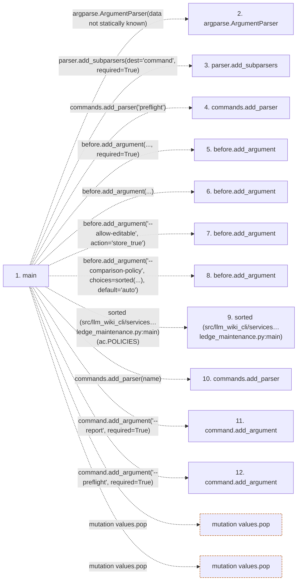

# knowledge_maintenance

**Entry point:** `main` (`process`)
**Source:** [knowledge_maintenance](../modules/knowledge_maintenance.md)
**Modules touched:** [analysis_capture](../modules/analysis_capture.md), [analysis_compatibility](../modules/analysis_compatibility.md), [canonical_json](../modules/canonical_json.md), [common](../modules/common.md), and 34 more

**Complete modules touched:**

- [analysis_capture](../modules/analysis_capture.md)
- [analysis_compatibility](../modules/analysis_compatibility.md)
- [canonical_json](../modules/canonical_json.md)
- [common](../modules/common.md)
- [domain_pack](../modules/domain_pack.md)
- [extractor_helpers](../modules/extractor_helpers.md)
- [filesystem_guard](../modules/filesystem_guard.md)
- [gitignore](../modules/gitignore.md)
- [helper_cache](../modules/helper_cache.md)
- [helper_runtime](../modules/helper_runtime.md)
- [host](../modules/host.md)
- [integrations](../modules/integrations.md)
- [io](../modules/io.md)
- [knowledge_envelope](../modules/knowledge_envelope.md)
- [knowledge_evidence](../modules/knowledge_evidence.md)
- [knowledge_generation](../modules/knowledge_generation.md)
- [knowledge_graph](../modules/knowledge_graph.md)
- [knowledge_kinds](../modules/knowledge_kinds.md)
- [knowledge_maintenance](../modules/knowledge_maintenance.md)
- [knowledge_model](../modules/knowledge_model.md)
- [knowledge_orchestration](../modules/knowledge_orchestration.md)
- [knowledge_packs](../modules/knowledge_packs.md)
- [knowledge_reuse_format](../modules/knowledge_reuse_format.md)
- [knowledge_storage](../modules/knowledge_storage.md)
- [knowledge_storage_io](../modules/knowledge_storage_io.md)
- [knowledge_validators](../modules/knowledge_validators.md)
- [maintenance_state](../modules/maintenance_state.md)
- [manifest_storage](../modules/manifest_storage.md)
- [markdown_sections](../modules/markdown_sections.md)
- [path_policy](../modules/path_policy.md)
- [section_ownership](../modules/section_ownership.md)
- [source_selection](../modules/source_selection.md)
- [source_snapshot](../modules/source_snapshot.md)
- [sync_manifest](../modules/sync_manifest.md)
- [typescript_helper_identity](../modules/typescript_helper_identity.md)
- [validation](../modules/validation.md)
- [wiki_media](../modules/wiki_media.md)
- [wiki_surface](../modules/wiki_surface.md)

**Related modules:** [analysis_capture](../modules/analysis_capture.md), [common](../modules/common.md), [extractor_registry](../modules/extractor_registry.md), [health_policy](../modules/health_policy.md), and 15 more

**Complete related modules:**

- [analysis_capture](../modules/analysis_capture.md)
- [common](../modules/common.md)
- [extractor_registry](../modules/extractor_registry.md)
- [health_policy](../modules/health_policy.md)
- [host](../modules/host.md)
- [knowledge_envelope](../modules/knowledge_envelope.md)
- [knowledge_evidence](../modules/knowledge_evidence.md)
- [knowledge_model](../modules/knowledge_model.md)
- [knowledge_orchestration](../modules/knowledge_orchestration.md)
- [knowledge_packs](../modules/knowledge_packs.md)
- [knowledge_storage](../modules/knowledge_storage.md)
- [knowledge_storage_io](../modules/knowledge_storage_io.md)
- [llm_wiki_cli___init__](../modules/llm_wiki_cli___init__.md)
- [llm_wiki_engine_contracts](../modules/llm_wiki_engine_contracts.md)
- [path_policy](../modules/path_policy.md)
- [source_selection](../modules/source_selection.md)
- [source_snapshot](../modules/source_snapshot.md)
- [sync_manifest](../modules/sync_manifest.md)
- [wiki_surface_index](../modules/wiki_surface_index.md)

## Call sequence

> Static overview in presentation order, not runtime execution order. Arrows retain captured callers; representative internal continuations and boundary examples precede repeated helper detail.

```mermaid
sequenceDiagram
    participant p0 as main
    participant p1 as preflight
    participant p2 as read_guarded
    participant p3 as validate_path
    participant p4 as validate_source_root
    participant p5 as _git
    participant p6 as build_source_snapshot
    participant p7 as _archive_binding
    participant p8 as _installed
    participant p9 as StorageReadSession.read
    participant p10 as parse_packed_root
    participant p11 as parse_knowledge_index
    participant p12 as SyncManifest.load
    participant p13 as validate_persisted_source_selection_identity
    participant p14 as has_contract
    participant p15 as capture_analysis
    participant p16 as _producer_evidence
    participant p17 as _infrastructure_extractor_component
    participant p18 as build_producer_record
    participant p19 as compare_components
    participant p20 as runtime_generation_options
    participant p21 as runtime_generation_options_hash
    participant p22 as get_prepared_typescript_root
    participant p23 as get_prepared_binary
    participant p24 as hash_source_snapshot
    participant p25 as producer_contracts
    participant p26 as _validate_range
    participant p27 as _validate_capture_options
    participant p28 as _require_relative_name
    participant p29 as argparse.ArgumentParser
    participant p30 as parser.add_subparsers
    p0->>p1: preflight
    p0->>p2: read_guarded
    p1->>p3: validate_path
    p1->>p4: validate_source_root
    p1->>p5: _git
    p1->>p6: build_source_snapshot
    p1->>p7: _archive_binding
    p1->>p8: _installed
    p1->>p9: StorageReadSession.read
    p1->>p10: parse_packed_root
    p1->>p11: parse_knowledge_index
    p1->>p12: SyncManifest.load
    p1->>p13: validate_persisted_source_selection_identity
    p1->>p14: has_contract
    p1->>p15: capture_analysis
    p1->>p16: _producer_evidence
    p1->>p17: _infrastructure_extractor_component
    p1->>p18: build_producer_record
    p1->>p19: compare_components
    p1->>p20: runtime_generation_options
    p1->>p21: runtime_generation_options_hash
    p1->>p22: get_prepared_typescript_root
    p1->>p23: get_prepared_binary
    p1->>p24: hash_source_snapshot
    p1->>p25: producer_contracts
    p2->>p26: _validate_range
    p6->>p27: _validate_capture_options
    p9->>p28: _require_relative_name
    p0-->>p29: argparse.ArgumentParser
    p0-->>p30: parser.add_subparsers(dest='command', required=True)
```

<!-- Auto-generated from static call edges. Dashed arrows are external or unresolved calls. Reviewed runtime conditions and side effects belong in Behavior. -->

> Call sequence diagram shows 30 of 2953 interactions; 2923 omitted to keep the visualization within the 30-interaction and generated-diagram limits, with uncertain identities omitted rather than inferred.

> Captured boundary calls: external 1 of 957 (956 omitted); unresolved 1 of 743 (742 omitted). These counts cover the captured static trace.

Omitted captured detail, grouped by actual caller occurrence and target module:

| Caller | Parent step | Target module | Kind | Omitted interactions |
| --- | --- | --- | --- | --- |
| `src/llm_wiki_cli/services/knowledge_maintenance.py:main` | 1 | - | unresolved | 27 |
| `src/llm_wiki_cli/services/knowledge_maintenance.py:main` | 1 | - | external | 10 |
| `src/llm_wiki_cli/services/knowledge_maintenance.py:preflight` | 25 | - | unresolved | 34 |
| `src/llm_wiki_cli/services/knowledge_maintenance.py:preflight` | 25 | - | external | 13 |
| `src/llm_wiki_engine/path_policy.py:validate_path` | 28 | [src/llm_wiki_engine/path_policy.py](../modules/path_policy.md) | internal | 2 |
| `src/llm_wiki_engine/path_policy.py:validate_path` | 28 | - | unresolved | 5 |
| `src/llm_wiki_engine/path_policy.py:validate_path` | 28 | [src/llm_wiki_engine/host.py](../modules/host.md) | internal | 2 |
| `src/llm_wiki_engine/host.py:current_host` | 32 | - | unresolved | 1 |
> Omission summary shows 8 of 700 groups; 692 further groups are not expanded here. Counts above include all omitted interactions.
> Detailed flow queries retain their own coverage and limits; omitted paths may execute at runtime.

> Trace truncated at the depth limit; deeper calls are omitted.

## Data flow

<!-- Auto-generated static analysis. Treat values and boundaries as best-effort hints, not runtime proof. -->

### Analysis coverage

**Effect analysis partially available.** Flow assembly and source effect analysis are separate; empty observations do not prove an empty handler body.

Source steps: 1254; effect analysis evaluated: 817, partial: 32, unavailable: 405. Counts include steps omitted from the displayed trace.

Collector observations for 849 source steps with known totals: observed: 4395, emitted: 4220, omitted: 175. Unavailable totals are excluded.

- Callable record unavailable for one or more source steps; those steps have no represented callable body.
- Effect collector omitted observations before flow assembly; displayed effects are partial.
- Effect collector totals unavailable; observed counts cover captured records only.

| Step | Callable record | Effect analysis | Collector totals | Observed | Emitted | Omitted |
|---|---|---|---|---:|---:|---:|
| `main` | `available` | `evaluated` | `available` | `10` | `10` | `0` |
| `argparse.ArgumentParser` | `not_applicable` | `not_applicable` | `not_applicable` | — | — | — |
| `parser.add_subparsers` | `not_applicable` | `not_applicable` | `not_applicable` | — | — | — |
| `commands.add_parser` | `not_applicable` | `not_applicable` | `not_applicable` | — | — | — |
| `before.add_argument` | `not_applicable` | `not_applicable` | `not_applicable` | — | — | — |
| `before.add_argument` | `not_applicable` | `not_applicable` | `not_applicable` | — | — | — |
| `before.add_argument` | `not_applicable` | `not_applicable` | `not_applicable` | — | — | — |
| `before.add_argument` | `not_applicable` | `not_applicable` | `not_applicable` | — | — | — |
| `sorted (src/llm_wiki_cli/services…ledge_maintenance.py:main)` | `not_applicable` | `not_applicable` | `not_applicable` | — | — | — |
| `commands.add_parser` | `not_applicable` | `not_applicable` | `not_applicable` | — | — | — |
| `command.add_argument` | `not_applicable` | `not_applicable` | `not_applicable` | — | — | — |
| `command.add_argument` | `not_applicable` | `not_applicable` | `not_applicable` | — | — | — |

### Step data

| Step | Inputs | Reads | Writes | Returns |
|---|---|---|---|---|
| `main` | `argv` | `ac`, `MAX_EVIDENCE_BYTES`, `MAX_EVIDENCE_BYTES`, `MAX_EVIDENCE_BYTES`, `tarfile`, `subprocess` | - | `...` |
| `argparse.ArgumentParser` | - | - | - | - |
| `parser.add_subparsers` | - | - | - | - |
| `commands.add_parser` | - | - | - | - |
| `before.add_argument` | - | - | - | - |
| `before.add_argument` | - | - | - | - |
| `before.add_argument` | - | - | - | - |
| `before.add_argument` | - | - | - | - |
| `sorted (src/llm_wiki_cli/services…ledge_maintenance.py:main)` | - | - | - | - |
| `commands.add_parser` | - | - | - | - |
| `command.add_argument` | - | - | - | - |
| `command.add_argument` | - | - | - | - |

### Call data

| From | To | Line | Call |
|---|---|---:|---|
| main | argparse.ArgumentParser | 414 | `argparse.ArgumentParser(data not statically known)` |
| main | parser.add_subparsers | 415 | `parser.add_subparsers(dest='command', required=True)` |
| main | commands.add_parser | 416 | `commands.add_parser('preflight')` |
| main | before.add_argument | 418 | `before.add_argument(..., required=True)` |
| main | before.add_argument | 425 | `before.add_argument(...)` |
| main | before.add_argument | 426 | `before.add_argument('--allow-editable', action='store_true')` |
| main | before.add_argument | 427 | `before.add_argument('--comparison-policy', choices=sorted(...), default='auto')` |
| main | sorted (src/llm_wiki_cli/services…ledge_maintenance.py:main) | 427 | `sorted(ac.POLICIES)` |
| main | commands.add_parser | 429 | `commands.add_parser(name)` |
| main | command.add_argument | 430 | `command.add_argument('--report', required=True)` |
| main | command.add_argument | 431 | `command.add_argument('--preflight', required=True)` |

### Boundary effects

| Kind | Target | Step | Line |
|---|---|---|---:|
| mutation | `values.pop` | `main` | 442 |
| mutation | `values.pop` | `main` | 443 |

### Static analysis gaps

| Kind | Step | Target | Line |
|---|---|---|---:|
| external_call | `main` | `argparse.ArgumentParser` | 414 |
| unresolved_call | `main` | `parser.add_subparsers` | 415 |
| unresolved_call | `main` | `commands.add_parser` | 416 |
| unresolved_call | `main` | `before.add_argument` | 418 |
| unresolved_call | `main` | `before.add_argument` | 425 |
| unresolved_call | `main` | `before.add_argument` | 426 |
| unresolved_call | `main` | `before.add_argument` | 427 |
| external_call | `main` | `sorted` | 427 |
| unresolved_call | `main` | `commands.add_parser` | 429 |
| unresolved_call | `main` | `command.add_argument` | 430 |
| unresolved_call | `main` | `command.add_argument` | 431 |
| step_limit | `main` | `first 12 steps` | 0 |

## Behavior

This flow starts at `main` and is classified as `process`. The generated call and data-flow sections are bounded static projections; runtime conditions and side effects require source-level confirmation.
