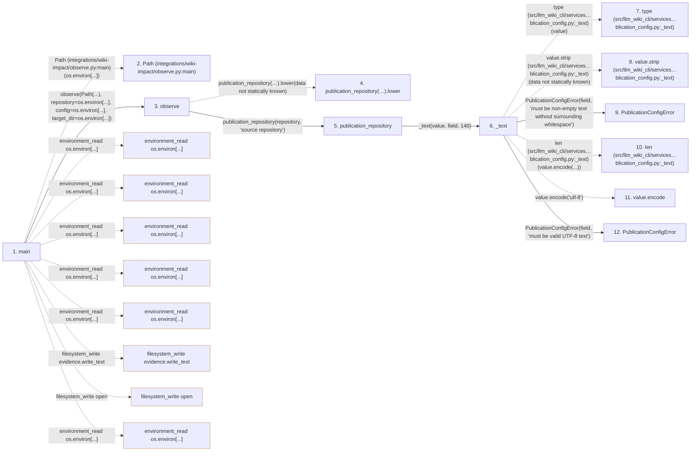

# observe

**Entry point:** `main` (`process`)
**Source:** [observe](../modules/observe.md)
**Modules touched:** [concept_identity](../modules/concept_identity.md), [observe](../modules/observe.md), [publication_config](../modules/publication_config.md), [source_selection](../modules/source_selection.md), and 1 more

**Complete modules touched:**

- [concept_identity](../modules/concept_identity.md)
- [observe](../modules/observe.md)
- [publication_config](../modules/publication_config.md)
- [source_selection](../modules/source_selection.md)
- [validation](../modules/validation.md)

**Related modules:** [publication_config](../modules/publication_config.md)

## Call sequence

> Static overview in presentation order, not runtime execution order. Arrows retain captured callers; representative internal continuations and boundary examples precede repeated helper detail.

```mermaid
sequenceDiagram
    participant p0 as main
    participant p1 as observe
    participant p2 as publication_repository
    participant p3 as load_publication_config
    participant p4 as publication_path
    participant p5 as _branch
    participant p6 as _text
    participant p7 as _consumer_root
    participant p8 as _relative_path
    participant p9 as locate_exact_repository_path
    participant p10 as read_publication_json
    participant p11 as validate_publication_config
    participant p12 as _locate_exact_path
    participant p13 as _object
    participant p14 as path_is_link_or_reparse
    participant p15 as require_repository_relative_path
    participant p16 as _choice
    participant p17 as _check_path
    participant p18 as _reference_providers
    participant p19 as _array
    participant p20 as _dependency
    participant p21 as publication_ref_name
    participant p22 as _content_profile
    participant p23 as _public_content_path
    participant p24 as _content_source_path
    participant p25 as require_portable_relative_path
    participant p26 as _section
    participant p27 as _content_repository_url
    participant p28 as _head
    participant p29 as Path (integrations/wiki-impact/observe.py:main)
    participant p30 as evidence.write_text
    p0->>p1: observe
    p1->>p2: publication_repository
    p1->>p3: load_publication_config
    p1->>p4: publication_path
    p1->>p5: _branch
    p2->>p6: _text
    p3->>p7: _consumer_root
    p3->>p8: _relative_path
    p3->>p9: locate_exact_repository_path
    p3->>p10: read_publication_json
    p3->>p11: validate_publication_config
    p9->>p12: _locate_exact_path
    p11->>p13: _object
    p7->>p14: path_is_link_or_reparse
    p8->>p15: require_repository_relative_path
    p11->>p16: _choice
    p11->>p17: _check_path
    p11->>p18: _reference_providers
    p11->>p19: _array
    p11->>p20: _dependency
    p11->>p21: publication_ref_name
    p11->>p22: _content_profile
    p22->>p23: _public_content_path
    p22->>p24: _content_source_path
    p15->>p25: require_portable_relative_path
    p20->>p26: _section
    p22->>p27: _content_repository_url
    p1->>p28: _head
    p0-->>p29: Path (integrations/wiki-impact/observe.py:main)(os.environ[...])
    p0-->>p30: evidence.write_text(..., encoding='utf-8')
```

<!-- Auto-generated from static call edges. Dashed arrows are external or unresolved calls. Reviewed runtime conditions and side effects belong in Behavior. -->

> Call sequence diagram shows 30 of 504 interactions; 474 omitted to keep the visualization within the 30-interaction and generated-diagram limits, with uncertain identities omitted rather than inferred.

> Captured boundary calls: external 1 of 140 (139 omitted); unresolved 1 of 155 (154 omitted). These counts cover the captured static trace.

Omitted captured detail, grouped by actual caller occurrence and target module:

| Caller | Parent step | Target module | Kind | Omitted interactions |
| --- | --- | --- | --- | --- |
| `integrations/wiki-impact/observe.py:observe` | 3 | - | unresolved | 21 |
| `src/llm_wiki_cli/services/publication_config.py:_text` | 6 | - | external | 6 |
| `src/llm_wiki_cli/services/publication_config.py:_text` | 6 | - | unresolved | 2 |
| `src/llm_wiki_cli/services/publication_config.py:_text` | 6 | [src/llm_wiki_cli/services/publication_config.py](../modules/publication_config.md) | internal | 4 |
| `src/llm_wiki_cli/services/publication_config.py:publication_repository` | 5 | - | unresolved | 2 |
| `src/llm_wiki_cli/services/publication_config.py:publication_repository` | 5 | [src/llm_wiki_cli/services/publication_config.py](../modules/publication_config.md) | internal | 1 |
| `src/llm_wiki_cli/services/publication_config.py:_consumer_root` | 23 | - | unresolved | 3 |
| `src/llm_wiki_cli/services/publication_config.py:_consumer_root` | 23 | - | external | 2 |
> Omission summary shows 8 of 89 groups; 81 further groups are not expanded here. Counts above include all omitted interactions.
> Detailed flow queries retain their own coverage and limits; omitted paths may execute at runtime.

> Trace truncated at the depth limit; deeper calls are omitted.

## Data flow

<!-- Auto-generated static analysis. Treat values and boundaries as best-effort hints, not runtime proof. -->

### Analysis coverage

**Effect analysis partially available.** Flow assembly and source effect analysis are separate; empty observations do not prove an empty handler body.

Source steps: 210; effect analysis evaluated: 133, partial: 4, unavailable: 73. Counts include steps omitted from the displayed trace.

Collector observations for 137 source steps with known totals: observed: 723, emitted: 706, omitted: 17. Unavailable totals are excluded.

- Callable record unavailable for one or more source steps; those steps have no represented callable body.
- Effect collector omitted observations before flow assembly; displayed effects are partial.
- Effect collector totals unavailable; observed counts cover captured records only.

| Step | Callable record | Effect analysis | Collector totals | Observed | Emitted | Omitted |
|---|---|---|---|---:|---:|---:|
| `main` | `available` | `partial` | `available` | `18` | `16` | `2` |
| `Path (integrations/wiki-impact/observe.py:main)` | `not_applicable` | `not_applicable` | `not_applicable` | — | — | — |
| `observe` | `available` | `evaluated` | `available` | `8` | `8` | `0` |
| `publication_repository(…).lower` | `not_applicable` | `not_applicable` | `not_applicable` | — | — | — |
| `publication_repository` | `available` | `evaluated` | `available` | `3` | `3` | `0` |
| `_text` | `available` | `evaluated` | `available` | `4` | `4` | `0` |
| `type (src/llm_wiki_cli/services…blication_config.py:_text)` | `not_applicable` | `not_applicable` | `not_applicable` | — | — | — |
| `value.strip (src/llm_wiki_cli/services…blication_config.py:_text)` | `not_applicable` | `not_applicable` | `not_applicable` | — | — | — |
| `PublicationConfigError` | `unavailable` | `unavailable` | `unavailable` | — | — | — |
| `len (src/llm_wiki_cli/services…blication_config.py:_text)` | `not_applicable` | `not_applicable` | `not_applicable` | — | — | — |
| `value.encode` | `not_applicable` | `not_applicable` | `not_applicable` | — | — | — |
| `PublicationConfigError` | `unavailable` | `unavailable` | `unavailable` | — | — | — |

### Step data

| Step | Inputs | Reads | Writes | Returns |
|---|---|---|---|---|
| `main` | - | `os`, `os`, `os`, `os`, `os`, `os`, `os` | - | `int(...)` |
| `Path (integrations/wiki-impact/observe.py:main)` | - | - | - | - |
| `observe` | `consumer: Path`, `repository: str`, `config: str`, `target_dir: str` | `DELIVERY_CHECKPOINT_PATH`, `DELIVERY_CHECKPOINT_PATH` | - | `report` |
| `publication_repository(…).lower` | - | - | - | - |
| `publication_repository` | `value: object`, `field: str` | - | - | `name` |
| `_text` | `value: object`, `field: str`, `maximum: int` | - | - | `value` |
| `type (src/llm_wiki_cli/services…blication_config.py:_text)` | - | - | - | - |
| `value.strip (src/llm_wiki_cli/services…blication_config.py:_text)` | - | - | - | - |
| `PublicationConfigError` | - | - | - | - |
| `len (src/llm_wiki_cli/services…blication_config.py:_text)` | - | - | - | - |
| `value.encode` | - | - | - | - |
| `PublicationConfigError` | - | - | - | - |

### Call data

| From | To | Line | Call |
|---|---|---:|---|
| main | Path (integrations/wiki-impact/observe.py:main) | 155 | `Path(os.environ[...])` |
| main | observe | 157 | `observe(Path(...), repository=os.environ[...], config=os.environ[...], target_dir=os.environ[...])` |
| observe | publication_repository(…).lower | 49 | `publication_repository(repository, 'source repository').lower(data not statically known)` |
| observe | publication_repository | 49 | `publication_repository(repository, 'source repository')` |
| publication_repository | _text | 71 | `_text(value, field, 140)` |
| _text | type (src/llm_wiki_cli/services…blication_config.py:_text) | 107 | `type(value)` |
| _text | value.strip (src/llm_wiki_cli/services…blication_config.py:_text) | 107 | `value.strip(data not statically known)` |
| _text | PublicationConfigError | 108 | `PublicationConfigError(field, 'must be non-empty text without surrounding whitespace')` |
| _text | len (src/llm_wiki_cli/services…blication_config.py:_text) | 112 | `len(value.encode(...))` |
| _text | value.encode | 112 | `value.encode('utf-8')` |
| _text | PublicationConfigError | 114 | `PublicationConfigError(field, 'must be valid UTF-8 text')` |

### Boundary effects

| Kind | Target | Step | Line |
|---|---|---|---:|
| environment_read | `os.environ[...]` | `main` | 155 |
| environment_read | `os.environ[...]` | `main` | 158 |
| environment_read | `os.environ[...]` | `main` | 159 |
| environment_read | `os.environ[...]` | `main` | 160 |
| environment_read | `os.environ[...]` | `main` | 161 |
| filesystem_write | `evidence.write_text` | `main` | 178 |
| filesystem_write | `open` | `main` | 181 |
| environment_read | `os.environ[...]` | `main` | 181 |

### Static analysis gaps

| Kind | Step | Target | Line |
|---|---|---|---:|
| unresolved_call | `observe` | `publication_repository(repository, 'source repository').lower` | 49 |
| external_call | `_text` | `type` | 107 |
| unresolved_call | `_text` | `value.strip` | 107 |
| unresolved_call | `_text` | `value.encode` | 112 |
| step_limit | `main` | `first 12 steps` | 0 |
| truncated_flow | `main` | `depth limit` | 0 |

## Behavior

This flow starts at `main` and is classified as `process`. The generated call and data-flow sections are bounded static projections; runtime conditions and side effects require source-level confirmation.
