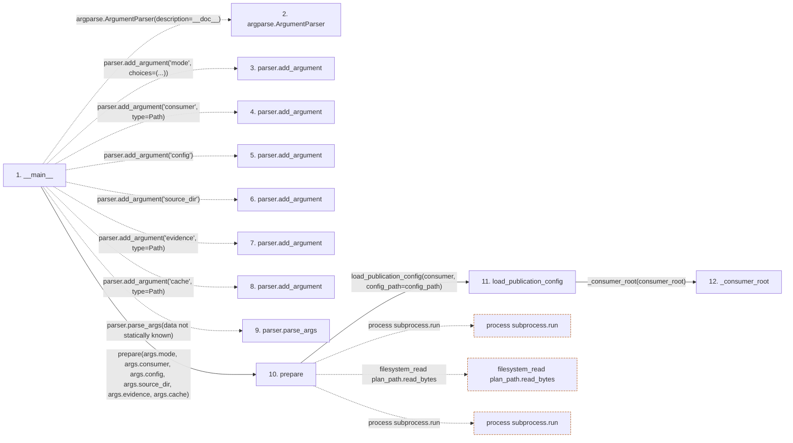

# prepare

**Entry point:** `__main__` (`process`)
**Source:** [wiki-candidate_prepare](../modules/wiki-candidate_prepare.md)
**Modules touched:** [analysis_capture](../modules/analysis_capture.md), [analysis_compatibility](../modules/analysis_compatibility.md), [bootstrap_recovery](../modules/bootstrap_recovery.md), and 53 more

**Complete modules touched:**

- [analysis_capture](../modules/analysis_capture.md)
- [analysis_compatibility](../modules/analysis_compatibility.md)
- [bootstrap_recovery](../modules/bootstrap_recovery.md)
- [canonical_json](../modules/canonical_json.md)
- [common](../modules/common.md)
- [concept_identity](../modules/concept_identity.md)
- [config](../modules/config.md)
- [dockerfile_parser](../modules/dockerfile_parser.md)
- [documentation_native](../modules/documentation_native.md)
- [extraction_jobs](../modules/extraction_jobs.md)
- [extraction_service](../modules/extraction_service.md)
- [extractor_helpers](../modules/extractor_helpers.md)
- [helper_cache](../modules/helper_cache.md)
- [helper_preparation](../modules/helper_preparation.md)
- [helper_runtime](../modules/helper_runtime.md)
- [immutable](../modules/immutable.md)
- [implementation_evidence](../modules/implementation_evidence.md)
- [infrastructure_inventory](../modules/infrastructure_inventory.md)
- [infrastructure_sync](../modules/infrastructure_sync.md)
- [inventory_cache](../modules/inventory_cache.md)
- [io](../modules/io.md)
- [knowledge_artifacts](../modules/knowledge_artifacts.md)
- [knowledge_envelope](../modules/knowledge_envelope.md)
- [knowledge_evidence](../modules/knowledge_evidence.md)
- [knowledge_freshness](../modules/knowledge_freshness.md)
- [knowledge_generation](../modules/knowledge_generation.md)
- [knowledge_governance](../modules/knowledge_governance.md)
- [knowledge_graph](../modules/knowledge_graph.md)
- [knowledge_index](../modules/knowledge_index.md)
- [knowledge_loader](../modules/knowledge_loader.md)
- [knowledge_model](../modules/knowledge_model.md)
- [knowledge_orchestration](../modules/knowledge_orchestration.md)
- [knowledge_packs](../modules/knowledge_packs.md)
- [knowledge_reuse](../modules/knowledge_reuse.md)
- [knowledge_storage](../modules/knowledge_storage.md)
- [knowledge_storage_io](../modules/knowledge_storage_io.md)
- [maintenance_projection](../modules/maintenance_projection.md)
- [maintenance_protocol](../modules/maintenance_protocol.md)
- [maintenance_shapes](../modules/maintenance_shapes.md)
- [maintenance_state](../modules/maintenance_state.md)
- [manifest_storage](../modules/manifest_storage.md)
- [normalization_diagnostics](../modules/normalization_diagnostics.md)
- [publication_config](../modules/publication_config.md)
- [python_implementation](../modules/python_implementation.md)
- [section_ownership](../modules/section_ownership.md)
- [source_retirement](../modules/source_retirement.md)
- [source_selection](../modules/source_selection.md)
- [source_snapshot](../modules/source_snapshot.md)
- [sync_manifest](../modules/sync_manifest.md)
- [typescript_helper_identity](../modules/typescript_helper_identity.md)
- [validation](../modules/validation.md)
- [wiki-candidate_prepare](../modules/wiki-candidate_prepare.md)
- [wiki_surface](../modules/wiki_surface.md)
- [wiki_write_basis](../modules/wiki_write_basis.md)
- [yaml_formats](../modules/yaml_formats.md)
- [yaml_syntax](../modules/yaml_syntax.md)

**Related modules:** [documentation_native](../modules/documentation_native.md), [helper_cache](../modules/helper_cache.md), [helper_preparation](../modules/helper_preparation.md), [helper_runtime](../modules/helper_runtime.md), and 5 more

**Complete related modules:**

- [documentation_native](../modules/documentation_native.md)
- [helper_cache](../modules/helper_cache.md)
- [helper_preparation](../modules/helper_preparation.md)
- [helper_runtime](../modules/helper_runtime.md)
- [knowledge_evidence](../modules/knowledge_evidence.md)
- [knowledge_freshness](../modules/knowledge_freshness.md)
- [knowledge_loader](../modules/knowledge_loader.md)
- [publication_config](../modules/publication_config.md)
- [source_retirement](../modules/source_retirement.md)

## Call sequence

> Static overview in presentation order, not runtime execution order. Arrows retain captured callers; representative internal continuations and boundary examples precede repeated helper detail.

```mermaid
sequenceDiagram
    participant p0 as __main__
    participant p1 as prepare
    participant p2 as load_publication_config
    participant p3 as publication_path
    participant p4 as selected_helper_languages
    participant p5 as ensure_helper
    participant p6 as hash_json
    participant p7 as load_knowledge_state
    participant p8 as helper_operation
    participant p9 as evaluate_documentation_native_freshness
    participant p10 as retired_entity_mappings
    participant p11 as _consumer_root
    participant p12 as build_source_snapshot
    participant p13 as read_entity_retirement_state
    participant p14 as _relative_path
    participant p15 as canonical_json_bytes
    participant p16 as entity_owner_present
    participant p17 as locate_exact_repository_path
    participant p18 as _native_source_snapshot_preflight
    participant p19 as _safe
    participant p20 as _generation_input_paths
    participant p21 as preparation_cache_root
    participant p22 as _collect_runtime
    participant p23 as lookup_helper
    participant p24 as guard_maintenance_owner
    participant p25 as _retained_empty_paths
    participant p26 as read_publication_json
    participant p27 as _runtime_generation_options
    participant p28 as _source_mismatches
    participant p29 as argparse.ArgumentParser
    participant p30 as parser.add_argument
    p0->>p1: prepare
    p1->>p2: load_publication_config
    p1->>p3: publication_path
    p1->>p4: selected_helper_languages
    p1->>p5: ensure_helper
    p1->>p6: hash_json
    p1->>p7: load_knowledge_state
    p1->>p8: helper_operation
    p1->>p9: evaluate_documentation_native_freshness
    p1->>p10: retired_entity_mappings
    p2->>p11: _consumer_root
    p4->>p12: build_source_snapshot
    p10->>p13: read_entity_retirement_state
    p2->>p14: _relative_path
    p6->>p15: canonical_json_bytes
    p10->>p16: entity_owner_present
    p2->>p17: locate_exact_repository_path
    p9->>p18: _native_source_snapshot_preflight
    p5->>p19: _safe
    p9->>p20: _generation_input_paths
    p5->>p21: preparation_cache_root
    p9->>p22: _collect_runtime
    p5->>p23: lookup_helper
    p7->>p24: guard_maintenance_owner
    p9->>p25: _retained_empty_paths
    p2->>p26: read_publication_json
    p9->>p27: _runtime_generation_options
    p9->>p28: _source_mismatches
    p0-->>p29: argparse.ArgumentParser(description=__doc__)
    p0-->>p30: parser.add_argument('mode', choices=(...))
```

<!-- Auto-generated from static call edges. Dashed arrows are external or unresolved calls. Reviewed runtime conditions and side effects belong in Behavior. -->

> Call sequence diagram shows 30 of 2944 interactions; 2914 omitted to keep the visualization within the 30-interaction and generated-diagram limits, with uncertain identities omitted rather than inferred.

> Captured boundary calls: external 1 of 942 (941 omitted); unresolved 1 of 713 (712 omitted). These counts cover the captured static trace.

Omitted captured detail, grouped by actual caller occurrence and target module:

| Caller | Parent step | Target module | Kind | Omitted interactions |
| --- | --- | --- | --- | --- |
| `integrations/wiki-candidate/prepare.py:__main__` | 1 | - | unresolved | 6 |
| `src/llm_wiki_cli/services/publication_config.py:_consumer_root` | 12 | - | unresolved | 3 |
| `src/llm_wiki_cli/services/publication_config.py:_consumer_root` | 12 | - | external | 2 |
| `src/llm_wiki_cli/services/publication_config.py:_consumer_root` | 12 | [src/llm_wiki_cli/services/source_selection.py](../modules/source_selection.md) | internal | 1 |
| `src/llm_wiki_cli/services/source_selection.py:path_is_link_or_reparse` | 15 | [src/llm_wiki_cli/services/source_selection.py](../modules/source_selection.md) | internal | 1 |
| `src/llm_wiki_cli/services/source_selection.py:_is_link_or_reparse_stat` | 16 | - | external | 4 |
| `src/llm_wiki_cli/services/source_selection.py:path_is_link_or_reparse` | 15 | - | unresolved | 1 |
| `src/llm_wiki_cli/services/publication_config.py:_consumer_root` | 12 | [src/llm_wiki_cli/services/publication_config.py](../modules/publication_config.md) | internal | 3 |
> Omission summary shows 8 of 690 groups; 682 further groups are not expanded here. Counts above include all omitted interactions.
> Detailed flow queries retain their own coverage and limits; omitted paths may execute at runtime.

> Trace truncated at the depth limit; deeper calls are omitted.

## Data flow

<!-- Auto-generated static analysis. Treat values and boundaries as best-effort hints, not runtime proof. -->

### Analysis coverage

**Effect analysis partially available.** Flow assembly and source effect analysis are separate; empty observations do not prove an empty handler body.

Source steps: 1290; effect analysis evaluated: 830, partial: 51, unavailable: 409. Counts include steps omitted from the displayed trace.

Collector observations for 881 source steps with known totals: observed: 5285, emitted: 5012, omitted: 273. Unavailable totals are excluded.

- Callable record unavailable for one or more source steps; those steps have no represented callable body.
- Effect collector omitted observations before flow assembly; displayed effects are partial.
- Effect collector totals unavailable; observed counts cover captured records only.

| Step | Callable record | Effect analysis | Collector totals | Observed | Emitted | Omitted |
|---|---|---|---|---:|---:|---:|
| `__main__` | `unavailable` | `unavailable` | `unavailable` | — | — | — |
| `argparse.ArgumentParser` | `not_applicable` | `not_applicable` | `not_applicable` | — | — | — |
| `parser.add_argument` | `not_applicable` | `not_applicable` | `not_applicable` | — | — | — |
| `parser.add_argument` | `not_applicable` | `not_applicable` | `not_applicable` | — | — | — |
| `parser.add_argument` | `not_applicable` | `not_applicable` | `not_applicable` | — | — | — |
| `parser.add_argument` | `not_applicable` | `not_applicable` | `not_applicable` | — | — | — |
| `parser.add_argument` | `not_applicable` | `not_applicable` | `not_applicable` | — | — | — |
| `parser.add_argument` | `not_applicable` | `not_applicable` | `not_applicable` | — | — | — |
| `parser.parse_args` | `not_applicable` | `not_applicable` | `not_applicable` | — | — | — |
| `prepare` | `available` | `evaluated` | `available` | `19` | `19` | `0` |
| `load_publication_config` | `available` | `evaluated` | `available` | `5` | `5` | `0` |
| `_consumer_root` | `available` | `evaluated` | `available` | `3` | `3` | `0` |

### Step data

| Step | Inputs | Reads | Writes | Returns |
|---|---|---|---|---|
| `__main__` | - | - | - | - |
| `argparse.ArgumentParser` | - | - | - | - |
| `parser.add_argument` | - | - | - | - |
| `parser.add_argument` | - | - | - | - |
| `parser.add_argument` | - | - | - | - |
| `parser.add_argument` | - | - | - | - |
| `parser.add_argument` | - | - | - | - |
| `parser.add_argument` | - | - | - | - |
| `parser.parse_args` | - | - | - | - |
| `prepare` | `mode: str`, `consumer: Path`, `config_path: str`, `source_dir: str`, `evidence: Path`, `cache: Path` | `_PROVIDER`, `_MODES`, `_LOCK`, `sys`, `sys`, `REASON_CONCEPT_OBSERVATION_CHANGED` | `helpers[...]`, `report[...]` | `none`, `none` |
| `load_publication_config` | `consumer_root: str \| Path`, `config_path: str \| Path` | `Path`, `SourceSelectionError` | - | `validate_publication_config(...)` |
| `_consumer_root` | `value: str \| Path` | `PublicationConfigError` | - | `root` |

### Call data

| From | To | Line | Call |
|---|---|---:|---|
| __main__ | argparse.ArgumentParser | 186 | `argparse.ArgumentParser(description=__doc__)` |
| __main__ | parser.add_argument | 187 | `parser.add_argument('mode', choices=(...))` |
| __main__ | parser.add_argument | 188 | `parser.add_argument('consumer', type=Path)` |
| __main__ | parser.add_argument | 189 | `parser.add_argument('config')` |
| __main__ | parser.add_argument | 190 | `parser.add_argument('source_dir')` |
| __main__ | parser.add_argument | 191 | `parser.add_argument('evidence', type=Path)` |
| __main__ | parser.add_argument | 192 | `parser.add_argument('cache', type=Path)` |
| __main__ | parser.parse_args | 193 | `parser.parse_args(data not statically known)` |
| __main__ | prepare | 194 | `prepare(args.mode, args.consumer, args.config, args.source_dir, args.evidence, args.cache)` |
| prepare | load_publication_config | 52 | `load_publication_config(consumer, config_path=config_path)` |
| load_publication_config | _consumer_root | 959 | `_consumer_root(consumer_root)` |

### Boundary effects

| Kind | Target | Step | Line |
|---|---|---|---:|
| process | `subprocess.run` | `prepare` | 74 |
| filesystem_read | `plan_path.read_bytes` | `prepare` | 90 |
| process | `subprocess.run` | `prepare` | 106 |

### Static analysis gaps

| Kind | Step | Target | Line |
|---|---|---|---:|
| external_call | `__main__` | `argparse.ArgumentParser` | 186 |
| unresolved_call | `__main__` | `parser.add_argument` | 187 |
| unresolved_call | `__main__` | `parser.add_argument` | 188 |
| unresolved_call | `__main__` | `parser.add_argument` | 189 |
| unresolved_call | `__main__` | `parser.add_argument` | 190 |
| unresolved_call | `__main__` | `parser.add_argument` | 191 |
| unresolved_call | `__main__` | `parser.add_argument` | 192 |
| unresolved_call | `__main__` | `parser.parse_args` | 193 |
| step_limit | `__main__` | `first 12 steps` | 0 |
| truncated_flow | `__main__` | `depth limit` | 0 |

## Behavior

This flow starts at `__main__` and is classified as `process`. The generated call and data-flow sections are bounded static projections; runtime conditions and side effects require source-level confirmation.
