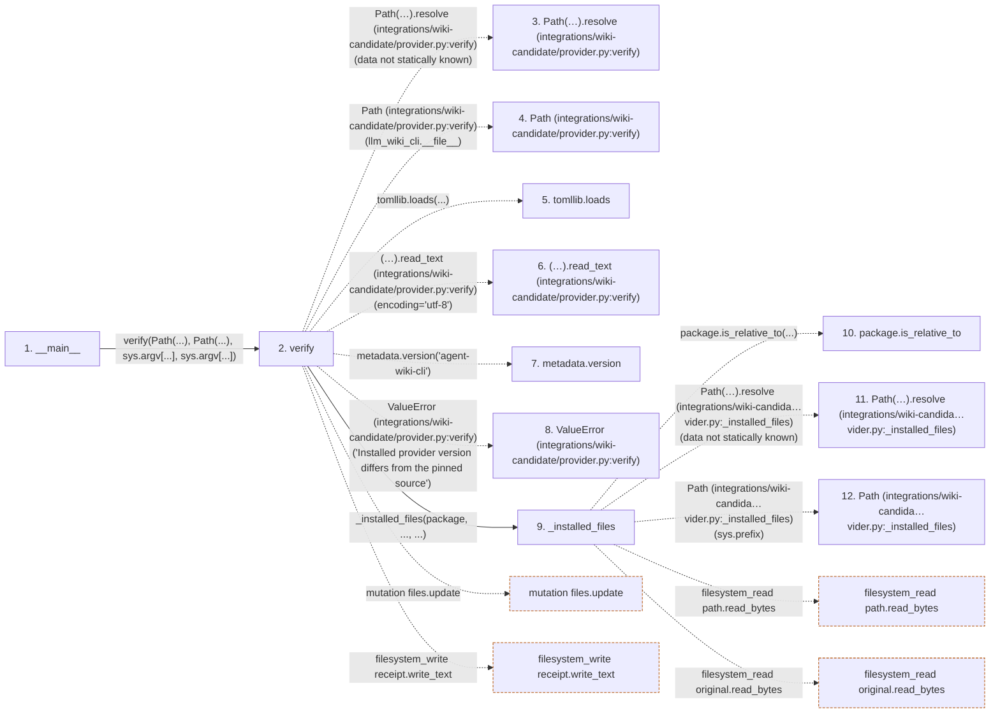

# provider

**Entry point:** `__main__` (`process`)
**Source:** [provider](../modules/provider.md)
**Modules touched:** [provider](../modules/provider.md)

**Related modules:** [llm_wiki_cli___init__](../modules/llm_wiki_cli___init__.md), [llm_wiki_engine___init__](../modules/llm_wiki_engine___init__.md)

## Call sequence

> Static overview in presentation order, not runtime execution order. Arrows retain captured callers; representative internal continuations and boundary examples precede repeated helper detail.

```mermaid
sequenceDiagram
    participant p0 as __main__
    participant p1 as verify
    participant p2 as setup
    participant p3 as _installed_files
    participant p4 as build_input
    participant p5 as Path (integrations/wiki-candidate/provider.py:__main__)
    participant p6 as Path(…).resolve (integrations/wiki-candidate/provider.py:verify)
    participant p7 as Path(…).resolve (integrations/wiki-candidate/provider.py:setup)
    participant p8 as Path (integrations/wiki-candidate/provider.py:verify)
    participant p9 as Path (integrations/wiki-candidate/provider.py:setup)
    participant p10 as tomllib.loads
    participant p11 as (…).resolve
    participant p12 as (…).read_text (integrations/wiki-candidate/provider.py:verify)
    participant p13 as consumer.is_dir
    participant p14 as metadata.version
    participant p15 as consumer.is_relative_to
    participant p16 as ValueError (integrations/wiki-candidate/provider.py:verify)
    participant p17 as ValueError (integrations/wiki-candidate/provider.py:setup)
    participant p18 as re.fullmatch
    participant p19 as (…).read_text (integrations/wiki-candidate/provider.py:verify, 1)
    participant p20 as Path(…).resolve (integrations/wiki-candidate/provider.py:setup, 1)
    participant p21 as temporary.is_relative_to
    participant p22 as files.update
    p0->>p1: verify
    p0->>p2: setup
    p1->>p3: _installed_files
    p2->>p4: build_input
    p0-->>p5: Path (integrations/wiki-candidate/provider.py:__main__)(sys.argv[...])
    p1-->>p6: Path(…).resolve (integrations/wiki-candidate/provider.py:verify)
    p0-->>p5: Path (integrations/wiki-candidate/provider.py:__main__)(sys.argv[...])
    p2-->>p7: Path(…).resolve (integrations/wiki-candidate/provider.py:setup)(strict=True)
    p1-->>p8: Path (integrations/wiki-candidate/provider.py:verify)(llm_wiki_cli.__file__)
    p2-->>p9: Path (integrations/wiki-candidate/provider.py:setup)(os.environ[...])
    p1-->>p10: tomllib.loads(...)
    p2-->>p11: (…).resolve(strict=True)
    p1-->>p12: (…).read_text (integrations/wiki-candidate/provider.py:verify)(encoding='utf-8')
    p2-->>p13: consumer.is_dir
    p1-->>p14: metadata.version('agent-wiki-cli')
    p2-->>p15: consumer.is_relative_to(workspace)
    p1-->>p16: ValueError (integrations/wiki-candidate/provider.py:verify)('Installed provider version differs from the pinned source')
    p2-->>p17: ValueError (integrations/wiki-candidate/provider.py:setup)('working-directory must be a directory inside GITHUB_WORKSPACE')
    p2-->>p18: re.fullmatch('[a-z0-9][a-z0-9._-]{0,39}', suffix)
    p1-->>p10: tomllib.loads(...)
    p2-->>p17: ValueError (integrations/wiki-candidate/provider.py:setup)('Invalid evidence-id (use up to 40 lowercase letters, digits, dots, dashes or underscores)')
    p1-->>p19: (…).read_text (integrations/wiki-candidate/provider.py:verify, 1)(encoding='utf-8')
    p2-->>p20: Path(…).resolve (integrations/wiki-candidate/provider.py:setup, 1)(strict=True)
    p1-->>p14: metadata.version('llm-wiki-engine')
    p2-->>p9: Path (integrations/wiki-candidate/provider.py:setup)(os.environ[...])
    p1-->>p16: ValueError (integrations/wiki-candidate/provider.py:verify)('Installed engine version differs from the pinned source')
    p2-->>p21: temporary.is_relative_to(workspace)
    p1-->>p22: files.update(_installed_files(...))
    p2-->>p17: ValueError (integrations/wiki-candidate/provider.py:setup)('RUNNER_TEMP must be separate from the workspace')
    p2-->>p9: Path (integrations/wiki-candidate/provider.py:setup)(tempfile.mkdtemp(...))
```

<!-- Auto-generated from static call edges. Dashed arrows are external or unresolved calls. Reviewed runtime conditions and side effects belong in Behavior. -->

> Call sequence diagram shows 30 of 114 interactions; 84 omitted to keep the visualization within the 30-interaction and generated-diagram limits, with uncertain identities omitted rather than inferred.

> Captured boundary calls: external 16 of 56 (40 omitted); unresolved 10 of 53 (43 omitted). These counts cover the captured static trace.

Omitted captured detail, grouped by actual caller occurrence and target module:

| Caller | Parent step | Target module | Kind | Omitted interactions |
| --- | --- | --- | --- | --- |
| `integrations/wiki-candidate/provider.py:_installed_files` | 9 | - | unresolved | 21 |
| `integrations/wiki-candidate/provider.py:_installed_files` | 9 | - | external | 8 |
| `integrations/wiki-candidate/provider.py:verify` | 2 | [integrations/wiki-candidate/provider.py](../modules/provider.md) | internal | 1 |
| `integrations/wiki-candidate/provider.py:verify` | 2 | - | unresolved | 4 |
| `integrations/wiki-candidate/provider.py:verify` | 2 | - | external | 6 |
| `integrations/wiki-candidate/provider.py:setup` | 57 | - | external | 11 |
| `integrations/wiki-candidate/provider.py:setup` | 57 | - | unresolved | 8 |
| `integrations/wiki-candidate/provider.py:build_input` | 81 | - | unresolved | 10 |
> Omission summary shows 8 of 9 groups; 1 further groups are not expanded here. Counts above include all omitted interactions.
> Detailed flow queries retain their own coverage and limits; omitted paths may execute at runtime.

## Data flow

<!-- Auto-generated static analysis. Treat values and boundaries as best-effort hints, not runtime proof. -->

### Analysis coverage

**Effect analysis partially available.** Flow assembly and source effect analysis are separate; empty observations do not prove an empty handler body.

Source steps: 6; effect analysis evaluated: 5, partial: 0, unavailable: 1. Counts include steps omitted from the displayed trace.

Collector observations for 5 source steps with known totals: observed: 48, emitted: 48, omitted: 0. Unavailable totals are excluded.

- Callable record unavailable for one or more source steps; those steps have no represented callable body.
- Effect collector totals unavailable; observed counts cover captured records only.

| Step | Callable record | Effect analysis | Collector totals | Observed | Emitted | Omitted |
|---|---|---|---|---:|---:|---:|
| `__main__` | `unavailable` | `unavailable` | `unavailable` | — | — | — |
| `verify` | `available` | `evaluated` | `available` | `7` | `7` | `0` |
| `Path(…).resolve (integrations/wiki-candidate/provider.py:verify)` | `not_applicable` | `not_applicable` | `not_applicable` | — | — | — |
| `Path (integrations/wiki-candidate/provider.py:verify)` | `not_applicable` | `not_applicable` | `not_applicable` | — | — | — |
| `tomllib.loads` | `not_applicable` | `not_applicable` | `not_applicable` | — | — | — |
| `(…).read_text (integrations/wiki-candidate/provider.py:verify)` | `not_applicable` | `not_applicable` | `not_applicable` | — | — | — |
| `metadata.version` | `not_applicable` | `not_applicable` | `not_applicable` | — | — | — |
| `ValueError (integrations/wiki-candidate/provider.py:verify)` | `not_applicable` | `not_applicable` | `not_applicable` | — | — | — |
| `_installed_files` | `available` | `evaluated` | `available` | `8` | `8` | `0` |
| `package.is_relative_to` | `not_applicable` | `not_applicable` | `not_applicable` | — | — | — |
| `Path(…).resolve (integrations/wiki-candida…vider.py:_installed_files)` | `not_applicable` | `not_applicable` | `not_applicable` | — | — | — |
| `Path (integrations/wiki-candida…vider.py:_installed_files)` | `not_applicable` | `not_applicable` | `not_applicable` | — | — | — |

### Step data

| Step | Inputs | Reads | Writes | Returns |
|---|---|---|---|---|
| `__main__` | - | - | - | - |
| `verify` | `source: Path`, `receipt: Path`, `revision: str`, `repository: str` | `sys` | - | - |
| `Path(…).resolve (integrations/wiki-candidate/provider.py:verify)` | - | - | - | - |
| `Path (integrations/wiki-candidate/provider.py:verify)` | - | - | - | - |
| `tomllib.loads` | - | - | - | - |
| `(…).read_text (integrations/wiki-candidate/provider.py:verify)` | - | - | - | - |
| `metadata.version` | - | - | - | - |
| `ValueError (integrations/wiki-candidate/provider.py:verify)` | - | - | - | - |
| `_installed_files` | `package: Path`, `expected: Path`, `declared`, `prefix: str` | - | `files[...]` | `...` |
| `package.is_relative_to` | - | - | - | - |
| `Path(…).resolve (integrations/wiki-candida…vider.py:_installed_files)` | - | - | - | - |
| `Path (integrations/wiki-candida…vider.py:_installed_files)` | - | - | - | - |

### Call data

| From | To | Line | Call |
|---|---|---:|---|
| __main__ | verify | 168 | `verify(Path(...), Path(...), sys.argv[...], sys.argv[...])` |
| verify | Path(…).resolve (integrations/wiki-candidate/provider.py:verify) | 55 | `Path(llm_wiki_cli.__file__).resolve(data not statically known)` |
| verify | Path (integrations/wiki-candidate/provider.py:verify) | 55 | `Path(llm_wiki_cli.__file__)` |
| verify | tomllib.loads | 56 | `tomllib.loads(...)` |
| verify | (…).read_text (integrations/wiki-candidate/provider.py:verify) | 56 | `(source / 'pyproject.toml').read_text(encoding='utf-8')` |
| verify | metadata.version | 57 | `metadata.version('agent-wiki-cli')` |
| verify | ValueError (integrations/wiki-candidate/provider.py:verify) | 59 | `ValueError('Installed provider version differs from the pinned source')` |
| verify | _installed_files | 60 | `_installed_files(package, ..., ...)` |
| _installed_files | package.is_relative_to | 24 | `package.is_relative_to(...)` |
| _installed_files | Path(…).resolve (integrations/wiki-candida…vider.py:_installed_files) | 24 | `Path(sys.prefix).resolve(data not statically known)` |
| _installed_files | Path (integrations/wiki-candida…vider.py:_installed_files) | 24 | `Path(sys.prefix)` |

### Boundary effects

| Kind | Target | Step | Line |
|---|---|---|---:|
| mutation | `files.update` | `verify` | 68 |
| filesystem_write | `receipt.write_text` | `verify` | 74 |
| filesystem_read | `path.read_bytes` | `_installed_files` | 34 |
| filesystem_read | `original.read_bytes` | `_installed_files` | 35 |

### Static analysis gaps

| Kind | Step | Target | Line |
|---|---|---|---:|
| unresolved_call | `verify` | `Path(llm_wiki_cli.__file__).resolve` | 55 |
| external_call | `verify` | `tomllib.loads` | 56 |
| unresolved_call | `verify` | `(source / 'pyproject.toml').read_text` | 56 |
| external_call | `verify` | `metadata.version` | 57 |
| external_call | `verify` | `ValueError` | 59 |
| unresolved_call | `_installed_files` | `package.is_relative_to` | 24 |
| unresolved_call | `_installed_files` | `Path(sys.prefix).resolve` | 24 |
| step_limit | `__main__` | `first 12 steps` | 0 |

## Behavior

This flow starts at `__main__` and is classified as `process`. The generated call and data-flow sections are bounded static projections; runtime conditions and side effects require source-level confirmation.
