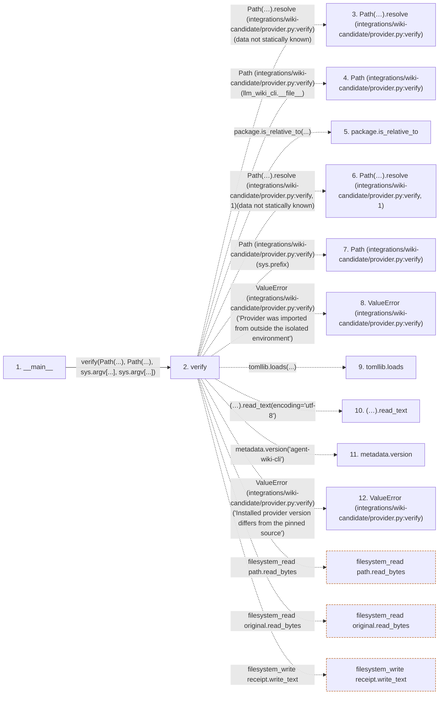

# provider

**Entry point:** `__main__` (`process`)
**Source:** [provider](../modules/provider.md)
**Modules touched:** [provider](../modules/provider.md)

**Related modules:** [llm_wiki_cli___init__](../modules/llm_wiki_cli___init__.md)

## Call sequence

> Static overview in presentation order, not runtime execution order. Arrows retain captured callers; representative internal continuations and boundary examples precede repeated helper detail.

```mermaid
sequenceDiagram
    participant p0 as __main__
    participant p1 as setup
    participant p2 as verify
    participant p3 as build_input
    participant p4 as Path (integrations/wiki-candidate/provider.py:__main__)
    participant p5 as Path(…).resolve (integrations/wiki-candidate/provider.py:verify)
    participant p6 as Path(…).resolve (integrations/wiki-candidate/provider.py:setup)
    participant p7 as Path (integrations/wiki-candidate/provider.py:verify)
    participant p8 as Path (integrations/wiki-candidate/provider.py:setup)
    participant p9 as package.is_relative_to
    participant p10 as (…).resolve
    participant p11 as Path(…).resolve (integrations/wiki-candidate/provider.py:verify, 1)
    participant p12 as consumer.is_dir
    participant p13 as consumer.is_relative_to
    participant p14 as ValueError (integrations/wiki-candidate/provider.py:verify)
    participant p15 as ValueError (integrations/wiki-candidate/provider.py:setup)
    participant p16 as tomllib.loads
    participant p17 as re.fullmatch
    participant p18 as (…).read_text
    participant p19 as metadata.version
    participant p20 as Path(…).resolve (integrations/wiki-candidate/provider.py:setup, 1)
    participant p21 as sorted
    participant p22 as temporary.is_relative_to
    participant p23 as package.rglob
    participant p24 as path.is_file
    p0->>p1: setup
    p0->>p2: verify
    p1->>p3: build_input
    p0-->>p4: Path (integrations/wiki-candidate/provider.py:__main__)(sys.argv[...])
    p2-->>p5: Path(…).resolve (integrations/wiki-candidate/provider.py:verify)
    p0-->>p4: Path (integrations/wiki-candidate/provider.py:__main__)(sys.argv[...])
    p1-->>p6: Path(…).resolve (integrations/wiki-candidate/provider.py:setup)(strict=True)
    p2-->>p7: Path (integrations/wiki-candidate/provider.py:verify)(llm_wiki_cli.__file__)
    p1-->>p8: Path (integrations/wiki-candidate/provider.py:setup)(os.environ[...])
    p2-->>p9: package.is_relative_to(...)
    p1-->>p10: (…).resolve(strict=True)
    p2-->>p11: Path(…).resolve (integrations/wiki-candidate/provider.py:verify, 1)
    p1-->>p12: consumer.is_dir
    p2-->>p7: Path (integrations/wiki-candidate/provider.py:verify)(sys.prefix)
    p1-->>p13: consumer.is_relative_to(workspace)
    p2-->>p14: ValueError (integrations/wiki-candidate/provider.py:verify)('Provider was imported from outside the isolated environment')
    p1-->>p15: ValueError (integrations/wiki-candidate/provider.py:setup)('working-directory must be a directory inside GITHUB_WORKSPACE')
    p2-->>p16: tomllib.loads(...)
    p1-->>p17: re.fullmatch('[a-z0-9][a-z0-9._-]{0,39}', suffix)
    p2-->>p18: (…).read_text(encoding='utf-8')
    p1-->>p15: ValueError (integrations/wiki-candidate/provider.py:setup)('Invalid evidence-id (use up to 40 lowercase letters, digits, dots, dashes or underscores)')
    p2-->>p19: metadata.version('agent-wiki-cli')
    p1-->>p20: Path(…).resolve (integrations/wiki-candidate/provider.py:setup, 1)(strict=True)
    p2-->>p14: ValueError (integrations/wiki-candidate/provider.py:verify)('Installed provider version differs from the pinned source')
    p1-->>p8: Path (integrations/wiki-candidate/provider.py:setup)(os.environ[...])
    p2-->>p21: sorted(package.rglob(...))
    p1-->>p22: temporary.is_relative_to(workspace)
    p2-->>p23: package.rglob('*')
    p1-->>p15: ValueError (integrations/wiki-candidate/provider.py:setup)('RUNNER_TEMP must be separate from the workspace')
    p2-->>p24: path.is_file
```

<!-- Auto-generated from static call edges. Dashed arrows are external or unresolved calls. Reviewed runtime conditions and side effects belong in Behavior. -->

> Call sequence diagram shows 30 of 99 interactions; 69 omitted to keep the visualization within the 30-interaction and generated-diagram limits, with uncertain identities omitted rather than inferred.

> Captured boundary calls: external 15 of 52 (37 omitted); unresolved 12 of 44 (32 omitted). These counts cover the captured static trace.

Omitted captured detail, grouped by actual caller occurrence and target module:

| Caller | Parent step | Target module | Kind | Omitted interactions |
| --- | --- | --- | --- | --- |
| `integrations/wiki-candidate/provider.py:verify` | 2 | - | unresolved | 15 |
| `integrations/wiki-candidate/provider.py:verify` | 2 | - | external | 10 |
| `integrations/wiki-candidate/provider.py:setup` | 43 | - | external | 12 |
| `integrations/wiki-candidate/provider.py:setup` | 43 | - | unresolved | 7 |
| `integrations/wiki-candidate/provider.py:build_input` | 66 | - | unresolved | 10 |
| `integrations/wiki-candidate/provider.py:build_input` | 66 | - | external | 15 |
> Detailed flow queries retain their own coverage and limits; omitted paths may execute at runtime.

## Data flow

<!-- Auto-generated static analysis. Treat values and boundaries as best-effort hints, not runtime proof. -->

### Analysis coverage

**Effect analysis partially available.** Flow assembly and source effect analysis are separate; empty observations do not prove an empty handler body.

Source steps: 4; effect analysis evaluated: 3, partial: 0, unavailable: 1. Counts include steps omitted from the displayed trace.

Collector observations for 3 source steps with known totals: observed: 32, emitted: 32, omitted: 0. Unavailable totals are excluded.

- Callable record unavailable for one or more source steps; those steps have no represented callable body.
- Effect collector totals unavailable; observed counts cover captured records only.

| Step | Callable record | Effect analysis | Collector totals | Observed | Emitted | Omitted |
|---|---|---|---|---:|---:|---:|
| `__main__` | `unavailable` | `unavailable` | `unavailable` | — | — | — |
| `verify` | `available` | `evaluated` | `available` | `9` | `9` | `0` |
| `Path(…).resolve (integrations/wiki-candidate/provider.py:verify)` | `not_applicable` | `not_applicable` | `not_applicable` | — | — | — |
| `Path (integrations/wiki-candidate/provider.py:verify)` | `not_applicable` | `not_applicable` | `not_applicable` | — | — | — |
| `package.is_relative_to` | `not_applicable` | `not_applicable` | `not_applicable` | — | — | — |
| `Path(…).resolve (integrations/wiki-candidate/provider.py:verify, 1)` | `not_applicable` | `not_applicable` | `not_applicable` | — | — | — |
| `Path (integrations/wiki-candidate/provider.py:verify)` | `not_applicable` | `not_applicable` | `not_applicable` | — | — | — |
| `ValueError (integrations/wiki-candidate/provider.py:verify)` | `not_applicable` | `not_applicable` | `not_applicable` | — | — | — |
| `tomllib.loads` | `not_applicable` | `not_applicable` | `not_applicable` | — | — | — |
| `(…).read_text` | `not_applicable` | `not_applicable` | `not_applicable` | — | — | — |
| `metadata.version` | `not_applicable` | `not_applicable` | `not_applicable` | — | — | — |
| `ValueError (integrations/wiki-candidate/provider.py:verify)` | `not_applicable` | `not_applicable` | `not_applicable` | — | — | — |

### Step data

| Step | Inputs | Reads | Writes | Returns |
|---|---|---|---|---|
| `__main__` | - | - | - | - |
| `verify` | `source: Path`, `receipt: Path`, `revision: str`, `repository: str` | `sys` | `files[...]` | - |
| `Path(…).resolve (integrations/wiki-candidate/provider.py:verify)` | - | - | - | - |
| `Path (integrations/wiki-candidate/provider.py:verify)` | - | - | - | - |
| `package.is_relative_to` | - | - | - | - |
| `Path(…).resolve (integrations/wiki-candidate/provider.py:verify, 1)` | - | - | - | - |
| `Path (integrations/wiki-candidate/provider.py:verify)` | - | - | - | - |
| `ValueError (integrations/wiki-candidate/provider.py:verify)` | - | - | - | - |
| `tomllib.loads` | - | - | - | - |
| `(…).read_text` | - | - | - | - |
| `metadata.version` | - | - | - | - |
| `ValueError (integrations/wiki-candidate/provider.py:verify)` | - | - | - | - |

### Call data

| From | To | Line | Call |
|---|---|---:|---|
| __main__ | verify | 140 | `verify(Path(...), Path(...), sys.argv[...], sys.argv[...])` |
| verify | Path(…).resolve (integrations/wiki-candidate/provider.py:verify) | 25 | `Path(llm_wiki_cli.__file__).resolve(data not statically known)` |
| verify | Path (integrations/wiki-candidate/provider.py:verify) | 25 | `Path(llm_wiki_cli.__file__)` |
| verify | package.is_relative_to | 26 | `package.is_relative_to(...)` |
| verify | Path(…).resolve (integrations/wiki-candidate/provider.py:verify, 1) | 26 | `Path(sys.prefix).resolve(data not statically known)` |
| verify | Path (integrations/wiki-candidate/provider.py:verify) | 26 | `Path(sys.prefix)` |
| verify | ValueError (integrations/wiki-candidate/provider.py:verify) | 27 | `ValueError('Provider was imported from outside the isolated environment')` |
| verify | tomllib.loads | 28 | `tomllib.loads(...)` |
| verify | (…).read_text | 28 | `(source / 'pyproject.toml').read_text(encoding='utf-8')` |
| verify | metadata.version | 29 | `metadata.version('agent-wiki-cli')` |
| verify | ValueError (integrations/wiki-candidate/provider.py:verify) | 31 | `ValueError('Installed provider version differs from the pinned source')` |

### Boundary effects

| Kind | Target | Step | Line |
|---|---|---|---:|
| filesystem_read | `path.read_bytes` | `verify` | 41 |
| filesystem_read | `original.read_bytes` | `verify` | 42 |
| filesystem_write | `receipt.write_text` | `verify` | 50 |

### Static analysis gaps

| Kind | Step | Target | Line |
|---|---|---|---:|
| unresolved_call | `verify` | `Path(llm_wiki_cli.__file__).resolve` | 25 |
| unresolved_call | `verify` | `package.is_relative_to` | 26 |
| unresolved_call | `verify` | `Path(sys.prefix).resolve` | 26 |
| external_call | `verify` | `ValueError` | 27 |
| external_call | `verify` | `tomllib.loads` | 28 |
| unresolved_call | `verify` | `(source / 'pyproject.toml').read_text` | 28 |
| external_call | `verify` | `metadata.version` | 29 |
| external_call | `verify` | `ValueError` | 31 |
| step_limit | `__main__` | `first 12 steps` | 0 |

## Behavior

This flow starts at `__main__` and is classified as `process`. The generated call and data-flow sections are bounded static projections; runtime conditions and side effects require source-level confirmation.
