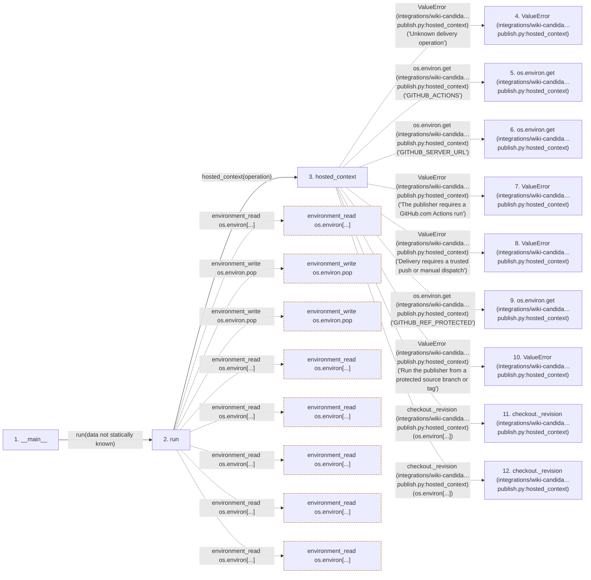

# publish

**Entry point:** `__main__` (`process`)
**Source:** [publish](../modules/publish.md)
**Modules touched:** [concept_identity](../modules/concept_identity.md), [filesystem_guard](../modules/filesystem_guard.md), [io](../modules/io.md), [knowledge_evidence](../modules/knowledge_evidence.md), and 11 more

**Complete modules touched:**

- [concept_identity](../modules/concept_identity.md)
- [filesystem_guard](../modules/filesystem_guard.md)
- [io](../modules/io.md)
- [knowledge_evidence](../modules/knowledge_evidence.md)
- [knowledge_storage](../modules/knowledge_storage.md)
- [knowledge_storage_io](../modules/knowledge_storage_io.md)
- [publication_candidate](../modules/publication_candidate.md)
- [publication_config](../modules/publication_config.md)
- [publication_contracts](../modules/publication_contracts.md)
- [publication_delivery](../modules/publication_delivery.md)
- [publication_impact](../modules/publication_impact.md)
- [publish](../modules/publish.md)
- [source_selection](../modules/source_selection.md)
- [validation](../modules/validation.md)
- [wiki_surface](../modules/wiki_surface.md)

**Related modules:** [knowledge_evidence](../modules/knowledge_evidence.md), [knowledge_storage_io](../modules/knowledge_storage_io.md), [publication_candidate](../modules/publication_candidate.md), and 4 more

**Complete related modules:**

- [knowledge_evidence](../modules/knowledge_evidence.md)
- [knowledge_storage_io](../modules/knowledge_storage_io.md)
- [publication_candidate](../modules/publication_candidate.md)
- [publication_config](../modules/publication_config.md)
- [publication_delivery](../modules/publication_delivery.md)
- [publication_impact](../modules/publication_impact.md)
- [validation](../modules/validation.md)

## Call sequence

> Static overview in presentation order, not runtime execution order. Arrows retain captured callers; representative internal continuations and boundary examples precede repeated helper detail.

```mermaid
sequenceDiagram
    participant p0 as __main__
    participant p1 as run
    participant p2 as validate_publication_config
    participant p3 as committed_record
    participant p4 as checked_artifact
    participant p5 as accepted_reviews
    participant p6 as validate_rollback_review
    participant p7 as _consumer_root
    participant p8 as read_publication_document
    participant p9 as _object
    participant p10 as validate_publication_receipt
    participant p11 as read_publication_json
    participant p12 as _choice
    participant p13 as compare_publication_impact
    participant p14 as _relative_path
    participant p15 as _check_path
    participant p16 as _reference_providers
    participant p17 as publication_repository
    participant p18 as _provider
    participant p19 as artifact_files
    participant p20 as _array
    participant p21 as _dependency
    participant p22 as publication_ref_name
    participant p23 as _content_profile
    participant p24 as read_guarded
    participant p25 as _text
    participant p26 as path_is_link_or_reparse
    participant p27 as require_repository_relative_path
    participant p28 as _json_tree
    participant p29 as Path (integrations/wiki-candida…ivery/publish.py:__main__)
    participant p30 as path.write_text (integrations/wiki-candida…ivery/publish.py:__main__)
    p0->>p1: run
    p1->>p2: validate_publication_config
    p1->>p3: committed_record
    p1->>p4: checked_artifact
    p1->>p5: accepted_reviews
    p1->>p6: validate_rollback_review
    p2->>p7: _consumer_root
    p4->>p8: read_publication_document
    p2->>p9: _object
    p4->>p10: validate_publication_receipt
    p3->>p11: read_publication_json
    p2->>p12: _choice
    p5->>p13: compare_publication_impact
    p2->>p14: _relative_path
    p2->>p15: _check_path
    p2->>p16: _reference_providers
    p2->>p17: publication_repository
    p4->>p18: _provider
    p4->>p19: artifact_files
    p2->>p20: _array
    p2->>p21: _dependency
    p2->>p22: publication_ref_name
    p2->>p23: _content_profile
    p19->>p24: read_guarded
    p14->>p25: _text
    p7->>p26: path_is_link_or_reparse
    p14->>p27: require_repository_relative_path
    p10->>p28: _json_tree
    p0-->>p29: Path (integrations/wiki-candida…ivery/publish.py:__main__)(os.environ[...])
    p0-->>p30: path.write_text (integrations/wiki-candida…ivery/publish.py:__main__)(..., encoding='utf-8')
```

<!-- Auto-generated from static call edges. Dashed arrows are external or unresolved calls. Reviewed runtime conditions and side effects belong in Behavior. -->

> Call sequence diagram shows 30 of 960 interactions; 930 omitted to keep the visualization within the 30-interaction and generated-diagram limits, with uncertain identities omitted rather than inferred.

> Captured boundary calls: external 1 of 373 (372 omitted); unresolved 1 of 257 (256 omitted). These counts cover the captured static trace.

Omitted captured detail, grouped by actual caller occurrence and target module:

| Caller | Parent step | Target module | Kind | Omitted interactions |
| --- | --- | --- | --- | --- |
| `integrations/wiki-candidate/delivery/publish.py:run` | 2 | [integrations/wiki-candidate/delivery/publish.py](../modules/publish.md) | internal | 2 |
| `integrations/wiki-candidate/delivery/publish.py:hosted_context` | 3 | - | external | 7 |
| `integrations/wiki-candidate/delivery/publish.py:hosted_context` | 3 | - | unresolved | 2 |
| `integrations/wiki-candidate/delivery/publish.py:run` | 2 | - | external | 13 |
| `integrations/wiki-candidate/delivery/publish.py:run` | 2 | - | unresolved | 26 |
| `src/llm_wiki_cli/services/publication_config.py:_consumer_root` | 25 | - | unresolved | 3 |
| `src/llm_wiki_cli/services/publication_config.py:_consumer_root` | 25 | - | external | 2 |
| `src/llm_wiki_cli/services/source_selection.py:path_is_link_or_reparse` | 28 | [src/llm_wiki_cli/services/source_selection.py](../modules/source_selection.md) | internal | 1 |
> Omission summary shows 8 of 180 groups; 172 further groups are not expanded here. Counts above include all omitted interactions.
> Detailed flow queries retain their own coverage and limits; omitted paths may execute at runtime.

> Trace truncated at the depth limit; deeper calls are omitted.

## Data flow

<!-- Auto-generated static analysis. Treat values and boundaries as best-effort hints, not runtime proof. -->

### Analysis coverage

**Effect analysis partially available.** Flow assembly and source effect analysis are separate; empty observations do not prove an empty handler body.

Source steps: 331; effect analysis evaluated: 221, partial: 10, unavailable: 100. Counts include steps omitted from the displayed trace.

Collector observations for 231 source steps with known totals: observed: 1189, emitted: 1136, omitted: 53. Unavailable totals are excluded.

- Callable record unavailable for one or more source steps; those steps have no represented callable body.
- Effect collector omitted observations before flow assembly; displayed effects are partial.
- Effect collector totals unavailable; observed counts cover captured records only.

| Step | Callable record | Effect analysis | Collector totals | Observed | Emitted | Omitted |
|---|---|---|---|---:|---:|---:|
| `__main__` | `unavailable` | `unavailable` | `unavailable` | — | — | — |
| `run` | `available` | `partial` | `available` | `28` | `16` | `12` |
| `hosted_context` | `available` | `partial` | `available` | `21` | `18` | `3` |
| `ValueError (integrations/wiki-candida…publish.py:hosted_context)` | `not_applicable` | `not_applicable` | `not_applicable` | — | — | — |
| `os.environ.get (integrations/wiki-candida…publish.py:hosted_context)` | `not_applicable` | `not_applicable` | `not_applicable` | — | — | — |
| `os.environ.get (integrations/wiki-candida…publish.py:hosted_context)` | `not_applicable` | `not_applicable` | `not_applicable` | — | — | — |
| `ValueError (integrations/wiki-candida…publish.py:hosted_context)` | `not_applicable` | `not_applicable` | `not_applicable` | — | — | — |
| `ValueError (integrations/wiki-candida…publish.py:hosted_context)` | `not_applicable` | `not_applicable` | `not_applicable` | — | — | — |
| `os.environ.get (integrations/wiki-candida…publish.py:hosted_context)` | `not_applicable` | `not_applicable` | `not_applicable` | — | — | — |
| `ValueError (integrations/wiki-candida…publish.py:hosted_context)` | `not_applicable` | `not_applicable` | `not_applicable` | — | — | — |
| `checkout._revision (integrations/wiki-candida…publish.py:hosted_context)` | `not_applicable` | `not_applicable` | `not_applicable` | — | — | — |
| `checkout._revision (integrations/wiki-candida…publish.py:hosted_context)` | `not_applicable` | `not_applicable` | `not_applicable` | — | — | — |

### Step data

| Step | Inputs | Reads | Writes | Returns |
|---|---|---|---|---|
| `__main__` | - | - | - | - |
| `run` | - | `os`, `os`, `os`, `os`, `os`, `os`, `os`, `os` | - | - |
| `hosted_context` | `operation: str` | `os`, `os`, `os`, `os`, `os`, `os`, `os`, `os` | - | `{...}` |
| `ValueError (integrations/wiki-candida…publish.py:hosted_context)` | - | - | - | - |
| `os.environ.get (integrations/wiki-candida…publish.py:hosted_context)` | - | - | - | - |
| `os.environ.get (integrations/wiki-candida…publish.py:hosted_context)` | - | - | - | - |
| `ValueError (integrations/wiki-candida…publish.py:hosted_context)` | - | - | - | - |
| `ValueError (integrations/wiki-candida…publish.py:hosted_context)` | - | - | - | - |
| `os.environ.get (integrations/wiki-candida…publish.py:hosted_context)` | - | - | - | - |
| `ValueError (integrations/wiki-candida…publish.py:hosted_context)` | - | - | - | - |
| `checkout._revision (integrations/wiki-candida…publish.py:hosted_context)` | - | - | - | - |
| `checkout._revision (integrations/wiki-candida…publish.py:hosted_context)` | - | - | - | - |

### Call data

| From | To | Line | Call |
|---|---|---:|---|
| __main__ | run | 338 | `run(data not statically known)` |
| run | hosted_context | 214 | `hosted_context(operation)` |
| hosted_context | ValueError (integrations/wiki-candida…publish.py:hosted_context) | 46 | `ValueError('Unknown delivery operation')` |
| hosted_context | os.environ.get (integrations/wiki-candida…publish.py:hosted_context) | 48 | `os.environ.get('GITHUB_ACTIONS')` |
| hosted_context | os.environ.get (integrations/wiki-candida…publish.py:hosted_context) | 49 | `os.environ.get('GITHUB_SERVER_URL')` |
| hosted_context | ValueError (integrations/wiki-candida…publish.py:hosted_context) | 51 | `ValueError('The publisher requires a GitHub.com Actions run')` |
| hosted_context | ValueError (integrations/wiki-candida…publish.py:hosted_context) | 53 | `ValueError('Delivery requires a trusted push or manual dispatch')` |
| hosted_context | os.environ.get (integrations/wiki-candida…publish.py:hosted_context) | 54 | `os.environ.get('GITHUB_REF_PROTECTED')` |
| hosted_context | ValueError (integrations/wiki-candida…publish.py:hosted_context) | 55 | `ValueError('Run the publisher from a protected source branch or tag')` |
| hosted_context | checkout._revision (integrations/wiki-candida…publish.py:hosted_context) | 56 | `checkout._revision(os.environ[...])` |
| hosted_context | checkout._revision (integrations/wiki-candida…publish.py:hosted_context) | 63 | `checkout._revision(os.environ[...])` |

### Boundary effects

| Kind | Target | Step | Line |
|---|---|---|---:|
| environment_read | `os.environ[...]` | `run` | 213 |
| environment_write | `os.environ.pop` | `run` | 216 |
| environment_write | `os.environ.pop` | `run` | 217 |
| environment_read | `os.environ[...]` | `run` | 220 |
| environment_read | `os.environ[...]` | `run` | 221 |
| environment_read | `os.environ[...]` | `run` | 232 |
| environment_read | `os.environ[...]` | `run` | 240 |
| environment_read | `os.environ[...]` | `run` | 262 |

### Static analysis gaps

| Kind | Step | Target | Line |
|---|---|---|---:|
| external_call | `hosted_context` | `ValueError` | 46 |
| external_call | `hosted_context` | `os.environ.get` | 48 |
| external_call | `hosted_context` | `os.environ.get` | 49 |
| external_call | `hosted_context` | `ValueError` | 51 |
| external_call | `hosted_context` | `ValueError` | 53 |
| external_call | `hosted_context` | `os.environ.get` | 54 |
| external_call | `hosted_context` | `ValueError` | 55 |
| unresolved_call | `hosted_context` | `checkout._revision` | 56 |
| unresolved_call | `hosted_context` | `checkout._revision` | 63 |
| step_limit | `__main__` | `first 12 steps` | 0 |
| truncated_flow | `__main__` | `depth limit` | 0 |

## Behavior

This flow starts at `__main__` and is classified as `process`. The generated call and data-flow sections are bounded static projections; runtime conditions and side effects require source-level confirmation.
