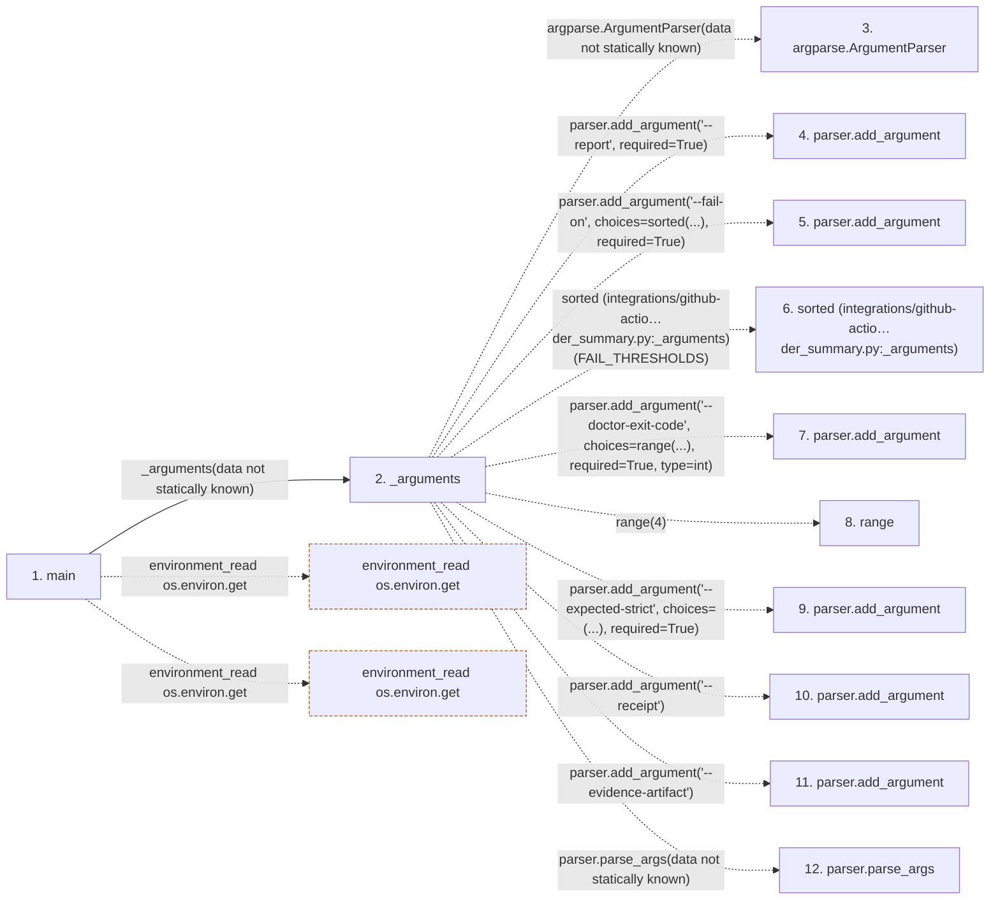

# render_summary

**Entry point:** `main` (`process`)
**Source:** [render_summary](../modules/render_summary.md)
**Modules touched:** [analysis_compatibility](../modules/analysis_compatibility.md), [ci_report](../modules/ci_report.md), [health_contract](../modules/health_contract.md), [health_summary](../modules/health_summary.md), and 2 more

**Complete modules touched:**

- [analysis_compatibility](../modules/analysis_compatibility.md)
- [ci_report](../modules/ci_report.md)
- [health_contract](../modules/health_contract.md)
- [health_summary](../modules/health_summary.md)
- [knowledge_freshness](../modules/knowledge_freshness.md)
- [render_summary](../modules/render_summary.md)

**Related modules:** [ci_report](../modules/ci_report.md), [health_summary](../modules/health_summary.md), [services_contracts](../modules/services_contracts.md)

## Call sequence

> Static overview in presentation order, not runtime execution order. Arrows retain captured callers; representative internal continuations and boundary examples precede repeated helper detail.

```mermaid
sequenceDiagram
    participant p0 as main
    participant p1 as load_report
    participant p2 as render_summary
    participant p3 as _write_receipt
    participant p4 as _arguments
    participant p5 as _append
    participant p6 as _validate_report_bytes
    participant p7 as assurance_rows
    participant p8 as detailed_health_rows
    participant p9 as _cell
    participant p10 as captured_analysis_diagnostic
    participant p11 as _required_object
    participant p12 as _enum (integrations/github-action/render_summary.py)
    participant p13 as _validate_availability
    participant p14 as _validate_freshness
    participant p15 as _validate_snapshot
    participant p16 as _validate_governance
    participant p17 as _validate_drift
    participant p18 as _validate_verification
    participant p19 as validate_doctor_payload
    participant p20 as analysis_diagnostic
    participant p21 as _exact_object (src/llm_wiki_cli/services/ci_report.py)
    participant p22 as _string_list
    participant p23 as _freshness_counts (integrations/github-action/render_summary.py)
    participant p24 as _nullable_boolean (integrations/github-action/render_summary.py)
    participant p25 as validate_health_details
    participant p26 as _contract_object
    participant p27 as _string (src/llm_wiki_cli/services/ci_report.py)
    participant p28 as _validate_doctor
    participant p29 as Path (integrations/github-action/render_summary.py:main)
    participant p30 as Path(…).read_bytes (integrations/github-actio…er_summary.py:load_report)
    p0->>p1: load_report
    p0->>p2: render_summary
    p0->>p3: _write_receipt
    p0->>p4: _arguments
    p0->>p5: _append
    p1->>p6: _validate_report_bytes
    p2->>p7: assurance_rows
    p2->>p8: detailed_health_rows
    p2->>p9: _cell
    p8->>p10: captured_analysis_diagnostic
    p6->>p11: _required_object
    p6->>p12: _enum (integrations/github-action/render_summary.py)
    p6->>p13: _validate_availability
    p6->>p14: _validate_freshness
    p6->>p15: _validate_snapshot
    p6->>p16: _validate_governance
    p6->>p17: _validate_drift
    p6->>p18: _validate_verification
    p6->>p19: validate_doctor_payload
    p10->>p20: analysis_diagnostic
    p19->>p21: _exact_object (src/llm_wiki_cli/services/ci_report.py)
    p15->>p22: _string_list
    p14->>p23: _freshness_counts (integrations/github-action/render_summary.py)
    p18->>p24: _nullable_boolean (integrations/github-action/render_summary.py)
    p19->>p25: validate_health_details
    p19->>p26: _contract_object
    p19->>p27: _string (src/llm_wiki_cli/services/ci_report.py)
    p19->>p28: _validate_doctor
    p0-->>p29: Path (integrations/github-action/render_summary.py:main)(args.report)
    p1-->>p30: Path(…).read_bytes (integrations/github-actio…er_summary.py:load_report)
```

<!-- Auto-generated from static call edges. Dashed arrows are external or unresolved calls. Reviewed runtime conditions and side effects belong in Behavior. -->

> Call sequence diagram shows 30 of 606 interactions; 576 omitted to keep the visualization within the 30-interaction and generated-diagram limits, with uncertain identities omitted rather than inferred.

> Captured boundary calls: external 1 of 198 (197 omitted); unresolved 1 of 109 (108 omitted). These counts cover the captured static trace.

Omitted captured detail, grouped by actual caller occurrence and target module:

| Caller | Parent step | Target module | Kind | Omitted interactions |
| --- | --- | --- | --- | --- |
| `integrations/github-action/render_summary.py:_arguments` | 2 | - | external | 3 |
| `integrations/github-action/render_summary.py:_arguments` | 2 | - | unresolved | 7 |
| `integrations/github-action/render_summary.py:load_report` | 13 | - | external | 2 |
| `integrations/github-action/render_summary.py:_validate_report_bytes` | 17 | - | external | 11 |
| `integrations/github-action/render_summary.py:_validate_report_bytes` | 17 | - | unresolved | 4 |
| `integrations/github-action/render_summary.py:_required_object` | 21 | [integrations/github-action/render_summary.py](../modules/render_summary.md) | internal | 1 |
| `integrations/github-action/render_summary.py:_object` | 22 | - | external | 2 |
| `integrations/github-action/render_summary.py:_required_object` | 21 | - | external | 3 |
> Omission summary shows 8 of 121 groups; 113 further groups are not expanded here. Counts above include all omitted interactions.
> Detailed flow queries retain their own coverage and limits; omitted paths may execute at runtime.

> Trace truncated at the depth limit; deeper calls are omitted.

## Data flow

<!-- Auto-generated static analysis. Treat values and boundaries as best-effort hints, not runtime proof. -->

### Step data

| Step | Inputs | Reads | Writes | Returns |
|---|---|---|---|---|
| `main` | - | `FAIL_THRESHOLDS`, `STATUS_SEVERITY` | - | `dashboard_exit` |
| `_arguments` | - | `FAIL_THRESHOLDS` | - | `parser.parse_args(...)` |
| `argparse.ArgumentParser` | - | - | - | - |
| `parser.add_argument` | - | - | - | - |
| `parser.add_argument` | - | - | - | - |
| `sorted (integrations/github-actio…der_summary.py:_arguments)` | - | - | - | - |
| `parser.add_argument` | - | - | - | - |
| `range` | - | - | - | - |
| `parser.add_argument` | - | - | - | - |
| `parser.add_argument` | - | - | - | - |
| `parser.add_argument` | - | - | - | - |
| `parser.parse_args` | - | - | - | - |

### Call data

| From | To | Line | Call |
|---|---|---:|---|
| main | _arguments | 552 | `_arguments(data not statically known)` |
| _arguments | argparse.ArgumentParser | 121 | `argparse.ArgumentParser(data not statically known)` |
| _arguments | parser.add_argument | 122 | `parser.add_argument('--report', required=True)` |
| _arguments | parser.add_argument | 123 | `parser.add_argument('--fail-on', choices=sorted(...), required=True)` |
| _arguments | sorted (integrations/github-actio…der_summary.py:_arguments) | 123 | `sorted(FAIL_THRESHOLDS)` |
| _arguments | parser.add_argument | 124 | `parser.add_argument('--doctor-exit-code', choices=range(...), required=True, type=int)` |
| _arguments | range | 126 | `range(4)` |
| _arguments | parser.add_argument | 130 | `parser.add_argument('--expected-strict', choices=(...), required=True)` |
| _arguments | parser.add_argument | 135 | `parser.add_argument('--receipt')` |
| _arguments | parser.add_argument | 136 | `parser.add_argument('--evidence-artifact')` |
| _arguments | parser.parse_args | 137 | `parser.parse_args(data not statically known)` |

### Boundary effects

| Kind | Target | Step | Line |
|---|---|---|---:|
| environment_read | `os.environ.get` | `main` | 566 |
| environment_read | `os.environ.get` | `main` | 568 |

### Static analysis gaps

| Kind | Step | Target | Line |
|---|---|---|---:|
| external_call | `_arguments` | `argparse.ArgumentParser` | 121 |
| unresolved_call | `_arguments` | `parser.add_argument` | 122 |
| unresolved_call | `_arguments` | `parser.add_argument` | 123 |
| external_call | `_arguments` | `sorted` | 123 |
| unresolved_call | `_arguments` | `parser.add_argument` | 124 |
| external_call | `_arguments` | `range` | 126 |
| unresolved_call | `_arguments` | `parser.add_argument` | 130 |
| unresolved_call | `_arguments` | `parser.add_argument` | 135 |
| unresolved_call | `_arguments` | `parser.add_argument` | 136 |
| unresolved_call | `_arguments` | `parser.parse_args` | 137 |
| step_limit | `main` | `first 12 steps` | 0 |
| truncated_flow | `main` | `depth limit` | 0 |

## Behavior

Reads the GitHub Action's doctor JSON, validates the exact contract and captured
doctor exit code, and renders a compact health table. When GitHub output paths
are present it appends the summary and status output, then returns whether the
report severity meets the configured degraded or unhealthy threshold. Invalid
input stops with a contract error rather than publishing a partial summary.
