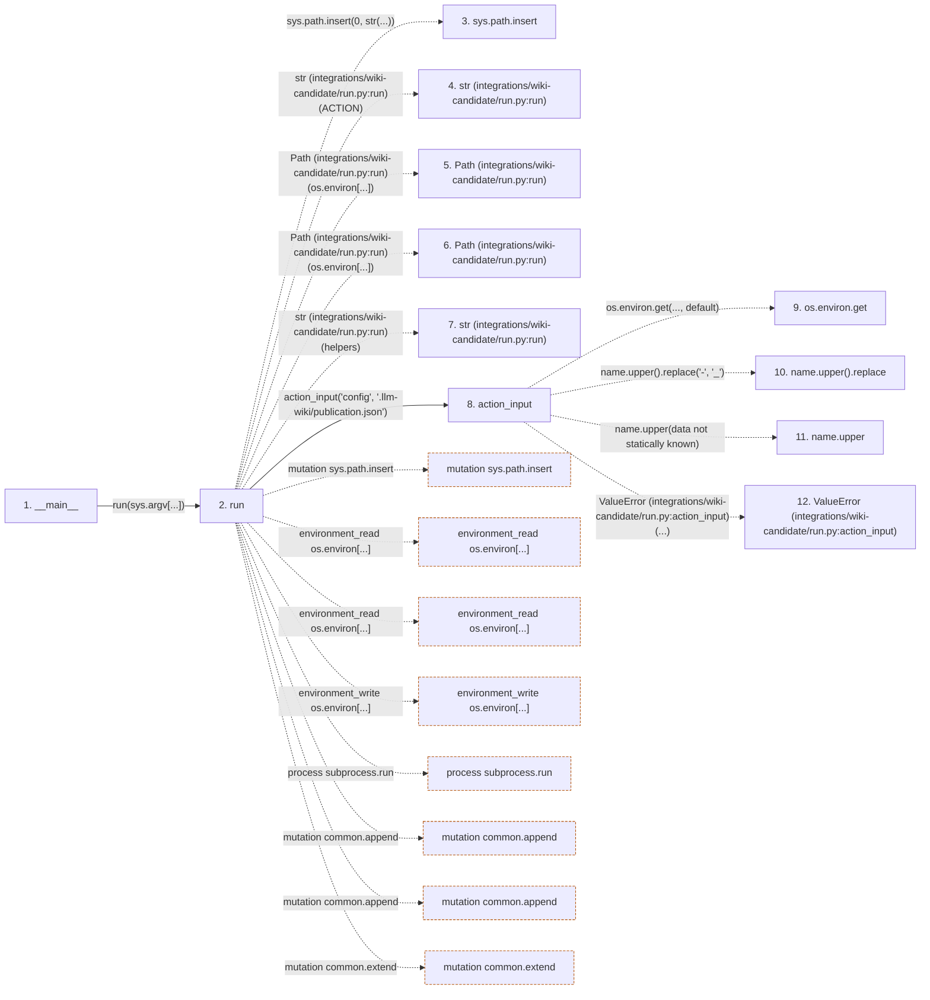

# run

**Entry point:** `__main__` (`process`)
**Source:** [run](../modules/run.md)
**Modules touched:** [io](../modules/io.md), [knowledge_evidence](../modules/knowledge_evidence.md), [knowledge_storage](../modules/knowledge_storage.md), [knowledge_storage_io](../modules/knowledge_storage_io.md), and 7 more

**Complete modules touched:**

- [io](../modules/io.md)
- [knowledge_evidence](../modules/knowledge_evidence.md)
- [knowledge_storage](../modules/knowledge_storage.md)
- [knowledge_storage_io](../modules/knowledge_storage_io.md)
- [publication_candidate](../modules/publication_candidate.md)
- [publication_config](../modules/publication_config.md)
- [publication_contracts](../modules/publication_contracts.md)
- [publication_delivery](../modules/publication_delivery.md)
- [publication_impact](../modules/publication_impact.md)
- [run](../modules/run.md)
- [validation](../modules/validation.md)

**Related modules:** [knowledge_evidence](../modules/knowledge_evidence.md), [publication_candidate](../modules/publication_candidate.md), [publication_impact](../modules/publication_impact.md)

## Call sequence

> Static overview in presentation order, not runtime execution order. Arrows retain captured callers; representative internal continuations and boundary examples precede repeated helper detail.

```mermaid
sequenceDiagram
    participant p0 as __main__
    participant p1 as run
    participant p2 as read_publication_document
    participant p3 as retain
    participant p4 as validate_publication_receipt
    participant p5 as _read_tree
    participant p6 as _absolute_path
    participant p7 as _tree_paths
    participant p8 as _json_tree
    participant p9 as split_delivery_tree
    participant p10 as hash_json
    participant p11 as validate_publication_basis
    participant p12 as validate_publication_report
    participant p13 as _hash_map
    participant p14 as _validate_review
    participant p15 as _proposal
    participant p16 as _guard
    participant p17 as _fail
    participant p18 as canonical_json_bytes
    participant p19 as _portable
    participant p20 as _public_hashes
    participant p21 as _validated_checkpoint
    participant p22 as action_input
    participant p23 as run_cli
    participant p24 as sha256_bytes
    participant p25 as StorageReadSession
    participant p26 as PublicationProtocolError
    participant p27 as write_diff
    participant p28 as _check_hash
    participant p29 as str (integrations/wiki-candidate/run.py:__main__)
    participant p30 as (…).write_text (integrations/wiki-candidate/run.py:__main__)
    p0->>p1: run
    p1->>p2: read_publication_document
    p1->>p3: retain
    p3->>p4: validate_publication_receipt
    p3->>p5: _read_tree
    p5->>p6: _absolute_path
    p5->>p7: _tree_paths
    p4->>p8: _json_tree
    p5->>p9: split_delivery_tree
    p4->>p10: hash_json
    p4->>p11: validate_publication_basis
    p4->>p12: validate_publication_report
    p4->>p13: _hash_map
    p4->>p14: _validate_review
    p4->>p15: _proposal
    p11->>p16: _guard
    p8->>p17: _fail
    p10->>p18: canonical_json_bytes
    p13->>p19: _portable
    p9->>p20: _public_hashes
    p9->>p21: _validated_checkpoint
    p1->>p22: action_input
    p1->>p23: run_cli
    p1->>p24: sha256_bytes
    p2->>p25: StorageReadSession
    p2->>p26: PublicationProtocolError
    p3->>p27: write_diff
    p4->>p28: _check_hash
    p0-->>p29: str (integrations/wiki-candidate/run.py:__main__)(exc)
    p0-->>p30: (…).write_text (integrations/wiki-candidate/run.py:__main__)(..., encoding='utf-8')
```

<!-- Auto-generated from static call edges. Dashed arrows are external or unresolved calls. Reviewed runtime conditions and side effects belong in Behavior. -->

> Call sequence diagram shows 30 of 440 interactions; 410 omitted to keep the visualization within the 30-interaction and generated-diagram limits, with uncertain identities omitted rather than inferred.

> Captured boundary calls: external 1 of 250 (249 omitted); unresolved 1 of 105 (104 omitted). These counts cover the captured static trace.

Omitted captured detail, grouped by actual caller occurrence and target module:

| Caller | Parent step | Target module | Kind | Omitted interactions |
| --- | --- | --- | --- | --- |
| `integrations/wiki-candidate/run.py:run` | 2 | - | external | 35 |
| `integrations/wiki-candidate/run.py:action_input` | 8 | - | external | 2 |
| `integrations/wiki-candidate/run.py:action_input` | 8 | - | unresolved | 2 |
| `integrations/wiki-candidate/run.py:run` | 2 | [integrations/wiki-candidate/run.py](../modules/run.md) | internal | 9 |
| `integrations/wiki-candidate/run.py:run` | 2 | - | unresolved | 16 |
| `integrations/wiki-candidate/run.py:run_cli` | 35 | - | unresolved | 1 |
| `integrations/wiki-candidate/run.py:run_cli` | 35 | - | external | 2 |
| `src/llm_wiki_cli/services/publication_impact.py:read_publication_document` | 45 | - | unresolved | 3 |
> Omission summary shows 8 of 72 groups; 64 further groups are not expanded here. Counts above include all omitted interactions.
> Detailed flow queries retain their own coverage and limits; omitted paths may execute at runtime.

> Trace truncated at the depth limit; deeper calls are omitted.

## Data flow

<!-- Auto-generated static analysis. Treat values and boundaries as best-effort hints, not runtime proof. -->

### Analysis coverage

**Effect analysis partially available.** Flow assembly and source effect analysis are separate; empty observations do not prove an empty handler body.

Source steps: 86; effect analysis evaluated: 76, partial: 2, unavailable: 8. Counts include steps omitted from the displayed trace.

Collector observations for 78 source steps with known totals: observed: 329, emitted: 305, omitted: 24. Unavailable totals are excluded.

- Callable record unavailable for one or more source steps; those steps have no represented callable body.
- Effect collector omitted observations before flow assembly; displayed effects are partial.
- Effect collector totals unavailable; observed counts cover captured records only.

| Step | Callable record | Effect analysis | Collector totals | Observed | Emitted | Omitted |
|---|---|---|---|---:|---:|---:|
| `__main__` | `unavailable` | `unavailable` | `unavailable` | — | — | — |
| `run` | `available` | `partial` | `available` | `33` | `19` | `14` |
| `sys.path.insert` | `not_applicable` | `not_applicable` | `not_applicable` | — | — | — |
| `str (integrations/wiki-candidate/run.py:run)` | `not_applicable` | `not_applicable` | `not_applicable` | — | — | — |
| `Path (integrations/wiki-candidate/run.py:run)` | `not_applicable` | `not_applicable` | `not_applicable` | — | — | — |
| `Path (integrations/wiki-candidate/run.py:run)` | `not_applicable` | `not_applicable` | `not_applicable` | — | — | — |
| `str (integrations/wiki-candidate/run.py:run)` | `not_applicable` | `not_applicable` | `not_applicable` | — | — | — |
| `action_input` | `available` | `evaluated` | `available` | `4` | `4` | `0` |
| `os.environ.get` | `not_applicable` | `not_applicable` | `not_applicable` | — | — | — |
| `name.upper().replace` | `not_applicable` | `not_applicable` | `not_applicable` | — | — | — |
| `name.upper` | `not_applicable` | `not_applicable` | `not_applicable` | — | — | — |
| `ValueError (integrations/wiki-candidate/run.py:action_input)` | `not_applicable` | `not_applicable` | `not_applicable` | — | — | — |

### Step data

| Step | Inputs | Reads | Writes | Returns |
|---|---|---|---|---|
| `__main__` | - | - | - | - |
| `run` | `mode: str` | `ACTION`, `os`, `os`, `ACCEPTED`, `sys`, `ACTION`, `os`, `os` | `os.environ[...]` | `none` |
| `sys.path.insert` | - | - | - | - |
| `str (integrations/wiki-candidate/run.py:run)` | - | - | - | - |
| `Path (integrations/wiki-candidate/run.py:run)` | - | - | - | - |
| `Path (integrations/wiki-candidate/run.py:run)` | - | - | - | - |
| `str (integrations/wiki-candidate/run.py:run)` | - | - | - | - |
| `action_input` | `name: str`, `default: str` | - | - | `value` |
| `os.environ.get` | - | - | - | - |
| `name.upper().replace` | - | - | - | - |
| `name.upper` | - | - | - | - |
| `ValueError (integrations/wiki-candidate/run.py:action_input)` | - | - | - | - |

### Call data

| From | To | Line | Call |
|---|---|---:|---|
| __main__ | run | 192 | `run(sys.argv[...])` |
| run | sys.path.insert | 94 | `sys.path.insert(0, str(...))` |
| run | str (integrations/wiki-candidate/run.py:run) | 94 | `str(ACTION)` |
| run | Path (integrations/wiki-candidate/run.py:run) | 97 | `Path(os.environ[...])` |
| run | Path (integrations/wiki-candidate/run.py:run) | 98 | `Path(os.environ[...])` |
| run | str (integrations/wiki-candidate/run.py:run) | 101 | `str(helpers)` |
| run | action_input | 102 | `action_input('config', '.llm-wiki/publication.json')` |
| action_input | os.environ.get | 21 | `os.environ.get(..., default)` |
| action_input | name.upper().replace | 21 | `name.upper().replace('-', '_')` |
| action_input | name.upper | 21 | `name.upper(data not statically known)` |
| action_input | ValueError (integrations/wiki-candidate/run.py:action_input) | 23 | `ValueError(...)` |

### Boundary effects

| Kind | Target | Step | Line |
|---|---|---|---:|
| mutation | `sys.path.insert` | `run` | 94 |
| environment_read | `os.environ[...]` | `run` | 97 |
| environment_read | `os.environ[...]` | `run` | 98 |
| environment_write | `os.environ[...]` | `run` | 101 |
| process | `subprocess.run` | `run` | 114 |
| mutation | `common.append` | `run` | 126 |
| mutation | `common.append` | `run` | 128 |
| mutation | `common.extend` | `run` | 129 |

### Static analysis gaps

| Kind | Step | Target | Line |
|---|---|---|---:|
| external_call | `action_input` | `os.environ.get` | 21 |
| unresolved_call | `action_input` | `name.upper().replace` | 21 |
| unresolved_call | `action_input` | `name.upper` | 21 |
| external_call | `action_input` | `ValueError` | 23 |
| step_limit | `__main__` | `first 12 steps` | 0 |
| truncated_flow | `__main__` | `depth limit` | 0 |

## Behavior

This flow starts at `__main__` and is classified as `process`. The generated call and data-flow sections are bounded static projections; runtime conditions and side effects require source-level confirmation.
