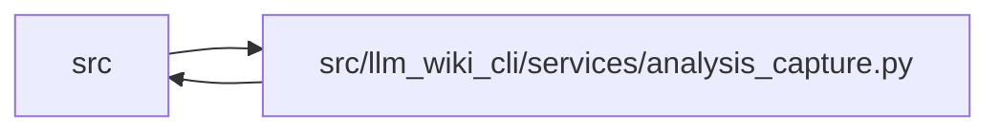

# analysis_capture Module

**Path:** `src/llm_wiki_cli/services/analysis_capture.py`

## Description

Operation-owned capture of installed analysis implementation and runtimes.

`analysis_input_status` checks the installed provider's Python/helper census and
registered implementation files. Its bounded relative paths, counts, omissions
and registry-review route describe classification/file gaps; readiness does not
establish runtime/helper readiness or analysis authority. No target source is
inventoried or executed and no file is automatically classified.

Unclassified inputs keep the issued component map empty. Separately frozen
diagnostics are available through `analysis_diagnostics`, and never participate
in producer identity or compatibility. Missing registered inputs retain unknown
authority. Census changes and removed required files are checked before an
operation-cached capture can be reused. Deliberately classified consumer files
preserve observation identities; changed shared/extractor inputs invalidate
their commitments. Final publication guards still own mutable-input checks.

## Imports

| Source | Symbols |
|--------|---------|
| `.` | `analysis_compatibility`, `extractor_helpers` |
| `.immutable` | `FrozenDict`, `freeze` |
| `.knowledge_envelope` | `hash_component_configuration` |
| `__future__` | `annotations` |
| `collections.abc` | `Mapping` |
| `contextvars` | `ContextVar` |
| `copy` | `deepcopy` |
| `dataclasses` | `replace` |
| `functools` | `wraps` |
| `hashlib` | `hashlib` |
| `importlib.metadata` | `version` |
| `json` | `json` |
| `pathlib` | `Path` |
| `platform` | `platform` |
| `re` | `re` |
| `sys` | `sys` |

## Local dependency map

<!-- Auto-generated local dependency summary. Do not edit by hand. -->

> Module-level dependencies exceed the generated-diagram limits, so the diagram and table below group them by top-level package. Counts report the number of module neighbors in each package.

### Internal neighbors

| Direction | Module |
|---|---|
| Inbound | `src` (11) |
| Outbound | `src` (4) |

> All 15 module neighbor(s) are summarized by package because the module-level view exceeds the 12-node limit.

## Classes

| Class | Line | Bases | Description |
|-------|------|-------|-------------|
| [_CapturedAnalysis](../entities/CapturedAnalysis.md) | 22 | `FrozenDict` | — |

## Functions

| Function | Signature | Decorators | Description |
|----------|-----------|------------|-------------|
| `_issued` | `(values, diagnostics = None)` | — | — |
| `analysis_diagnostics` | `(captured)` | — | Return informational owner-captured diagnostics, never producer identity. |
| `_input_rows` | `(root, rules)` | — | — |
| `_status` | `(rows, *, limit = 20, reason = None)` | — | — |
| `analysis_input_status` | `(*, package_root = None, limit = 20)` | — | Read installed provider classification; never inventory target source or execute it. |
| `validate_analysis_diagnostics` | `(value)` | — | Validate bounded informational task diagnostics without reading installed files. |
| `capture_operation` | `(function)` | — | — |
| `registry` | `(root: Path \| None = None) -> dict` | — | — |
| `implementation_hash` | `(root: Path, paths: list[str]) -> str` | — | — |
| `capture_analysis` | `(registry_entries: Mapping[str, str], *, helper_cache_dir = None, source_root: str \| Path = '.', languages = None, package_root: Path \| None = None) -> dict` | — | Capture immutable JSON inputs once; unavailable providers stay unknown. |
| `attach` | `(component, captured: Mapping \| None)` | — | — |