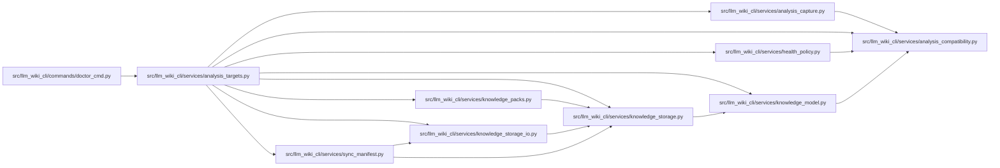

# analysis_targets Module

**Path:** `src/llm_wiki_cli/services/analysis_targets.py`

## Description

Read-only declared-target prerequisites, separate from live analysis authority.

Compares project-declared proof-owner environments with committed analysis metadata. It distinguishes matching declared provenance, recognized portable runtime commitments, capture-required differences and unknown prerequisites. Target declarations are inert data; neither a matching result nor a stored implementation hash verifies a future target's runtime identity, dependency versions, package equivalence, source freshness or semantic correctness.

The snapshot reader checks committed knowledge/manifest/surface bindings through guarded reads and rechecks them before returning. It does not discover application sources, invoke extractors or target processes, prepare helpers or change ownership. Missing, malformed or unsupported records remain unknown. Producer component, target and response bounds are explicit; aggregate mismatch/unknown counts include omitted rows and selected scope discloses unselected components.

Fresh target-native proof remains required. A known mismatch points to the project's authorized complete target-host capture and review, including provenance and removals. It never rewrites runtime commitments, repairs a wiki, or grants authority from a declaration's capture-route text.

## Imports

| Source | Symbols |
|--------|---------|
| `.` | `analysis_compatibility` |
| `.analysis_capture` | `registry` |
| `.health_policy` | `digest`, `strict_json`, `strict_json` |
| `.knowledge_model` | `_parse_bundle`, `parse_knowledge_index` |
| `.knowledge_packs` | `parse_packed_root` |
| `.knowledge_storage` | `parse_store_root` |
| `.knowledge_storage_io` | `StorageReadSession`, `read_guarded` |
| `.sync_manifest` | `SyncManifest` |
| `__future__` | `annotations` |
| `collections` | `Counter` |
| `collections.abc` | `Mapping` |
| `json` | `json` |
| `pathlib` | `Path` |
| `re` | `re` |
| `typing` | `Any` |

## Local dependency map

<!-- Auto-generated local dependency summary. Do not edit by hand. -->

### Internal neighbors

| Direction | Module |
|---|---|
| Inbound | [doctor_cmd](../modules/doctor_cmd.md) |
| Outbound | [analysis_capture](../modules/analysis_capture.md) |
| Outbound | [analysis_compatibility](../modules/analysis_compatibility.md) |
| Outbound | [health_policy](../modules/health_policy.md) |
| Outbound | [knowledge_model](../modules/knowledge_model.md) |
| Outbound | [knowledge_packs](../modules/knowledge_packs.md) |
| Outbound | [knowledge_storage](../modules/knowledge_storage.md) |
| Outbound | [knowledge_storage_io](../modules/knowledge_storage_io.md) |
| Outbound | [sync_manifest](../modules/sync_manifest.md) |

## Functions

| Function | Signature | Decorators | Description |
|----------|-----------|------------|-------------|
| `normalize_targets` | `(value)` | — | Accept project-owned declarations as data, never commands or authority. |
| `_portable` | `(record, target, rules)` | — | Recognize only the runtime commitments issued by registered profiles. |
| `_compare` | `(record, target, rules)` | — | — |
| `compare_targets` | `(records, targets, *, rules = None)` | — | Compare prerequisite metadata; never create or replace runtime identities. |
| `inspect_targets` | `(wiki_dir, targets)` | — | Read committed producer headers, without source discovery or extraction. |
| `load_targets` | `(path)` | — | — |