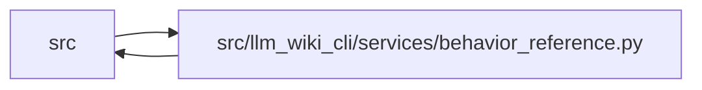

# behavior_reference Module

**Path:** `src/llm_wiki_cli/services/behavior_reference.py`

## Description

Versioned reference data derived from the llm-wiki provider's declarations.

## Imports

| Source | Symbols |
|--------|---------|
| `.` | `cli_reference`, `current_contracts`, `skills`, `task_compact`, `task_contract` |
| `..` | `config` |
| `..cli` | `build_cli_parser` |
| `.helper_runtime` | `resolve_helper_policy` |
| `.knowledge_evidence` | `hash_json` |
| `.knowledge_storage_io` | `read_guarded` |
| `.validation` | `require_portable_relative_path` |
| `__future__` | `annotations` |
| `collections.abc` | `Mapping` |
| `functools` | `lru_cache` |
| `importlib` | `metadata`, `resources` |
| `json` | `json` |
| `pathlib` | `Path` |
| `tomllib` | `tomllib` |
| `typing` | `Any` |

## Local dependency map

<!-- Auto-generated local dependency summary. Do not edit by hand. -->

> Module-level dependencies exceed the generated-diagram limits, so the diagram and table below group them by top-level package. Counts report the number of module neighbors in each package.

### Internal neighbors

| Direction | Module |
|---|---|
| Inbound | `src` (5) |
| Outbound | `src` (11) |

> All 16 module neighbor(s) are summarized by package because the module-level view exceeds the 12-node limit.

## Functions

| Function | Signature | Decorators | Description |
|----------|-----------|------------|-------------|
| `_package_facts` | `() -> dict[str, str]` | — | — |
| `_installed_identity` | `(distribution: metadata.Distribution) -> dict[str, str]` | — | — |
| `_identity` | `(name: str, version: str, requires_python: str) -> dict[str, str]` | — | — |
| `_argument` | `(root, commands, dest)` | — | — |
| `_request_defaults` | `(schema: str) -> dict[str, Any]` | — | — |
| `_task_facts` | `(root, current) -> dict[str, Any]` | — | — |
| `get_behavior_facts` | `() -> dict[str, Any]` | — | Return detached declarations for the loaded provider without inspecting a consumer wiki. |
| `_schema` | `() -> dict` | `@lru_cache(maxsize=1)` | — |
| `_validate_paths` | `(paths) -> None` | — | — |
| `validate_behavior_facts` | `(contract: object) -> None` | — | Validate a saved provider declaration and its commitment independently of the live provider. |
| `parse_behavior_facts` | `(raw: bytes \| str) -> dict[str, Any]` | — | Decode a bounded behavior contract with unique keys and finite JSON values. |
| `load_behavior_facts` | `(path: str \| Path) -> dict[str, Any]` | — | Read a saved behavior reference as bounded data. |
| `_rows` | `(entries) -> list[str]` | — | — |
| `render_behavior_reference` | `(contract: object) -> str` | — | Render a validated contract as Markdown using only its recorded facts. |
