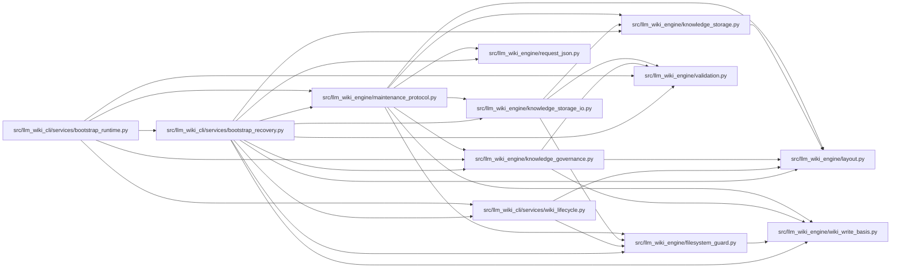

# bootstrap_recovery Module

**Path:** `src/llm_wiki_cli/services/bootstrap_recovery.py`

## Description

Recover only journaled first-use output before capturing fresh evidence.

## Imports

| Source | Symbols |
|--------|---------|
| `.wiki_lifecycle` | `is_pristine_wiki_target` |
| `__future__` | `annotations` |
| `contextlib` | `contextmanager` |
| `json` | `json` |
| `llm_wiki_engine.filesystem_guard` | `atomic_write_guarded_bytes`, `ensure_guarded_directory`, `remove_guarded_tree`, `unlink_guarded_bytes` |
| `llm_wiki_engine.knowledge_governance` | `_governance_lock_root`, `repository_metadata` |
| `llm_wiki_engine.knowledge_storage` | `MAX_EXPANDED_BYTES`, `canonical_bytes`, `digest` |
| `llm_wiki_engine.knowledge_storage_io` | `_absolute_path`, `read_guarded` |
| `llm_wiki_engine.layout` | `DEFAULT_LAYOUT` |
| `llm_wiki_engine.maintenance_protocol` | `MaintenanceProtocolError`, `WikiWriteBasis`, `governance_writer_lock`, `storage_writer_lock`, `guard_maintenance_owner`, `save_recovery_snapshot`, `snapshot_wiki` |
| `llm_wiki_engine.request_json` | `_pairs`, `_constant` |
| `llm_wiki_engine.validation` | `is_portable_relative_path` |
| `llm_wiki_engine.wiki_write_basis` | `ACTIVE_BOOTSTRAP_JOURNAL` |
| `pathlib` | `Path`, `PurePosixPath` |
| `re` | `re` |
| `tempfile` | `tempfile` |
| `uuid` | `uuid4` |

## Local dependency map

<!-- Auto-generated local dependency summary. Do not edit by hand. -->

### Internal neighbors

| Direction | Module |
|---|---|
| Inbound | [bootstrap_runtime](../modules/bootstrap_runtime.md) |
| Outbound | [wiki_lifecycle](../modules/wiki_lifecycle.md) |
| Outbound | [filesystem_guard](../modules/filesystem_guard.md) |
| Outbound | [knowledge_governance](../modules/knowledge_governance.md) |
| Outbound | [knowledge_storage](../modules/knowledge_storage.md) |
| Outbound | [knowledge_storage_io](../modules/knowledge_storage_io.md) |
| Outbound | [layout](../modules/layout.md) |
| Outbound | [maintenance_protocol](../modules/maintenance_protocol.md) |
| Outbound | [request_json](../modules/request_json.md) |
| Outbound | [validation](../modules/validation.md) |
| Outbound | [wiki_write_basis](../modules/wiki_write_basis.md) |

## Functions

| Function | Signature | Decorators | Description |
|----------|-----------|------------|-------------|
| `_record_below` | `(parent: Path, root: Path) -> Path` | — | — |
| `_earlier_record_parents` | `(root: Path, current: Path) -> list[Path]` | — | Places where releases up to 6.1.0 kept a linked worktree's record. |
| `_is_interrupted_record` | `(path: Path, root: Path) -> bool` | — | — |
| `_record_path` | `(root: Path) -> Path` | — | — |
| `_json` | `(raw: bytes)` | — | — |
| `_invalid` | `(message: str) -> MaintenanceProtocolError` | — | — |
| `_load_record` | `(root: Path)` | — | — |
| `pending_bootstrap` | `(wiki_dir: str \| Path) -> bool` | — | — |
| `guard_incomplete_bootstrap` | `(root: Path) -> None` | — | — |
| `_safe_name` | `(name) -> bool` | — | — |
| `_directories` | `(root: Path) -> set[str]` | — | — |
| `_save_record` | `(root: Path, record: dict) -> None` | — | — |
| `_complete` | `(root: Path, record: dict, *, status = 'complete') -> None` | — | — |
| `_recovery_inputs` | `(root: Path, record: dict)` | — | — |
| `_recover` | `(root: Path, record: dict) -> None` | — | Validate the entire tree before restoring with exact-byte comparisons. |
| `bootstrap_write_operation` | `(wiki_dir: str \| Path, *, preflight)` | `@contextmanager` | Lock before mutation and retain first-use preimages across interruption. |
