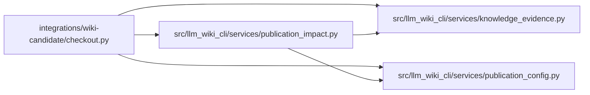

# checkout Module

**Path:** `integrations/wiki-candidate/checkout.py`

## Description

Bind a local candidate action to the consumer checkout and accepted inputs.

## Imports

| Source | Symbols |
|--------|---------|
| `__future__` | `annotations` |
| `json` | `json` |
| `llm_wiki_cli.services.knowledge_evidence` | `sha256_bytes` |
| `llm_wiki_cli.services.publication_config` | `publication_control_overlap`, `publication_path` |
| `llm_wiki_cli.services.publication_impact` | `MAX_JSON_BYTES` |
| `os` | `os` |
| `pathlib` | `Path` |
| `re` | `re` |
| `subprocess` | `subprocess` |

## Local dependency map

<!-- Auto-generated local dependency summary. Do not edit by hand. -->

### Internal neighbors

| Direction | Module |
|---|---|
| Outbound | [knowledge_evidence](../modules/knowledge_evidence.md) |
| Outbound | [publication_config](../modules/publication_config.md) |
| Outbound | [publication_impact](../modules/publication_impact.md) |

## Functions

| Function | Signature | Decorators | Description |
|----------|-----------|------------|-------------|
| `_git` | `(directory: Path, *args: str) -> bytes` | — | — |
| `_revision` | `(value: str) -> str` | — | — |
| `_repository` | `(directory: Path) -> Path` | — | — |
| `_clean` | `(directory: Path, separate_target: Path \| None = None) -> None` | — | — |
| `verified_target` | `(consumer: Path, target_dir: str, target_revision: str) -> str \| None` | — | — |
| `verified_checkout` | `(consumer: Path, source_revision: str, target_dir: str, accepted: dict[str, str]) -> str` | — | — |
| `accepted_inputs` | `(consumer: Path, accepted: dict[str, str], revision: str, runtime: Path) -> tuple[dict[str, str], str \| None]` | — | Read explicitly accepted metadata from Git, independently of the source commit. |
