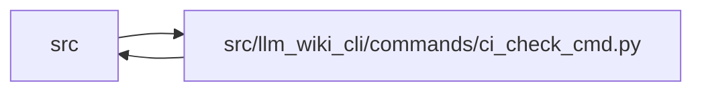

# ci_check_cmd Module

**Path:** `src/llm_wiki_cli/commands/ci_check_cmd.py`

## Description

Runs the lint service in strict mode for automation. Unsupported report-schema
values are rejected before source-path validation, cache preparation or report
destination selection; the diagnostic lists `auto`, `v1`, `v2`, `v3` and `v4`.
The command emits the selected console format and attempts a Markdown report
when enabled, using the default or explicit authorized destination. `--no-report`
disables that artifact while retaining checks. Blocking wiki findings and
required explicit report-write failures return nonzero; local metrics remain
best effort.

## Imports

| Source | Symbols |
|--------|---------|
| `..config` | `DEFAULT_WIKI_DIR`, `validate_path`, `validate_source_root` |
| `..services.ci_report` | `build_ci_check_payload` |
| `..services.doctor_service` | `compose_doctor_report` |
| `..services.extraction_jobs` | `extraction_job_request_from_args`, `print_extraction_job_plan` |
| `..services.health_summary` | `ASSURANCE_DISCLOSURE`, `ci_health_rows`, `summary_cell` |
| `..services.inventory_cache` | `InventoryCacheStats`, `cache_options_from_args`, `format_cache_stats`, `prepare_cache_options` |
| `..services.io` | `write_bytes_atomic` |
| `..services.knowledge_storage_diagnostics` | `storage_report` |
| `..services.lint_service` | `LintIssue`, `build_report`, `render_markdown`, `render_text`, `report_to_dict` |
| `..services.metrics` | `record_validation_event` |
| `..services.progress` | `observed_phase` |
| `..services.runtime_output` | `RuntimeDestination`, `RuntimeOutputError`, `prepare_destination`, `stderr_warning` |
| `__future__` | `annotations` |
| `dataclasses` | `replace` |
| `json` | `json` |
| `pathlib` | `Path` |
| `sys` | `sys` |
| `time` | `time` |

## Local dependency map

<!-- Auto-generated local dependency summary. Do not edit by hand. -->

> Module-level dependencies exceed the generated-diagram limits, so the diagram and table below group them by top-level package. Counts report the number of module neighbors in each package.

### Internal neighbors

| Direction | Module |
|---|---|
| Inbound | `src` (1) |
| Outbound | `src` (12) |

> All 13 module neighbor(s) are summarized by package because the module-level view exceeds the 12-node limit.

## Functions

| Function | Signature | Decorators | Description |
|----------|-----------|------------|-------------|
| `_render_console` | `(report, output_format: str, **payload_options) -> str` | — | — |
| `_health_for_report` | `(report)` | — | — |
| `_decision_summary` | `(report, *, markdown: bool, health = None) -> str` | — | Present the captured evaluation; ordinary CI has no release admission. |
| `_report_destination` | `(args) -> RuntimeDestination` | — | — |
| `_persist_report` | `(destination: RuntimeDestination, report) -> int` | `@observed_phase('report_persistence')` | — |
| `run` | `(args) -> None` | — | — |