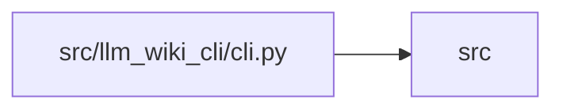

# cli Module

**Path:** `src/llm_wiki_cli/cli.py`

## Description

Defines the `llm-wiki` argument parser and dispatch boundary. It registers the
complete command tree, validates shared numeric and source-selection options,
and routes the parsed namespace to focused command or service modules. Optional
features such as MCP remain behind their command boundary so ordinary parser
startup does not require their runtime packages.

Sync accepts `--repair-evidence` as an explicitly scoped owning operation with
`--no-plugins`. Its values are canonical POSIX source keys relative to the supplied
source root, independent of native filesystem spelling. Copied preview arguments
preserve selection/helper/cache bindings and safely represent spaces and leading
dashes. The option limits application after full analysis, without granting force
or recovery authorization.

Query, extraction and sync help expose the existing captured-evidence recovery
route. Snapshot explanation remains separate from explicitly authorized full live
analysis. One-file extraction prints raw JSON without a wiki argument, setup or
stored repair. The sync hint preserves preview/review/authority, final re-anchor
and strict validation; help text grants no extra write or setup authority.

## Imports

| Source | Symbols |
|--------|---------|
| `.cli_declarations` | `_build_parser`, `build_cli_parser` |
| `.commands` | `api_diff_cmd`, `bump_cmd`, `ci_check_cmd`, `docs_cmd`, `doctor_cmd`, `generate_prompt_cmd`, `install_ci_cmd`, `init_cmd`, `install_cmd`, `knowledge_cmd`, `maintenance_cmd`, `mcp_cmd`, `metrics_cmd`, `migrate_cmd`, `obsidian_cmd`, `plugins_cmd`, `prepare_extractors_cmd`, `queue_cmd`, `query_cmd`, `reference_cmd`, `release_cmd`, `review_cmd`, `search_cmd`, `site_cmd`, `skills_cmd`, `status_cmd`, `sync_cmd`, `team_cmd`, `task_cmd`, `trigger_cmd`, `uninstall_cmd`, `upgrade_cmd` |
| `.config` | `PathValidationError` |
| `.services` | `bootstrap_runtime`, `context_service`, `extraction_service`, `lint_service` |
| `.services.helper_runtime` | `current_helper_configuration`, `helper_operation` |
| `.services.resource_diagnostics` | `resource_failure_hint` |
| `contextlib` | `contextmanager` |
| `llm_wiki_engine.analysis_compatibility` | `comparison_scope` |
| `llm_wiki_engine.progress` | `Progress` |
| `llm_wiki_engine.runtime_output` | `RuntimeOutputError` |
| `os` | `os` |
| `sys` | `sys` |

## Local dependency map

<!-- Auto-generated local dependency summary. Do not edit by hand. -->

> Module-level dependencies exceed the generated-diagram limits, so the diagram and table below group them by top-level package. Counts report the number of module neighbors in each package.

### Internal neighbors

| Direction | Module |
|---|---|
| Outbound | `src` (41) |

> All 41 module neighbor(s) are summarized by package because the module-level view exceeds the 12-node limit.

## Functions

| Function | Signature | Decorators | Description |
|----------|-----------|------------|-------------|
| `_helper_preparation_policy` | `(args)` | — | — |
| `_dispatch_command` | `(args)` | — | — |
| `_print_exception_notes` | `(exc: BaseException) -> None` | — | — |
| `_report_cli_errors` | `()` | `@contextmanager` | — |
| `main` | `()` | — | — |
