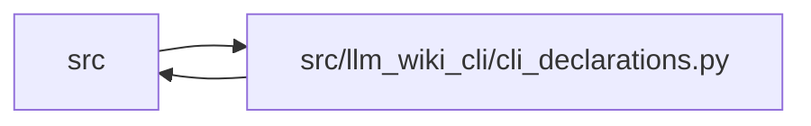

# cli_declarations Module

**Path:** `src/llm_wiki_cli/cli_declarations.py`

## Description

Declarations of every ``llm-wiki`` command, option and default.

The parser is built here without importing command implementations, so the
CLI reference and other readers can describe the CLI without loading the
application or the public API. ``llm_wiki_cli.cli`` adds dispatch.

## Imports

| Source | Symbols |
|--------|---------|
| `.` | `__version__` |
| `.config` | `AGENT_CHOICES`, `DEFAULT_WIKI_DIR` |
| `.services.extraction_jobs` | `ExtractionJobsAction` |
| `.services.maintenance_queue` | `DEFAULT_QUEUE_LIMIT`, `MAX_QUEUE_LIMIT`, `MIN_QUEUE_LIMIT`, `validate_queue_limit` |
| `.services.site_export` | `SUPPORTED_KNOWLEDGE_METADATA`, `SUPPORTED_SITE_FORMATS`, `SUPPORTED_SITE_PROFILES` |
| `.services.site_html_check` | `SUPPORTED_LINK_MODES` |
| `argparse` | `argparse` |
| `llm_wiki_engine.contracts` | `BOOTSTRAP_SKIP_DATA_FLOW_FLAG`, `INITIALIZABLE_SURFACES`, `SUPPORTED_DOCUMENTATION_KNOWLEDGE_MODES` |
| `llm_wiki_engine.knowledge_governance` | `ACTOR_KINDS`, `ALIAS_LOCATOR`, `ALIAS_NATURAL_KEY` |
| `llm_wiki_engine.knowledge_model` | `KnowledgeProjectionProfile` |

## Local dependency map

<!-- Auto-generated local dependency summary. Do not edit by hand. -->

> Module-level dependencies exceed the generated-diagram limits, so the diagram and table below group them by top-level package. Counts report the number of module neighbors in each package.

### Internal neighbors

| Direction | Module |
|---|---|
| Inbound | `src` (4) |
| Outbound | `src` (9) |

> All 13 module neighbor(s) are summarized by package because the module-level view exceeds the 12-node limit.

## Classes

| Class | Line | Bases | Description |
|-------|------|-------|-------------|
| [_ExplicitContextOption](../entities/ExplicitContextOption.md) | 48 | `argparse.Action` | Retain which semantic options were supplied beside a request file. |

## Functions

| Function | Signature | Decorators | Description |
|----------|-----------|------------|-------------|
| `_positive_int` | `(value: str) -> int` | — | — |
| `_nonnegative_int` | `(value: str) -> int` | — | — |
| `_queue_limit` | `(value: str) -> int` | — | — |
| `_nonblank_query` | `(value: str) -> str` | — | — |
| `_surface_values` | `(value: str) -> tuple[str, ...]` | — | — |
| `_add_helper_cache_argument` | `(parser)` | — | — |
| `_add_include_tests_argument` | `(parser)` | — | — |
| `_add_source_selection_argument` | `(parser)` | — | — |
| `_add_jobs_argument` | `(parser)` | — | — |
| `_add_queue_command` | `(subparsers)` | — | — |
| `_add_maintenance_command` | `(subparsers)` | — | — |
| `_build_parser` | `()` | — | — |
| `build_cli_parser` | `() -> argparse.ArgumentParser` | — | Build the declared CLI without parsing arguments or running commands. |
| `_add_helper_preparation_arguments` | `(parser)` | — | Accept the operation policy before or after nested command names. |
| `_add_query_command` | `(subparsers)` | — | — |
| `_add_task_context_command` | `(subparsers)` | — | — |
| `_register_commands` | `(subparsers)` | — | — |
| `_add_doctor_command` | `(subparsers)` | — | — |
| `_add_init_command` | `(subparsers)` | — | — |
| `_add_extract_command` | `(subparsers)` | — | — |
| `_add_progress_arguments` | `(parser)` | — | — |
| `_add_lint_command` | `(subparsers)` | — | — |
| `_add_prepare_extractors_command` | `(subparsers)` | — | — |
| `_add_ci_check_command` | `(subparsers)` | — | — |
| `_add_install_ci_command` | `(subparsers)` | — | — |
| `_add_install_command` | `(subparsers)` | — | — |
| `_add_knowledge_wiki_argument` | `(parser)` | — | — |
| `_add_knowledge_dry_run` | `(parser)` | — | — |
| `_add_governance_actor_arguments` | `(parser)` | — | — |
| `_add_lifecycle_arguments` | `(parser, *, reason: str, successor: bool = False)` | — | — |
| `_add_knowledge_command` | `(subparsers)` | — | — |
| `_add_plugins_command` | `(subparsers)` | — | — |
| `_add_team_command` | `(subparsers)` | — | — |
| `_add_trigger_agent_command` | `(subparsers)` | — | — |
| `_add_bootstrap_command` | `(subparsers)` | — | — |
| `_add_bump_command` | `(subparsers)` | — | — |
| `_add_generate_prompt_command` | `(subparsers)` | — | — |
| `_add_metrics_command` | `(subparsers)` | — | — |
| `_add_api_diff_command` | `(subparsers)` | — | — |
| `_add_search_command` | `(subparsers)` | — | — |
| `_add_review_command` | `(subparsers)` | — | — |
| `_add_uninstall_command` | `(subparsers)` | — | — |
| `_add_status_command` | `(subparsers)` | — | — |
| `_add_mcp_command` | `(subparsers)` | — | — |
| `_add_obsidian_command` | `(subparsers)` | — | — |
| `_add_site_command` | `(subparsers)` | — | — |
| `_add_projection_metadata_arguments` | `(parser, *, public_identity_dest: str)` | — | — |
| `_add_site_hub_arguments` | `(parser)` | — | — |
| `_add_skills_command` | `(subparsers)` | — | — |
| `_add_skills_selection_arguments` | `(parser)` | — | — |
| `_add_release_command` | `(subparsers)` | — | — |
| `_add_upgrade_command` | `(subparsers)` | — | — |
| `_add_sync_command` | `(subparsers)` | — | — |
| `_add_migrate_command` | `(subparsers)` | — | — |
| `_add_context_command` | `(subparsers)` | — | — |
| `_add_docs_command` | `(subparsers)` | — | — |
| `_add_reference_command` | `(subparsers)` | — | — |
| `_add_publication_impact_arguments` | `(parser, *, child = False)` | — | — |
| `_add_publication_impact_command` | `(docs_sub)` | — | — |
| `_add_publication_wiki_arguments` | `(parser)` | — | — |
| `_add_publication_wiki_command` | `(docs_sub)` | — | — |
