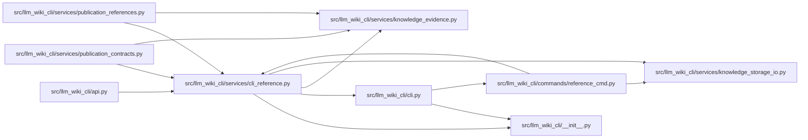

# cli_reference Module

**Path:** `src/llm_wiki_cli/services/cli_reference.py`

## Description

Deterministic CLI reference data and inert Markdown from parser declarations.

## Imports

| Source | Symbols |
|--------|---------|
| `..` | `__version__` |
| `..cli` | `build_cli_parser` |
| `.knowledge_evidence` | `hash_json` |
| `.knowledge_storage_io` | `read_guarded` |
| `__future__` | `annotations` |
| `argparse` | `argparse` |
| `collections.abc` | `Mapping` |
| `functools` | `lru_cache` |
| `html` | `html` |
| `importlib` | `metadata`, `resources` |
| `json` | `json` |
| `math` | `math` |
| `pathlib` | `Path` |
| `re` | `re` |
| `tomllib` | `tomllib` |
| `typing` | `Any` |

## Local dependency map

<!-- Auto-generated local dependency summary. Do not edit by hand. -->

### Internal neighbors

| Direction | Module |
|---|---|
| Inbound | [api](../modules/api.md) |
| Inbound | [reference_cmd](../modules/reference_cmd.md) |
| Inbound | [publication_contracts](../modules/publication_contracts.md) |
| Inbound | [publication_references](../modules/publication_references.md) |
| Outbound | [llm_wiki_cli___init__](../modules/llm_wiki_cli___init__.md) |
| Outbound | [cli](../modules/cli.md) |
| Outbound | [knowledge_evidence](../modules/knowledge_evidence.md) |
| Outbound | [knowledge_storage_io](../modules/knowledge_storage_io.md) |

## Classes

| Class | Line | Bases | Description |
|-------|------|-------|-------------|
| [CLIReferenceError](../entities/CLIReferenceError.md) | 46 | `ValueError` | CLI declarations or supplied reference data violate the portable contract. |

## Functions

| Function | Signature | Decorators | Description |
|----------|-----------|------------|-------------|
| `_text` | `(value: object) -> str \| None` | — | — |
| `_notes` | `(owner: object) -> list[str]` | — | — |
| `_value` | `(value: object, depth: int = 0) -> Any` | — | — |
| `_custom_symbol` | `(value: object) -> str` | — | — |
| `_symbol` | `(value: object) -> str \| None` | — | — |
| `_argument` | `(action, identity, group, exclusive)` | — | — |
| `_command` | `(parser, name, path, *, help_text = None, deprecated = False, seen = None)` | — | — |
| `build_cli_contract` | `(parser: argparse.ArgumentParser, *, package: Mapping[str, Any], program: str) -> dict[str, Any]` | — | Capture declarations without parsing arguments or executing application code. |
| `_package_identity` | `() -> dict[str, Any]` | — | — |
| `get_cli_contract` | `() -> dict[str, Any]` | — | Describe the installed llm-wiki CLI through its public parser owner. |
| `_schema` | `() -> dict[str, Any]` | `@lru_cache(maxsize=1)` | — |
| `_json_tree` | `(value: object, depth: int = 0, budget = None) -> None` | — | — |
| `_matches_type` | `(value, kind)` | — | — |
| `_validate_schema` | `(value, rule, root, field)` | — | — |
| `_validate_command` | `(node, expected_path, program)` | — | — |
| `validate_cli_contract` | `(contract: object) -> None` | — | Validate closed portable reference data and its complete commitment. |
| `_pairs` | `(pairs)` | — | — |
| `parse_cli_contract` | `(raw: bytes \| str) -> dict[str, Any]` | — | Validate exact observed UTF-8 JSON bytes without reopening their source. |
| `load_cli_contract` | `(path: str \| Path) -> dict[str, Any]` | — | Read one guarded contract file as data; never load an application CLI. |
| `_prose` | `(value: str) -> str` | — | — |
| `_code` | `(value: object) -> str` | — | — |
| `render_cli_reference` | `(contract: object) -> str` | — | Render validated metadata deterministically, including hidden declarations. |
