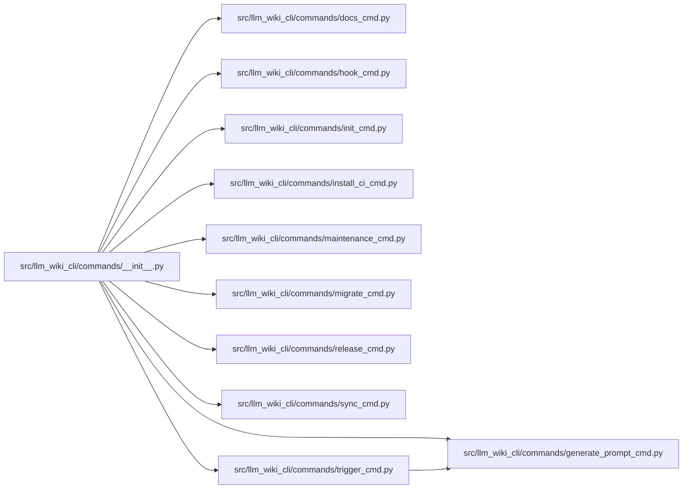

# __init__ Module

**Path:** `src/llm_wiki_cli/commands/__init__.py`

## Description

Imports and exposes command modules through the `llm_wiki_cli.commands` package namespace.

## Imports

| Source | Symbols |
|--------|---------|
| `.` | `docs_cmd`, `init_cmd`, `extract_cmd`, `lint_cmd`, `hook_cmd`, `install_ci_cmd`, `trigger_cmd`, `generate_prompt_cmd`, `release_cmd`, `sync_cmd`, `migrate_cmd`, `maintenance_cmd` |

## Local dependency map

<!-- Auto-generated local dependency summary. Do not edit by hand. -->

### Internal neighbors

| Direction | Module |
|---|---|
| Outbound | [docs_cmd](../modules/docs_cmd.md) |
| Outbound | [generate_prompt_cmd](../modules/generate_prompt_cmd.md) |
| Outbound | [hook_cmd](../modules/hook_cmd.md) |
| Outbound | [init_cmd](../modules/init_cmd.md) |
| Outbound | [install_ci_cmd](../modules/install_ci_cmd.md) |
| Outbound | [maintenance_cmd](../modules/maintenance_cmd.md) |
| Outbound | [migrate_cmd](../modules/migrate_cmd.md) |
| Outbound | [release_cmd](../modules/release_cmd.md) |
| Outbound | [sync_cmd](../modules/sync_cmd.md) |
| Outbound | [trigger_cmd](../modules/trigger_cmd.md) |
