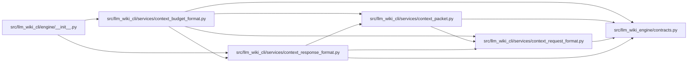

# context_budget_format Module

**Path:** `src/llm_wiki_cli/services/context_budget_format.py`

## Description

Format checks for ``llm-wiki-context/v3`` budgeted context responses.

A response is a budgeted context envelope, an invalid-request envelope or a
cannot-fit refusal. These checks read no repository, wiki, knowledge state or
token counter. The embedded body is a v2 context response or a v2 qualified
packet, so its deeper rules are those formats' own checks. Binding
``request_id`` to a request and recounting the emitted text need the request
and the named counter; ``context_budget.validate_budgeted_context`` does both.

## Imports

| Source | Symbols |
|--------|---------|
| `.` | `context_packet`, `context_request_format`, `context_response_format` |
| `__future__` | `annotations` |
| `collections.abc` | `Mapping` |
| `hashlib` | `hashlib` |
| `json` | `json` |
| `llm_wiki_engine.contracts` | `CONTEXT_BUDGET_PROTOCOL_VERSION`, `CONTEXT_KNOWLEDGE_PROTOCOL_VERSION` |
| `re` | `re` |
| `typing` | `Any` |

## Local dependency map

<!-- Auto-generated local dependency summary. Do not edit by hand. -->

### Internal neighbors

| Direction | Module |
|---|---|
| Inbound | [engine___init__](../modules/engine___init__.md) |
| Outbound | [context_packet](../modules/context_packet.md) |
| Outbound | [context_request_format](../modules/context_request_format.md) |
| Outbound | [context_response_format](../modules/context_response_format.md) |
| Outbound | [llm_wiki_engine_contracts](../modules/llm_wiki_engine_contracts.md) |

## Classes

| Class | Line | Bases | Description |
|-------|------|-------|-------------|
| [BudgetedContextResponseError](../entities/BudgetedContextResponseError.md) | 79 | `ValueError` | A budgeted context response does not follow ``llm-wiki-context/v3``. |

## Functions

| Function | Signature | Decorators | Description |
|----------|-----------|------------|-------------|
| `validate_budgeted_context_response` | `(document: object) -> None` | — | Raise ``BudgetedContextResponseError`` unless *document* is a valid v3 response. |
| `_validate` | `(document: object) -> None` | — | — |
| `_validate_success` | `(data: Mapping[str, Any]) -> None` | — | — |
| `_accounting` | `(value: object, field: str) -> Mapping[str, Any]` | — | — |
| `_validate_changes` | `(value: object) -> None` | — | — |
| `_portable_paths` | `(value: object, field: str) -> list[str]` | — | — |
| `_validate_context` | `(value: object) -> None` | — | — |
| `_validate_packet` | `(value: object) -> None` | — | — |
| `_validate_metadata` | `(value: object) -> None` | — | — |
| `_validate_invalid_request` | `(data: Mapping[str, Any]) -> None` | — | — |
| `_validate_refusal` | `(data: Mapping[str, Any]) -> None` | — | — |
| `_validate_native` | `(value: object, field: str) -> None` | — | — |
| `_object` | `(value: object, field: str) -> Mapping[str, Any]` | — | — |
| `_exact` | `(value: Mapping[str, Any], required: set[str] \| frozenset[str], optional: set[str] \| frozenset[str], field: str) -> None` | — | — |
| `_text` | `(value: object, field: str) -> None` | — | — |
| `_sha256` | `(value: object, field: str) -> None` | — | — |
