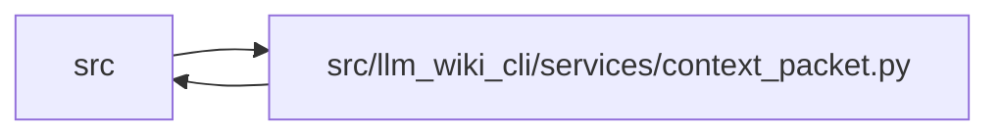

# context_packet Module

**Path:** `src/llm_wiki_cli/services/context_packet.py`

## Description

Canonical Qualified Context Packet construction and verification.

The packet builder coordinates one source inventory, one wiki surface
evaluation, and one native-knowledge read view.  Context response construction
then consumes only those captured values.  Optimistic source and wiki anchors
are checked before the canonical bytes are returned, so a mutation cannot
silently detach the response from its declared basis.

Explicit change selections retain their supplied paths or Git range/index
identity. Rendering revalidates that same selection against the captured basis,
including staged index changes, before sealing the response.

This module is deliberately provider- and persistence-free.  It returns bytes
in memory, never refreshes native artifacts, and keeps structural validation
separate from live reconciliation.

Live inventory collection carries the configured manifest's retained empty
source paths into the parser request. This preserves current module observations
without discovering every unowned empty file. Parsing failures and unavailable
coverage retain their explicit states rather than being presented as emptiness.

Declared ordinary authority is checked before metadata helpers use it. A typed authority refusal retains the original local cause and exposes a bounded domain/recovery diagnostic shared by API, CLI and MCP. It never turns lost ownership into legacy absence, selects a backup or adoption identity, or performs recovery. Original source/wiki boundaries and strict packet integrity remain authoritative.

## Imports

| Source | Symbols |
|--------|---------|
| `.` | `context_request_format`, `context_packet_builder` |
| `.context_request_format` | `CONTEXT_COVERAGE_LIMITATION_CODE_MAX_LENGTH`, `CONTEXT_COVERAGE_LIMITATION_LIMIT` |
| `.implementation_evidence` | `validate_implementation_summary` |
| `.knowledge_envelope` | `KnowledgeEnvelopeError`, `validate_configured_public_identity` |
| `.knowledge_freshness` | `KNOWN_FRESHNESS_REASON_CODES`, `REASON_RECORDED_BASIS_MATCHES_LIVE_EVALUATION` |
| `.knowledge_model` | `ComputedFreshness`, `ConceptKind`, `EvidenceState`, `Lifecycle`, `Origin`, `Resolution`, `TargetClass`, `Verification`, `concept_kind_for_page_kind` |
| `.maintenance_status` | `validate_maintenance_summary`, `validate_maintenance_summary` |
| `__future__` | `annotations` |
| `collections.abc` | `Mapping`, `Sequence` |
| `dataclasses` | `dataclass` |
| `json` | `json` |
| `llm_wiki_engine` | `wiki_surface` |
| `llm_wiki_engine.contracts` | `CONTEXT_KNOWLEDGE_PROTOCOL_VERSION`, `QUALIFIED_CONTEXT_PACKET_KNOWLEDGE_SCHEMA_VERSION`, `QUALIFIED_CONTEXT_PACKET_SCHEMA_VERSION`, `TYPED_GRAPH_SCHEMA_VERSION` |
| `llm_wiki_engine.knowledge_evidence` | `canonical_json_bytes`, `is_valid_sha256`, `sha256_bytes` |
| `llm_wiki_engine.knowledge_graph` | `CORE_RELATIONSHIP_KINDS`, `ENDPOINT_KINDS`, `GRAPH_COVERAGE_ANALYZERS`, `GRAPH_EVIDENCE_STATES`, `GRAPH_ORIGINS`, `GRAPH_RESOLUTIONS`, `is_supported_relationship_kind` |
| `llm_wiki_engine.packet_field_policy` | `PUBLIC_URI_FIELDS`, `STRUCTURAL_PATH_FIELDS`, `STRING_CLASSES`, `UnclassifiedPacketField`, `classify_string`, `validate_field_coverage` |
| `llm_wiki_engine.validation` | `require_repository_relative_path` |
| `llm_wiki_engine.wiki_media` | `contains_uri_authority_userinfo` |
| `math` | `math` |
| `re` | `re` |
| `types` | `MappingProxyType` |
| `typing` | `Any` |
| `urllib.parse` | `urlsplit` |

## Local dependency map

<!-- Auto-generated local dependency summary. Do not edit by hand. -->

> Module-level dependencies exceed the generated-diagram limits, so the diagram and table below group them by top-level package. Counts report the number of module neighbors in each package.

### Internal neighbors

| Direction | Module |
|---|---|
| Inbound | `src` (11) |
| Outbound | `src` (14) |

> All 24 module neighbor(s) are summarized by package because the module-level view exceeds the 12-node limit.

## Classes

| Class | Line | Bases | Description |
|-------|------|-------|-------------|
| [_PacketWireContract](../entities/PacketWireContract.md) | 123 | — | One immutable schema/protocol/policy binding for canonical packets. |
| [ContextPacketError](../entities/ContextPacketError.md) | 170 | `ValueError` | Base failure for context-packet construction and consumption. |
| [ContextPacketMalformedError](../entities/ContextPacketMalformedError.md) | 176 | `ContextPacketError` | The supplied bytes do not satisfy the canonical packet contract. |
| [ContextPacketPathPolicyError](../entities/ContextPacketPathPolicyError.md) | 189 | `ContextPacketError` | A structural packet field violates its declared path policy. |
| [QualifiedContextPacket](../entities/QualifiedContextPacket.md) | 218 | — | Immutable canonical packet bytes plus safe value accessors. |
| [ContextPacketValidation](../entities/ContextPacketValidation.md) | 255 | — | Successful structural validation with explicitly unevaluated freshness. |

## Functions

| Function | Signature | Decorators | Description |
|----------|-----------|------------|-------------|
| `_packet_contract_for_schema` | `(schema_version: object) -> _PacketWireContract` | — | — |
| `validate_context_packet` | `(packet_bytes: bytes \| bytearray \| memoryview) -> ContextPacketValidation` | — | Strictly validate canonical bytes without performing live reads. |
| `_packet_limitations` | `(response: Mapping[str, Any], basis: Mapping[str, Any]) -> list[str]` | — | — |
| `_context_policy_digest` | `(schema_version: str = CONTEXT_PACKET_SCHEMA_VERSION) -> str` | — | — |
| `_path_policy_digest` | `() -> str` | — | — |
| `_path_policy_receipt` | `(value: Mapping[str, Any]) -> dict[str, Any]` | — | — |
| `_mapping_key_is_repository_path` | `(pointer: tuple[str, ...]) -> bool` | — | — |
| `_list_item_is_repository_path` | `(pointer: tuple[str, ...]) -> bool` | — | — |
| `_repository_path` | `(value: object, field: str) -> str` | — | — |
| `_reject_machine_local_path` | `(value: object, error: ContextPacketPathPolicyError) -> None` | — | — |
| `_packet_id` | `(body: Mapping[str, Any]) -> str` | — | — |
| `_encode_packet_payload` | `(payload: Mapping[str, Any]) -> bytes` | — | — |
| `_coerce_packet_bytes` | `(value: bytes \| bytearray \| memoryview) -> bytes` | — | — |
| `_strict_json_payload` | `(raw: bytes) -> dict[str, Any]` | — | — |
| `_validate_json_tree` | `(value: Any) -> None` | — | — |
| `_validate_packet_shape` | `(payload: Mapping[str, Any], packet_contract: _PacketWireContract) -> None` | — | — |
| `_validate_assurance` | `(value: Any) -> None` | — | — |
| `_validate_packet_request` | `(value: Any, packet_contract: _PacketWireContract) -> dict[str, Any]` | — | — |
| `_validate_response` | `(value: Any, request: Mapping[str, Any], packet_contract: _PacketWireContract) -> None` | — | — |
| `_validate_explicit_knowledge_response` | `(value: Any, request: Mapping[str, Any], *, source_priorities: Mapping[str, str] \| None = None) -> None` | — | — |
| `_validate_explicit_knowledge_bounds` | `(value: Any) -> dict[str, dict[str, int \| bool]]` | — | — |
| `_validate_collection_bound` | `(value: Any, field: str, *, returned_limit: int \| None = None) -> dict[str, int \| bool]` | — | — |
| `_validate_explicit_selection` | `(value: Any, bounds: Mapping[str, Mapping[str, int \| bool]], *, freshness_evaluated: bool, source_priorities: Mapping[str, str] \| None) -> None` | — | — |
| `_validate_explicit_concept` | `(value: Mapping[str, Any], field: str, *, freshness_evaluated: bool) -> None` | — | — |
| `_validate_implementation_summary` | `(value: Any, field: str) -> None` | — | Validate curated syntax evidence without admitting raw native records. |
| `_validate_explicit_page` | `(value: Mapping[str, Any], field: str) -> None` | — | — |
| `_validate_wiki_page_coordinate` | `(*, page_kind: object, page_id: object, canonical_path: object, mcp_uri: object, role: object, field: str) -> None` | — | — |
| `_validate_explicit_relationship` | `(value: Mapping[str, Any], field: str) -> None` | — | — |
| `_validate_knowledge_relationship_semantics` | `(relationship: Mapping[str, Any], target: Mapping[str, Any], field: str) -> None` | — | — |
| `_validate_context_endpoint` | `(value: Any, field: str) -> None` | — | — |
| `_validate_canonical_coverage` | `(value: Mapping[str, Any], field: str, *, includes_analyzer: bool = False) -> None` | — | — |
| `_validate_portable_uri` | `(value: str, field: str) -> None` | — | — |
| `_validate_native_wiki_uri` | `(value: str, field: str) -> None` | — | — |
| `_validate_normalized_context_target` | `(value: str, field: str) -> None` | — | — |
| `_wiki_uri_for_canonical_path` | `(value: str, field: str) -> str` | — | — |
| `_reject_raw_projection_content` | `(value: Any, field: str) -> None` | — | — |
| `_validate_explicit_ranking_policy` | `(value: Any, knowledge_value: Any, *, response_truncated: Any) -> None` | — | — |
| `_validate_explicit_source_bounds` | `(response: Mapping[str, Any]) -> None` | — | — |
| `_explicit_response_source_priorities` | `(response: Mapping[str, Any]) -> dict[str, str]` | — | — |
| `_validate_basis` | `(value: Any, packet_contract: _PacketWireContract) -> None` | — | — |
| `_validate_repository_basis` | `(value: Any) -> None` | — | — |
| `_validate_knowledge_basis` | `(value: Any, packet_contract: _PacketWireContract) -> None` | — | — |
| `_validate_freshness_basis` | `(value: Any, packet_contract: _PacketWireContract) -> None` | — | — |
| `_validate_response_basis_consistency` | `(response: Mapping[str, Any], basis: Mapping[str, Any], request: Mapping[str, Any], packet_contract: _PacketWireContract) -> None` | — | — |
| `_validate_delivery` | `(value: Any, response: Mapping[str, Any], basis: Mapping[str, Any]) -> None` | — | — |
| `_validate_path_policy_shape` | `(value: Any) -> None` | — | — |
| `_mapping` | `(value: Any, field: str) -> Mapping[str, Any]` | — | — |
| `_exact_fields` | `(value: Mapping[str, Any], allowed: set[str] \| frozenset[str], field: str, *, required: set[str] \| frozenset[str] \| None = None) -> None` | — | — |
| `_string_list` | `(value: Any, field: str) -> list[str]` | — | — |
| `_object_list` | `(value: Any, field: str) -> list[Mapping[str, Any]]` | — | — |
| `_stable_code` | `(value: Any, field: str) -> str` | — | — |
| `_nonnegative_integer` | `(value: Any, field: str) -> int` | — | — |
| `_domain_hash` | `(domain: str, value: Mapping[str, Any]) -> str` | — | — |
| `_freeze_json` | `(value: Any) -> Any` | — | — |
| `_thaw_json` | `(value: Any) -> Any` | — | — |
| `_pointer` | `(parts: Sequence[str]) -> str` | — | — |
| `__getattr__` | `(name: str) -> Any` | — | — |
