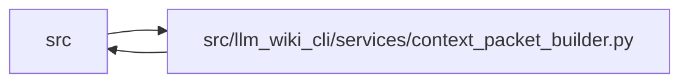

# context_packet_builder Module

**Path:** `src/llm_wiki_cli/services/context_packet_builder.py`

## Description

Build Qualified Context Packets from one captured read.

The packet builder coordinates one source inventory, one wiki surface
evaluation, and one native-knowledge read view.  Context response construction
then consumes only those captured values.  Optimistic source and wiki anchors
are checked before the canonical bytes are returned, so a mutation cannot
silently detach the response from its declared basis.

This module is deliberately provider- and persistence-free.  It returns bytes
in memory and never refreshes native artifacts.  Checking a packet's format
lives in :mod:`context_packet`, which loads none of the builders.

## Imports

| Source | Symbols |
|--------|---------|
| `.` | `context_service`, `wiki_surface` |
| `..` | `__version__` |
| `.change_selection` | `select_changes` |
| `.context_packet` | `_context_policy_digest`, `_domain_hash`, `_encode_packet_payload`, `_freeze_json`, `_KNOWLEDGE_PACKET_CONTRACT`, `_LEGACY_PACKET_CONTRACT`, `_LIMITATION_RE`, `_packet_id`, `_packet_limitations`, `_PacketWireContract`, `_path_policy_receipt`, `_thaw_json`, `CONTEXT_PACKET_ASSURANCE_LEVEL`, `ContextPacketError`, `ContextPacketMalformedError`, `ContextPacketPathPolicyError`, `QualifiedContextPacket`, `validate_context_packet` |
| `.contracts` | `CONTEXT_KNOWLEDGE_PROTOCOL_VERSION` |
| `.dependencies` | `analyze_dependencies` |
| `.documentation_queries` | `DocumentationGraphQueryService`, `DocumentationQueryError`, `knowledge_view_selection_eligible` |
| `.documentation_query_builder` | `validate_live_query_source_selection` |
| `.domain_pack` | `uses_builtin_context_source` |
| `.extraction_jobs` | `ExtractionJobPlan`, `ExtractionJobRequest` |
| `.extraction_service` | `InventoryResult` |
| `.extractor_helpers` | `SUPPORTED_HELPERS` |
| `.filesystem_guard` | `fresh_no_follow_stat`, `guard_windows_directory_chain`, `hold_windows_readonly_file` |
| `.helper_cache` | `HelperPreparationError` |
| `.io` | `first_unsafe_path_component` |
| `.knowledge_consumption` | `KnowledgeReadView` |
| `.knowledge_envelope` | `hash_source_snapshot` |
| `.knowledge_evidence` | `is_valid_sha256`, `sha256_bytes` |
| `.knowledge_governance` | `GOVERNANCE_LOCK_FILENAME`, `_governance_lock_root` |
| `.knowledge_loader` | `KnowledgeLoadIssue` |
| `.knowledge_model` | `ComputedFreshness` |
| `.knowledge_observability` | `knowledge_freshness_disclosure` |
| `.knowledge_storage_io` | `read_guarded` |
| `.knowledge_verification` | `verification_summaries_for_concepts` |
| `.maintenance_protocol` | `ADOPTION_FILENAME`, `guard_maintenance_owner`, `MaintenanceProtocolError` |
| `.maintenance_status` | `attach_maintenance_status`, `compact_maintenance_summary` |
| `.path_policy` | `DEFAULT_WIKI_DIR`, `PathValidationError`, `validate_path` |
| `.plugins` | `runtime_plugin_fallback_root` |
| `.source_retirement` | `retained_empty_module_paths_from_wiki` |
| `.source_snapshot` | `directory_identity`, `SourceSnapshot`, `SourceSnapshotError`, `SourceSnapshotMutationError`, `build_source_snapshot`, `capture_source_selection_inputs`, `source_snapshot_inputs_match_current_files`, `source_snapshot_matches_current_files`, `confirmed_missing_source_paths` |
| `.wiki_surface_index` | `SurfaceIndexEvaluation`, `evaluate_surface_index` |
| `__future__` | `annotations` |
| `collections.abc` | `Callable`, `Iterable`, `Mapping`, `Sequence` |
| `contextlib` | `ExitStack` |
| `contextvars` | `ContextVar` |
| `copy` | `deepcopy` |
| `dataclasses` | `dataclass` |
| `enum` | `Enum` |
| `functools` | `wraps` |
| `os` | `os` |
| `pathlib` | `Path` |
| `re` | `re` |
| `stat` | `stat` |
| `types` | `MappingProxyType` |
| `typing` | `Any` |

## Local dependency map

<!-- Auto-generated local dependency summary. Do not edit by hand. -->

> Module-level dependencies exceed the generated-diagram limits, so the diagram and table below group them by top-level package. Counts report the number of module neighbors in each package.

### Internal neighbors

| Direction | Module |
|---|---|
| Inbound | `src` (13) |
| Outbound | `src` (32) |

> All 42 module neighbor(s) are summarized by package because the module-level view exceeds the 12-node limit.

## Classes

| Class | Line | Bases | Description |
|-------|------|-------|-------------|
| [ContextPacketSourceMutationError](../entities/ContextPacketSourceMutationError.md) | 129 | `ContextPacketError` | A captured source or wiki anchor changed before packet return. |
| [ContextPacketUnavailableError](../entities/ContextPacketUnavailableError.md) | 141 | `ContextPacketError` | A required read-only packet capability is unavailable. |
| [ContextPacketAuthorityError](../entities/ContextPacketAuthorityError.md) | 151 | `ContextPacketError` | Ordinary authority refused a read; only explicit complete recovery can restore it. |
| [CapturedContextRead](../entities/CapturedContextRead.md) | 291 | — | One coordinated in-memory source/wiki read used by a packet response. |
| [ContextBasisComparison](../entities/ContextBasisComparison.md) | 344 | — | Comparison with caller data, which can never assert currentness. |
| [ContextPacketReconciliation](../entities/ContextPacketReconciliation.md) | 370 | — | Consumer-time comparison against one fresh official read. |

## Functions

| Function | Signature | Decorators | Description |
|----------|-----------|------------|-------------|
| `describe_context_packet_error` | `(error: BaseException) -> dict[str, Any]` | — | Describe a packet failure without echoing offending values or host roots. |
| `_packet_contract_for_request` | `(request: Mapping[str, Any]) -> _PacketWireContract` | — | — |
| `_validate_reconciliation_contract` | `(*, packet_id: object, policy: object, state: object, current: object, facets: object, limitations: object) -> None` | — | — |
| `_guarded_capture` | `(function)` | — | — |
| `_guard_windows_inputs` | `(root: Path, paths: Iterable[str]) -> None` | — | — |
| `capture_context_read` | `(src_dir: str = '.', wiki_dir: str = DEFAULT_WIKI_DIR, *, allow_external_src: bool = False, read_only: bool = True, job_request: ExtractionJobRequest \| None = None, plan_reporter: Callable[[ExtractionJobPlan], None] \| None = None, source_selection: str \| Path \| None = None, allow_selection_mismatch: bool = False, strict_wiki_symlinks: bool = False, helper_cache_dir: str \| None = None, only_files: Iterable[str] \| None = None, max_source_files: int \| None = None, max_source_bytes: int \| None = None, max_wiki_bytes: int \| None = None, respect_ignores: bool = False, capture_implementation_observations: bool = True) -> CapturedContextRead` | `@_guarded_capture` | Capture one source inventory, wiki surface, and knowledge read view. |
| `build_context_from_captured_read` | `(captured: CapturedContextRead, request: Mapping[str, Any], *, freshness_ranking_out: dict[str, int] \| None = None) -> tuple[dict[str, Any], list[str]]` | — | Build a versioned context payload solely from one captured read. |
| `_build_legacy_context_from_captured_read` | `(captured: CapturedContextRead, normalized: Mapping[str, Any]) -> tuple[dict[str, Any], list[str]]` | — | Retain the frozen v1 response construction without semantic changes. |
| `_build_knowledge_context_from_captured_read` | `(captured: CapturedContextRead, normalized: Mapping[str, Any], *, freshness_ranking_out: dict[str, int] \| None = None) -> tuple[dict[str, Any], list[str]]` | — | Build explicit v2 knowledge selection from the coordinated capture. |
| `_captured_source_classification` | `(captured: CapturedContextRead, inventory: Mapping[str, Any], normalized: Mapping[str, Any], warnings: list[str]) -> dict[str, str]` | — | — |
| `_captured_source_payload` | `(inventory: Mapping[str, Any], classification: Mapping[str, str], budget: int, *, freshness_rank_by_source: Mapping[str, int]) -> tuple[dict[str, Any], bool]` | — | — |
| `_captured_query_service` | `(captured: CapturedContextRead, inventory: Mapping[str, Any], query_surface: Mapping[str, Any], knowledge_view: KnowledgeReadView \| None) -> DocumentationGraphQueryService` | — | — |
| `_explicit_filter_enrichment_from_captured_read` | `(query_service: DocumentationGraphQueryService \| None, query_surface: Mapping[str, Any] \| None, filters: Mapping[str, Any], warnings: list[str]) -> dict[str, Any]` | — | — |
| `build_qualified_context` | `(src_dir: str = '.', wiki_dir: str = DEFAULT_WIKI_DIR, request: Mapping[str, Any] \| None = None, *, allow_external_src: bool = False, read_only: bool = True, job_request: ExtractionJobRequest \| None = None, plan_reporter: Callable[[ExtractionJobPlan], None] \| None = None, source_selection: str \| Path \| None = None) -> QualifiedContextPacket` | — | Build a canonical packet in memory from one coordinated read view. |
| `packet_from_captured_response` | `(captured: CapturedContextRead, normalized: Mapping[str, Any], response: Mapping[str, Any]) -> QualifiedContextPacket` | — | Seal and validate a selected response against its unchanged captured basis. |
| `_fit_knowledge_packet_response` | `(captured: CapturedContextRead, request: Mapping[str, Any], response: dict[str, Any], packet_contract: _PacketWireContract) -> dict[str, Any]` | — | Tail-reduce v2 native selection before the canonical byte limit. |
| `_set_knowledge_collection_prefix` | `(selection: dict[str, Any], bounds: dict[str, Any], name: str, original_items: list[Any], returned: int) -> None` | — | — |
| `_candidate_packet_size` | `(captured: CapturedContextRead, request: Mapping[str, Any], response: Mapping[str, Any], packet_contract: _PacketWireContract) -> int` | — | — |
| `compare_context_packet_basis` | `(packet_bytes: bytes \| bytearray \| memoryview, expected_basis: Mapping[str, Any]) -> ContextBasisComparison` | — | Compare caller-provided expected basis without claiming currentness. |
| `reconcile_context_packet` | `(packet_bytes: bytes \| bytearray \| memoryview, src_dir: str = '.', wiki_dir: str = DEFAULT_WIKI_DIR, *, allow_external_src: bool = False, read_only: bool = True, job_request: ExtractionJobRequest \| None = None, plan_reporter: Callable[[ExtractionJobPlan], None] \| None = None, source_selection: str \| Path \| None = None) -> ContextPacketReconciliation` | — | Validate first, then compare every packet facet with a fresh read. |
| `_reconcile_packet_views` | `(packet_payload: Mapping[str, Any], live_payload: Mapping[str, Any]) -> ContextPacketReconciliation` | — | Compare validated packet views produced by an official captured read. |
| `_build_protocol_enrichment_from_captured_read` | `(captured: CapturedContextRead, inventory: dict[str, Any], filters: dict[str, Any], warnings: list[str], *, prefer_fresh: bool = False, freshness_ranking_out: dict[str, int] \| None = None) -> dict[str, Any]` | — | — |
| `_normalized_request` | `(request: Mapping[str, Any]) -> dict[str, Any]` | — | — |
| `_packet_body` | `(captured: CapturedContextRead, request: Mapping[str, Any], response: Mapping[str, Any], packet_contract: _PacketWireContract) -> dict[str, Any]` | — | — |
| `_packet_basis` | `(captured: CapturedContextRead, packet_contract: _PacketWireContract, request: Mapping[str, Any]) -> dict[str, Any]` | — | — |
| `_freshness_basis` | `(view: KnowledgeReadView) -> dict[str, Any]` | — | — |
| `_is_free_text_pointer` | `(pointer: tuple[str, ...]) -> bool` | — | — |
| `_reconciliation_facets` | `(packet: Mapping[str, Any], live: Mapping[str, Any]) -> dict[str, dict[str, Any]]` | — | — |
| `_live_facet` | `(expected: Any, observed: Any, *, mismatch_reason: str) -> dict[str, Any]` | — | — |
| `_unevaluated_facet` | `(matches: bool, reason: str) -> dict[str, Any]` | — | — |
| `_source_anchor` | `(snapshot: SourceSnapshot) -> str` | — | — |
| `_source_snapshot_anchor_payload` | `(snapshot: SourceSnapshot) -> dict[str, Any]` | — | — |
| `_assert_source_unchanged` | `(snapshot: SourceSnapshot, expected_anchor: str, *, metrics: dict[str, int] \| None = None) -> None` | — | — |
| `confirmed_missing_source_paths` | `(snapshot: SourceSnapshot, requested_paths: Iterable[str]) -> frozenset[str]` | — | Adapt the shared source owner's guarded requested-absence observation. |
| `_assert_source_inputs_unchanged` | `(snapshot: SourceSnapshot, expected_anchor: str) -> None` | — | — |
| `_assert_selection_unchanged` | `(captured: CapturedContextRead) -> None` | — | — |
| `_wiki_anchor` | `(root: Path, *, reject_all_symlinks: bool = False, max_bytes: int \| None = None, metrics: dict[str, int] \| None = None, integrity_out: dict[str, tuple[int, ...]] \| None = None, guard_windows: bool = False) -> str` | — | — |
| `_assert_wiki_integrity` | `(expected: Mapping[str, tuple[int, ...]]) -> None` | — | — |
| `_wiki_symlink_is_captured_input` | `(relative_path: str) -> bool` | — | — |
| `_assert_wiki_unchanged` | `(root: Path, expected_anchor: str, *, reject_all_symlinks: bool = False, max_bytes: int \| None = None, metrics: dict[str, int] \| None = None, expected_integrity: Mapping[str, tuple[int, ...]] \| None = None) -> None` | — | — |
| `_wire_value` | `(value: Any) -> Any` | — | — |
