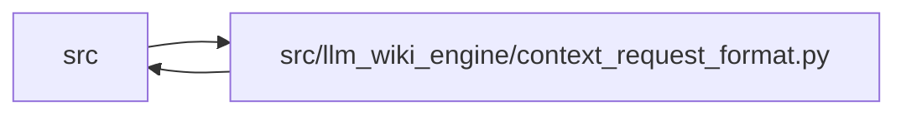

# context_request_format Module

**Path:** `src/llm_wiki_engine/context_request_format.py`

## Description

Format checks for context requests: the context, budget and change shapes.

These checks decide whether a request is well formed; they read no
repository, wiki or knowledge state. Building the context a request asks
for lives in ``context_service`` and ``context_budget``.

## Imports

| Source | Symbols |
|--------|---------|
| `.knowledge_model` | `ComputedFreshness`, `EvidenceState` |
| `__future__` | `annotations` |
| `collections.abc` | `Mapping` |
| `llm_wiki_engine` | `wiki_surface` |
| `llm_wiki_engine.context_knowledge_contract` | `KNOWLEDGE_MODE_VALUES` |
| `llm_wiki_engine.contracts` | `CONTEXT_BUDGET_PROTOCOL_VERSION`, `CONTEXT_KNOWLEDGE_PROTOCOL_VERSION`, `CONTEXT_PROTOCOL_VERSION` |
| `llm_wiki_engine.knowledge_graph` | `CORE_RELATIONSHIP_KINDS`, `GRAPH_ORIGINS`, `GRAPH_RESOLUTIONS` |
| `re` | `re` |
| `typing` | `Any` |

## Local dependency map

<!-- Auto-generated local dependency summary. Do not edit by hand. -->

> Module-level dependencies exceed the generated-diagram limits, so the diagram and table below group them by top-level package. Counts report the number of module neighbors in each package.

### Internal neighbors

| Direction | Module |
|---|---|
| Inbound | `src` (7) |
| Outbound | `src` (5) |

> All 12 module neighbor(s) are summarized by package because the module-level view exceeds the 12-node limit.

## Classes

| Class | Line | Bases | Description |
|-------|------|-------|-------------|
| [ProtocolRequestError](../entities/ProtocolRequestError.md) | 118 | `ValueError` | Validation error for Wiki-as-Context protocol requests. |

## Functions

| Function | Signature | Decorators | Description |
|----------|-----------|------------|-------------|
| `_validate_protocol_request` | `(data: object) -> dict` | — | Return a normalised protocol request or raise ``ProtocolRequestError``. |
| `_validate_protocol_request_impl` | `(data: object) -> dict` | — | — |
| `_normalise_protocol_focus` | `(raw_focus: object) -> list[str]` | — | — |
| `_normalise_protocol_filters` | `(raw_filters: object) -> dict` | — | — |
| `_validate_surface_filter` | `(value: str) -> None` | — | — |
| `_validate_enum_filter` | `(key: str, value: str, known: set[str]) -> None` | — | — |
| `_validate_relationship_kind_filter` | `(value: str) -> None` | — | — |
| `validate_budget_request` | `(data: Mapping[str, Any]) -> dict[str, Any]` | — | — |
| `portable_path` | `(value: str) -> str` | — | — |
| `validate_changes` | `(value: object) -> dict` | — | — |
