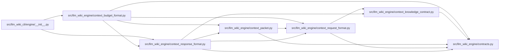

# context_response_format Module

**Path:** `src/llm_wiki_engine/context_response_format.py`

## Description

Format checks for ``llm-wiki-context/v1`` and ``/v2`` protocol responses.

A response is either a successful budgeted context or an error envelope.
These checks read no repository, wiki or knowledge state. The success body
is the one a qualified context packet carries as ``response``, so the deeper
native knowledge rules are the packet format's own checks.

## Imports

| Source | Symbols |
|--------|---------|
| `.` | `context_packet` |
| `__future__` | `annotations` |
| `collections.abc` | `Mapping` |
| `llm_wiki_engine` | `context_request_format` |
| `llm_wiki_engine.context_knowledge_contract` | `KNOWLEDGE_MODE_VALUES` |
| `llm_wiki_engine.contracts` | `CONTEXT_KNOWLEDGE_PROTOCOL_VERSION`, `CONTEXT_PROTOCOL_VERSION` |
| `typing` | `Any` |

## Local dependency map

<!-- Auto-generated local dependency summary. Do not edit by hand. -->

### Internal neighbors

| Direction | Module |
|---|---|
| Inbound | [engine___init__](../modules/engine___init__.md) |
| Inbound | [context_budget_format](../modules/context_budget_format.md) |
| Outbound | [context_knowledge_contract](../modules/context_knowledge_contract.md) |
| Outbound | [context_packet](../modules/context_packet.md) |
| Outbound | [context_request_format](../modules/context_request_format.md) |
| Outbound | [llm_wiki_engine_contracts](../modules/llm_wiki_engine_contracts.md) |

## Classes

| Class | Line | Bases | Description |
|-------|------|-------|-------------|
| [ContextResponseError](../entities/ContextResponseError.md) | 41 | `ValueError` | A context protocol response does not follow its format. |

## Functions

| Function | Signature | Decorators | Description |
|----------|-----------|------------|-------------|
| `validate_context_response` | `(document: object) -> None` | — | Raise ``ContextResponseError`` unless *document* is a valid v1 or v2 response. |
| `_validate` | `(document: object) -> None` | — | — |
| `_validate_error` | `(data: Mapping[str, Any], protocol: str) -> None` | — | — |
| `_validate_success` | `(data: Mapping[str, Any], protocol: str) -> None` | — | — |
| `_request` | `(data: Mapping[str, Any], protocol: str) -> dict[str, Any]` | — | Return the normalized request the response's own fields describe. |
| `_object` | `(value: object, field: str) -> Mapping[str, Any]` | — | — |
| `_exact` | `(value: Mapping[str, Any], required: set[str] \| frozenset[str], optional: set[str] \| frozenset[str], field: str) -> None` | — | — |
| `_text` | `(value: object, field: str) -> None` | — | — |
