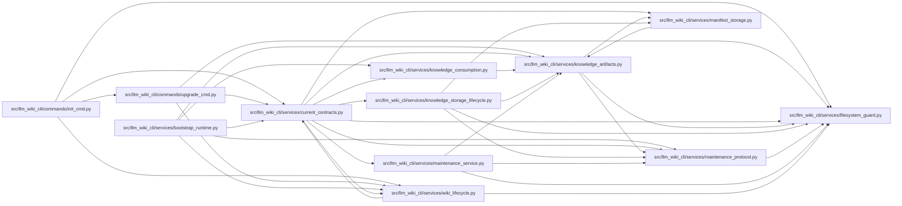

# current_contracts Module

**Path:** `src/llm_wiki_cli/services/current_contracts.py`

## Description

The library selects current task and view contracts and native storage during authorized setup. New data uses compressed packed knowledge and indexed ordinary maintenance ownership. Upgrade preserves validated recovery preimages and source/wiki content, rejects damaged authority, and keeps human review separate from ordinary pending maintenance. Read-only consumption never upgrades files.

Setup distinguishes untouched scaffolds from established canonical wikis and incomplete authority. Missing adopted or governed data requires complete recovery; a current format label does not establish source freshness or prose approval. Older canonical layouts are seeded by the owning command with complete preimages, while selected-source scaffolds remain first-use targets.

## Imports

| Source | Symbols |
|--------|---------|
| `.filesystem_guard` | `ensure_guarded_directory` |
| `.knowledge_artifacts` | `current_knowledge_format` |
| `.knowledge_consumption` | `load_knowledge_read_view` |
| `.knowledge_storage_lifecycle` | `_committed_inputs`, `migrate_knowledge_storage`, `_absolute_path` |
| `.maintenance_protocol` | `load_adoption_marker`, `guard_maintenance_owner`, `snapshot_wiki`, `save_recovery_snapshot` |
| `.maintenance_service` | `adopt_maintenance_authority` |
| `.manifest_storage` | `current_manifest_format` |
| `.wiki_lifecycle` | `is_pristine_wiki_target` |
| `__future__` | `annotations` |
| `hashlib` | `hashlib` |
| `json` | `json` |
| `pathlib` | `Path` |
| `tempfile` | `tempfile` |

## Local dependency map

<!-- Auto-generated local dependency summary. Do not edit by hand. -->

### Internal neighbors

| Direction | Module |
|---|---|
| Inbound | [init_cmd](../modules/init_cmd.md) |
| Inbound | [upgrade_cmd](../modules/upgrade_cmd.md) |
| Inbound | [bootstrap_runtime](../modules/bootstrap_runtime.md) |
| Inbound | [wiki_lifecycle](../modules/wiki_lifecycle.md) |
| Outbound | [filesystem_guard](../modules/filesystem_guard.md) |
| Outbound | [knowledge_artifacts](../modules/knowledge_artifacts.md) |
| Outbound | [knowledge_consumption](../modules/knowledge_consumption.md) |
| Outbound | [knowledge_storage_lifecycle](../modules/knowledge_storage_lifecycle.md) |
| Outbound | [maintenance_protocol](../modules/maintenance_protocol.md) |
| Outbound | [maintenance_service](../modules/maintenance_service.md) |
| Outbound | [manifest_storage](../modules/manifest_storage.md) |
| Outbound | [wiki_lifecycle](../modules/wiki_lifecycle.md) |

## Functions

| Function | Signature | Decorators | Description |
|----------|-----------|------------|-------------|
| `current_contract_defaults` | `() -> dict` | — | Return detached installation policy; callers do not elect wire versions. |
| `upgrade_current_knowledge` | `(src_dir, wiki_dir, *, helper_cache_dir = None, source_selection = None, allow_external_src = False, _captured = None, _seed_legacy = None) -> dict` | — | Use existing guarded writers and recovery copies; never repair bad authority. |