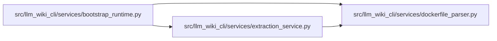

# dockerfile_parser Module

**Path:** `src/llm_wiki_cli/services/dockerfile_parser.py`

## Description

Stage-owned Dockerfile source observations without image evaluation.

## Imports

| Source | Symbols |
|--------|---------|
| `__future__` | `annotations` |
| `copy` | `deepcopy` |
| `json` | `json` |
| `re` | `re` |
| `shlex` | `shlex` |

## Local dependency map

<!-- Auto-generated local dependency summary. Do not edit by hand. -->

### Internal neighbors

| Direction | Module |
|---|---|
| Inbound | [bootstrap_runtime](../modules/bootstrap_runtime.md) |
| Inbound | [extraction_service](../modules/extraction_service.md) |

## Functions

| Function | Signature | Decorators | Description |
|----------|-----------|------------|-------------|
| `_empty_declarations` | `() -> dict` | — | — |
| `_words` | `(value: str, escape: str = '\\') -> list[str]` | — | — |
| `_heredoc_words` | `(value: str) -> list[str]` | — | Retain quotes and escapes so literal redirects cannot become heredocs. |
| `_heredocs` | `(instruction: str, value: str) -> list[tuple[str, bool]]` | — | — |
| `_trim_continuation` | `(line: str, escape: str) -> tuple[str, bool]` | — | — |
| `_instructions` | `(text: str)` | — | Keep continuation and heredoc bodies attached to their source owner. |
| `_stage` | `(argument: str, line: int, stages: list[dict], escape: str) -> dict` | — | — |
| `_pairs` | `(argument: str, escape: str) -> list[tuple[str, str]]` | — | — |
| `_split_builder_flags` | `(argument: str, escape: str) -> tuple[str, list[str]]` | — | Decode leading flags without consuming or rewriting source arguments. |
| `_copy` | `(argument: str, instruction: str, escape: str) -> dict` | — | — |
| `_observe` | `(stage: dict, record: dict, escape: str) -> None` | — | — |
| `parse_dockerfile` | `(text: str) -> dict` | — | Parse source declarations with stage ownership, without resolving defaults. |
