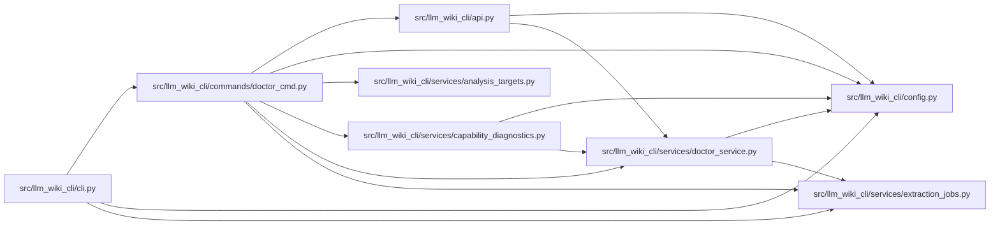

# doctor_cmd Module

**Path:** `src/llm_wiki_cli/commands/doctor_cmd.py`

## Description

Renders the read-only knowledge health report as text or JSON and propagates its
exit status. With `--capabilities`, the v2 report adds provider, helper,
unsupported-input, and plugin diagnostics while retaining the detailed health
sections and explicit preparation commands.

`--analysis-inputs` instead runs the installed-provider census/file preflight,
without inspecting project source or knowledge health. It renders a bounded
text summary by default or with `--format text`, and retains the structured
diagnostic with `--format json`. Both formats preserve the reported path and
omission counts, corrective route and qualifications. Text paths are quoted
with escaped control characters. Exit 0 means ready coverage and exit 2 means
unavailable inputs; choosing a format does not change this policy.
It is exclusive with capability and explicit health-schema selection. A ready
census is independent of runtime/helper preparation and semantic correctness.

`--target-runtime` reads a bounded project declaration file and committed wiki producer headers. Matching declared prerequisites exit 0; capture-required or unknown prerequisites exit 2. Its JSON reports keep recorded implementation/configuration/runtime commitments separate from declared target metadata and disclose row bounds and unselected scope. The mode rejects strict-health and explicit comparison-policy replacement; it is not source freshness or target execution proof. Native string paths are converted at the filesystem boundary and retain the existing guarded reader policy.

## Imports

| Source | Symbols |
|--------|---------|
| `..api` | `get_analysis_input_status` |
| `..config` | `DEFAULT_WIKI_DIR`, `validate_path` |
| `..services.analysis_targets` | `inspect_targets`, `load_targets` |
| `..services.capability_diagnostics` | `build_capability_doctor`, `render_capability_doctor` |
| `..services.doctor_service` | `build_doctor_report`, `render_doctor_text` |
| `..services.extraction_jobs` | `extraction_job_request_from_args` |
| `__future__` | `annotations` |
| `json` | `json` |

## Local dependency map

<!-- Auto-generated local dependency summary. Do not edit by hand. -->

### Internal neighbors

| Direction | Module |
|---|---|
| Inbound | [cli](../modules/cli.md) |
| Outbound | [api](../modules/api.md) |
| Outbound | [config](../modules/config.md) |
| Outbound | [analysis_targets](../modules/analysis_targets.md) |
| Outbound | [capability_diagnostics](../modules/capability_diagnostics.md) |
| Outbound | [doctor_service](../modules/doctor_service.md) |
| Outbound | [extraction_jobs](../modules/extraction_jobs.md) |

## Functions

| Function | Signature | Decorators | Description |
|----------|-----------|------------|-------------|
| `_render_analysis_input_text` | `(report) -> str` | — | Readable classification diagnostics with unchanged scope and work bounds. |
| `run` | `(args) -> None` | — | — |