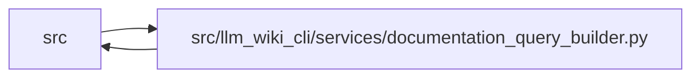

# documentation_query_builder Module

**Path:** `src/llm_wiki_cli/services/documentation_query_builder.py`

## Description

Shared construction for supported documentation query services.

## Imports

| Source | Symbols |
|--------|---------|
| `.` | `context_service`, `extraction_service` |
| `.context_packet_builder` | `_assert_wiki_unchanged`, `_wiki_anchor`, `_assert_source_unchanged`, `_assert_wiki_unchanged`, `_source_anchor`, `_wiki_anchor`, `confirmed_missing_source_paths` |
| `.dependencies` | `analyze_dependencies` |
| `.documentation_queries` | `DocumentationGraphQueryService` |
| `.entrypoints` | `build_flow` |
| `.python_implementation` | `analysis_identity` |
| `.source_path_diagnostics` | `source_path_diagnostics` |
| `.source_snapshot` | `SourceSnapshot`, `build_source_snapshot`, `capture_source_selection_inputs` |
| `__future__` | `annotations` |
| `collections.abc` | `Callable`, `Iterable`, `Mapping` |
| `hashlib` | `hashlib` |
| `llm_wiki_engine.knowledge_consumption` | `KnowledgeReadView`, `attach_implementation_read_view`, `load_knowledge_read_view` |
| `llm_wiki_engine.knowledge_storage_io` | `read_guarded` |
| `llm_wiki_engine.knowledge_verification` | `attach_machine_verification_read_view`, `verification_summaries_for_concepts` |
| `llm_wiki_engine.maintenance_status` | `attach_maintenance_view_from_inputs` |
| `llm_wiki_engine.query_request_format` | `DEFAULT_DOCUMENTATION_QUERY_LIMIT`, `MAX_DOCUMENTATION_QUERY_LIMIT`, `MAX_SUPPLIED_PATHS`, `QUERY_IDENTITY_BYTE_LIMIT`, `DocumentationQueryError`, `_portable_supplied_path`, `_supplied_path_values`, `normalize_concept_coordinate`, `normalize_documentation_query_limit`, `normalize_documentation_query_text`, `normalize_supplied_paths`, `validate_live_query_source_selection` |
| `llm_wiki_engine.source_selection` | `SourceSelectionError`, `resolve_source_selection` |
| `llm_wiki_engine.wiki_surface_index` | `evaluate_surface_index` |
| `pathlib` | `Path` |
| `shlex` | `shlex` |
| `time` | `perf_counter_ns` |
| `typing` | `Any` |

## Local dependency map

<!-- Auto-generated local dependency summary. Do not edit by hand. -->

> Module-level dependencies exceed the generated-diagram limits, so the diagram and table below group them by top-level package. Counts report the number of module neighbors in each package.

### Internal neighbors

| Direction | Module |
|---|---|
| Inbound | `src` (12) |
| Outbound | `src` (16) |

> All 26 module neighbor(s) are summarized by package because the module-level view exceeds the 12-node limit.

## Functions

| Function | Signature | Decorators | Description |
|----------|-----------|------------|-------------|
| `_diff_metadata_path` | `(value: str, *, prefixed: bool) -> str \| None` | — | — |
| `supplied_paths_from_unified_diff` | `(value: object) -> tuple[str, ...]` | — | Extract bounded exact paths from supplied unified-diff metadata only. |
| `_live_source_selection_identity` | `(source_root: Path, source_selection: str \| Path \| None, inventory_result: object) -> Mapping[str, object] \| None` | — | — |
| `assemble_documentation_query_service` | `(*, inventory: Mapping[str, Mapping[str, Any]], call_edges: Iterable[Mapping[str, Any]], flows: Iterable[Mapping[str, Any]], data_flows: object, dependency_analysis: Mapping[str, Any] \| None, surface_index: Mapping[str, Any] \| None, limit: int, knowledge_view: object, machine_verification: Mapping[str, Mapping[str, Any]], service_factory: Any = DocumentationGraphQueryService, inventory_result: object \| None = None, snapshot_call_inventory: bool = False) -> DocumentationGraphQueryService` | — | Assemble the shared service with a caller-supplied service factory. |
| `build_documentation_query_service_from_view` | `(*, wiki_root: Path, knowledge_view: KnowledgeReadView, limit: int, inventory: Mapping[str, Mapping[str, Any]] \| None = None, call_edges: Iterable[Mapping[str, Any]] = (), flows: Iterable[Mapping[str, Any]] = (), data_flows: object = (), dependency_analysis: Mapping[str, Any] \| None = None, surface_index: Mapping[str, Any] \| None = None, inventory_result: object \| None = None, snapshot_call_inventory: bool = False) -> DocumentationGraphQueryService` | — | Assemble one service around an already evaluated native read view. |
| `build_snapshot_documentation_query_service` | `(*, wiki_root: Path, limit: int) -> DocumentationGraphQueryService` | — | Build a snapshot-only service without source extraction. |
| `build_live_documentation_query_service` | `(*, source_root: Path, wiki_root: Path, limit: int, read_only: bool, helper_cache_dir: Path \| None = None, include_plugins: bool = True, source_plugins_only: bool = False, require_live_freshness: bool = False, source_selection: str \| Path \| None = None, paths: Iterable[str] \| None = None, source_policy: str = 'explicit', extract_payload_builder: Callable[..., Any] \| None = None, source_snapshot_builder: Callable[..., Any] \| None = None, call_edge_resolver: Callable[[Any], Any] \| None = None, flow_builder: Callable[[Any, Any], Any] = build_flow, surface_evaluator: Callable[..., Any] = evaluate_surface_index, knowledge_view_builder: Callable[..., Any] \| None = None, query_surface_builder: Callable[..., Any] \| None = None, dependency_analyzer: Callable[..., Any] = analyze_dependencies, verification_view_attacher: Callable[..., Any] = attach_machine_verification_read_view, verification_summarizer: Callable[..., Any] = verification_summaries_for_concepts, snapshot_view_loader: Callable[..., Any] = load_knowledge_read_view, metrics_observer: Callable[[Mapping[str, Any]], None] \| None = None, service_factory: Any = DocumentationGraphQueryService) -> DocumentationGraphQueryService` | — | Build a live service using one operation-scoped extraction. |
