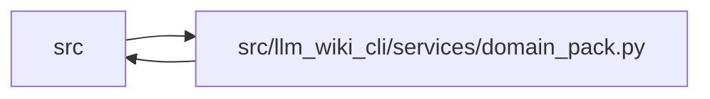

# domain_pack Module

**Path:** `src/llm_wiki_cli/services/domain_pack.py`

## Description

Domain packs: the replaceable parts of turning sources into wiki pages.

A :class:`DomainPack` bundles the domain decisions the engine asks about:

* a :class:`SourceClassifier` decides which repository files are sources and
  which source kind (for code: language) each one is;
* ``extractors`` name the extractor of each source kind the pack adds, as
  ``"module:attribute"`` entry points the host can import. Built-in languages
  keep their bundled extractors;
* a :class:`PageNamer` names the module and entity pages generated from an
  inventory. Page kinds themselves are fixed by the knowledge format;
* a :class:`PageRenderer` writes the Markdown of every generated page: module
  and entity pages, and the index, workflow, flow, infrastructure, API
  contract, dependency and load-order pages. Each request carries the
  built-in Markdown, so a renderer can adjust it instead of starting over;
* a :class:`ContextSource` decides which sources are related to a changed
  one and how much of each source budgeted context shows at each detail
  level;
* :class:`~.reference_providers.ReferenceProvider` values serve the
  reference kinds a publication policy may declare, so public documentation
  can depend on the pack's contracts;
* a :class:`HelperToolchain` names the analysis helpers a source tree needs
  and prepares (builds or reuses from its cache) the ones an operation may
  use. Helper builds and runs are subprocesses, so they need a host that
  grants them.

The interfaces, page requests and the implementations that need no source
analysis live in :mod:`llm_wiki_engine.pack_interfaces` and are importable here
too. A pack can also name the knowledge-core providers its domain needs
(``integrations``, an :class:`~llm_wiki_engine.integrations.IntegrationSet`).

:data:`CODE_DOCS_PACK` is today's code-documentation behavior and the default.
A host chooses another pack with :func:`using_pack` or ``Engine(pack=...)``;
every call that classifies sources or names pages inside that block uses it.
Pages named by one pack are not renamed by another, so a wiki should keep
using the pack that generated it.

When sync refreshes a page it keeps what people wrote in that page kind's
reviewed sections and takes everything else from the renderer:

* module and entity pages: ``Description`` and the description cells of the
  ``Attributes``, ``Methods``, ``Classes`` and ``Functions`` tables;
* workflow and flow pages: ``Behavior``;
* infrastructure, API contract, dependency and load-order pages: ``Notes``;
* the index: level-two sections under headings it does not write itself.

A renderer that wants people to write there keeps those headings; any section
it adds stays current with sources.

Qualified context packets (and task context, which seals one) need the
built-in :class:`CodeContextSource`: a packet's policy digest names that
ranking, so packets refuse to seal under a pack that replaces it.

## Imports

| Source | Symbols |
|--------|---------|
| `..extractors.common` | `LANGUAGE_EXTENSIONS`, `inventory_language_for_path` |
| `.helper_preparation` | `prepare_operation_helpers` |
| `.helper_runtime` | `PreparedHelperHandle`, `required_helper_languages` |
| `.reference_providers` | `BUILTIN_REFERENCE_PROVIDERS`, `ReferenceProvider`, `check_reference_providers` |
| `.source_snapshot` | `SourceSnapshot` |
| `__future__` | `annotations` |
| `collections.abc` | `Iterable`, `Mapping` |
| `dataclasses` | `dataclass`, `field` |
| `llm_wiki_engine.pack_interfaces` | `BuiltInPageRenderer`, `DomainPack`, `NoContextSource`, `StemPageNamer`, `_qualified_type_name`, `active_pack`, `using_pack`, `PAGE_REQUEST_KINDS`, `ContextDetail`, `ContextSource`, `EntityOccurrenceKey`, `EntityPageRequest`, `ExtensionSourceClassifier`, `HelperToolchain`, `ModulePageRequest`, `NoHelperToolchain`, `PageNamer`, `PageRenderer`, `PageRequest`, `SourceClassifier` |
| `pathlib` | `PurePath` |
| `types` | `MappingProxyType` |
| `typing` | `TYPE_CHECKING`, `Any` |

## Local dependency map

<!-- Auto-generated local dependency summary. Do not edit by hand. -->

> Module-level dependencies exceed the generated-diagram limits, so the diagram and table below group them by top-level package. Counts report the number of module neighbors in each package.

### Internal neighbors

| Direction | Module |
|---|---|
| Inbound | `src` (11) |
| Outbound | `src` (6) |

> All 15 module neighbor(s) are summarized by package because the module-level view exceeds the 12-node limit.

## Classes

| Class | Line | Bases | Description |
|-------|------|-------|-------------|
| [BuiltInPageRenderer](../entities/domain_pack_BuiltInPageRenderer.md) | 96 | `_EngineBuiltInPageRenderer` | Today's code-documentation pages; subclass it to adjust them. |
| [CodeContextSource](../entities/CodeContextSource.md) | 116 | — | Code context: import neighbors, then classes and functions by detail. |
| [CodeSourceClassifier](../entities/CodeSourceClassifier.md) | 234 | `ExtensionSourceClassifier` | The built-in languages; Go ``_test.go`` files are opt-in. |
| [StemPageNamer](../entities/domain_pack_StemPageNamer.md) | 256 | `_EngineStemPageNamer` | Module pages named by source stem, entity pages by entity name. |
| [BundledHelperToolchain](../entities/BundledHelperToolchain.md) | 260 | `HelperToolchain` | The bundled Go, Rust, TypeScript and Haskell helpers and their cache. |
| [DomainPack](../entities/domain_pack_DomainPack.md) | 288 | `_EngineDomainPack` | A named set of domain decisions: classification, naming, rendering, context, |

## Functions

| Function | Signature | Decorators | Description |
|----------|-----------|------------|-------------|
| `render_with_pack` | `(request: ModulePageRequest \| EntityPageRequest \| PageRequest) -> str` | — | Render ``request`` with the current pack's page renderer. |
| `context_related_sources` | `(inventory: Mapping[str, Mapping[str, Any]]) -> Mapping[str, Iterable[str]]` | — | Related sources from the current pack's context source. |
| `context_entry` | `(data: Mapping[str, Any], detail: ContextDetail) -> dict[str, Any]` | — | One source's context entry from the current pack's context source. |
| `uses_builtin_context_source` | `() -> bool` | — | Whether this context ranks and shows sources with :class:`CodeContextSource`. |
| `pack_extractor` | `(source_kind: str, entry_point: str) -> bool` | — | Whether the active pack extracts ``source_kind`` with ``entry_point``. |
| `current_pack` | `() -> _EngineDomainPack` | — | The pack chosen for this context, or :data:`CODE_DOCS_PACK`. |
| `uses_default_pack` | `() -> bool` | — | Whether this context uses :data:`CODE_DOCS_PACK`. |
