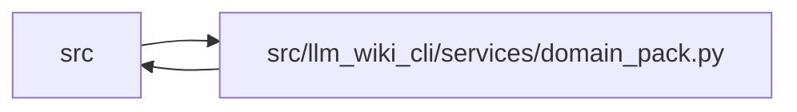

# domain_pack Module

**Path:** `src/llm_wiki_cli/services/domain_pack.py`

## Description

Domain packs: the replaceable parts of turning sources into wiki pages.

A :class:`DomainPack` bundles the domain decisions the engine asks about:

* a :class:`SourceClassifier` decides which repository files are sources and
  which source kind (for code: language) each one is;
* ``extractors`` name the extractor of each source kind the pack adds, as
  ``"module:attribute"`` entry points the host can import. Built-in languages
  keep their bundled extractors;
* a :class:`PageNamer` names the module and entity pages generated from an
  inventory. Page kinds themselves are fixed by the knowledge format;
* a :class:`PageRenderer` writes the Markdown of every generated page: module
  and entity pages, and the index, workflow, flow, infrastructure, API
  contract, dependency and load-order pages. Each request carries the
  built-in Markdown, so a renderer can adjust it instead of starting over;
* a :class:`ContextSource` decides which sources are related to a changed
  one and how much of each source budgeted context shows at each detail
  level;
* :class:`~.reference_providers.ReferenceProvider` values serve the
  reference kinds a publication policy may declare, so public documentation
  can depend on the pack's contracts;
* a :class:`HelperToolchain` names the analysis helpers a source tree needs
  and prepares (builds or reuses from its cache) the ones an operation may
  use. Helper builds and runs are subprocesses, so they need a host that
  grants them.

:data:`CODE_DOCS_PACK` is today's code-documentation behavior and the default.
A host chooses another pack with :func:`using_pack` or ``Engine(pack=...)``;
every call that classifies sources or names pages inside that block uses it.
Pages named by one pack are not renamed by another, so a wiki should keep
using the pack that generated it.

When sync refreshes a page it keeps what people wrote in that page kind's
reviewed sections and takes everything else from the renderer:

* module and entity pages: ``Description`` and the description cells of the
  ``Attributes``, ``Methods``, ``Classes`` and ``Functions`` tables;
* workflow and flow pages: ``Behavior``;
* infrastructure, API contract, dependency and load-order pages: ``Notes``;
* the index: level-two sections under headings it does not write itself.

A renderer that wants people to write there keeps those headings; any section
it adds stays current with sources.

Qualified context packets (and task context, which seals one) need the
built-in :class:`CodeContextSource`: a packet's policy digest names that
ranking, so packets refuse to seal under a pack that replaces it.

## Imports

| Source | Symbols |
|--------|---------|
| `..extractors.common` | `LANGUAGE_EXTENSIONS`, `inventory_language_for_path` |
| `.helper_preparation` | `prepare_operation_helpers` |
| `.helper_runtime` | `PreparedHelperHandle`, `required_helper_languages` |
| `.reference_providers` | `BUILTIN_REFERENCE_PROVIDERS`, `ReferenceProvider`, `check_reference_providers` |
| `.source_snapshot` | `SourceSnapshot` |
| `__future__` | `annotations` |
| `collections` | `Counter`, `defaultdict` |
| `collections.abc` | `Callable`, `Iterable`, `Iterator`, `Mapping` |
| `contextlib` | `contextmanager` |
| `contextvars` | `ContextVar` |
| `dataclasses` | `dataclass`, `field`, `replace` |
| `llm_wiki_engine.validation` | `portable_page_component`, `portable_path_key` |
| `llm_wiki_engine.wiki_surface` | `PageKind` |
| `pathlib` | `PurePath` |
| `re` | `re` |
| `types` | `MappingProxyType` |
| `typing` | `TYPE_CHECKING`, `Any`, `Literal`, `Protocol`, `runtime_checkable` |

## Local dependency map

<!-- Auto-generated local dependency summary. Do not edit by hand. -->

> Module-level dependencies exceed the generated-diagram limits, so the diagram and table below group them by top-level package. Counts report the number of module neighbors in each package.

### Internal neighbors

| Direction | Module |
|---|---|
| Inbound | `src` (12) |
| Outbound | `src` (7) |

> All 17 module neighbor(s) are summarized by package because the module-level view exceeds the 12-node limit.

## Classes

| Class | Kind | Line | Bases / Target | Description |
|-------|------|------|----------------|-------------|
| [SourceClassifier](../entities/SourceClassifier.md) | Class | 79 | `Protocol` | Decides which files are sources and of which kind. |
| [PageNamer](../entities/PageNamer.md) | Class | 103 | `Protocol` | Names the generated module and entity pages for an inventory. |
| [ModulePageRequest](../entities/ModulePageRequest.md) | Class | 120 | — | Everything a renderer gets for one module page. |
| [EntityPageRequest](../entities/EntityPageRequest.md) | Class | 138 | — | Everything a renderer gets for one entity page. |
| [PageRequest](../entities/PageRequest.md) | Class | 170 | — | Everything a renderer gets for one page that is not a module or entity. |
| [PageRenderer](../entities/PageRenderer.md) | Class | 209 | `Protocol` | Writes the Markdown of generated pages. |
| [BuiltInPageRenderer](../entities/BuiltInPageRenderer.md) | Class | 225 | — | Today's code-documentation pages; subclass it to adjust them. |
| [ContextDetail](../entities/ContextDetail.md) | Type alias | 254 | `Literal['deep', 'slim', 'summary']` | — |
| [ContextSource](../entities/ContextSource.md) | Class | 258 | `Protocol` | How sources relate and appear in budgeted context. |
| [CodeContextSource](../entities/CodeContextSource.md) | Class | 279 | — | Code context: import neighbors, then classes and functions by detail. |
| [ExtensionSourceClassifier](../entities/ExtensionSourceClassifier.md) | Class | 406 | — | Classifies sources by file extension, first matching kind wins. |
| [CodeSourceClassifier](../entities/CodeSourceClassifier.md) | Class | 468 | `ExtensionSourceClassifier` | The built-in languages; Go ``_test.go`` files are opt-in. |
| [StemPageNamer](../entities/StemPageNamer.md) | Class | 592 | — | Module pages take the source file stem, entity pages the entity name. |
| [HelperToolchain](../entities/HelperToolchain.md) | Class | 655 | — | Which analysis helpers a source tree needs, and how they are prepared. |
| [BundledHelperToolchain](../entities/BundledHelperToolchain.md) | Class | 681 | `HelperToolchain` | The bundled Go, Rust, TypeScript and Haskell helpers and their cache. |
| [NoHelperToolchain](../entities/NoHelperToolchain.md) | Class | 703 | `HelperToolchain` | Needs and prepares no helpers. |
| [DomainPack](../entities/DomainPack.md) | Class | 755 | — | A named set of domain decisions: classification, naming, rendering, context, |

## Functions

| Function | Signature | Decorators | Description |
|----------|-----------|------------|-------------|
| `render_with_pack` | `(request: ModulePageRequest \| EntityPageRequest \| PageRequest) -> str` | — | Render ``request`` with the current pack's page renderer. |
| `context_related_sources` | `(inventory: Mapping[str, Mapping[str, Any]]) -> Mapping[str, Iterable[str]]` | — | Related sources from the current pack's context source. |
| `context_entry` | `(data: Mapping[str, Any], detail: ContextDetail) -> dict[str, Any]` | — | One source's context entry from the current pack's context source. |
| `uses_builtin_context_source` | `() -> bool` | — | Whether this context ranks and shows sources with :class:`CodeContextSource`. |
| `_suffixes` | `(value: object, field_name: str) -> tuple[str, ...]` | — | — |
| `_safe_page_component` | `(value: object, *, fallback: str = 'page') -> str` | — | — |
| `_path_parts` | `(path: str) -> tuple[str, ...]` | — | — |
| `_page_name_with_extension` | `(filepath: str) -> str` | — | A page-safe path stem that includes the source extension. |
| `_page_name_from_source_path` | `(filepath: str) -> str` | — | A page-safe stem from the full source path without extension. |
| `_disambiguate_paths` | `(filepaths: list[str], stem: str) -> dict[str, str]` | — | Add parent directories until every path sharing ``stem`` is unique. |
| `_globally_disambiguate_module_pages` | `(page_map: dict[str, str]) -> dict[str, str]` | — | Resolve portable filesystem collisions after stem-group disambiguation. |
| `_entity_occurrences` | `(inventory: Mapping[str, Mapping[str, Any]]) -> list[tuple[EntityOccurrenceKey, Mapping[str, Any]]]` | — | — |
| `_check_extractors` | `(extractors: object, classifier: SourceClassifier) -> Mapping[str, str]` | — | — |
| `pack_extractor` | `(source_kind: str, entry_point: str) -> bool` | — | Whether the active pack extracts ``source_kind`` with ``entry_point``. |
| `_qualified_type_name` | `(value: object) -> str` | — | — |
| `current_pack` | `() -> DomainPack` | — | The pack chosen for this context, or :data:`CODE_DOCS_PACK`. |
| `uses_default_pack` | `() -> bool` | — | Whether this context uses :data:`CODE_DOCS_PACK`. |
| `using_pack` | `(pack: DomainPack) -> Iterator[DomainPack]` | `@contextmanager` | Classify, name, render and build context inside the block with ``pack``. |
