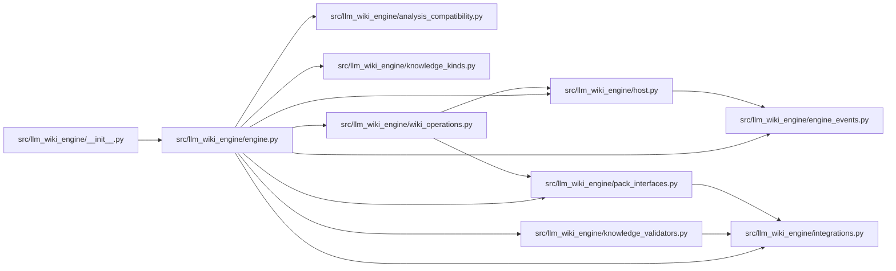

# engine Module

**Path:** `src/llm_wiki_engine/engine.py`

## Description

An engine that runs wiki use cases with no application code.

:class:`Engine` holds what its caller grants: a :class:`~.host.Host`
(processes, environment, working directory, clock and output streams), the
:class:`~.pack_interfaces.DomainPack` that classifies, extracts, names and
renders sources, the :class:`~.knowledge_validators.ValidatorRegistry` every
knowledge index must pass, the :class:`~.knowledge_kinds.KindRegistry` of
custom kinds and the :class:`~.integrations.IntegrationSet` of knowledge-core
providers (the pack's, with the engine's own on top). Every call runs inside
one :class:`Operation` that applies those choices to all work beneath it.

Use cases run on the engine and write progress to the host's streams:
:meth:`Engine.bootstrap`, :meth:`Engine.sync` and :meth:`Engine.lint` (see
:mod:`.wiki_operations`). They take a typed request, return a typed result
and never exit the process.

This engine never prepares analysis helpers and serves no publication
targets; an application that needs them builds on its own engine.
Importing this module loads no application code.

## Imports

| Source | Symbols |
|--------|---------|
| `.` | `wiki_operations` |
| `.analysis_compatibility` | `comparison_scope`, `selected_policy` |
| `.engine_events` | `EngineEvent`, `EventKind`, `operation_identity` |
| `.host` | `ALL_CAPABILITIES`, `Host`, `using_host` |
| `.integrations` | `DEFAULT_INTEGRATIONS`, `IntegrationSet`, `using_integrations` |
| `.knowledge_kinds` | `DEFAULT_KINDS`, `KindRegistry`, `using_kinds` |
| `.knowledge_validators` | `DEFAULT_VALIDATORS`, `ValidatorRegistry`, `using_validators` |
| `.pack_interfaces` | `DomainPack`, `using_pack` |
| `.wiki_operations` | `BootstrapRequest`, `BootstrapResult`, `LintReport`, `LintRequest`, `SyncRequest`, `SyncResult` |
| `__future__` | `annotations` |
| `collections.abc` | `Callable`, `Iterator`, `Mapping` |
| `contextlib` | `ExitStack`, `contextmanager` |
| `dataclasses` | `dataclass` |
| `os` | `os` |
| `typing` | `Any`, `ParamSpec`, `TypeVar` |
| `uuid` | `uuid` |

## Local dependency map

<!-- Auto-generated local dependency summary. Do not edit by hand. -->

### Internal neighbors

| Direction | Module |
|---|---|
| Inbound | [llm_wiki_engine___init__](../modules/llm_wiki_engine___init__.md) |
| Outbound | [analysis_compatibility](../modules/analysis_compatibility.md) |
| Outbound | [engine_events](../modules/engine_events.md) |
| Outbound | [host](../modules/host.md) |
| Outbound | [integrations](../modules/integrations.md) |
| Outbound | [knowledge_kinds](../modules/knowledge_kinds.md) |
| Outbound | [knowledge_validators](../modules/knowledge_validators.md) |
| Outbound | [pack_interfaces](../modules/pack_interfaces.md) |
| Outbound | [wiki_operations](../modules/wiki_operations.md) |

## Classes

| Class | Line | Bases | Description |
|-------|------|-------|-------------|
| [Operation](../entities/engine_Operation.md) | 58 | — | The settings in force for one engine call and everything beneath it. |
| [Engine](../entities/engine_Engine.md) | 69 | — | One configured engine; independent engines may run side by side. |

## Functions

| Function | Signature | Decorators | Description |
|----------|-----------|------------|-------------|
| `_to_dict` | `(result: Any) -> Mapping[str, Any]` | — | — |
| `_request_data` | `(request: object) -> dict[str, str]` | — | — |
| `_error_data` | `(error: BaseException) -> dict[str, object]` | — | — |
