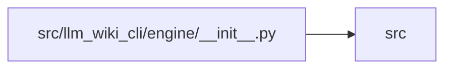

# __init__ Module

**Path:** `src/llm_wiki_cli/engine/__init__.py`

## Description

Embeddable engine: run wiki operations on behalf of a host application.

An :class:`Engine` holds what the caller grants: a :class:`Host` (processes,
environment, working directory, clock), whether bundled analysis helpers may
be prepared automatically, the analysis comparison policy, the
:class:`ValidatorRegistry` every knowledge index must pass and the
:class:`KindRegistry` of custom concept, relationship and graph-edge kinds
it declares, the :class:`DomainPack` that classifies sources, names
pages, renders them, builds budgeted context, serves publication
reference kinds and prepares analysis helpers, the
:class:`PublicationTargetRegistry` of places a reviewed documentation
candidate may be published to, and the :class:`IntegrationSet` of
knowledge-core providers (the pack's, with the engine's own on top). Every call runs
inside one :class:`Operation` that applies those choices to all work beneath
it, including calls into :mod:`llm_wiki_cli.api`.

Unlike the CLI and the public API, an engine never prepares helpers unless the
caller grants ``helper_preparation="auto"``. Importing this module loads
neither the CLI, command modules nor the public API.

Use cases run directly on the engine and write progress to the host's
streams: :meth:`Engine.bootstrap`, :meth:`Engine.sync`, :meth:`Engine.lint`,
:meth:`Engine.migrate` and :meth:`Engine.upgrade`.
They take a typed request, return a typed result and never exit the process.
A host built with ``events=`` also receives structured
:class:`EngineEvent` objects for each use-case call: started, one
``message`` per line written, then finished or failed.

    from llm_wiki_cli import api
    from llm_wiki_cli.engine import Engine, NoProcessHost

    engine = Engine(host=NoProcessHost())
    result = engine.call(api.search_wiki, "billing", wiki_dir="docs/llm_wiki")

## Imports

| Source | Symbols |
|--------|---------|
| `..services.bootstrap_runtime` | `execute_bootstrap` |
| `..services.bootstrap_service` | `BootstrapContractError`, `BootstrapRequest`, `BootstrapRequestError`, `BootstrapResult`, `BootstrapServiceError` |
| `..services.context_budget_format` | `CONTEXT_BUDGET_RESPONSE_PROTOCOL`, `BudgetedContextResponseError`, `validate_budgeted_context_response` |
| `..services.context_response_format` | `CONTEXT_RESPONSE_PROTOCOLS`, `ContextResponseError`, `validate_context_response` |
| `..services.domain_pack` | `CODE_DOCS_PACK`, `BuiltInPageRenderer`, `BundledHelperToolchain`, `CodeContextSource`, `ContextSource`, `DomainPack`, `EntityPageRequest`, `ExtensionSourceClassifier`, `HelperToolchain`, `ModulePageRequest`, `NoHelperToolchain`, `PageNamer`, `PageRenderer`, `PageRequest`, `SourceClassifier`, `StemPageNamer`, `using_pack` |
| `..services.helper_runtime` | `helper_operation`, `helper_policy` |
| `..services.lint_request` | `LintRequest`, `LintRequestError` |
| `..services.lint_service` | `LintReport`, `execute_lint` |
| `..services.migrate_runtime` | `execute_migrate` |
| `..services.migrate_service` | `MigrateError`, `MigrateOutcome`, `MigrateRequest`, `MigrateRequestError` |
| `..services.publication_targets` | `DEFAULT_PUBLICATION_TARGETS`, `GitHubWikiTarget`, `PublicationTarget`, `PublicationTargetRegistry`, `using_publication_targets` |
| `..services.reference_providers` | `BUILTIN_REFERENCE_PROVIDERS`, `BehaviorFactsProvider`, `CliContractProvider`, `ContractFileProvider`, `ReferenceProvider` |
| `..services.sync_runtime` | `execute_sync` |
| `..services.sync_service` | `SyncError`, `SyncOutcome`, `SyncRequest`, `SyncRequestError` |
| `..services.upgrade_runtime` | `execute_upgrade` |
| `..services.upgrade_service` | `UpgradeError`, `UpgradeOutcome`, `UpgradeRequest`, `UpgradeRequestError` |
| `__future__` | `annotations` |
| `collections.abc` | `Callable`, `Iterator`, `Mapping` |
| `contextlib` | `ExitStack`, `contextmanager` |
| `dataclasses` | `dataclass` |
| `llm_wiki_engine.analysis_compatibility` | `selected_policy`, `comparison_scope` |
| `llm_wiki_engine.engine_events` | `ENGINE_EVENT_SCHEMA_VERSION`, `EVENT_KINDS`, `EngineEvent`, `EventKind`, `EventSink`, `operation_identity`, `validate_engine_event` |
| `llm_wiki_engine.extract_format` | `EXTRACT_SCHEMA_VERSION`, `ExtractPayloadError`, `validate_extract_payload` |
| `llm_wiki_engine.host` | `ALL_CAPABILITIES`, `Host`, `HostCapabilityError`, `MessageStream`, `NoProcessHost`, `current_host`, `using_host` |
| `llm_wiki_engine.integrations` | `DEFAULT_INTEGRATIONS`, `IntegrationSet`, `using_integrations` |
| `llm_wiki_engine.knowledge_kinds` | `DEFAULT_KINDS`, `ConceptKindSpec`, `KindRegistry`, `RelationshipKindSpec`, `using_kinds` |
| `llm_wiki_engine.knowledge_validators` | `DEFAULT_VALIDATORS`, `ModelValidator`, `ValidatorRegistry`, `using_validators` |
| `llm_wiki_engine.maintenance_queue_format` | `MAINTENANCE_QUEUE_SCHEMA_VERSION`, `MaintenanceQueueError`, `validate_maintenance_queue` |
| `llm_wiki_engine.maintenance_status_format` | `MAINTENANCE_STATUS_SCHEMA_VERSION`, `MaintenanceStatusError`, `validate_maintenance_status` |
| `llm_wiki_engine.query_result_format` | `DOCUMENTATION_QUERY_SCHEMA_VERSION`, `SEARCH_RESULT_SCHEMA_VERSION`, `QueryResultError`, `validate_documentation_query_result`, `validate_search_result` |
| `llm_wiki_engine.surface_index_format` | `SURFACE_INDEX_SCHEMA_VERSION`, `SurfaceIndexError`, `validate_surface_index` |
| `os` | `os` |
| `pathlib` | `Path` |
| `typing` | `TYPE_CHECKING`, `Any`, `Literal`, `ParamSpec`, `TypeVar` |
| `uuid` | `uuid` |

## Local dependency map

<!-- Auto-generated local dependency summary. Do not edit by hand. -->

> Module-level dependencies exceed the generated-diagram limits, so the diagram and table below group them by top-level package. Counts report the number of module neighbors in each package.

### Internal neighbors

| Direction | Module |
|---|---|
| Outbound | `src` (27) |

> All 27 module neighbor(s) are summarized by package because the module-level view exceeds the 12-node limit.

## Classes

| Class | Kind | Line | Bases / Target | Description |
|-------|------|------|----------------|-------------|
| [HelperPreparation](../entities/HelperPreparation.md) | Type alias | 242 | `Literal['auto', 'never']` | — |
| [Operation](../entities/Operation.md) | Class | 251 | — | The settings in force for one engine call and everything beneath it. |
| [Engine](../entities/Engine.md) | Class | 265 | — | One configured engine; independent engines may run side by side. |

## Functions

| Function | Signature | Decorators | Description |
|----------|-----------|------------|-------------|
| `_to_dict` | `(result: Any) -> Mapping[str, Any]` | — | — |
| `_request_data` | `(request: object) -> dict[str, str]` | — | — |
| `_error_data` | `(error: BaseException) -> dict[str, object]` | — | — |
