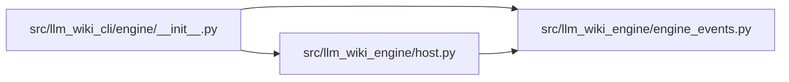

# engine_events Module

**Path:** `src/llm_wiki_engine/engine_events.py`

## Description

Structured events an engine reports to its host while an operation runs.

A host that wants more than text on its streams passes an event sink, any
callable taking one :class:`EngineEvent`, as ``Host(events=...)``. Every
engine use case then reports:

``operation.started``
    ``data``: ``source_root`` and ``wiki_root`` when the request has them.
``message``
    One line the operation wrote to the host; ``data``: ``stream``
    (``"stdout"`` or ``"stderr"``) and ``text`` (without the line break).
    Lines written while output is deliberately discarded are not reported.
``operation.finished``
    ``data``: ``result``, the JSON-ready form of the returned result.
``operation.failed``
    ``data``: ``error`` (exception class name), ``message`` and, when the
    error carries one, ``exit_code``. The exception is still raised.

All events of one call share ``operation`` (the use-case name, such as
``"sync"``) and ``operation_id``, so one sink can serve several engines.
``data`` holds only JSON-compatible values.

:meth:`EngineEvent.to_dict` writes the ``llm-wiki-engine-event/v1`` format
(JSON Schema ``llm-wiki-engine-event-v1.schema.json``); a host that receives
serialized events checks one with :func:`validate_engine_event` or reads it
back with :meth:`EngineEvent.from_dict`. The sink runs on the
operation's thread; an exception it raises stops the operation the same way
a failing stream write would.

This module only uses the standard library, so a host can import it without
loading the engine.

## Imports

| Source | Symbols |
|--------|---------|
| `__future__` | `annotations` |
| `collections.abc` | `Callable`, `Iterator`, `Mapping` |
| `contextlib` | `contextmanager` |
| `contextvars` | `ContextVar` |
| `dataclasses` | `dataclass`, `field` |
| `types` | `MappingProxyType` |
| `typing` | `Any`, `Literal` |

## Local dependency map

<!-- Auto-generated local dependency summary. Do not edit by hand. -->

### Internal neighbors

| Direction | Module |
|---|---|
| Inbound | [engine___init__](../modules/engine___init__.md) |
| Inbound | [host](../modules/host.md) |

## Classes

| Class | Kind | Line | Bases / Target | Description |
|-------|------|------|----------------|-------------|
| [EventKind](../entities/EventKind.md) | Type alias | 43 | `Literal['operation.started', 'message', 'operation.finished', 'operation.failed']` | — |
| [EngineEvent](../entities/EngineEvent.md) | Class | 55 | — | One thing that happened during an engine operation. |
| [OperationIdentity](../entities/OperationIdentity.md) | Class | 167 | — | Names the engine operation that events are reported for. |

## Functions

| Function | Signature | Decorators | Description |
|----------|-----------|------------|-------------|
| `_json_value` | `(value: object, path: str) -> None` | — | — |
| `_text` | `(value: object, path: str, *, empty: bool = False) -> None` | — | — |
| `validate_engine_event` | `(document: object) -> None` | — | Refuse a document that is not a valid ``llm-wiki-engine-event/v1`` event. |
| `current_operation` | `() -> OperationIdentity \| None` | — | The engine operation running in this context, if any. |
| `operation_identity` | `(name: str, operation_id: str) -> Iterator[OperationIdentity]` | `@contextmanager` | Report events inside the block as part of operation ``name``. |
