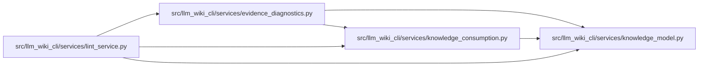

# evidence_diagnostics Module

**Path:** `src/llm_wiki_cli/services/evidence_diagnostics.py`

## Description

Explain captured versus fresh evidence without repairing or accepting it.

Consumes one validated knowledge view and its existing manifest/freshness
results to explain whether an old captured failure has no fresh result, a valid
fresh normalization, or a fresh observation that is still malformed or
unavailable. Captured source hashes distinguish unchanged, changed and
incomparable coordinates. Producer metadata and bounded version labels describe
the comparison without inventing historical package identity or rejected records.

The shared description and hint enrich lint and detailed evidence explanations.
They preserve unknown committed evidence and its strict error until an owning
refresh publishes coherent replacement state. A fresh producer failure points
to raw extraction and cause repair; a valid fresh result points to owning sync
and its separately reviewed broad-update route. The consumer performs no source
discovery, extraction, setup, writes or evidence-state changes.

This per-concept explanation is separate from aggregate knowledge observability,
whose privacy contract excludes source coordinates and producer identities.

## Imports

| Source | Symbols |
|--------|---------|
| `.knowledge_consumption` | `KnowledgeReadView` |
| `.knowledge_model` | `ComputedFreshness`, `ConceptRecord`, `EvidenceState` |
| `__future__` | `annotations` |
| `json` | `json` |

## Local dependency map

<!-- Auto-generated local dependency summary. Do not edit by hand. -->

### Internal neighbors

| Direction | Module |
|---|---|
| Inbound | [lint_service](../modules/lint_service.md) |
| Outbound | [knowledge_consumption](../modules/knowledge_consumption.md) |
| Outbound | [knowledge_model](../modules/knowledge_model.md) |

## Functions

| Function | Signature | Decorators | Description |
|----------|-----------|------------|-------------|
| `_label` | `(value: str \| None) -> str` | — | — |
| `captured_evidence_diagnostic` | `(view: KnowledgeReadView, concept: ConceptRecord) -> tuple[str, str] \| None` | — | Return bounded interpretation/guidance over this read's existing inputs. |
